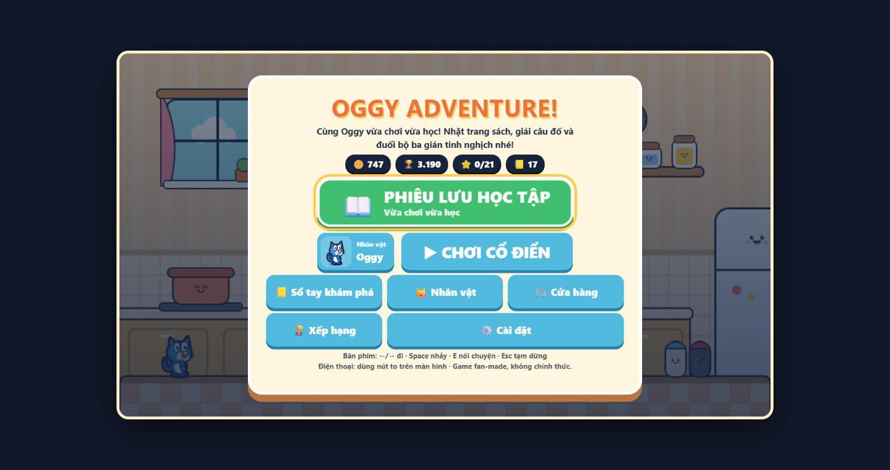
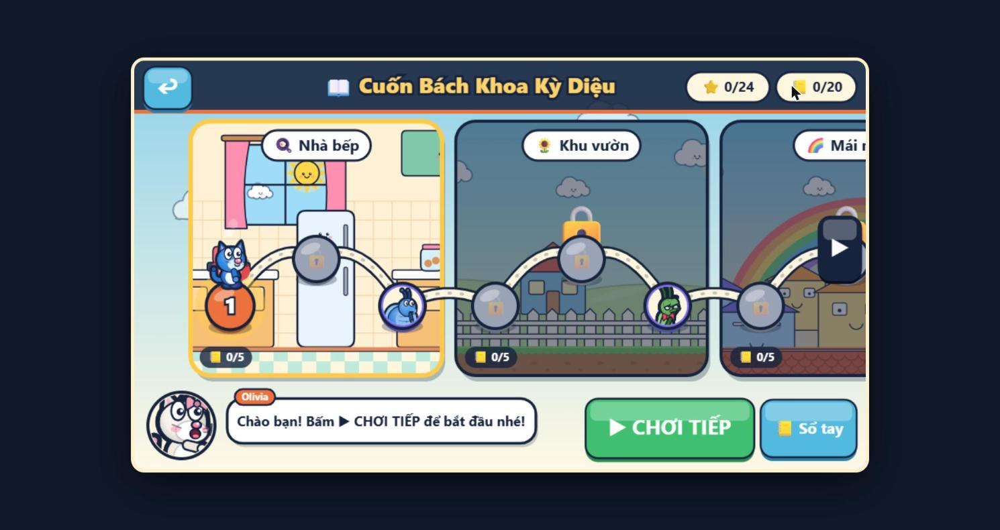
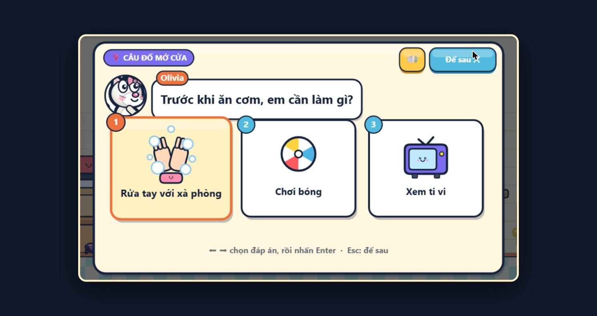

# Oggy Adventure

**▶ Chơi ngay: <https://oggy-adventure.tiennhm.io.vn>**

Game phiêu lưu đi cảnh 2D **vừa chơi vừa học** cho các bé 5–10 tuổi, chạy thẳng trên trình duyệt. Cùng Oggy đi qua 4 hành trình: nhặt trang sách để mở thẻ kiến thức, giải câu đố để mở cửa, giẫm ba chú gián tinh nghịch Joey, Marky, Dee Dee và hạ trùm cuối mỗi khu.

Game viết bằng HTML5 Canvas và JavaScript thuần. Không có bước build, không dùng thư viện ngoài. Nhân vật và cảnh nền được vẽ bằng Canvas, tiếng được tổng hợp bằng Web Audio API. File ảnh duy nhất là ảnh chụp thật trên thẻ kiến thức (xem [Ảnh chụp thực tế & ghi công](#ảnh-chụp-thực-tế--ghi-công)).

> **Lưu ý bản quyền:** Đây là sản phẩm fan-made, phi thương mại, không liên quan tới chủ sở hữu thương hiệu *Oggy and the Cockroaches* (Xilam). Tên và hình tượng nhân vật thuộc về chủ sở hữu. Nếu muốn phát hành công khai hoặc thương mại, hãy thay nhân vật, tên và mọi yếu tố có bản quyền bằng thiết kế nguyên bản hoặc đã được cấp phép.

| Menu | Bản đồ hành trình | Câu đố |
|---|---|---|
|  |  |  |

Xem thêm ảnh trong [`docs/screenshots/`](docs/screenshots/).

## Phiêu lưu học tập (4 hành trình)

Ở menu chính, bấm nút xanh lớn **📖 PHIÊU LƯU HỌC TẬP** → chọn chế độ chơi → chọn hành trình. Mỗi hành trình có truyện tranh mở đầu, một bản đồ vẽ theo từng khu, người dẫn đường riêng và trùm cuối mỗi khu.

| Hành trình | Người dẫn đường | Các khu | Màn | Thẻ kiến thức |
|---|---|---|---|---|
| 📖 **Cuốn Bách Khoa Kỳ Diệu** | Olivia | Nhà bếp → Khu vườn → Mái nhà → Tầng hầm | 8 | 20 |
| ⭐ **Vòng quanh Việt Nam** | Bob | Hà Nội → Vịnh Hạ Long → Cố đô Huế → Phố cổ Hội An → TP. Hồ Chí Minh → Miền Tây sông nước | 12 | 24 |
| 🌍 **Vòng quanh thế giới** | Giáo sư Cú | Ai Cập → Pháp → Nhật Bản → Rừng Amazon → Bắc Cực | 10 | 20 |
| 🚀 **Khoa học & Vũ trụ** | Rô-bốt Bíp | Thời khủng long → Bên trong cơ thể → Đại dương sâu → Hệ Mặt Trời | 8 | 18 |

Tổng cộng 38 màn, 82 thẻ kiến thức và gần 50 câu đố.

### Chế độ chơi: 🧸 Bé chơi / 🔥 Thử thách

Chọn một lần, game sẽ nhớ. Muốn đổi thì vào **⚙️ Cài đặt → Chế độ chơi**.

| | 🧸 Bé chơi (mặc định) | 🔥 Thử thách |
|---|---|---|
| Mạng đầu lượt | 5 ❤️ | 3 ❤️ |
| Rơi xuống hố | Không mất mạng, quay lại chỗ đứng an toàn | Mất 1 mạng |
| Hết mạng | Hồi đầy mạng ở cờ gần nhất, không thua | Thua, phải chơi lại |
| Gián | Đi chậm hơn, khó chạm trúng hơn | Tốc độ gốc |
| Trùm | Ít máu hơn (60%), đánh chậm hơn, báo trước lâu hơn | Như bản gốc |
| Nhảy | Dễ hơn: nhảy được ngay sau khi rời mép, giữ nút để nhảy cao hơn | Bình thường |
| Trợ giúp | Thua 2 lần ở cùng một màn thì có thêm khiên và tim | Sau 3 lần |

### Học như thế nào?

- **Trang sách bay 📖:** mỗi màn có vài trang sách. Nhặt được trang sách thì mở một **thẻ kiến thức** có hình vẽ và một câu ngắn dễ hiểu. Có nút 🔊 để nghe đọc to nếu trình duyệt có giọng tiếng Việt.
- **Cổng câu đố ❓:** có cổng chắn giữa đường hoặc ở cửa EXIT. Cổng hỏi một câu với 2–3 đáp án có hình. Trả lời sai **không bị phạt**: người dẫn đường đưa gợi ý để bé thử lại. Trả lời đúng thì cổng mở và có thêm lời giải thích.
- **Người dẫn đường 💬:** đứng gần nhân vật có dấu **!** (hoặc bấm E) để nghe kể chuyện và mẹo chơi.
- **Truyện tranh:** xem ở đầu hành trình, trước mỗi trùm và khi về đích. Bấm **Bỏ qua ⏭** nếu đã xem rồi.
- **📒 Sổ tay khám phá:** nơi lưu mọi thẻ đã sưu tầm, xếp theo hành trình và theo khu. Mở từ menu chính hoặc từ bản đồ hành trình. Thẻ được lưu trên máy. Thẻ có ảnh thật hiện ảnh làm hình nhỏ; mở thẻ rồi bấm vào ảnh (hoặc phím ↓) để phóng to.

### Ảnh chụp thực tế & ghi công

76 trên 82 thẻ kiến thức có thêm **ảnh chụp thật** đặt cạnh hình vẽ cartoon (ví dụ ảnh Hồ Gươm, kim tự tháp Giza, bộ xương khủng long). Dưới mỗi ảnh có một dòng ghi công ngắn: tác giả · giấy phép · nguồn.

| Hành trình | Thẻ có ảnh | Dung lượng |
|---|---|---|
| 📖 Cuốn Bách Khoa Kỳ Diệu | 16/20 | ~0,9 MB |
| ⭐ Vòng quanh Việt Nam | 23/24 | ~1,8 MB |
| 🌍 Vòng quanh thế giới | 19/20 | ~1,5 MB |
| 🚀 Khoa học & Vũ trụ | 18/18 | ~0,95 MB |

- **Ghi công đầy đủ:** trang [`docs/credits.html`](docs/credits.html) (trên web: <https://oggy-adventure.tiennhm.io.vn/docs/credits.html>) liệt kê từng ảnh kèm tác giả, giấy phép và link trang gốc.
- **Giấy phép được nhận:** Public Domain, CC0, CC BY, CC BY-SA, Unsplash License, Pexels License. Không nhận NC, ND, GFDL. Danh sách này nằm trong `OG.Photos.licenseOk` và smoke test dùng chung hàm đó. Ảnh đã được thu nhỏ (rộng tối đa 800px) và chuyển sang WebP, nên mỗi entry có ghi chú "Đã thu nhỏ, chuyển sang WebP".
- **Cấu trúc:** ảnh ở `assets/photos/<hành trình>/<cardId>.webp`. File `credits.js` cạnh ảnh gọi `OG.Photos.register(...)`; dùng file `.js` thay cho `.json` để game vẫn chạy được qua `file://`. Code vẽ ảnh nằm ở `src/story/photos.js`.
- **Thêm hoặc thay ảnh:** dùng `python tools/photos/fetch_commons.py` (cần Pillow). Lệnh `get` tải một ảnh Commons cho một thẻ, lệnh `write <hành trình>` sinh lại `credits.js` từ `_entries.json`. `_entries.json` chỉ dùng lúc soạn và không được deploy.
- Thẻ không có ảnh, hoặc ảnh tải lỗi, vẫn hiện hình vẽ cartoon như cũ.

## Chiến dịch cổ điển

Nút **▶ CHƠI CỔ ĐIỂN** mở chiến dịch gốc "Ngôi nhà của Oggy" (không có câu đố). Phần dưới đây mô tả chế độ này.

## Tính năng

- **Bản đồ thế giới "Ngôi nhà của Oggy"** gồm 4 khu vực chính: Nhà bếp → Khu vườn → Mái nhà → Hang ổ. Ngoài ra có 3 màn phụ không bắt buộc: Tầng hầm, Phòng tắm, Gác mái. Màn sau mở khoá khi xong màn trước.
- **4 trận trùm:** Dee Dee (lăn, ăn bánh hồi máu), Marky (đặt bẫy, đập búa, ném cờ lê), Joey (lao, ném nắp chai, gọi gián con). Trận cuối là cả bộ ba cùng lúc. Trùm nào cũng báo trước đòn đánh. Muốn hạ trùm thì giẫm lên đầu khi có mũi tên vàng **"GIẪM!"**, hoặc bấm E/J để đánh bật nắp chai và cờ lê về phía nó.
- **Kẻ địch trong màn:** gián con đi tuần. Ba chú gián cũng xuất hiện trong màn: Joey lao nhanh, Marky nhảy cò cò, Dee Dee hay đứng lại ăn.
- **3 nhân vật:**
  - Oggy: +10% điểm.
  - Jack: vào màn nào cũng có sẵn 1 khiên. Mở khoá bằng xu.
  - Olivia: nhảy cao hơn. Mở khoá khi qua Khu vườn.
- **Skin và cửa hàng:** mua skin bằng xu. Vật phẩm gồm khiên bong bóng, giày lò xo (nhảy đôi), nam châm (hút pizza/xu) và tim dự phòng (+1 mạng).
- **Nhiệm vụ:**
  - Mỗi màn có nhiệm vụ riêng (ăn hết pizza, không bị thương, về đích nhanh…).
  - Mỗi ngày có 3 nhiệm vụ mới, kèm thêm các thành tựu lâu dài.
  - Mỗi màn chấm tối đa 3 sao.
- **Bảng xếp hạng:** lưu trên máy. Có thẻ thành tích để chia sẻ hoặc tải về dạng ảnh PNG. Bảng xếp hạng online là tuỳ chọn, xem `src/social/INTEGRATION.md`.
- **Âm thanh:** mỗi khu vực, trận trùm, menu và bản đồ có nhạc nền riêng, kèm hiệu ứng âm thanh. Chỉnh âm lượng hoặc tắt tiếng trong Cài đặt.
- **Lưu tiến độ** tự động bằng `localStorage`: xu, màn đã mở, sao, skin, nhiệm vụ, bảng xếp hạng. Trình duyệt chặn `localStorage` thì game vẫn chơi được, chỉ là không lưu.
- **Tạm dừng:** bấm Esc/P hoặc nút ⏸. Game cũng tự dừng khi chuyển tab hay cửa sổ mất focus.

## Điều khiển

| Thao tác | Bàn phím (PC) | Cảm ứng (mobile) |
|---|---|---|
| Đi trái / phải | ← → hoặc A D | ◀ ▶ |
| Nhảy (nhảy đôi khi có giày lò xo) | Space, W hoặc ↑ | ⬆ |
| Tương tác / đánh bật đồ ném của trùm | E hoặc J | ✦ |
| Tạm dừng / tiếp tục | Esc hoặc P | nút ⏸ trên đầu màn hình |
| Bật / tắt tiếng | M | Cài đặt → Tắt tiếng |

Trong menu và bản đồ:
- Chọn: mũi tên hoặc WASD.
- Xác nhận: Enter hoặc Space.
- Quay lại: Esc.
- Mở bảng nhiệm vụ trên bản đồ: E.
- Trên điện thoại: chạm vào màn để đi tới, chạm lần nữa để vào chơi.

Các nút cảm ứng tự hiện trên thiết bị cảm ứng. Muốn bật/tắt cố định thì vào **Cài đặt → Nút cảm ứng**. Trên điện thoại nên xoay ngang màn hình.

### Hướng dẫn chơi nhanh

1. Bấm **📖 PHIÊU LƯU HỌC TẬP** (hoặc **▶ CHƠI CỔ ĐIỂN**), chọn màn trên bản đồ rồi bấm Enter.
2. Nhặt đủ số pizza ghi ở góc trên bên trái (🍕 x/y). Đủ rồi thì cửa **EXIT** cuối màn sẽ mở.
3. Giẫm lên gián để tiêu diệt chúng. Chạm ngang vào gián sẽ mất 1 mạng ❤️.
4. Đi qua cửa EXIT để vào trận trùm. Né đòn theo dấu báo trước (chấm than, vùng đỏ, bóng đổ). Khi thấy mũi tên vàng "GIẪM!" thì nhảy lên đầu trùm.
5. Hạ được cả bộ ba ở Hang ổ là thắng. Sau đó nhập tên để lưu điểm lên bảng xếp hạng.

## 📚 Học lập trình game với Oggy

Mã nguồn của game đồng thời là **giáo trình** cho sinh viên đã biết JavaScript cơ bản. Giáo trình không dạy lại cú pháp mà dạy
**khái niệm làm game** và **design pattern** qua 14 bài, mỗi bài gắn với code thật trong `src/`: game loop và delta time, input,
vật lý và va chạm AABB, state machine và scene, event bus (observer), vẽ procedural bằng Canvas, camera và parallax,
AI kẻ địch và trùm, Web Audio, lưu trữ và migrate dữ liệu, thiết kế hướng dữ liệu (data-driven), kiểm thử và CI.

- **Bắt đầu tại đây:** [`docs/learn/README.md`](docs/learn/README.md) (lộ trình, thời lượng, cách chạy game, mở DevTools, dùng VS Code, quy tắc làm bài tập).
- Sơ đồ kiến trúc (module, scene, event, vòng đời một frame): [`docs/learn/ARCHITECTURE-DIAGRAMS.md`](docs/learn/ARCHITECTURE-DIAGRAMS.md).
- Quy ước comment và code: [`docs/learn/CODE_STYLE.md`](docs/learn/CODE_STYLE.md).

## Chạy game

**Cách 1: mở file trực tiếp.** Nhấp đúp vào `index.html` để mở bằng Chrome, Edge, Firefox hoặc Safari. Game không dùng ES modules nên chạy được qua `file://`.

**Cách 2: dùng server tĩnh.** Một số trình duyệt chặn `localStorage` khi mở qua `file://`, cách này tránh được chuyện đó. Chọn một trong hai lệnh:

```bash
python -m http.server 8080
# hoặc
npx serve .
```

Sau đó mở http://localhost:8080.

## Kiểm thử

```bash
node tests/smoke.js            # chạy toàn bộ luồng game trong Node, thoát mã 1 nếu có lỗi
node tests/smoke.js --verbose  # in từng bước và số lần phát mỗi event
node --check src/core/main.js  # kiểm tra cú pháp một file
node tests/check-doc-links.js  # kiểm tra link tương đối trong giáo trình docs/learn/
```

Không cần cài gì thêm, Node 20 trở lên là đủ (CI dùng Node 22). Smoke test chơi hết 38 màn hành trình nên mất khoảng 20–60 giây tuỳ máy.

Smoke test làm những việc sau:
- Dựng DOM, canvas, `localStorage` và `AudioContext` giả (`tests/fake-dom.js`).
- Nạp mọi script đúng thứ tự trong `index.html`.
- Chơi bằng phím, chạm và click qua cả luồng: menu → cài đặt/nhân vật/cửa hàng/xếp hạng → bản đồ → 4 màn + 4 trùm → chiến thắng → nhập tên → bảng xếp hạng. Sau đó chơi thêm màn phụ, game over và chơi lại.
- Chơi trọn cả 4 hành trình ở chế độ Bé chơi: chọn chế độ, truyện tranh, bản đồ hành trình, nhặt trang sách, câu đố (trả lời sai rồi đúng), trùm cuối mỗi khu, màn kết, Sổ tay.
- Chạy thêm các kiểm tra hồi quy (`qaChecks`): tạm dừng, nhạc theo scene, vật phẩm, lưu dữ liệu, rò rỉ listener.
- Kiểm tra ảnh thẻ kiến thức: giấy phép hợp lệ, đủ tác giả và nguồn, file tồn tại và không quá 400 KB, không có ảnh thiếu ghi công, `docs/credits.html` nạp đủ `credits.js`.

Test chỉ kiểm tra lỗi runtime và lỗi luồng chơi. Hình ảnh, độ khó và âm thanh vẫn phải thử bằng tay.

## Deploy

Đây là site tĩnh: chỉ cần tải lên `index.html`, `src/`, `assets/` và (nếu muốn) `docs/`. Không có bước build.

- **GitHub Pages (đã cấu hình):** `.github/workflows/pages.yml` chạy mỗi khi push lên nhánh `master`.
  1. Chạy `node tests/smoke.js`. Test đỏ thì dừng, không deploy.
  2. Đóng gói `index.html`, `src/`, `docs/`, `assets/` (bỏ các file `_entries.json`), `CNAME`, `.nojekyll` và các file SEO.
  3. Deploy lên Pages với tên miền trong file `CNAME`.

  Lần đầu dùng, vào **Settings → Pages → Source** và chọn **GitHub Actions**.
- **Cloudflare Pages / Netlify / Vercel:** tạo project kiểu static, để trống build command, output directory là thư mục gốc (nơi có `index.html`). Có thể dùng Direct Upload với cả thư mục.
- **Hosting tĩnh bất kỳ** (nginx, S3…): chép nguyên các file lên là chạy.

## Cấu trúc thư mục

```
index.html              Khung HTML/CSS, HUD, nút cảm ứng, danh sách <script> theo thứ tự load
src/
  core/                 Namespace OG, event bus, Save (localStorage), Input, Camera, Physics, DOM, Scenes, Loop, main.js (khởi động, load cuối)
  data/                 Dữ liệu nhân vật/skin (characters.js) và 4 màn chính (levels.js)
  story/                Truyện tranh, thẻ kiến thức, câu đố, Sổ tay, người dẫn đường (story.js, learn.js, guide.js, scenes.js)
  journeys/             4 hành trình: home, vietnam, world, science (mỗi thư mục: theme.js, content.js, extras.js, journey.js)
  gfx/                  Sprite nhân vật vẽ bằng Canvas (sprites.js), skin phụ kiện (skins.js), nền và trang trí từng khu vực (scenery.js)
  audio/                Engine âm thanh + hiệu ứng (audio.js), nhạc nền tổng hợp (music.js)
  game/                 Gameplay: player, kẻ địch, vật phẩm, hạt, tiến độ, lượt chơi, scene màn chơi và scene trận trùm
  bosses/               Bộ khung trùm dùng chung (bosses.js) và từng trùm: deedee.js, marky.js, joey.js, trio.js
  world/                Bản đồ thế giới (world.js), bản đồ hành trình (journey-map.js), 3 màn phụ (extraLevels.js), nhiệm vụ và thành tựu (quests.js)
  ui/                   Menu, chọn nhân vật, cài đặt, tạm dừng, kết quả (menus.js), HUD (hud.js), cửa hàng (shop.js), ui.css
  social/               Thẻ thành tích, chia sẻ (social.js), bảng xếp hạng (leaderboard.js), social.css
assets/photos/          Ảnh chụp thật cho thẻ kiến thức (WebP) + credits.js ghi công, mỗi hành trình một thư mục
tools/photos/           fetch_commons.py: tải ảnh Wikimedia Commons, thu nhỏ, sinh credits.js (không deploy)
tests/                  Smoke test Node: smoke.js, fake-dom.js
docs/                   credits.html (ghi công ảnh), ARCHITECTURE.md (kiến trúc, hợp đồng API, danh sách event), STORY.md (hành trình học tập v2), screenshots/, ví dụ worker bảng xếp hạng online, trang demo sprite
  learn/                Giáo trình lập trình game: README.md (lộ trình 14 bài), CODE_STYLE.md, ARCHITECTURE-DIAGRAMS.md, các bài 00–13
legacy/index.mvp.html   Bản MVP một file ban đầu (chỉ để tham khảo)
.github/workflows/      CI: smoke test và deploy GitHub Pages
```

Mỗi file JS là một IIFE và tự đăng ký vào `window.OG` (ví dụ `OG.Audio`, `OG.World`). Muốn thêm màn hoặc skin thì gọi `OG.Data.registerLevel` / `OG.Data.registerSkin` trong một file được load trước `src/core/main.js`. Chi tiết xem `docs/ARCHITECTURE.md`.
