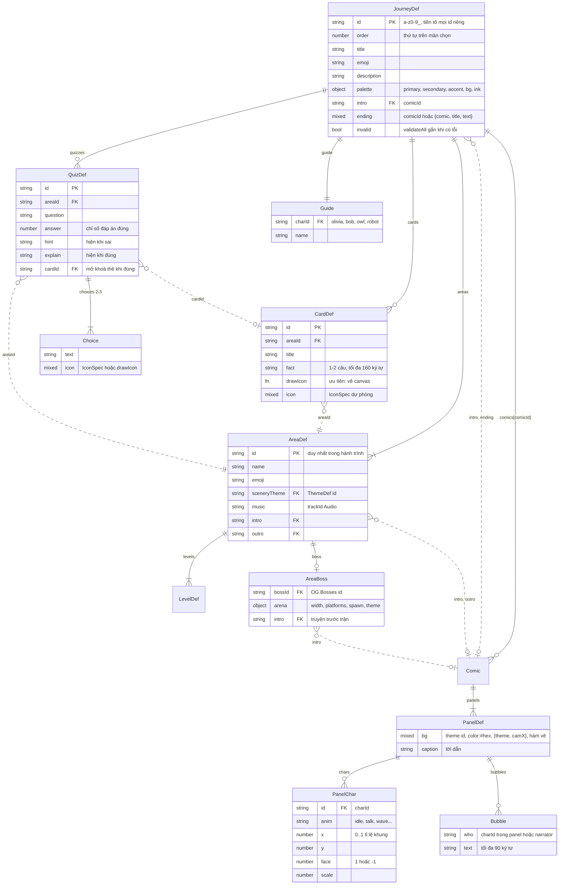
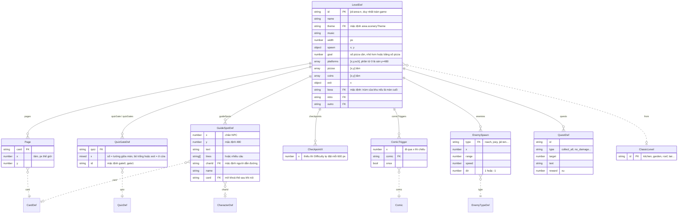
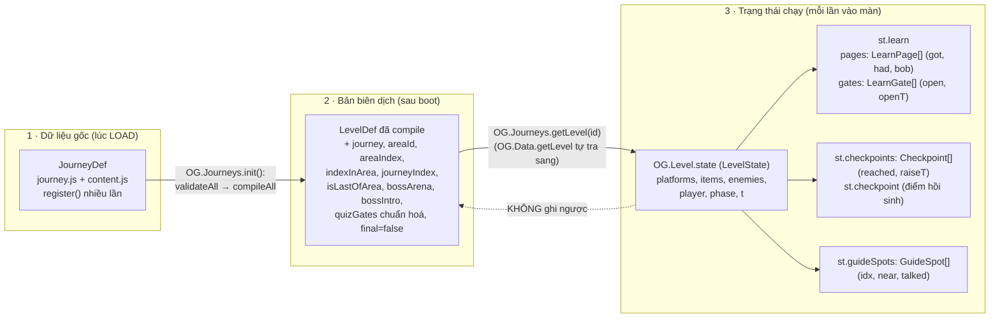
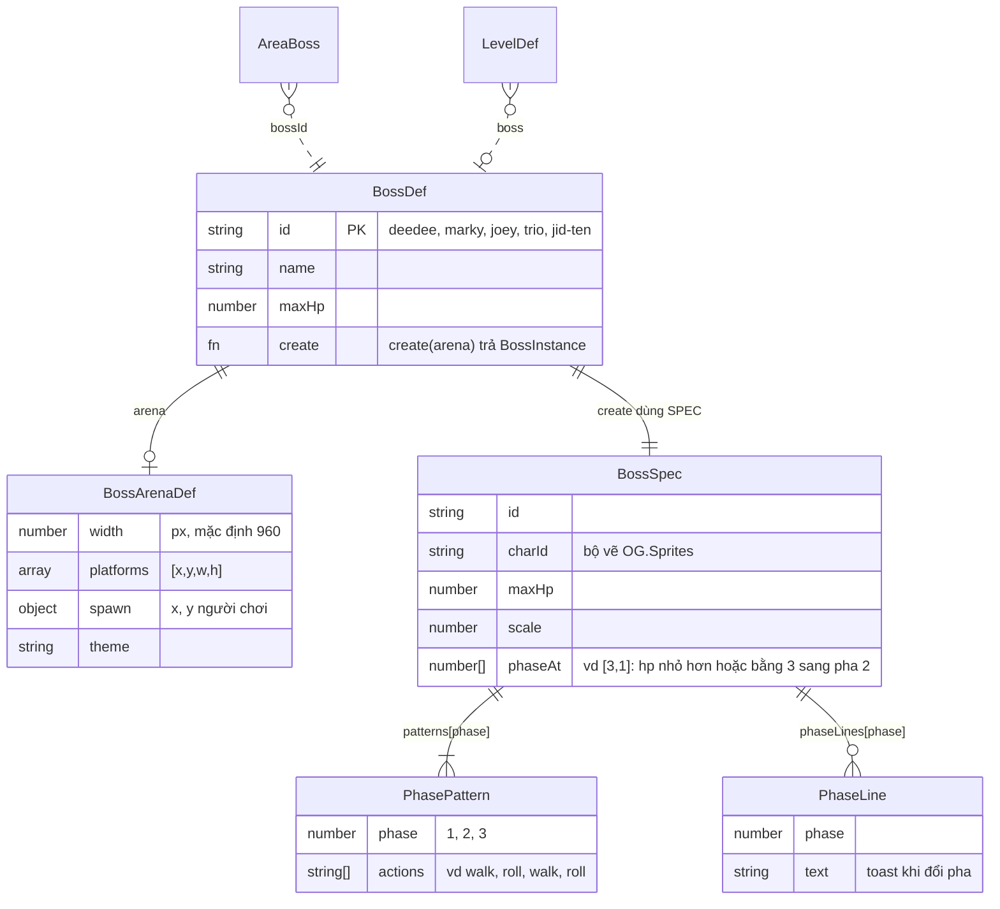
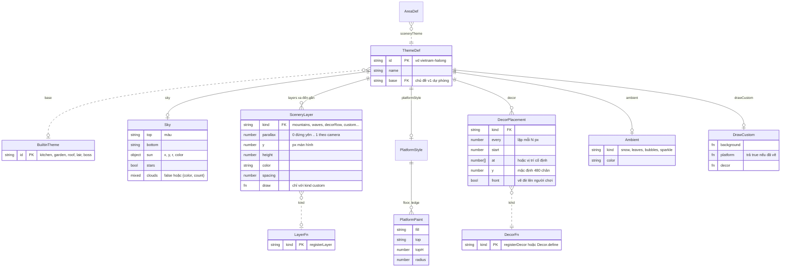
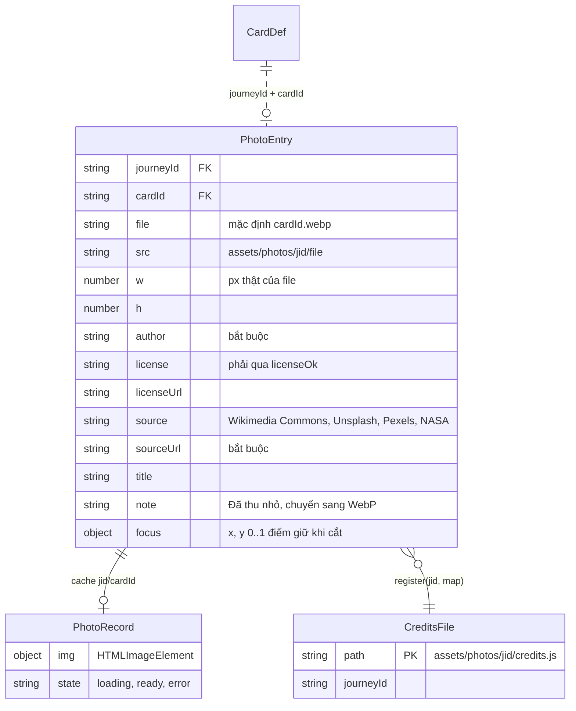
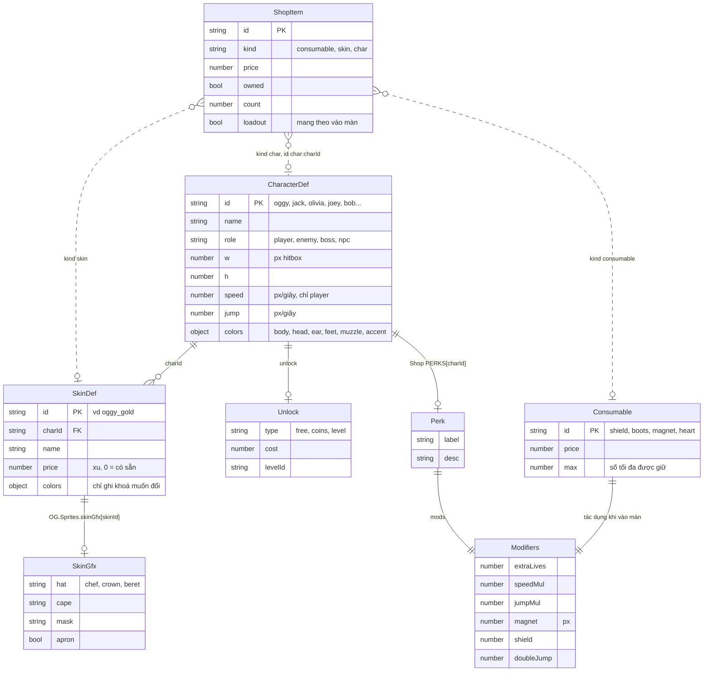
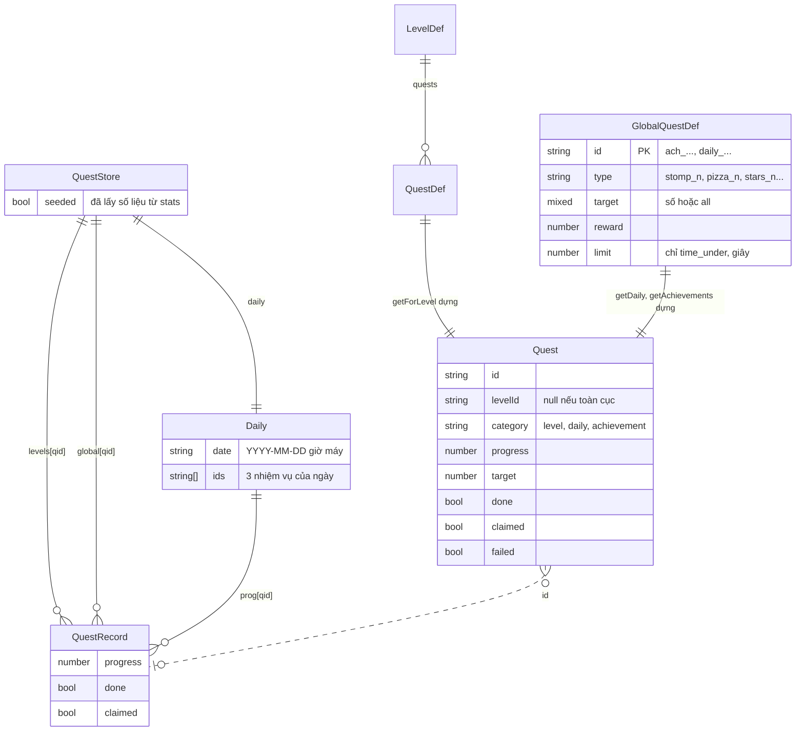
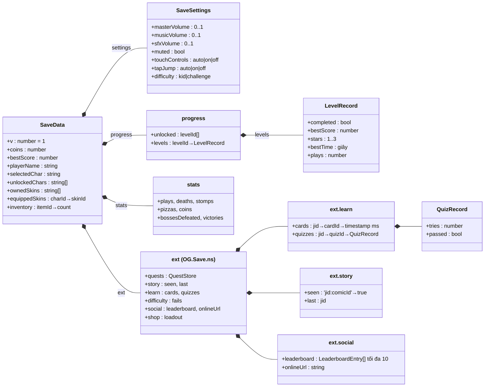
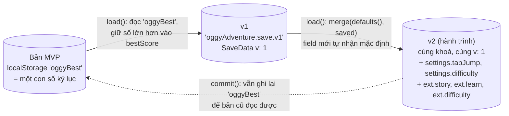

# 01 · Mô hình dữ liệu

Game là **data-driven** (hướng dữ liệu): phần lớn nội dung (màn chơi, thẻ kiến thức, câu đố, truyện tranh, cảnh nền, ảnh,
nhiệm vụ) là **object JavaScript thuần** được "đăng ký" vào một registry lúc nạp file. Code engine chỉ đọc dữ liệu đó.
Trang này vẽ hình dạng của các object ấy và quan hệ giữa chúng.

Kiểu dữ liệu dùng chung được khai báo một lần trong [src/types.d.ts](../../src/types.d.ts); kiểu chỉ dùng trong một file nằm ở
`@typedef` đầu file đó. Hợp đồng gốc: [`docs/STORY.md` mục 2, 4, 8](../STORY.md) và [`docs/ARCHITECTURE.md` mục 7](../ARCHITECTURE.md).

Mục lục:
1. [Nội dung một hành trình](#1-nội-dung-một-hành-trình)
2. [Bên trong một màn (LevelDef)](#2-bên-trong-một-màn-leveldef)
3. [Dữ liệu gốc → bản biên dịch → trạng thái chạy](#3-dữ-liệu-gốc--bản-biên-dịch--trạng-thái-chạy)
4. [Trùm](#4-trùm)
5. [Chủ đề cảnh nền (ThemeDef)](#5-chủ-đề-cảnh-nền-themedef)
6. [Ảnh chụp cho thẻ (Photo entry)](#6-ảnh-chụp-cho-thẻ-photo-entry)
7. [Nhân vật, skin, cửa hàng](#7-nhân-vật-skin-cửa-hàng)
8. [Nhiệm vụ (Quest)](#8-nhiệm-vụ-quest)
9. [Dữ liệu lưu (SaveData trong localStorage)](#9-dữ-liệu-lưu-savedata-trong-localstorage)
10. [Các thế hệ dữ liệu lưu và cách nâng cấp](#10-các-thế-hệ-dữ-liệu-lưu-và-cách-nâng-cấp)

Ký hiệu ER: đường **liền** = dữ liệu **lồng** bên trong (mảng/field con); đường **đứt** = tham chiếu bằng **id chuỗi**
(phải tra cứu, có thể sai — vì vậy mới cần `validate`). Cách đọc ký hiệu số lượng: [README](README.md#er-diagram-sơ-đồ-thực-thể--quan-hệ).

---

## 1. Nội dung một hành trình

[(xem SVG)](svg/01-journey-content.svg)

**Cách đọc:** một `JourneyDef` (hành trình, vd `home`) chứa nhiều khu (`AreaDef`, vd `kitchen`), mỗi khu nhiều màn.
Thẻ kiến thức (`CardDef`) và câu đố (`QuizDef`) nằm **phẳng** ở cấp hành trình rồi trỏ ngược về khu bằng `areaId`;
truyện tranh nằm trong object `comics` với **khoá** là `comicId`.

**Vì sao thiết kế như vậy:**
- Thẻ/câu đố để phẳng (không lồng trong khu) để **một file** [`content.js`](../../src/journeys/home/content.js) khai báo mọi nội dung học tập,
  còn [`journey.js`](../../src/journeys/home/journey.js) khai báo khu/màn. Cả hai gọi `OG.Journeys.register` với cùng `id`;
  hàm nội bộ `mergeById` trong [src/core/journeys.js](../../src/core/journeys.js) **gộp** `areas/cards/quizzes` theo `id`, `comics` gộp theo khoá.
- Tham chiếu bằng id chuỗi (đường đứt) giúp người soạn nội dung viết dữ liệu dễ (không cần lồng object), đổi lại **có thể gõ sai**.
  Vì thế `OG.Journeys.validate` (hàm nội bộ `validateCards`, `validateQuizzes`, `validateComics`, `validateLevel`) kiểm tra mọi id tham chiếu;
  hành trình có lỗi bị gắn `invalid = true` và ẩn khỏi màn chọn (`validateAll`), game không sập.
- `IconSpec` là kiểu **hợp** (union): hàm vẽ | `{decor}` | `{char}` | `{emoji}` | chuỗi emoji. Người soạn chọn cách dễ nhất;
  `OG.Learn.drawIcon` trong [src/story/learn.js](../../src/story/learn.js) phân loại và gọi đúng bộ vẽ.

**Đánh đổi:** không có kiểm tra kiểu lúc chạy như cơ sở dữ liệu thật; mọi ràng buộc ("2–3 lựa chọn", "≤ 160 ký tự") nằm trong code `validate*`.

---

## 2. Bên trong một màn (LevelDef)

[(xem SVG)](svg/01-level-def.svg)

**Cách đọc:** `LevelDef` của hành trình **đúng định dạng màn cổ điển v1** (`platforms`, `pizzas`, `exit`...) cộng thêm các mảng v2:
trang sách (`pages`), cổng câu đố, NPC dẫn đường, checkpoint, truyện chen giữa màn. Field `from` cho phép **mượn hình học** của một
màn cổ điển (vd `from: 'kitchen'`) rồi chỉ thêm phần học tập.

**Vì sao:**
- Dùng lại định dạng v1 nên scene `level` ([src/game/level.js](../../src/game/level.js), hàm nội bộ `buildState`) **không cần biết** màn đó thuộc hành trình
  hay chiến dịch cổ điển. Phần v2 được xử lý bởi **level hook** (`OG.Level.addHook`): `checkpoints` ([src/game/difficulty.js](../../src/game/difficulty.js)),
  `learn` ([src/story/learn.js](../../src/story/learn.js)), `guide` ([src/story/guide.js](../../src/story/guide.js)), `story-comics` ([src/story/story.js](../../src/story/story.js)).
- Toạ độ dạng mảng `[x, y, w, h]` cho gọn khi soạn hàng chục màn; `buildState` đổi sang object `{x, y, w, h, isFloor}` một lần lúc vào màn.
- `quizGate` (một cổng) và `quizGates` (nhiều cổng) đều được chấp nhận; hàm nội bộ `normalizeGates` trong [src/core/journeys.js](../../src/core/journeys.js)
  chuẩn hoá thành một mảng `[{id, quiz, x}]` để phía sau chỉ xử lý một dạng.

---

## 3. Dữ liệu gốc → bản biên dịch → trạng thái chạy

Cùng một màn tồn tại ở **ba dạng**. Phân biệt ba dạng này là chìa khoá để hiểu vì sao chơi lại màn vẫn "sạch".

[(xem SVG)](svg/01-data-runtime.svg)

**Cách đọc từ trái sang phải:**
1. **Dữ liệu gốc** là thứ người soạn viết. `register` có thể gọi nhiều lần cho cùng hành trình.
2. **Bản biên dịch**: `OG.Journeys.init()` (do [src/core/main.js](../../src/core/main.js) gọi trong `boot`, *sau* khi trùm và nhân vật đã đăng ký)
   chạy `validateAll` rồi hàm nội bộ `compileAll` → `compileLevel`: điền giá trị mặc định (`theme` lấy từ khu, `exit` mặc định...),
   chép hình học từ màn `from`, gắn field điều hướng (`journeyIndex`, `isLastOfArea`...). Kết quả cache trong `CompiledCache`
   (`levels`, `order`); `register` lần nữa sẽ xoá cache (`compiled = null`).
3. **Trạng thái chạy**: mỗi lần vào màn, `buildState` tạo `LevelState` mới; các hook tạo `st.learn`, `st.checkpoints`, `st.guideSpots`.

**Vì sao tách ba dạng:** nếu hook ghi `got = true` thẳng vào `LevelDef.pages`, lần chơi sau trang sách biến mất mãi mãi.
Comment trong hook `story-comics` nói đúng điều này: "KHÔNG ghi `fired` vào dữ liệu gốc". **Bất biến**: dữ liệu biên dịch là *chỉ đọc* trong lúc chơi.

**Đánh đổi:** tốn thêm một bước compile và bộ nhớ cho bản sao (`clone` bằng `JSON.parse(JSON.stringify(...))` khi mượn `from`),
nhưng đổi lại code gameplay đơn giản và không có lỗi "dữ liệu bị bẩn".

---

## 4. Trùm

[(xem SVG)](svg/01-boss-data.svg)

**Cách đọc:** `BossDef` là bản đăng ký trong `OG.Bosses.register` ([src/bosses/bosses.js](../../src/bosses/bosses.js)). Mỗi file trùm
([deedee.js](../../src/bosses/deedee.js), [joey.js](../../src/bosses/joey.js), [marky.js](../../src/bosses/marky.js)) khai báo một hằng `SPEC`
(`BossSpec`) gồm **bộ đòn theo pha** (`patterns`) và ngưỡng máu đổi pha (`phaseAt`). Ví dụ Dee Dee:
`patterns: { 1: ['walk','roll','walk','roll'], 2: ['roll','eat','walk','roll','pots'], 3: ['roll3','eat','pots','roll3'] }`, `phaseAt: [3, 1]`.

**Vì sao:** bộ đòn là **dữ liệu** chứ không phải `if/else` → đổi nhịp trùm chỉ cần sửa mảng (`🧪 Thử` trong `deedee.js`).
Trùm hành trình dùng chung trùm có sẵn; khu chỉ cần ghi `boss: {bossId}` và tuỳ chọn `arena` riêng. Trạng thái chạy của trùm
(`BossInstance`, `Arena`) là **object có hành vi**, nên vẽ ở [02-class-diagrams.md mục 4](02-class-diagrams.md#4-trùm-ogbosses).

---

## 5. Chủ đề cảnh nền (ThemeDef)

[(xem SVG)](svg/01-theme-def.svg)

**Cách đọc:** khu trỏ tới chủ đề bằng `sceneryTheme`. Chủ đề mô tả bầu trời, các **lớp parallax** (lớp xa cuộn chậm, lớp gần cuộn nhanh),
kiểu sàn, đồ trang trí rải theo `every`/`at`, hạt bay lớp phủ. `kind` của lớp/decor là **tên** tra trong registry `OG.Scenery`
([src/core/scenery-registry.js](../../src/core/scenery-registry.js)); hàm vẽ thật nằm trong [src/gfx/decor.js](../../src/gfx/decor.js) và các file `decor-*.js`.

**Vì sao:**
- Registry nằm ở **core** (luôn có), bộ vẽ ở **gfx**: dữ liệu hành trình chỉ cần tên, không phụ thuộc file vẽ nào.
- `base` + hàm `fallbackDecor` / `fallbackLayer` = **graceful degradation**: thiếu decor thì vẽ bụi cây mặt cười, thiếu chủ đề thì
  `baseOf(id)` trả chủ đề v1 (mặc định `garden`). Không bao giờ có màn trống trơn hay lỗi.
- `drawCustom` là "lối thoát hiểm" cho chủ đề cần vẽ đặc biệt mà không phải sửa bộ vẽ chung.

---

## 6. Ảnh chụp cho thẻ (Photo entry)

[(xem SVG)](svg/01-photo-entry.svg)

**Cách đọc:** ảnh **không** nằm trong `CardDef`. Mỗi `assets/photos/<jid>/credits.js` gọi `OG.Photos.register(jid, {cardId: entry})`
lúc nạp ([src/story/photos.js](../../src/story/photos.js), hàm `register`). Cặp `(journeyId, cardId)` nối ảnh với thẻ.
`PhotoRecord` chỉ có trong RAM, tạo lần đầu khi `OG.Photos.image` được gọi (nạp lười, xem [03 luồng g](03-sequence-flows.md#g-tải-ảnh-lười-lazy-cho-thẻ--fallback)).

**Vì sao:**
- Thêm ảnh **không cần sửa** `content.js` (người soạn nội dung học tập và người tìm ảnh làm việc độc lập).
- `register` **chuẩn hoá ở cổng vào** (chuỗi được `trim`, số được ép kiểu) và **từ chối** entry thiếu `author`/`sourceUrl` hoặc giấy phép
  không qua `licenseOk` (danh sách trắng: Public Domain, CC0, CC BY, CC BY-SA, Unsplash, Pexels; chặn NC/ND/GFDL...). An toàn pháp lý trước.
- Dữ liệu là `.js` chứ không phải `.json` vì `fetch()` file cục bộ bị chặn qua `file://` (xem [ADR-01](06-design-decisions.md#adr-01-không-build-step-không-es-modules-namespace-og--iife)).
  File `_entries.json` cạnh ảnh chỉ là file tạm của công cụ, CI xoá trước khi deploy.

---

## 7. Nhân vật, skin, cửa hàng

[(xem SVG)](svg/01-char-shop.svg)

**Cách đọc:** `OG.Data.characters` ([src/data/characters.js](../../src/data/characters.js)) là registry nhân vật (hitbox, tốc độ, màu);
skin chỉ là **bộ màu thay thế** (+ phụ kiện vẽ trong [src/gfx/skins.js](../../src/gfx/skins.js)). `ShopItem` là **view** (khung nhìn) mà
`OG.Shop.listItems` ([src/ui/shop.js](../../src/ui/shop.js)) dựng ra lúc chạy từ ba nguồn (vật phẩm `CONSUMABLES`, skin, nhân vật);
hàm nội bộ `resolve(itemId)` là chỗ **duy nhất** hiểu mã `'char:'`, `'skin:'`.

**Vì sao:** skin = dữ liệu màu nên thêm skin chỉ cần `OG.Data.registerSkin` (không vẽ lại nhân vật). Vật phẩm và đặc tính nhân vật quy về
**một kiểu `Modifiers`** (hệ số `*Mul` nhân, còn lại cộng) → `OG.Game.newRun` / `levelMods` ([src/game/game.js](../../src/game/game.js)) gộp mọi nguồn bằng
`mergeMods` mà không cần biết vật phẩm cụ thể.

---

## 8. Nhiệm vụ (Quest)

[(xem SVG)](svg/01-quest.svg)

**Cách đọc:** có ba nguồn định nghĩa: nhiệm vụ màn (`LevelDef.quests`), thành tựu (`ACHIEVEMENTS`) và kho nhiệm vụ ngày (`DAILY_POOL`)
trong [src/world/quests.js](../../src/world/quests.js). Thứ được lưu chỉ là **tiến độ** (`QuestStore` trong `OG.Save.ns('quests')`);
object `Quest` đầy đủ được dựng lại mỗi lần `list()` / `getForLevel()`.

**Vì sao:** tách *định nghĩa* (trong code, đổi được khi cập nhật game) khỏi *tiến độ* (trong save) → sửa câu chữ hay phần thưởng
không làm hỏng save cũ. Nhiệm vụ ngày chọn bằng **seeded random** từ chuỗi ngày (`hashStr` FNV-1a + `seededRandom`) nên chỉ cần lưu `date` và `ids`.

---

## 9. Dữ liệu lưu (SaveData trong localStorage)

[(xem SVG)](svg/01-save-data.svg)

**Cách đọc:** toàn bộ dữ liệu người chơi là **một object** `OG.Save.data` (kiểu `SaveData` trong [src/core/save.js](../../src/core/save.js)),
được `JSON.stringify` và ghi vào `localStorage` dưới khoá **`oggyAdventure.save.v1`**. Phần trên (`coins`, `settings`, `progress`...) là của core;
phần `ext` chia thành **ngăn riêng cho từng module**, lấy bằng `OG.Save.ns(name)`:

| Ngăn | Module ghi | Nội dung |
|---|---|---|
| `ext.quests` | [src/world/quests.js](../../src/world/quests.js) | `QuestStore` (mục 8) |
| `ext.story` | [src/story/story.js](../../src/story/story.js) | truyện đã xem `seen['<jid>:<comicId>']`, hành trình gần nhất `last` |
| `ext.learn` | [src/story/learn.js](../../src/story/learn.js) | thẻ đã mở (thời điểm ms), kết quả câu đố |
| `ext.difficulty` | [src/game/difficulty.js](../../src/game/difficulty.js) | số lần thua mỗi màn `fails[levelId]` (để bật trợ giúp) |
| `ext.social` | [src/social/leaderboard.js](../../src/social/leaderboard.js) | bảng xếp hạng cục bộ (tối đa 10 `LeaderboardEntry`), URL máy chủ online nếu đã bật |
| `ext.shop` | [src/ui/shop.js](../../src/ui/shop.js) | `loadout[itemId]`: bật/tắt "mang theo" vật phẩm |

Khoá `localStorage` khác: `oggyBest` (kỷ lục của bản MVP, vẫn được ghi để tương thích ngược) và `oggyAdventure.probe` (khoá tạm để thử ghi được không).

**Vì sao:**
- **Một khoá, một object**: ghi/đọc một lần, dễ xoá (`OG.Save.reset`), dễ xem trong DevTools.
- **Namespace `ext`**: hai module không bao giờ ghi đè field của nhau; thêm module mới không phải sửa `defaults()`.
- `progress.levels` dùng chung cho màn cổ điển và màn hành trình (id màn hành trình có tiền tố `<jid>-` nên không đụng nhau).

**Đánh đổi:** `localStorage` đồng bộ (chặn luồng chính), giới hạn ~5 MB và có thể bị chặn (private mode) → mọi truy cập bọc `try/catch`
(hàm nội bộ `storageGet/storageSet`), `OG.Save.available` cho biết có lưu thật được không. Mỗi module tự "vá" ngăn của mình khi thiếu field
(vd hàm `store()` trong `quests.js`) vì save có thể bị sửa tay.

---

## 10. Các thế hệ dữ liệu lưu và cách nâng cấp

[(xem SVG)](svg/01-save-generations.svg)

**Cách đọc:** chưa từng có thay đổi phá vỡ định dạng, nên chiến lược nâng cấp là **deep merge với mặc định**
(hàm nội bộ `merge` trong [src/core/save.js](../../src/core/save.js)): save cũ thiếu `settings.tapJump` → sau khi gộp có `'auto'`.
Mảng được **thay nguyên** (không gộp theo chỉ số). Kỷ lục của bản MVP được **migrate** một chiều bằng cách đọc khoá `oggyBest`.

**Suy luận cần lưu ý:** field `v` (= 1) có trong `defaults()` nhưng **chưa có đoạn code nào rẽ nhánh theo `v`**. Nó được để sẵn cho ngày
cần đổi định dạng thật (vd đổi tên field): khi đó `load()` sẽ cần `if (saved.v < 2) { ...chuyển đổi... }` trước khi `merge`.
Luồng chi tiết của `load/commit`: [03 luồng f](03-sequence-flows.md#f-lưu-tải-và-migrate-dữ-liệu).
