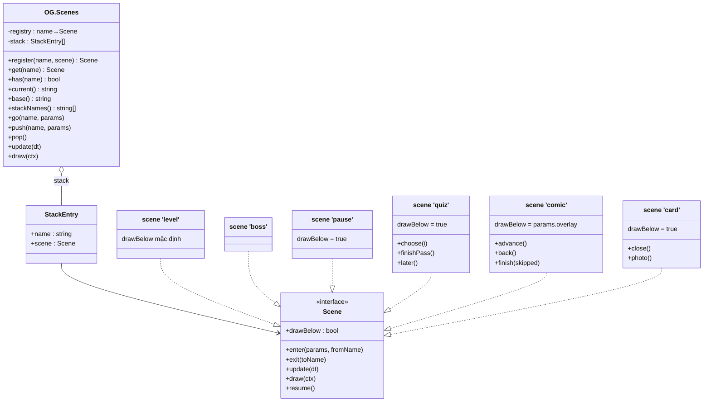
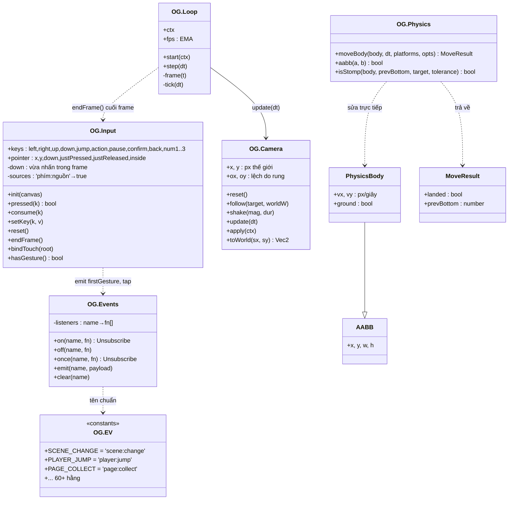
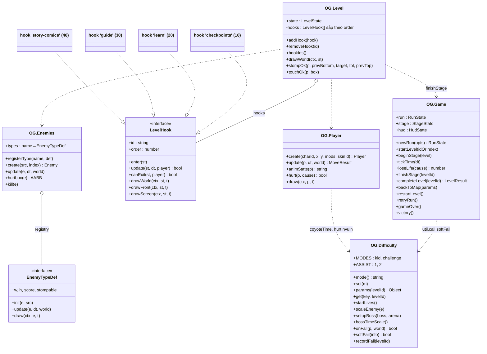
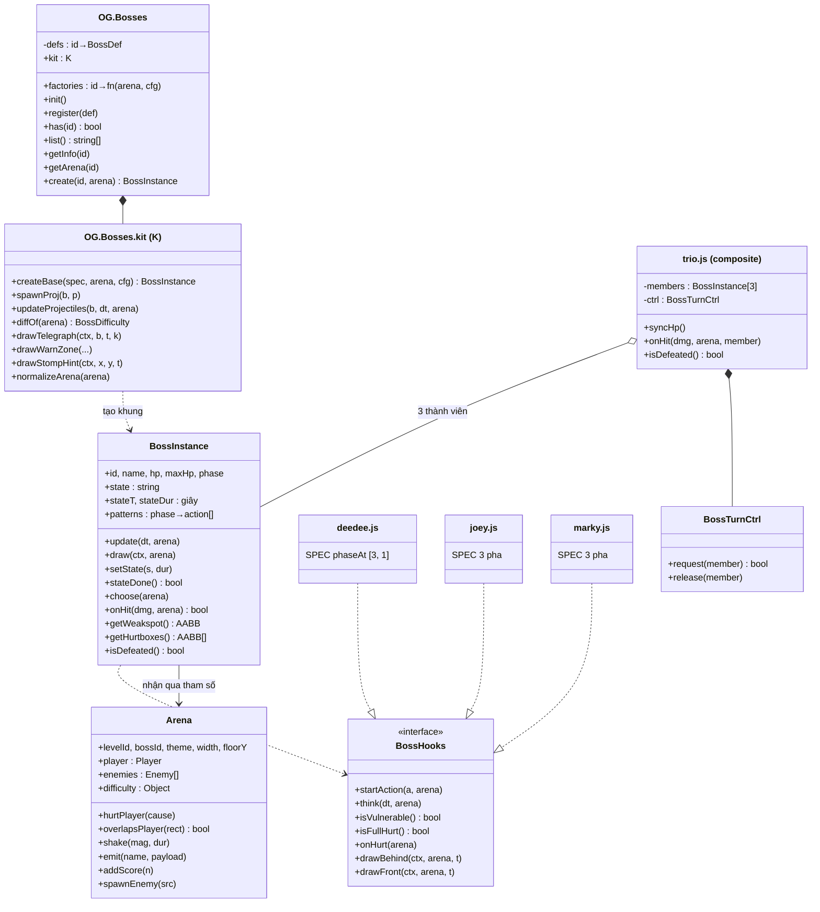
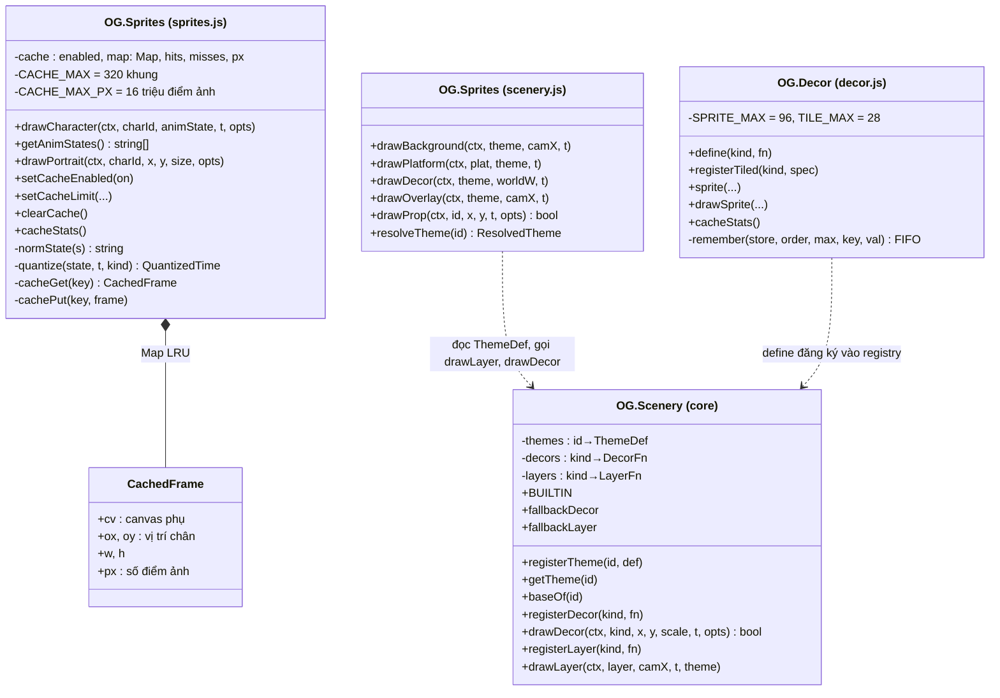
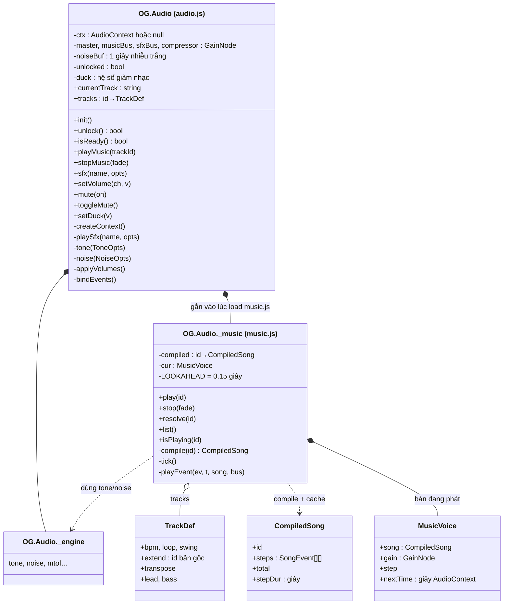
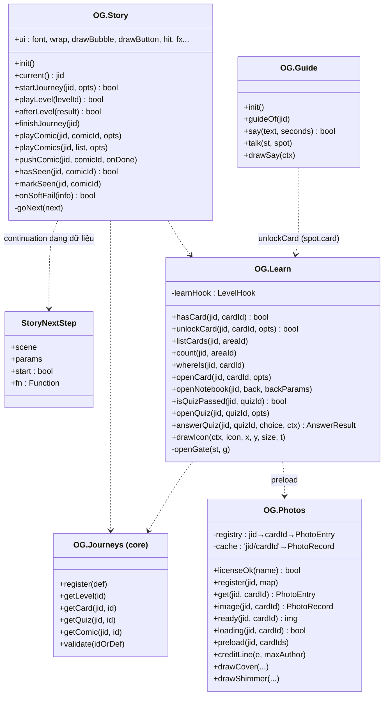
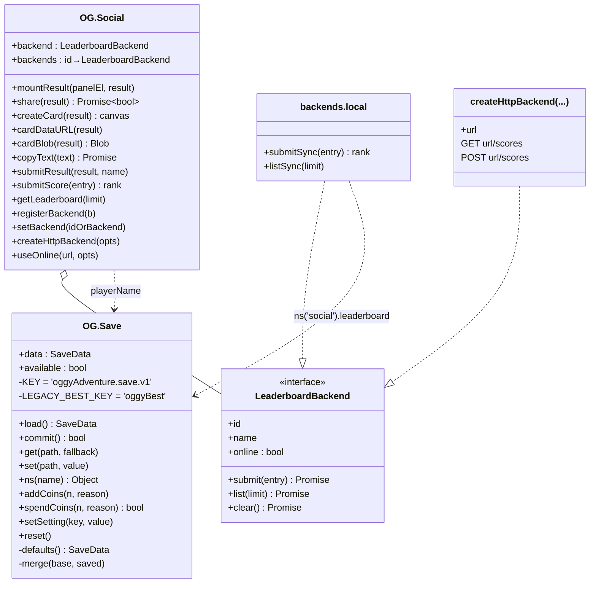

# 02 · Sơ đồ lớp của các namespace `OG.*`

Game không có `class` của JavaScript. Mỗi file là một **IIFE** (hàm tự gọi ngay khi nạp) tạo ra **một object** và gắn vào
`window.OG` — đó là **module pattern**. Biến khai báo bên trong IIFE là **nội bộ** (private, ký hiệu `-`), field gắn vào `OG.X`
là **công khai** (public, ký hiệu `+`). Vì mỗi module chỉ có **một** object, ta vẽ nó như một lớp có đúng một thể hiện (singleton).

Phụ thuộc giữa các module ở mức thư mục đã có trong [ARCHITECTURE-DIAGRAMS mục 1](../learn/ARCHITECTURE-DIAGRAMS.md#1-module-và-phụ-thuộc-giữa-các-namespace-og).
Trang này đi vào **bên trong** từng module: dữ liệu, hàm, và các "giao diện" (interface) mà module khác phải tuân theo.

Mục lục:
1. [Scene: interface và máy trạng thái `OG.Scenes`](#1-scene-interface-và-máy-trạng-thái-ogscenes)
2. [Lõi engine: Events, Input, Loop, Camera, Physics](#2-lõi-engine-events-input-loop-camera-physics)
3. [Gameplay: Game, Level + hook, Player, Enemies, Difficulty](#3-gameplay-game-level--hook-player-enemies-difficulty)
4. [Trùm (`OG.Bosses`)](#4-trùm-ogbosses)
5. [Đồ hoạ: Sprites (cache LRU), Scenery, Decor](#5-đồ-hoạ-sprites-cache-lru-scenery-decor)
6. [Âm thanh: Audio + sequencer nhạc](#6-âm-thanh-audio--sequencer-nhạc)
7. [Học tập: Story, Learn, Guide, Photos](#7-học-tập-story-learn-guide-photos)
8. [Lưu trữ và mạng xã hội: Save, Social, backend adapter](#8-lưu-trữ-và-mạng-xã-hội-save-social-backend-adapter)
9. [Bảng tổng hợp design pattern](#9-bảng-tổng-hợp-design-pattern)

---

## 1. Scene: interface và máy trạng thái `OG.Scenes`

[(xem SVG)](svg/02-scenes.svg)

**Cách đọc:** mọi scene chỉ là object có (một phần) các hàm của interface `Scene` (khai báo trong [src/types.d.ts](../../src/types.d.ts)).
`OG.Scenes` ([src/core/scenes.js](../../src/core/scenes.js)) giữ một `registry` (tên → scene) và một `stack` (ngăn xếp). `update` chỉ gọi
scene **trên cùng**; `draw` vẽ từ scene thấp nhất còn nhìn thấy (dừng ở scene có `drawBelow === false`) lên đỉnh.

**Pattern:**
- **State** (trạng thái): mỗi scene là một trạng thái, `go/push/pop` là chuyển trạng thái. Các luồng chuyển: [ARCHITECTURE-DIAGRAMS mục 2](../learn/ARCHITECTURE-DIAGRAMS.md#2-state-machine-các-scene).
- **Registry + "stub rồi ghi đè"**: `register` lần sau ghi đè lần trước, nên [src/game/default-scenes.js](../../src/game/default-scenes.js) đăng ký menu/pause mặc định,
  rồi [src/ui/menus.js](../../src/ui/menus.js) đăng ký bản thật trong `init()`.
- **Interface tuỳ chọn**: `OG.Scenes` kiểm tra `if (scene.enter)` trước khi gọi, và bọc bằng `OG.util.safe` → scene lỗi không làm kẹt máy trạng thái.

**Vì sao stack thay vì một biến `currentScene`:** pause, thẻ, câu đố chỉ cần `push` lên trên màn chơi; màn chơi bên dưới tự "đóng băng"
(không được `update`) mà không cần cờ `isPaused` rải khắp code. **Đánh đổi:** phải nhớ `pop` đúng lúc, và callback chạy sau `pop` (vd `onPass`
của câu đố) phải được gọi **sau** khi pop xong (xem `finishPass`, và bẫy "pop TRƯỚC rồi mới gọi cb" trong `comic.finish`).

---

## 2. Lõi engine: Events, Input, Loop, Camera, Physics

[(xem SVG)](svg/02-core.svg)

**Cách đọc:**
- `OG.Events` ([src/core/events.js](../../src/core/events.js)) là **event bus**: `listeners` là bảng tên → mảng hàm. `on` trả về hàm huỷ đăng ký;
  `emit` duyệt trên **bản sao** mảng và bọc từng listener bằng `OG.util.safe`; listener `'*'` nhận mọi event. `OG.EV` là bảng **hằng tên** event.
- `OG.Input` ([src/core/input.js](../../src/core/input.js)) tách **đang giữ** (`keys.*`) khỏi **vừa nhấn** (`down`, đọc bằng `pressed`, xoá ở `endFrame`).
  `sources` đếm **nguồn** giữ phím (bàn phím, nút cảm ứng, chạm nửa phải) để nhả một nguồn không tắt phím khi nguồn kia vẫn giữ.
  Input phát `input:firstGesture` (lần chạm/phím đầu tiên) và `input:tap` nhưng **không biết** ai nghe (Audio dùng cái đầu để mở khoá âm thanh).
- `OG.Loop` ([src/core/loop.js](../../src/core/loop.js)): `frame` (gọi bởi `requestAnimationFrame`) tính `dt`, gọi `tick`; `step(dt)` cho smoke test gọi thẳng `tick`.
- `OG.Physics` ([src/core/physics.js](../../src/core/physics.js)) là **hàm thuần** trên dữ liệu: nhận `PhysicsBody` (một `AABB` có vận tốc), sửa trực tiếp, trả `MoveResult`.
  `Player` và `Enemy` trong [src/types.d.ts](../../src/types.d.ts) đều `extends` các kiểu này.

**Pattern:** **Observer / publish–subscribe** (`Events`), **Facade** nhỏ (`Input` gói bàn phím + chuột + cảm ứng thành phím logic),
**hàm thuần trên dữ liệu** (`Physics`: không giữ trạng thái, dễ test). **Vì sao Physics không là "class Body có method move()":** player, kẻ địch,
trùm có hình dạng dữ liệu khác nhau; chỉ cần có `x, y, w, h, vx, vy, ground` là dùng được `moveBody` (duck typing — "kêu như vịt thì là vịt").

---

## 3. Gameplay: Game, Level + hook, Player, Enemies, Difficulty

[(xem SVG)](svg/02-gameplay.svg)

**Cách đọc:**
- `OG.Game` ([src/game/game.js](../../src/game/game.js)) giữ **lượt chơi** (`run`), **màn hiện tại** (`stage`, dùng chung cho màn và trận trùm ngay sau)
  và quyết định luồng **màn → trùm → bản đồ** (`finishStage`, `completeLevel`, `backToMap`).
- `OG.Level` ([src/game/level.js](../../src/game/level.js)) vừa là scene `'level'` vừa là **điểm cắm** `addHook`. Bốn hook cài interface `LevelHook`
  nằm ở bốn file khác: [difficulty.js](../../src/game/difficulty.js) (`checkpointHook`), [learn.js](../../src/story/learn.js) (`learnHook`),
  [guide.js](../../src/story/guide.js), [story.js](../../src/story/story.js). Số trong ngoặc là `order` (nhỏ chạy trước).
- `OG.Enemies` ([src/game/enemies.js](../../src/game/enemies.js)) là **registry** loại địch: `roach`, `joey`, `marky`, `deedee` có sẵn, hành trình đăng ký thêm
  (`science-crab`, `vietnam-roach`...) trong `extras.js`.

**Pattern:**
- **Plugin / hook** (gần với **template method**): `level.update` cố định thứ tự các bước (người chơi → rơi vực → hook → vật phẩm → kẻ địch → cửa ra);
  hook chỉ điền vào các "khe" `enter/update/canExit/draw*`. `update` trả `true` = dừng frame (vd vừa push câu đố). `level.js` không có dòng nào về
  checkpoint hay trang sách.
- **Strategy + registry** (`EnemyTypeDef`): mỗi loại địch là một bộ hàm `init/update/draw`; `create` tra theo `type` trong dữ liệu màn.
- **Tham số hoá độ khó** (`Difficulty.params`): mọi nơi hỏi `get('coyoteTime')`, `get('enemySpeedMul')`... thay vì `if (kid)`; có cache theo
  khoá `mode | màn | version`.

**Đánh đổi của hook:** thứ tự `order` là hợp đồng ngầm (checkpoint 10 phải chạy trước để cập nhật vị trí an toàn sớm nhất); đọc code `level.js`
một mình không thấy hết hành vi của màn.

---

## 4. Trùm (`OG.Bosses`)

[(xem SVG)](svg/02-bosses.svg)

**Cách đọc:**
- [src/bosses/bosses.js](../../src/bosses/bosses.js) có ba phần: **registry** (`register/has/create`), **kit** dùng chung (`K`), và khung trùm `K.createBase`.
- `createBase` dựng một `BossInstance` có sẵn máy trạng thái (`setState`, `stateDone`, `choose`), máu/pha (`onHit`, `computePhase`), vật lý, vẽ.
  Mỗi file trùm ([deedee.js](../../src/bosses/deedee.js), [joey.js](../../src/bosses/joey.js), [marky.js](../../src/bosses/marky.js)) gọi `createBase(SPEC, arena, cfg)`
  rồi **gán thêm** các hàm trong "interface" `BossHooks` (tên interface do sơ đồ đặt, code không có tên này).
- [trio.js](../../src/bosses/trio.js) dùng lại `OG.Bosses.factories.joey/marky/deedee` tạo 3 thành viên nhỏ và gói thành **một** `BossInstance`.
- `Arena` do scene `'boss'` dựng (hàm nội bộ `makeArena` trong [src/game/boss-scene.js](../../src/game/boss-scene.js)).

**Pattern:**
- **Template method**: `b.update` của khung cố định trình tự (giảm bộ đếm → xử lý trạng thái chung `roar/recoil/breather/wait` → còn lại gọi `b.think`
  → `physics` → `updateProjectiles`); trùm chỉ viết phần riêng. Comment trong code ghi rõ "Vòng cập nhật (template method)".
- **Strategy qua hàm gán thêm**: `startAction`, `think`, `isVulnerable`... thay cho kế thừa lớp.
- **Composite**: `trio` trông như một trùm với scene boss; **token / turn-taking** (`BossTurnCtrl`) để chỉ một tên ra đòn một lúc.
- **Dependency injection**: trùm không gọi `OG.Player`, `OG.Camera` trực tiếp mà gọi `arena.hurtPlayer`, `arena.shake`... → thay `arena` giả là test được.
  `K.normalizeArena` bù các hàm còn thiếu.

**Vì sao không dùng `class Boss extends BossBase`:** dự án viết ES5 vừa phải, không transpile; gán hàm vào object làm cùng việc, và trùm ghép
(`trio`) chỉ cần gọi lại factory với `cfg` khác. **Đánh đổi:** không có kiểm tra "đã cài đủ hook chưa" — khung luôn kiểm tra `typeof b.think === 'function'`.
Máy trạng thái của từng trùm: [04-state-machines.md mục 3](04-state-machines.md#3-máy-trạng-thái-trùm).

---

## 5. Đồ hoạ: Sprites (cache LRU), Scenery, Decor

[(xem SVG)](svg/02-gfx.svg)

**Cách đọc:**
- `OG.Sprites` được **ba file góp vào cùng một object**: [sprites.js](../../src/gfx/sprites.js) (nhân vật), [skins.js](../../src/gfx/skins.js) (`skinGfx`),
  [scenery.js](../../src/gfx/scenery.js) (nền, sàn, prop). Sơ đồ tách thành hai ô cho dễ đọc.
- `drawCharacter` vẽ procedural (bằng lệnh Canvas), nhưng trước đó `quantize` làm tròn thời gian `t` về một số hữu hạn khung (vd `run`: 12 khung / 0,36 s),
  ghép khoá (`frameKey`), tra `cacheGet`; trượt cache thì vẽ vào canvas phụ rồi `cachePut`.
- `cachePut` loại khung cũ nhất khi vượt **một trong hai** giới hạn (số khung hoặc tổng điểm ảnh). `cacheGet` trúng thì `delete` rồi `set` lại khoá →
  khoá được dời xuống cuối `Map` (Map của JS giữ thứ tự chèn) — đó là **LRU không cần danh sách liên kết**.
- `OG.Decor` ([decor.js](../../src/gfx/decor.js)) cache ảnh decor/dải parallax tĩnh bằng **FIFO** (`remember`) — comment trong code so sánh hai cách.
- `OG.Scenery` ([src/core/scenery-registry.js](../../src/core/scenery-registry.js)) là registry ở **core**; mọi hàm vẽ đăng ký bọc `save/restore` + `try/catch`, lỗi thì vẽ hình dự phòng.

**Pattern:** **Registry** (theme/decor/layer), **Memoization / cache** (LRU cho nhân vật, FIFO cho decor), **Null object / fallback** (`fallbackDecor`,
`fallbackLayer`), **mở rộng object qua nhiều file** (`OG.Sprites`). Lý do chọn procedural + cache: [ADR-06](06-design-decisions.md#adr-06-vẽ-procedural-bằng-canvas--cache-khung-hình-lru).

---

## 6. Âm thanh: Audio + sequencer nhạc

[(xem SVG)](svg/02-audio.svg)

**Cách đọc:** [src/audio/audio.js](../../src/audio/audio.js) sở hữu `AudioContext` và đồ thị âm thanh: nguồn → `sfxBus` / `trackGain → musicBus` → `master` →
`compressor` → loa. Nó **tự nghe event** (`bindEvents`: `player:jump` → `sfx('jump')`...), gameplay không gọi Audio.
[src/audio/music.js](../../src/audio/music.js) là **sequencer**: bản nhạc là dữ liệu (`TrackDef`), được `compile` một lần thành lưới bước; `tick` chạy bằng
`setInterval` và lên lịch trước `LOOKAHEAD` giây các nốt kèm thời điểm chính xác trên đồng hồ của `AudioContext`.

**Pattern:** **Observer** (Audio nghe event bus), **Facade** (`sfx(name)` che hàng chục node Web Audio), **data-driven + compile & cache** (nhạc).
Vì sao tổng hợp âm thanh thay vì file `.mp3`: [ADR-07](06-design-decisions.md#adr-07-âm-thanh-tổng-hợp-bằng-web-audio-không-dùng-file).
Vòng đời `AudioContext`: [04 mục 7](04-state-machines.md#7-audiocontext).

---

## 7. Học tập: Story, Learn, Guide, Photos

[(xem SVG)](svg/02-story.svg)

**Cách đọc:**
- `OG.Story` ([src/story/story.js](../../src/story/story.js)) là **người điều phối** hành trình: quyết định truyện nào chiếu, theo thứ tự nào, rồi đi tiếp đâu.
  "Đi tiếp đâu" là một **continuation dạng dữ liệu** `StoryNextStep` (`{scene, params, start}` hoặc `{fn}`), được `goNext` thực hiện.
- `OG.Learn` ([src/story/learn.js](../../src/story/learn.js)) giữ logic học tập (thẻ, sổ tay, câu đố) và hook `learn`; giao diện vẽ nằm trong
  [src/story/scenes.js](../../src/story/scenes.js) (scene `card`, `quiz`, `notebook`).
- `OG.Guide` ([src/story/guide.js](../../src/story/guide.js)): NPC trong màn (hook `guide`). `OG.Photos` ([src/story/photos.js](../../src/story/photos.js)): registry ảnh nạp lười.

**Pattern:** **Mediator / coordinator** (`Story` đứng giữa scene, Game và dữ liệu), **continuation** (truyền "việc làm tiếp" như dữ liệu thay vì
lồng callback), **callback `onPass/onClose`** (closure giữ đúng cổng, đúng màn), **lazy-load + cache** (`Photos`).
**Vì sao tách logic (`learn.js`) khỏi giao diện (`scenes.js`):** smoke test gọi `answerQuiz` trực tiếp để kiểm tra luật "sai không phạt", và giao diện
được làm đẹp mà không đụng luật.

---

## 8. Lưu trữ và mạng xã hội: Save, Social, backend adapter

[(xem SVG)](svg/02-save-social.svg)

**Cách đọc:**
- `OG.Save` ([src/core/save.js](../../src/core/save.js)) là **cổng duy nhất** tới `localStorage` (hợp đồng: không module nào gọi `localStorage` trực tiếp).
- Bảng xếp hạng ([src/social/leaderboard.js](../../src/social/leaderboard.js)) nói chuyện với mọi nơi lưu điểm qua **cùng một giao diện**
  `LeaderboardBackend`. `local` luôn là **nguồn sự thật**; nếu bật online (`useOnline` hoặc `OG.Config.LEADERBOARD_URL`), điểm được gửi kèm
  lên backend HTTP mà không chặn game. Máy chủ mẫu: [docs/leaderboard-worker.example.js](../leaderboard-worker.example.js).

**Pattern:** **Adapter** (mọi backend cùng hình dạng), **Strategy** (chọn backend lúc chạy bằng `setBackend`), **local-first**,
**không tin dữ liệu ngoài** (`sanitize` mọi entry dù đọc từ save hay máy chủ). Thêm Firebase/Supabase = viết một object có `id, submit, list`
rồi `registerBackend`, không sửa scene.

---

## 9. Bảng tổng hợp design pattern

| Pattern | Ở đâu (file · hàm) | Vì sao dùng |
|---|---|---|
| Module pattern (IIFE + namespace) | mọi file `src/**` → `window.OG.X` | chạy được qua `file://`, không build step ([ADR-01](06-design-decisions.md#adr-01-không-build-step-không-es-modules-namespace-og--iife)) |
| Registry | `OG.Scenes.register`, `OG.Journeys.register`, `OG.Bosses.register`, `OG.Enemies.registerType`, `OG.Scenery.register*`, `OG.Photos.register`, `OG.Data.register*` | dữ liệu/module đăng ký từ bên ngoài, core không cần biết danh sách |
| "Stub rồi ghi đè" | [default-scenes.js](../../src/game/default-scenes.js) → [menus.js](../../src/ui/menus.js) `init` | game luôn chạy được kể cả khi thiếu module tính năng |
| Optional call | `OG.util.call(ns, method, ...)` trong [namespace.js](../../src/core/namespace.js) | tầng dưới gọi tầng trên mà không phụ thuộc cứng |
| Observer / pub-sub | [events.js](../../src/core/events.js); Audio, Quests, HUD nghe | tách module ([ADR-03](06-design-decisions.md#adr-03-event-bus-để-tách-module)) |
| State machine | `OG.Scenes`, `st.phase`, `BossInstance.state`, scene `quiz`/`comic` | luồng rõ ràng, mỗi trạng thái một đoạn code ([04](04-state-machines.md)) |
| Template method | `K.createBase` → `b.update` gọi `b.think`; `level.update` gọi hook | cố định trình tự, chỉ cho điền phần riêng |
| Strategy | `EnemyTypeDef`, `BossHooks`, `LeaderboardBackend`, `Difficulty.params` | đổi hành vi bằng dữ liệu/hàm, không `if` theo loại |
| Adapter | `LeaderboardBackend` (`local`, HTTP) | cùng giao diện cho nhiều nơi lưu |
| Composite | [trio.js](../../src/bosses/trio.js) | ba trùm trông như một với scene boss |
| Dependency injection | `Arena` trong [boss-scene.js](../../src/game/boss-scene.js) `makeArena` | trùm không phụ thuộc core, dễ test |
| Memoization / cache | Sprites (LRU `Map`), Decor (FIFO), Photos, Difficulty `computed`, `Social.cardDataURL` | việc tốn kém chỉ làm một lần |
| Continuation | `StoryNextStep` + `goNext` trong [story.js](../../src/story/story.js) | chuỗi truyện → scene tiếp theo không lồng callback |
| Fallback / graceful degradation | `fallbackDecor`, `Photos` → hình cartoon, Audio không hỗ trợ → im lặng | trẻ em không bao giờ thấy màn hình lỗi |
