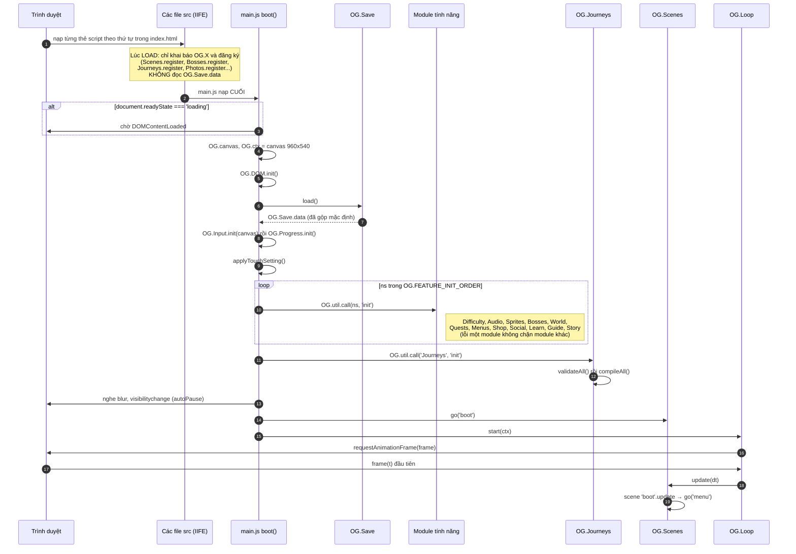
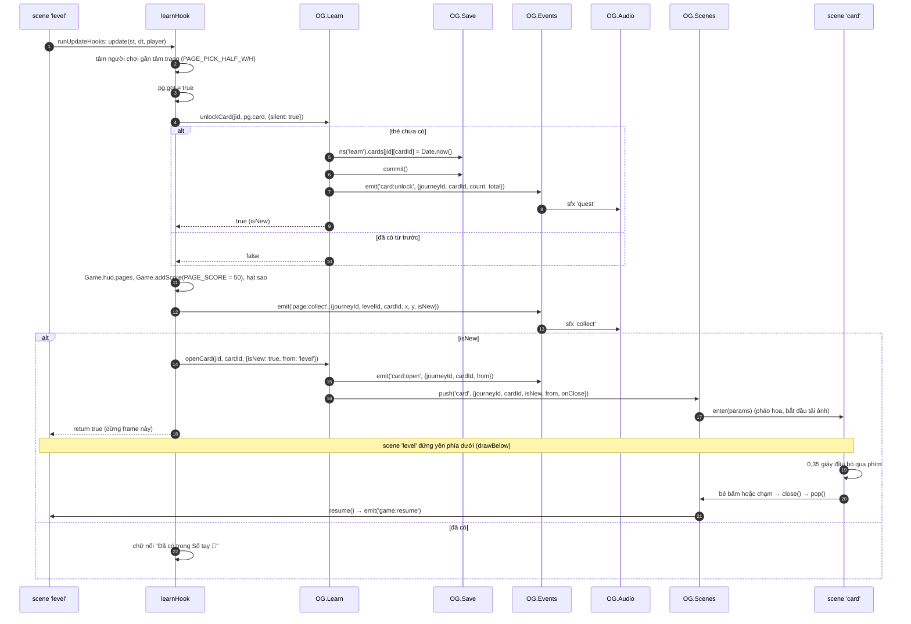
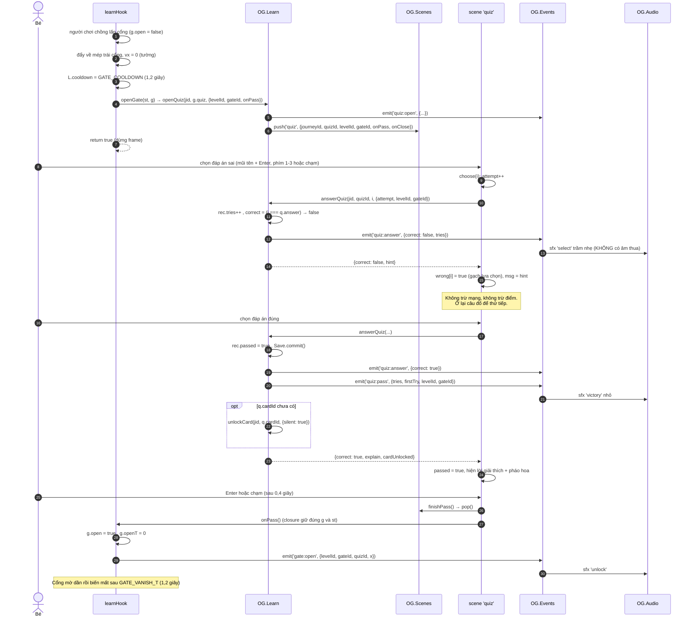
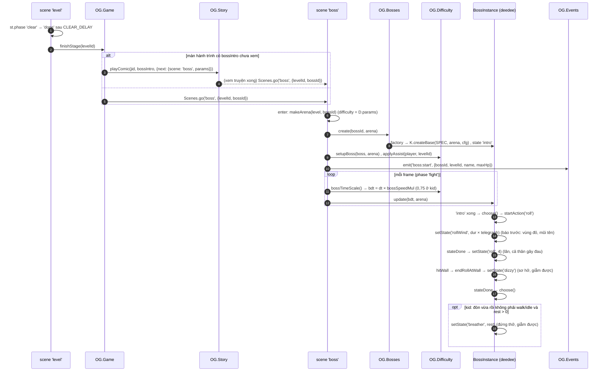
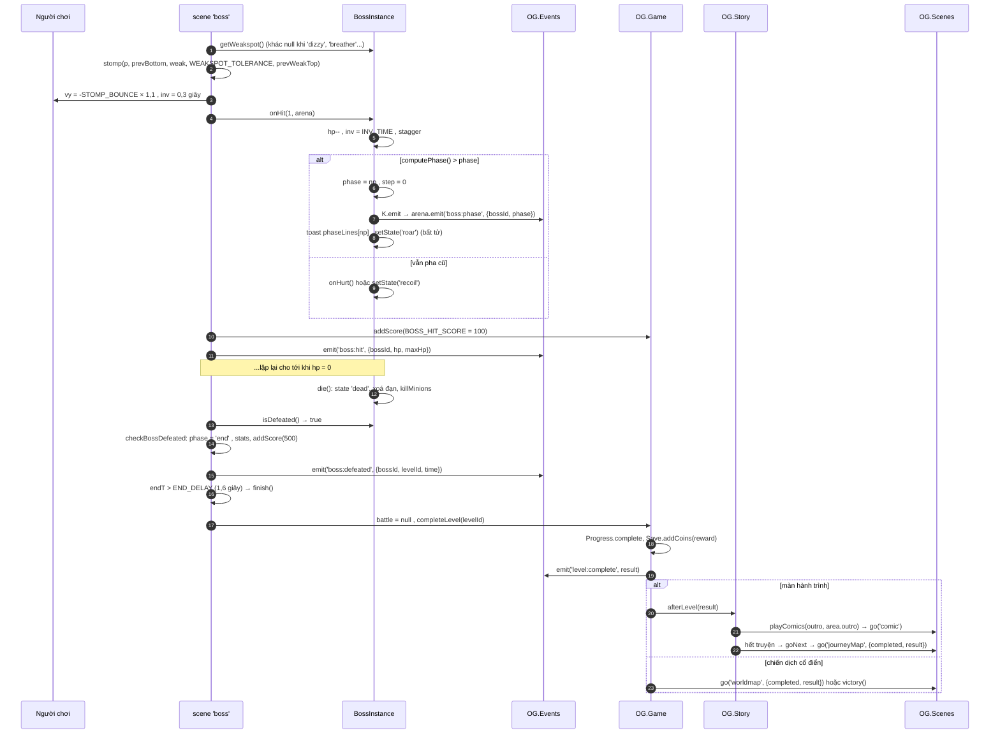
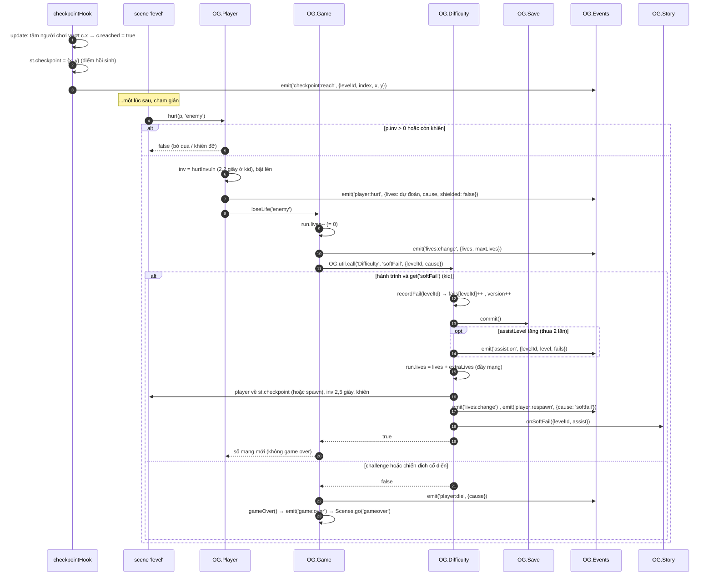
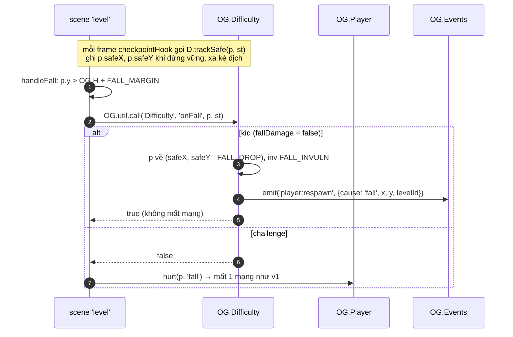
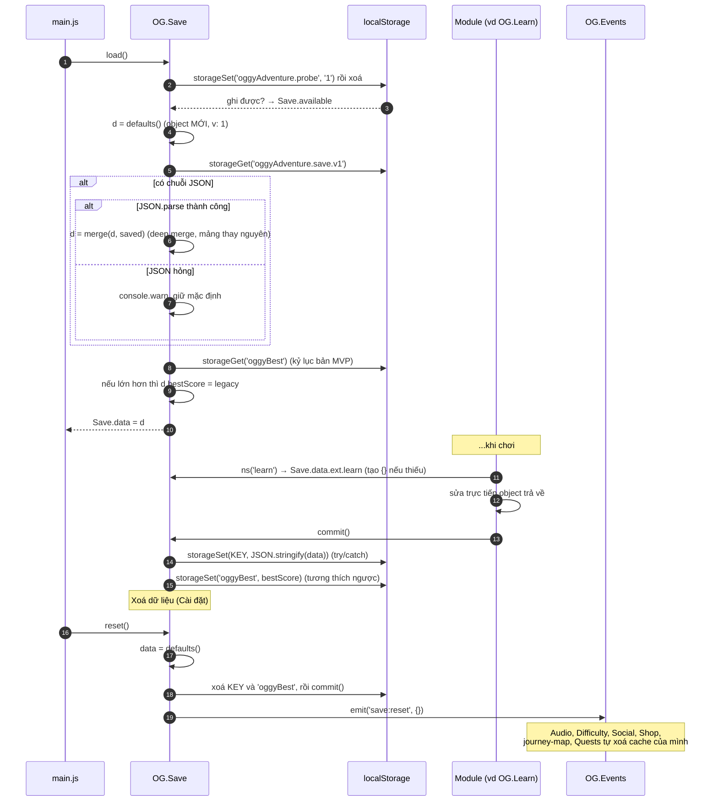
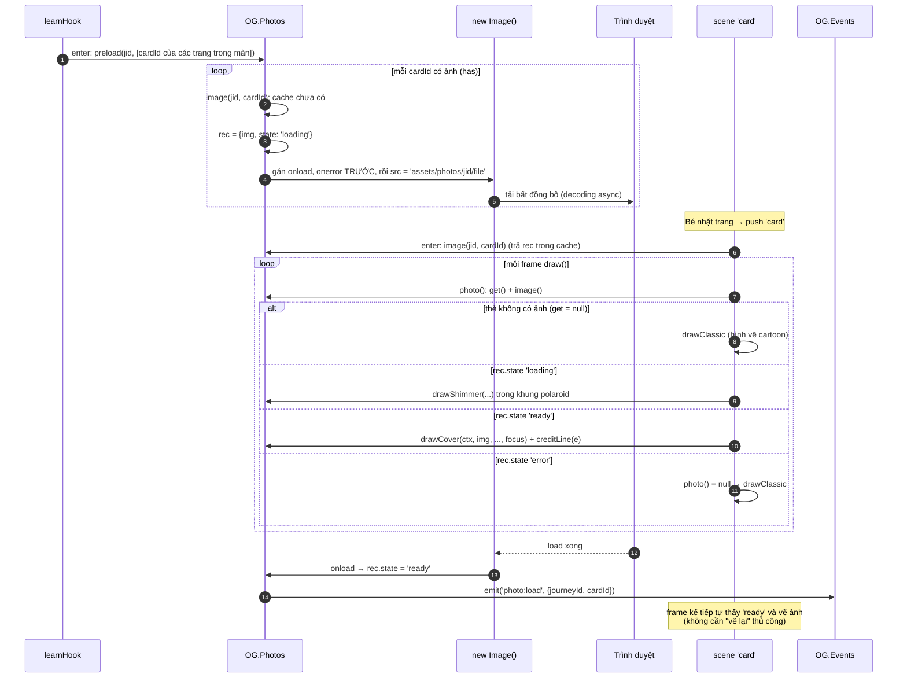
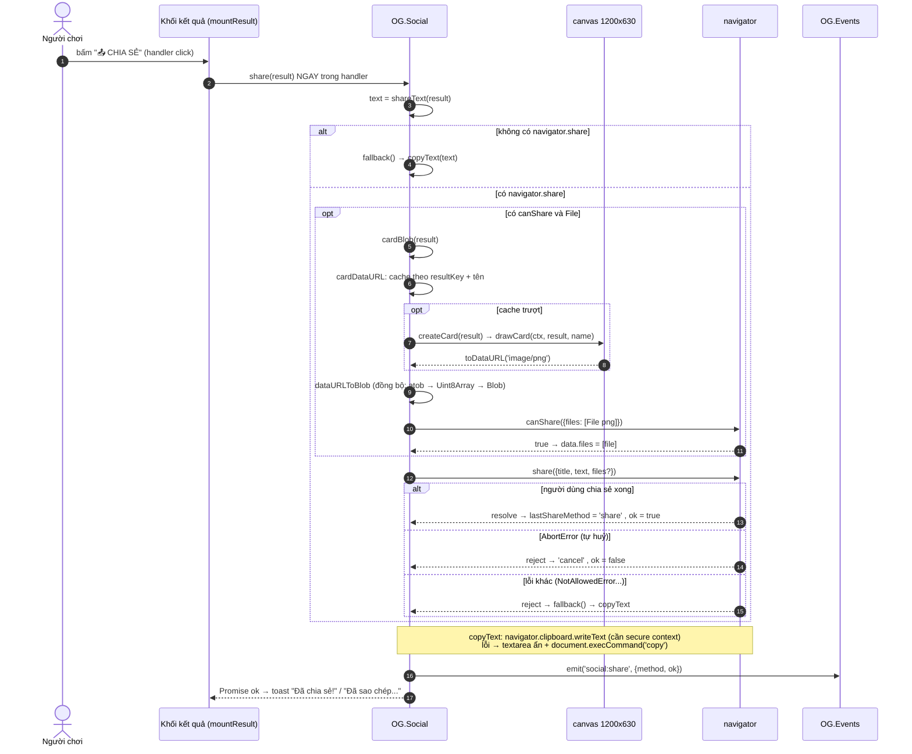

# 03 · Các luồng quan trọng (sequence diagram)

Mỗi sơ đồ dưới đây đọc **từ trên xuống theo thời gian**. Cột là module/scene; mũi tên liền là lời gọi hàm hoặc `emit`,
mũi tên đứt là giá trị trả về. Tên hàm, scene, event lấy nguyên văn từ code.

Vòng đời **một frame** (Loop → Scenes → Player → Physics → draw) đã có ở
[ARCHITECTURE-DIAGRAMS mục 4](../learn/ARCHITECTURE-DIAGRAMS.md#4-vòng-đời-một-frame-sequence-diagram); các luồng ở đây giả định bạn đã hiểu nó.

Mục lục:
- [(a) Khởi động game](#a-khởi-động-game)
- [(b) Nhặt trang sách → mở thẻ → lưu Sổ tay](#b-nhặt-trang-sách--mở-thẻ--lưu-sổ-tay)
- [(c) Cổng câu đố: sai → gợi ý → đúng → mở cửa](#c-cổng-câu-đố-sai--gợi-ý--đúng--mở-cửa)
- [(d) Một trận trùm](#d-một-trận-trùm)
- [(e) Hết mạng ở chế độ Bé chơi](#e-hết-mạng-ở-chế-độ-bé-chơi)
- [(f) Lưu, tải và migrate dữ liệu](#f-lưu-tải-và-migrate-dữ-liệu)
- [(g) Tải ảnh lười (lazy) cho thẻ + fallback](#g-tải-ảnh-lười-lazy-cho-thẻ--fallback)
- [(h) Chia sẻ điểm](#h-chia-sẻ-điểm)

---

## (a) Khởi động game

[(xem SVG)](svg/03-a-boot.svg)

**Code:** [index.html](../../index.html) (thứ tự `<script>`), [src/core/main.js](../../src/core/main.js) (`boot`, `OG.FEATURE_INIT_ORDER`, `applyTouchSetting`),
[src/core/save.js](../../src/core/save.js) (`load`), [src/core/journeys.js](../../src/core/journeys.js) (`init`), [src/game/default-scenes.js](../../src/game/default-scenes.js) (scene `boot`).

**Vì sao có hai giai đoạn "load" và "boot":** lúc nạp script, dữ liệu lưu chưa được đọc và các module khác có thể chưa tồn tại; nên file chỉ được
**đăng ký** (registry). Mọi việc cần dữ liệu thật dồn vào `boot()`, theo đúng thứ tự phụ thuộc: `Save.load` **trước** `Progress.init`
(⚠️ đảo lại thì Progress làm việc trên dữ liệu mặc định rồi `commit` ghi đè save thật — comment trong `main.js`).
`Journeys.init` chạy **sau** các module tính năng vì `validate` cần biết trùm/nhân vật nào đã đăng ký.
`Loop.start` cuối cùng: frame đầu tiên chỉ chạy khi đã có scene. Lúc này `AudioContext` **chưa** được tạo (chờ cử chỉ đầu tiên, [04 mục 7](04-state-machines.md#7-audiocontext)).

---

## (b) Nhặt trang sách → mở thẻ → lưu Sổ tay

[(xem SVG)](svg/03-b-page.svg)

**Code:** [src/story/learn.js](../../src/story/learn.js) (`learnHook.update`, `unlockCard`, `openCard`), [src/story/scenes.js](../../src/story/scenes.js) (scene `card`: `enter`, `update`, `close`),
[src/game/level.js](../../src/game/level.js) (hàm nội bộ `runUpdateHooks`), [src/audio/audio.js](../../src/audio/audio.js) (`bindEvents`).

**Đọc thế nào:** "lưu Sổ tay" chính là bước 5–6: Sổ tay (scene `notebook`) **không có dữ liệu riêng**, nó đọc lại `ext.learn.cards` qua `OG.Learn.listCards`.
Thẻ được lưu **ngay lúc nhặt** chứ không đợi qua màn → bé thoát giữa chừng vẫn giữ thẻ.

**Vì sao `return true`:** hook vừa `push` một scene; nếu `level.update` chạy tiếp (vật phẩm, kẻ địch) trong cùng frame thì kẻ địch có thể
đánh trúng bé ngay dưới popup. **Vì sao khoá phím 0,35 giây:** phím/chạm vừa dùng để nhặt trang không được đóng luôn thẻ vừa mở.

---

## (c) Cổng câu đố: sai → gợi ý → đúng → mở cửa

[(xem SVG)](svg/03-c-quiz.svg)

**Code:** [src/story/learn.js](../../src/story/learn.js) (`learnHook.update`, `canExit`, `openGate`, `openQuiz`, `answerQuiz`),
[src/story/scenes.js](../../src/story/scenes.js) (scene `quiz`: `choose`, `finishPass`, `later`).

**Nhánh không vẽ:** bấm **"Để sau ✕"** hoặc Esc → `later()` → `pop()` + `onClose` (cổng giữa màn không truyền `onClose`), cổng vẫn khoá;
nhờ `cooldown` 1,2 giây câu đố không bật lại ngay frame sau (⚠️ thiếu cooldown = kẹt vĩnh viễn). Cổng ở cửa EXIT (`x: 'exit'`) đi đường khác:
`level.js` hỏi `canExit` của hook → `false` = chặn và mở câu đố.

**Vì sao thiết kế như vậy:** luật giáo dục "sai không bao giờ bị phạt" ([`STORY.md` mục 0](../STORY.md)) được đặt trong **logic** `answerQuiz` chứ không chỉ
ở giao diện, nên smoke test kiểm tra được. Cổng **hỏi lại mỗi lần vào màn** (`gates` dựng mới trong `learnHook.enter`) để bé ôn tập;
`ext.learn.quizzes` chỉ ghi lịch sử (`tries`, `passed`) cho Sổ tay và thống kê.

---

## (d) Một trận trùm

Chia hai phần: **(d1)** vào trận và một chu kỳ đòn đánh; **(d2)** trúng đòn → đổi pha → gục → truyện → bản đồ.
Ví dụ dùng **Dee Dee** ([src/bosses/deedee.js](../../src/bosses/deedee.js)) ở chế độ Bé chơi.

### (d1) Vào trận, telegraph, tấn công, nghỉ thở

[(xem SVG)](svg/03-d1-boss-start.svg)

### (d2) Trúng đòn → đổi pha → gục → truyện → bản đồ

[(xem SVG)](svg/03-d2-boss-end.svg)

**Code:** [src/game/game.js](../../src/game/game.js) (`finishStage`, `completeLevel`), [src/game/boss-scene.js](../../src/game/boss-scene.js) (`makeArena`, `stompBossOrGetHurt`,
`checkBossDefeated`, `finish`), [src/bosses/bosses.js](../../src/bosses/bosses.js) (`K.createBase`: `setState`, `choose`, `onHit`, `die`, `getWeakspot`),
[src/bosses/deedee.js](../../src/bosses/deedee.js) (`startAction`, `think`, `endRollAtWall`), [src/game/difficulty.js](../../src/game/difficulty.js) (`setupBoss`, `bossTimeScale`),
[src/story/story.js](../../src/story/story.js) (`afterLevel`, `playComics`).

**Vì sao:**
- **Telegraph** (báo hiệu trước đòn) luôn là một trạng thái riêng tên kết thúc bằng `Wind`; `setState` tự nhân thời lượng với `diff.telegraph`
  (1,3 ở kid). Một quy ước tên thay cho cờ rải rác — đánh đổi: đặt sai tên (vd `rollPrep`) là mất hiệu ứng ở chế độ kid.
- **Time scale**: trùm nhận `bdt` đã nhân hệ số nên *mọi* bộ đếm giờ của trùm chậm lại đồng loạt, người chơi vẫn chạy tốc độ thật.
- `battle = null` **trước** `completeLevel`: để `OG.BossScene.isActive()` là `false` khi scene đổi.
- `stage` dùng chung cho màn và trận trùm sau nó → sao "không bị thương" tính cả hai.

---

## (e) Hết mạng ở chế độ Bé chơi

### (e1) Bị thương đến hết mạng → softFail → hồi sinh ở checkpoint

[(xem SVG)](svg/03-e1-softfail.svg)

### (e2) Rơi xuống hố

[(xem SVG)](svg/03-e2-fall.svg)

**Code:** [src/game/player.js](../../src/game/player.js) (`hurt`), [src/game/game.js](../../src/game/game.js) (`loseLife`, `gameOver`),
[src/game/difficulty.js](../../src/game/difficulty.js) (`softFail`, `recordFail`, `onFall`, `trackSafe`, `checkpointHook`), [src/game/level.js](../../src/game/level.js) (`handleFall`),
[src/story/story.js](../../src/story/story.js) (`onSoftFail`).

**Vì sao:** chế độ cho trẻ 5–10 tuổi "không bao giờ game over" nhưng vẫn có cảm giác thử thách (mất tim, quay lại checkpoint).
**DDA** (dynamic difficulty adjustment — tự điều chỉnh độ khó): thua cùng màn nhiều lần → `assistLevel` tăng → địch chậm hơn, trùm ít máu hơn, có khiên.
Lời gọi đi qua `OG.util.call` nên `game.js` không phụ thuộc cứng `difficulty.js`. ⚠️ Bẫy trong `player.js`: `player:hurt` phát **trước** `loseLife`
nên payload phải "đoán trước" số mạng.

---

## (f) Lưu, tải và migrate dữ liệu

[(xem SVG)](svg/03-f-save.svg)

**Code:** [src/core/save.js](../../src/core/save.js) (`load`, `commit`, `ns`, `reset`, hàm nội bộ `defaults`, `merge`, `storageGet`, `storageSet`, `storageRemove`).

**Vì sao:**
- `defaults()` là **hàm** trả object mới (không phải hằng) → `reset()` rồi sửa `data` không làm bẩn "bản mặc định".
- **Deep merge** = cơ chế nâng cấp: thêm field mới vào `defaults()` là save cũ tự có giá trị mặc định, không cần viết code migrate cho mỗi field.
  Migrate thật (khoá khác, định dạng khác) chỉ có một trường hợp: `oggyBest` của bản MVP.
- Mọi truy cập `localStorage` bọc `try/catch` vì nó **có thể ném lỗi** (bị chặn, đầy, private mode); game vẫn chạy với dữ liệu trong RAM.
- `save:reset` dùng **event** để các module tự dọn cache: `Save` không cần biết module nào có cache.

**Đánh đổi:** `commit()` ghi **toàn bộ** object mỗi lần (đơn giản, dữ liệu nhỏ nên nhanh). Nếu save lớn lên nhiều, cần gộp nhiều lần ghi (debounce).
Xem thêm bài học [11-luu-tru-migrate.md](../learn/11-luu-tru-migrate.md).

---

## (g) Tải ảnh lười (lazy) cho thẻ + fallback

[(xem SVG)](svg/03-g-photo.svg)

**Code:** [src/story/photos.js](../../src/story/photos.js) (`preload`, `image`, `ready`, `drawCover`, `drawShimmer`, `creditLine`),
[src/story/learn.js](../../src/story/learn.js) (`learnHook.enter`), [src/story/scenes.js](../../src/story/scenes.js) (scene `card`: `enter`, `photo`, `draw`; hàm `drawPolaroid`).

**Vì sao:**
- **Lazy-load**: 4 hành trình có hơn 70 ảnh; tải hết lúc khởi động là lãng phí trên điện thoại. `preload` chỉ tải ảnh của **màn đang chơi**,
  nên khi bé nhặt trang, ảnh thường đã sẵn sàng.
- **Máy trạng thái 3 trạng thái** (`loading → ready | error`, đúng một lần) + cache theo khoá `'jid/cardId'` → mỗi ảnh chỉ `new Image()` một lần
  dù `draw` hỏi 60 lần/giây; lỗi không thử lại liên tục.
- **Không cần callback vẽ lại** vì game vẽ lại toàn bộ canvas mỗi frame (immediate mode).
- **Fallback**: thiếu ảnh hay lỗi mạng → bố cục cartoon cũ, game không bao giờ hỏng. ⚠️ Gán `onload/onerror` trước `src` (comment trong `image`).
- Dòng ghi công **không được bỏ**: tràn chỗ thì cắt ngắn tên tác giả dần (vòng `for` quanh `creditLine` trong `drawPolaroid`).

---

## (h) Chia sẻ điểm

[(xem SVG)](svg/03-h-share.svg)

**Code:** [src/social/social.js](../../src/social/social.js) (`mountResult`, `share`, `shareText`, `copyText`, `cardBlob`, `cardDataURL`, `createCard`, hàm nội bộ
`drawCard`, `dataURLToBlob`, `execCopy`). Nút "🖼️ TẢI ẢNH" bên cạnh dùng `downloadCard` (thẻ `<a download>`).

**Vì sao:**
- **Progressive enhancement** (nâng cấp dần): `navigator.share` (điện thoại) → Clipboard API → `execCommand` (trình duyệt cũ, `file://`).
  Không có gì thì vẫn còn nút tải ảnh.
- **User activation**: `navigator.share` chỉ được gọi "ngay" trong xử lý cú bấm. `canvas.toBlob` là bất đồng bộ, đợi nó có thể làm hết hạn quyền
  (Safari rất chặt) → code giải mã base64 **đồng bộ** (`dataURLToBlob`) để giữ mọi thứ trong cùng một lượt xử lý.
- **Cache thẻ** theo `resultKey` + tên: `toDataURL` ảnh 1200×630 tốn hàng chục ms, không vẽ lại khi bấm chia sẻ nhiều lần.
