# 04 · Máy trạng thái

**Finite state machine** (FSM — máy hữu hạn trạng thái): tại mỗi thời điểm, đối tượng ở **đúng một** trạng thái; mỗi trạng thái có
code riêng; một **điều kiện** (hết giờ, chạm tường, bị giẫm...) đưa nó sang trạng thái khác. Game dùng FSM ở khắp nơi vì nó biến
"hàng chục cờ boolean rối nhau" thành một biến `state` dễ đọc, dễ vẽ, dễ test.

Đã có ở tổng quan (không vẽ lại): máy trạng thái **các scene** và pha `play → clear → done` của scene `level`
([ARCHITECTURE-DIAGRAMS mục 2](../learn/ARCHITECTURE-DIAGRAMS.md#2-state-machine-các-scene)). Bài học lý thuyết:
[05-state-machine-scene.md](../learn/05-state-machine-scene.md).

Mục lục:
1. [Hoạt ảnh nhân vật](#1-hoạt-ảnh-nhân-vật)
2. [Vòng đời người chơi](#2-vòng-đời-người-chơi)
3. [Máy trạng thái trùm](#3-máy-trạng-thái-trùm)
4. [Scene câu đố (`quiz`)](#4-scene-câu-đố-quiz)
5. [Scene truyện tranh (`comic`)](#5-scene-truyện-tranh-comic)
6. [Scene thẻ kiến thức (`card`)](#6-scene-thẻ-kiến-thức-card)
7. [AudioContext](#7-audiocontext)
8. [Cổng câu đố và checkpoint](#8-cổng-câu-đố-và-checkpoint)
9. [Ảnh chụp đang tải (PhotoRecord)](#9-ảnh-chụp-đang-tải-photorecord)

---

## 1. Hoạt ảnh nhân vật

### 1.1 Người chơi: trạng thái được TÍNH LẠI mỗi frame

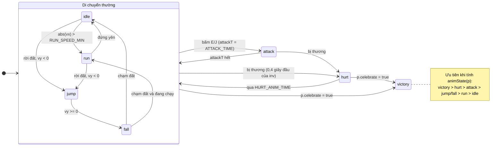
[(xem SVG)](svg/04-anim-player.svg)

**Cách đọc:** `OG.Player.animState(p)` ([src/game/player.js](../../src/game/player.js)) không lưu "trạng thái trước" để chuyển; nó **suy ra**
trạng thái từ dữ liệu vật lý theo thứ tự ưu tiên (dòng `if` đầu tiên đúng thì trả về). `Player.update` so với `p.anim` cũ: khác thì đặt lại
`p.animT = 0` (giây kể từ khi vào trạng thái), giống thì cộng `dt`. Sprites dùng `animT` để vẽ đúng tư thế.

**Vì sao suy ra thay vì lưu:** không bao giờ lệch giữa "hình đang vẽ" và "vật lý thật" (vd đang rơi mà vẫn vẽ dáng chạy). **Đánh đổi:** không có
hoạt ảnh "chuyển tiếp" (vd tư thế tiếp đất); phần đó được bù ở tầng vẽ bằng squash & stretch khi blit (`computeLandSquash` trong
[src/gfx/sprites.js](../../src/gfx/sprites.js)).

### 1.2 Tập trạng thái mà Sprites vẽ được

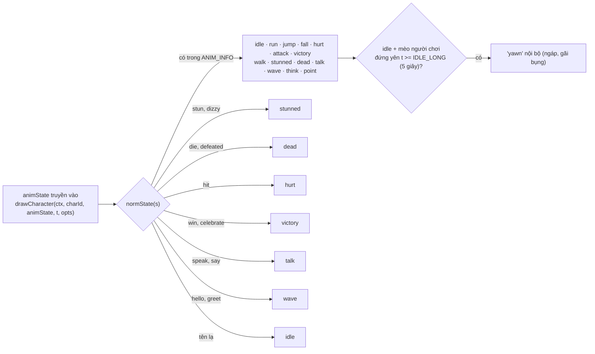
[(xem SVG)](svg/04-anim-sprites.svg)

**Cách đọc:** [src/gfx/sprites.js](../../src/gfx/sprites.js) có `ANIMS` (14 tên công khai, `getAnimStates()` trả về) và bảng `ANIM_INFO`
(trạng thái **lặp**: `loop` + `frames`; trạng thái **một lần**: `dur` + `fps`). `normState` chấp nhận bí danh và đưa tên lạ về `idle`
(hợp đồng [`STORY.md` mục 9](../STORY.md)). Trùm có thêm lớp chuyển đổi riêng `K.anim` trong [src/bosses/bosses.js](../../src/bosses/bosses.js)
(`walk → run`, `stunned → hurt`, `dead → hurt`, `roll → attack` nếu Sprites không có).

**Vì sao:** người viết truyện tranh / trùm gõ `'dizzy'` hay `'win'` vẫn ra hình hợp lý thay vì lỗi — **dễ tha thứ** cho người soạn dữ liệu.

---

## 2. Vòng đời người chơi

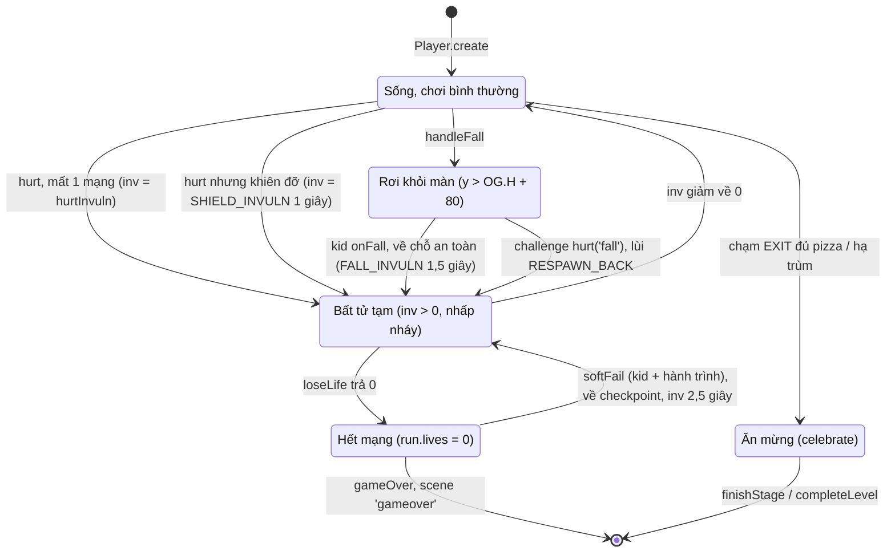
[(xem SVG)](svg/04-player-life.svg)

**Cách đọc:** trạng thái ở đây là **khái niệm**, trong code là tổ hợp field của `Player` (`inv`, `invMax`, `shield`, `celebrate`, vị trí `y`)
và `OG.Game.run.lives`. Các chuyển nằm ở `OG.Player.hurt` ([src/game/player.js](../../src/game/player.js)), `handleFall`
([src/game/level.js](../../src/game/level.js)), `OG.Game.loseLife` ([src/game/game.js](../../src/game/game.js)), `onFall` / `softFail`
([src/game/difficulty.js](../../src/game/difficulty.js)). Luồng chi tiết theo thời gian: [03 luồng e](03-sequence-flows.md#e-hết-mạng-ở-chế-độ-bé-chơi).

**Vì sao có "bất tử tạm" (i-frames):** không có nó, đứng chồng lên một con gián 1 giây = mất mọi mạng (mỗi frame một lần trúng). Trong lúc bất tử,
`hurt` trả `false` ngay dòng đầu. Sau mỗi lần hồi sinh cũng cho bất tử để bé không bị "đánh úp" lúc vừa xuất hiện.

---

## 3. Máy trạng thái trùm

### 3.1 Khung chung (`K.createBase`)

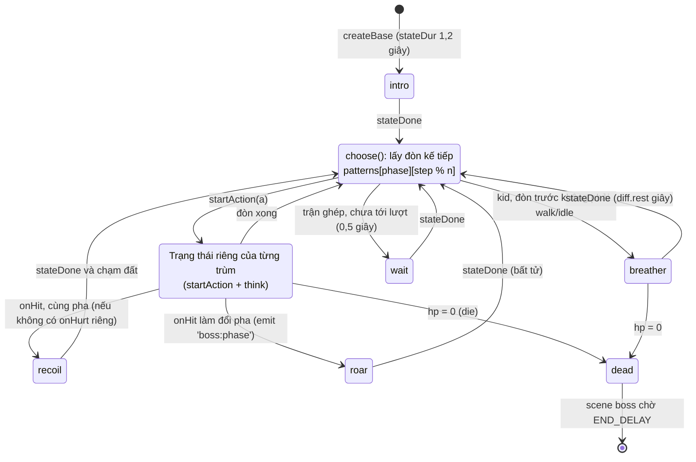
[(xem SVG)](svg/04-boss-base.svg)

**Cách đọc:** `b.update` trong [src/bosses/bosses.js](../../src/bosses/bosses.js) tự xử lý các trạng thái **chung** `roar`, `recoil`, `breather`, `wait`, `dead`;
mọi trạng thái khác chuyển cho `b.think` của từng trùm (đây là **template method**). `setState(s, dur)` đặt `state`, `stateT = 0`, `stateDur`;
`stateDone()` = `stateT >= stateDur`. Hai quy ước tên quan trọng:
- Trạng thái kết thúc bằng **`Wind`** (lấy đà) là **telegraph**: thời lượng nhân `diff.telegraph`, chế độ kid vẽ thêm vòng đếm ngược.
- Trạng thái trong `STUN_STATES = ['stuck', 'dizzy', 'rest']` là **khoảng hở**: thời lượng nhân `diff.stun`.

**Giẫm được khi nào:** `getWeakspot()` trả `null` khi đang `roar/recoil/intro`, khi bất tử, hoặc khi `isVulnerable()` của trùm nói không;
riêng `breather` trên mặt đất luôn giẫm được. Mũi tên "GIẪM!" được vẽ **đúng khi** `getWeakspot()` khác null → hình ảnh luôn khớp luật va chạm.

### 3.2 Dee Dee

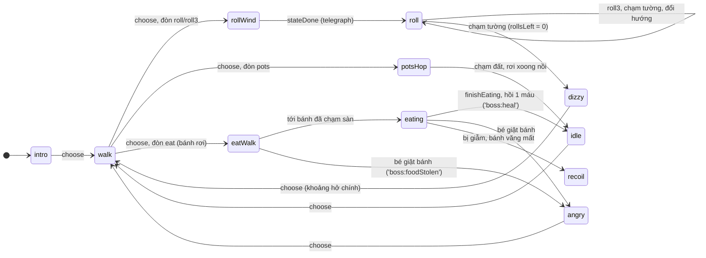
[(xem SVG)](svg/04-boss-deedee.svg)

Nguồn: `startAction`, `think`, `endRollAtWall`, `finishEating`, `onHurt` trong [src/bosses/deedee.js](../../src/bosses/deedee.js).
"`walk` → ..." nghĩa là "sau một lần `choose()`" (đòn kế tiếp theo `patterns`, không nhất thiết từ `walk`).
**Giẫm được** (`isVulnerable`): `walk, dizzy, eating, eatWalk, wait, idle, angry`. **Cả thân gây đau** (`isFullHurt`): `roll, rollWind, potsHop`.

### 3.3 Joey

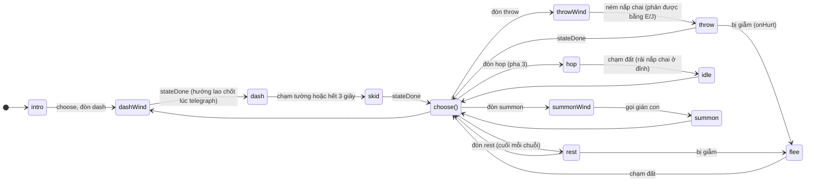
[(xem SVG)](svg/04-boss-joey.svg)

Nguồn: [src/bosses/joey.js](../../src/bosses/joey.js). Mỗi chuỗi trong `patterns` **kết thúc bằng `'rest'`** → luôn có khoảng hở định kỳ, kể cả pha 3.
`summon` tự đổi thành `throw` nếu sân đã đủ lính (`MAX_MINIONS`) — AI luôn có phương án dự phòng.
**Giẫm được:** `rest, throwWind, throw, summonWind, summon, skid, wait, idle`. **Cả thân gây đau:** `dash, hop, flee`.

### 3.4 Marky

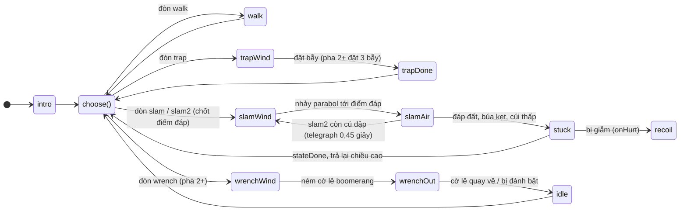
[(xem SVG)](svg/04-boss-marky.svg)

Nguồn: [src/bosses/marky.js](../../src/bosses/marky.js) (`startAction`, hàm nội bộ `beginSlam`, `think`, `onHurt`).
Marky **khó giẫm nhất**: `isVulnerable` chỉ đúng ở `stuck` và `wait`. ⚠️ Bẫy trong code: rời `stuck` (hoặc bị đánh, đổi pha, gục) phải gọi
`setHeight(b.fullH)`, quên một chỗ là hitbox "lùn" mãi.

### 3.5 Bộ ba (`trio`): điều phối lượt

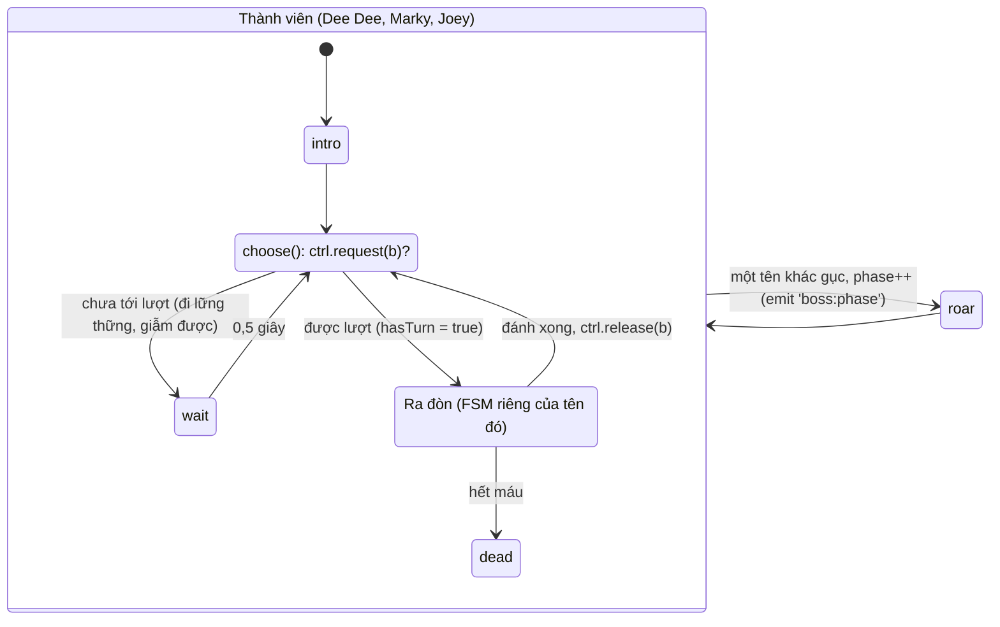
[(xem SVG)](svg/04-boss-trio.svg)

Nguồn: [src/bosses/trio.js](../../src/bosses/trio.js). `ctrl.idx` trỏ tới tên đang giữ lượt (bỏ qua tên đã gục); `release` chuyển lượt cho tên kế tiếp.
Các thành viên được tạo với `emitPhase: false`, `phaseAt: []` → chỉ `trio.onHit` quyết định pha (= 1 + số tên đã gục) và tự phát `boss:phase`.
`isDefeated()` = cả ba đã gục (không dựa vào tổng máu vì Dee Dee hồi máu được).
**Vì sao:** dùng **nguyên** AI của 3 trùm đơn, chỉ thêm một "token" lượt đánh → trận cuối khó vừa phải mà không phải viết AI mới.

### 3.6 Trận trùm ở cấp scene (`battle.phase`)

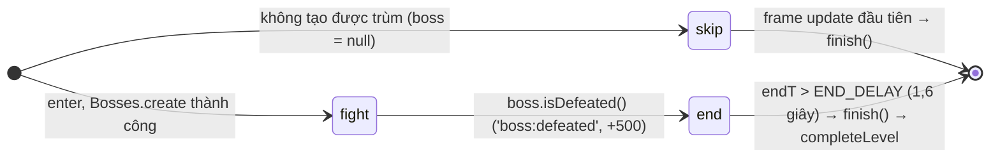
[(xem SVG)](svg/04-boss-battle.svg)

Nguồn: [src/game/boss-scene.js](../../src/game/boss-scene.js) (`BattleState.phase`, `checkBossDefeated`, `finish`). ⚠️ Bẫy được ghi trong code:
`skip` không gọi `finish()` ngay trong `enter` vì `enter` đang chạy bên trong `Scenes.go()`; đổi scene lồng vào đó làm rối thứ tự `exit/enter`.
Trong pha `end`, `Game.tickTime` không còn được gọi → thời gian xem trùm gục không tính vào thành tích.

---

## 4. Scene câu đố (`quiz`)

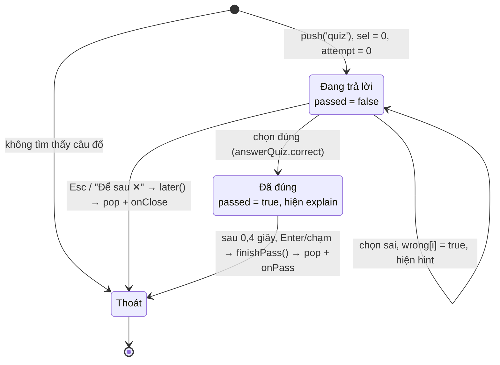
[(xem SVG)](svg/04-quiz.svg)

Nguồn: scene `quiz` trong [src/story/scenes.js](../../src/story/scenes.js) (`enter`, `choose`, `finishPass`, `later`, `update`). Ô đã chọn sai không chọn lại được
(`if (this.wrong[i]) return`). **Không có trạng thái "thua"** — đúng nguyên tắc "sai không phạt". Lựa chọn bắt đầu ở 0 và giữ nguyên khi sai
là **hợp đồng phím** mà smoke test dựa vào ([`STORY.md` mục 6.5](../STORY.md)).

---

## 5. Scene truyện tranh (`comic`)

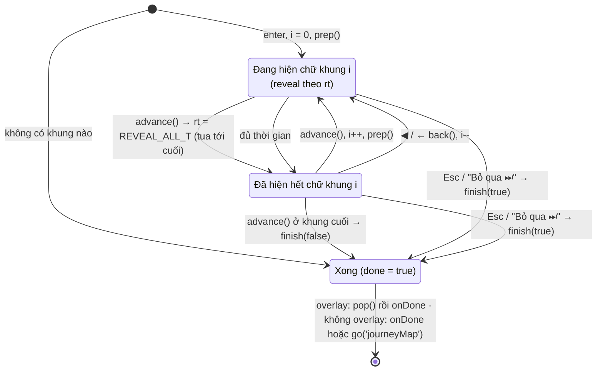
[(xem SVG)](svg/04-comic.svg)

Nguồn: scene `comic` trong [src/story/scenes.js](../../src/story/scenes.js) (`enter`, `prep`, `advance`, `back`, `finish`). `finish` luôn `markSeen` và phát
`comic:end` (kể cả khi bỏ qua). Cờ `done` chống gọi `finish` hai lần trong cùng frame (chạm "Bỏ qua" + Esc) — nếu không, `onDone` chạy hai lần → nhảy hai scene.
Mỗi khung có `INPUT_GRACE` (0,2 giây) bỏ qua phím "tiến" để một cú bấm không lướt qua hai khung.
Hai chế độ: `go('comic')` giữa các cảnh (che kín, `drawBelow = false`) và `push('comic', {overlay: true})` giữa màn chơi (thấy màn mờ phía sau).

---

## 6. Scene thẻ kiến thức (`card`)

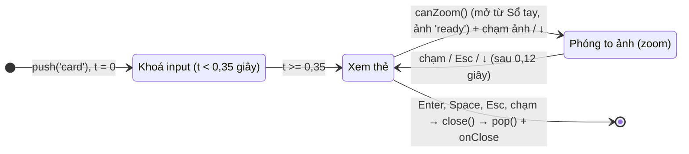
[(xem SVG)](svg/04-card.svg)

Nguồn: scene `card` trong [src/story/scenes.js](../../src/story/scenes.js). Khi `zoom = true`, `update` chỉ xử lý input của chế độ phóng to rồi `return` sớm —
comment trong code gọi đây là **trạng thái con** (FSM lồng nhau) mà không cần biến `state` riêng.

---

## 7. AudioContext

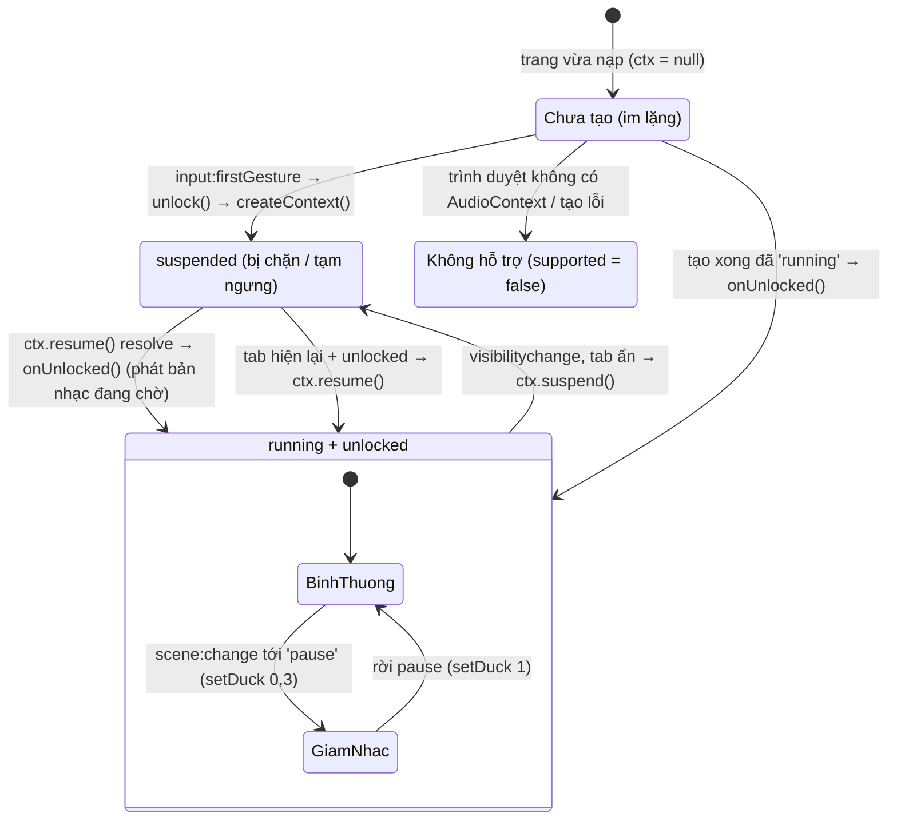
[(xem SVG)](svg/04-audio.svg)

Nguồn: [src/audio/audio.js](../../src/audio/audio.js) (`createContext`, `unlock`, `onUnlocked`, `ready`, `setDuck`, `bindDom`, `onSceneChange`).
`playSfx` chỉ phát khi `ready()` = có `ctx`, đã `unlocked`, `state !== 'closed'`. Trước khi mở khoá, `playMusic('menu')` chỉ ghi `currentTrack`;
`onUnlocked` sẽ bắt đầu bản đó.

**Vì sao:** **autoplay policy** — trình duyệt chặn trang tự phát tiếng khi người dùng chưa tương tác; tạo `AudioContext` lúc nạp trang sẽ ra
`suspended` kèm cảnh báo. Game đợi `input:firstGesture` (do [src/core/input.js](../../src/core/input.js) phát ở pha capture, kể cả khi bấm nút DOM).
`bindDom` còn nghe cử chỉ dự phòng (`_gestured`) phòng khi Input là bản stub. Ẩn tab thì `suspend()` để nhạc không chạy ngầm (sequencer tự chờ).
Mẹo iOS: phát một buffer im lặng 1 mẫu ngay trong cử chỉ đầu tiên.

---

## 8. Cổng câu đố và checkpoint

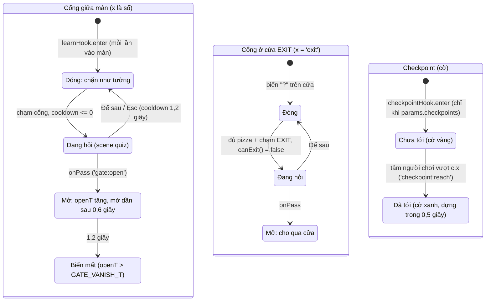
[(xem SVG)](svg/04-gate-checkpoint.svg)

Nguồn: `learnHook` (`enter`, `update`, `canExit`, `drawWorld`) và `openGate` trong [src/story/learn.js](../../src/story/learn.js) (kiểu `LearnGate`: `open`, `openT`);
`checkpointHook` trong [src/game/difficulty.js](../../src/game/difficulty.js) (kiểu `Checkpoint`: `reached`, `raiseT`, hằng `FLAG_RAISE_TIME`).

**Vì sao:** trạng thái cổng/cờ là **trạng thái chạy** trong `st.learn` / `st.checkpoints`, dựng lại ở mỗi lần vào màn → cổng **hỏi lại** (ôn tập),
cờ cắm lại. Checkpoint xét bằng "tâm vượt qua x" (không cần va chạm hitbox) để nhảy qua trên đầu cờ vẫn tính — dễ tha thứ cho trẻ em.
Checkpoint mặc định chỉ bật ở chế độ kid (`checkpoints: true`, cách nhau `checkpointSpacing` = 600 px nếu màn không ghi).

---

## 9. Ảnh chụp đang tải (PhotoRecord)

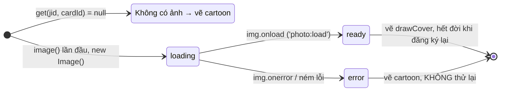
[(xem SVG)](svg/04-photo.svg)

Nguồn: `image`, `ready`, `loading`, `register` trong [src/story/photos.js](../../src/story/photos.js). Record nằm trong `cache['jid/cardId']`; gọi `register`
lại cho cùng thẻ sẽ `delete cache[...]` để nạp ảnh mới. Mỗi record đi `loading → ready | error` **đúng một lần**.
