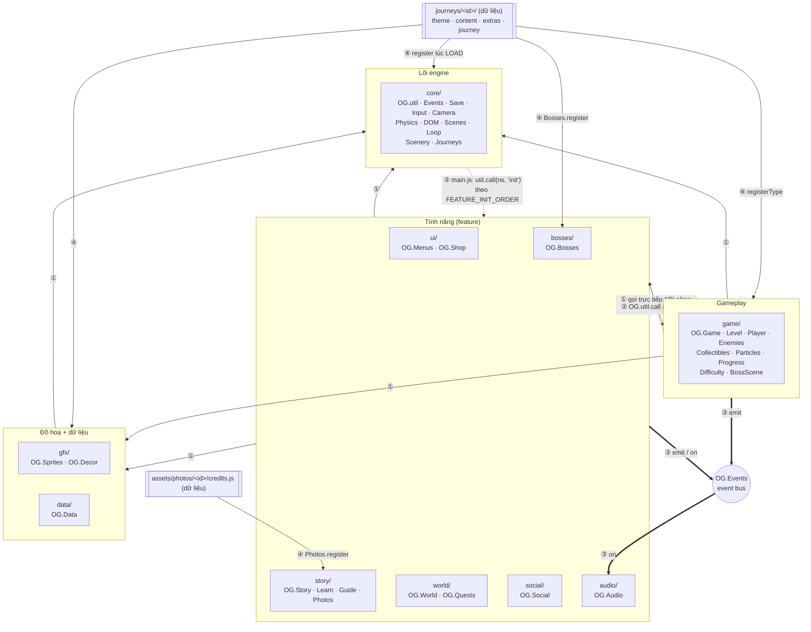
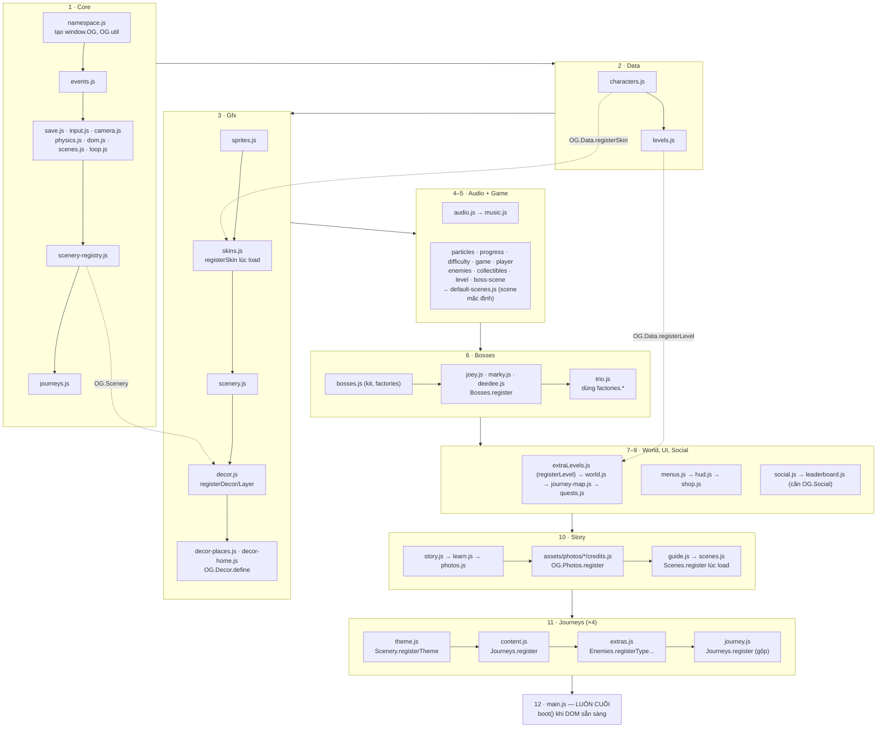
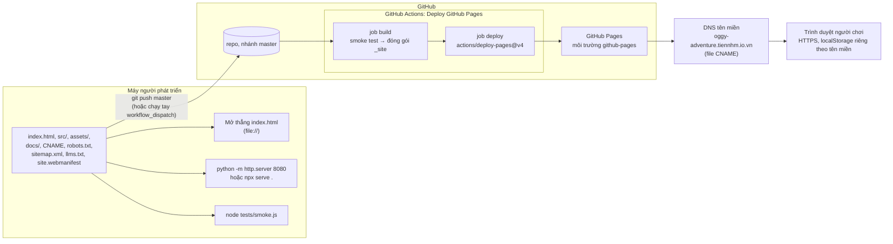
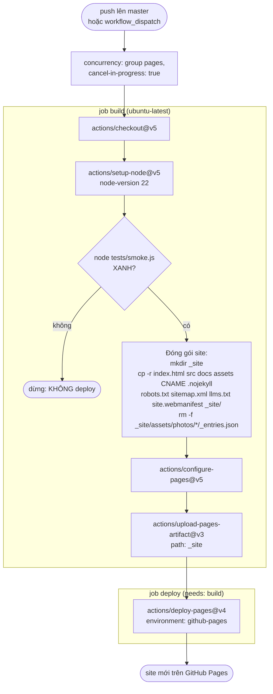
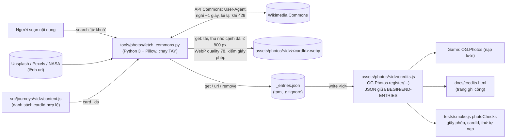

# 05 · Thành phần, thứ tự nạp và triển khai

Trang này trả lời ba câu hỏi: (a) code chia thành những **lớp** (layer) nào và lớp nào được gọi lớp nào; (b) vì sao thứ tự thẻ
`<script>` trong [index.html](../../index.html) lại như vậy; (c) từ máy bạn tới trình duyệt của người chơi, code đi qua những đâu.

Sơ đồ phụ thuộc **giữa các namespace** (ai gọi API của ai) đã có ở
[ARCHITECTURE-DIAGRAMS mục 1](../learn/ARCHITECTURE-DIAGRAMS.md#1-module-và-phụ-thuộc-giữa-các-namespace-og). Ở đây ta nhìn theo
**kênh giao tiếp** và **luật** hướng phụ thuộc.

Mục lục:
1. [Component diagram: các lớp và bốn kênh giao tiếp](#1-component-diagram-các-lớp-và-bốn-kênh-giao-tiếp)
2. [Luật hướng phụ thuộc (ma trận)](#2-luật-hướng-phụ-thuộc-ma-trận)
3. [Thứ tự nạp `<script>` và phụ thuộc lúc LOAD](#3-thứ-tự-nạp-script-và-phụ-thuộc-lúc-load)
4. [Deployment: từ máy bạn tới tên miền](#4-deployment-từ-máy-bạn-tới-tên-miền)
5. [Pipeline CI chi tiết](#5-pipeline-ci-chi-tiết)
6. [Dây chuyền ảnh: Wikimedia Commons → assets/photos](#6-dây-chuyền-ảnh-wikimedia-commons--assetsphotos)

---

## 1. Component diagram: các lớp và bốn kênh giao tiếp

[(xem SVG)](svg/05-components.svg)

**Bốn kênh giao tiếp:**

| Kênh | Hình | Dùng khi | Ví dụ thật |
|---|---|---|---|
| ① Gọi trực tiếp | mũi tên liền | lớp **trên** cần dịch vụ của lớp **dưới** (luôn có mặt) | `OG.Physics.moveBody` trong [src/game/player.js](../../src/game/player.js) |
| ② Gọi tuỳ chọn | nét đứt | lớp dưới cần "báo" lớp trên mà **không được phụ thuộc cứng** | `OG.util.call('Difficulty', 'softFail', ...)` trong [src/game/game.js](../../src/game/game.js) `loseLife` |
| ③ Event bus | mũi tên đậm | thông báo "đã xảy ra chuyện gì", không cần biết ai nghe | `emit('player:jump')` → Audio, Sprites nghe ([src/core/events.js](../../src/core/events.js)) |
| ④ Đăng ký lúc LOAD | mũi tên liền từ khối dữ liệu | dữ liệu / phần mở rộng **cắm vào** registry | `OG.Journeys.register` trong [src/journeys/home/journey.js](../../src/journeys/home/journey.js) |

**Vì sao bốn kênh:** mỗi kênh giải một bài toán khác nhau về **coupling** (độ dính giữa module). ① rõ ràng nhất nhưng dính chặt, nên chỉ cho đi
**xuống**. ② cho phép xoá hẳn một module tính năng (xoá thẻ `<script>`) mà game vẫn chạy. ③ cho nhiều người nghe một sự việc mà nơi phát không
phải sửa (thêm âm thanh mới = thêm listener trong `audio.js`). ④ là **inversion of control** (đảo ngược điều khiển): engine không có danh sách
hành trình, hành trình tự đăng ký.

**Đánh đổi:** ② và ③ khó lần theo hơn (không "Go to definition" được) — vì vậy có bảng `OG.EV` và sơ đồ luồng event ở tổng quan.

---

## 2. Luật hướng phụ thuộc (ma trận)

Hàng = lớp **gọi**, cột = lớp **bị gọi**. ✅ được gọi trực tiếp · 🔸 chỉ qua `OG.util.call` / event · ⛔ không được.

| gọi ↓ / bị gọi → | core | data | gfx | game | feature | journeys |
|---|---|---|---|---|---|---|
| **core** | ✅ | ⛔ (trừ `journeys.js` đọc lúc chạy) | ⛔ | ⛔ (trừ `main.js` gọi `Progress.init`) | 🔸 | ⛔ |
| **data** | ✅ | ✅ | ⛔ | ⛔ | ⛔ | ⛔ (`OG.Data.getLevel` tra `OG.Journeys`, ở core) |
| **gfx** | ✅ | ✅ | ✅ | đọc trạng thái lúc chạy (`OG.Level.state`, `OG.Game.run`) | ⛔ | ⛔ |
| **game** | ✅ | ✅ | ✅ | ✅ | 🔸 (`Bosses`, `Menus`, `Shop`, `Quests`, `Social`, `Story`) | ⛔ |
| **feature** | ✅ | ✅ | ✅ | ✅ | ✅ đọc/gọi API công khai, **không ghi đè** namespace khác | ⛔ |
| **journeys** | ✅ (đăng ký) | ✅ (`registerCharacter`) | ✅ (`Decor.define`) | ✅ (`Enemies.registerType`) | ✅ (`Bosses.register`) | ⛔ (hành trình không gọi nhau) |

Các luật này đến từ [`docs/ARCHITECTURE.md` mục 1 và 8](../ARCHITECTURE.md) ("mọi lời gọi từ core hoặc game vào module tính năng đi qua
`OG.util.call`") và bảng phụ thuộc đo bằng `grep` ở [ARCHITECTURE-DIAGRAMS mục 1.4](../learn/ARCHITECTURE-DIAGRAMS.md#14-bảng-phụ-thuộc-theo-thư-mục-lúc-chạy-lấy-từ-grep-oga-z).
Ngoại lệ có chủ đích: [src/core/journeys.js](../../src/core/journeys.js) đọc `OG.Bosses`, `OG.Progress` **lúc chạy** để kiểm tra dữ liệu.

**Vì sao:** hướng phụ thuộc một chiều = sửa UI không làm vỡ vật lý; `core/` có thể mang sang game khác. Đây là ý tưởng **layered architecture**
(kiến trúc phân tầng) và **dependency rule**: phụ thuộc chỉ chỉ vào trong / xuống dưới.

---

## 3. Thứ tự nạp `<script>` và phụ thuộc lúc LOAD

Mũi tên ở đây chỉ vẽ phụ thuộc **lúc LOAD** (file đọc `OG.X` ngay khi được nạp) — loại phụ thuộc **bắt buộc** thứ tự. Phụ thuộc lúc chạy không vẽ.

[(xem SVG)](svg/05-load-order.svg)

**Cách đọc:** khối là nhóm trong [index.html](../../index.html) (đánh số giống [`docs/ARCHITECTURE.md` mục 2](../ARCHITECTURE.md)), mũi tên đậm giữa
các khối là thứ tự nạp; mũi tên đứt là phụ thuộc lúc LOAD **vượt nhóm** đáng chú ý.

**Lý do của từng ràng buộc:**
- `namespace.js` **đầu tiên**: tạo `window.OG` và `OG.util` mà mọi file khác dùng ngay dòng `var OG = window.OG;`.
- `scenery-registry.js`, `journeys.js` thuộc **core** (không phải gfx/story) để dữ liệu hành trình đăng ký được mà không cần file vẽ nào.
- `skins.js` sau `characters.js` vì gọi `OG.Data.registerSkin` lúc nạp; `decor*.js` sau `scenery-registry.js` vì gọi `registerDecor/registerLayer`.
- `default-scenes.js` **cuối nhóm game**: đăng ký scene mặc định để module tính năng nạp sau **ghi đè** trong `init()`.
- `trio.js` sau `joey/marky/deedee.js` vì dùng `OG.Bosses.factories.*` lúc nạp (thiếu factory nào thì trận chỉ có các tên còn lại).
- `credits.js` (ảnh) sau `photos.js`: smoke test kiểm tra đúng điều này (`photoChecks` trong [tests/smoke.js](../../tests/smoke.js)).
- `scenes.js` của story gắn `OG.Story.drawComicPanel` lúc nạp nên sau `story.js`; nó đăng ký bản DOM dự phòng của `journeyMap`, còn bản canvas
  được [src/world/journey-map.js](../../src/world/journey-map.js) đăng ký trong `OG.World.init` (lúc **chạy**, nên thắng).
- Mỗi hành trình: `theme → content → extras → journey`. `journey.js` cuối vì tham chiếu chủ đề, thẻ, câu đố theo tên (được `validate` kiểm lúc boot).
- `main.js` **cuối cùng**: mọi `OG.X` đã có; `boot()` mới bắt đầu đọc `OG.Save.data` và gọi `init()`.

**Vì sao phải lo thứ tự:** không có ES modules thì trình duyệt không tự sắp xếp phụ thuộc như `import`; thứ tự thẻ `<script>` **là** đồ thị phụ thuộc.
Quy tắc giảm rủi ro: lúc LOAD **chỉ đăng ký**, mọi việc khác để lúc CHẠY (trong `init()` hoặc hàm), nên phần lớn phụ thuộc không quan tâm thứ tự.

---

## 4. Deployment: từ máy bạn tới tên miền

[(xem SVG)](svg/05-deployment.svg)

**Cách đọc:** chỉ có **file tĩnh**, không có máy chủ ứng dụng hay cơ sở dữ liệu. Bên trái là ba cách chạy ở máy bạn
(xem [README.md](../../README.md) phần cách chạy): mở thẳng `file://` (game cố ý hỗ trợ), hoặc server tĩnh (tránh trình duyệt chặn `localStorage` qua `file://`).
Push lên `master` kích hoạt workflow [.github/workflows/pages.yml](../../.github/workflows/pages.yml). File `CNAME` chứa tên miền riêng; GitHub Pages phục vụ
site dưới tên miền đó.

**Vì sao:** game thuần client nên GitHub Pages (miễn phí, có HTTPS) là đủ. HTTPS còn cần cho `navigator.clipboard` và `navigator.share`
(chỉ có trong *secure context*). Dữ liệu người chơi nằm trong `localStorage` **của trình duyệt** theo từng tên miền — đổi tên miền thì người chơi
"mất" save (dữ liệu vẫn ở tên miền cũ), nên tên miền cũng là một phần hợp đồng dữ liệu.

---

## 5. Pipeline CI chi tiết

[(xem SVG)](svg/05-ci.svg)

**Cách đọc:** đúng từng bước trong [.github/workflows/pages.yml](../../.github/workflows/pages.yml). Quyền tối thiểu: `contents: read`, `pages: write`, `id-token: write`.

**Vì sao:**
- **Smoke test làm cổng chặn**: [tests/smoke.js](../../tests/smoke.js) nạp mọi script bằng `vm` với DOM giả ([tests/fake-dom.js](../../tests/fake-dom.js)) và chơi hết game;
  đỏ thì không deploy. Không có build step nên đây là "bước biên dịch" duy nhất bắt lỗi.
- **Đóng gói có chọn lọc** (danh sách trắng thư mục): `tests/`, `legacy/`, `tools/` không lên mạng; `_entries.json` (file tạm của công cụ ảnh) bị xoá.
  File public mới (vd một trang HTML ở gốc) **phải thêm vào lệnh `cp`**, nếu không sẽ không được deploy.
- `.nojekyll`: tắt Jekyll của GitHub Pages để phục vụ nguyên file (Jekyll bỏ qua thư mục/file bắt đầu bằng `_`).
- `concurrency` + `cancel-in-progress`: push liên tiếp chỉ deploy bản mới nhất.

---

## 6. Dây chuyền ảnh: Wikimedia Commons → assets/photos

[(xem SVG)](svg/05-photo-pipeline.svg)

**Cách đọc:** công cụ chạy **trên máy người soạn**, không nằm trong game và không được deploy. Lệnh `search`, `get`, `url`, `write`, `list`, `remove`
mô tả ở đầu [tools/photos/fetch_commons.py](../../tools/photos/fetch_commons.py). Đầu ra là ảnh WebP + `credits.js`; game và trang
[docs/credits.html](../credits.html) đều đọc `credits.js` qua `OG.Photos.register` ([src/story/photos.js](../../src/story/photos.js)).

**Vì sao:**
- **Ảnh nằm trong repo, không hotlink** (nhúng thẳng link ảnh Commons): chạy được offline/`file://`, không phụ thuộc máy chủ người khác, kích thước đã tối ưu,
  và ghi công được kiểm soát ([ADR-09](06-design-decisions.md#adr-09-ảnh-chụp-lưu-trong-repo--ghi-công-không-hotlink)).
- **Sinh code từ dữ liệu** (`credits.js`): vẫn là JSON hợp lệ giữa hai dấu mốc để công cụ và smoke test đọc lại bằng `json.loads` / `JSON.parse`.
- **Một danh sách trắng giấy phép dùng ở ba nơi** (công cụ, `OG.Photos.licenseOk`, smoke test) → ảnh sai giấy phép bị chặn ở cả lúc soạn, lúc chạy và lúc CI.
