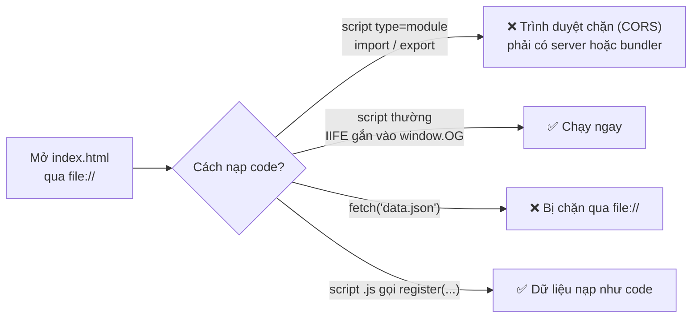
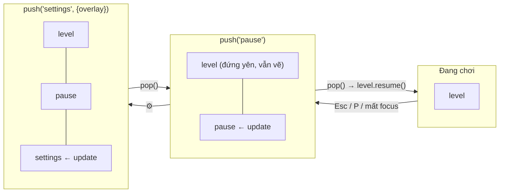
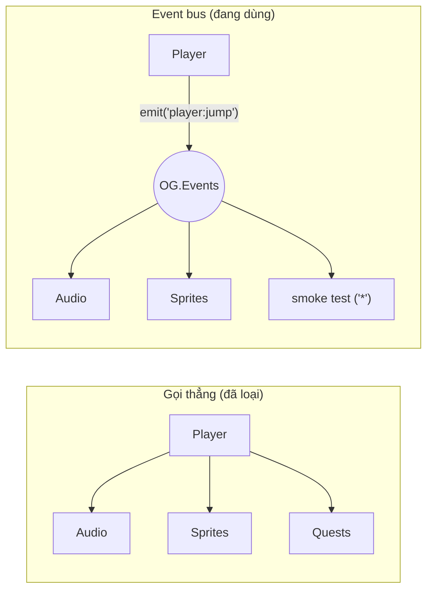
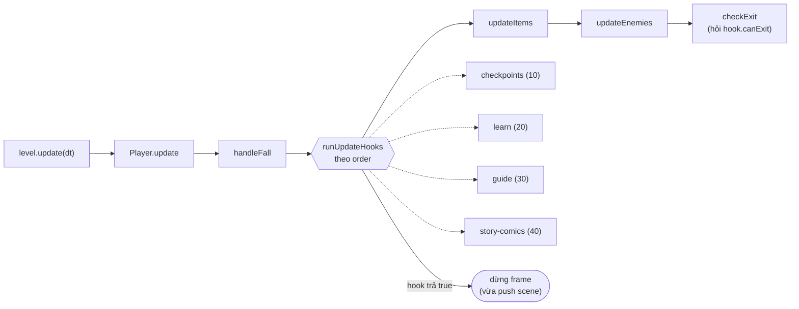
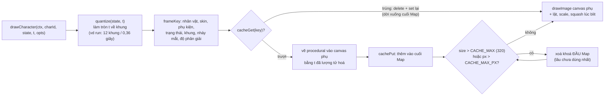
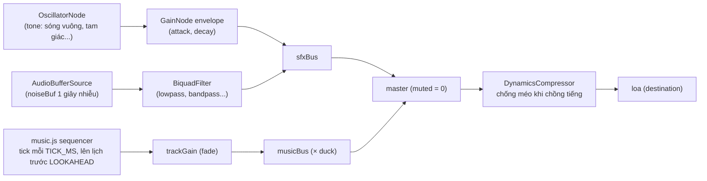
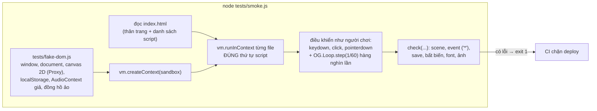

# 06 · Bản ghi quyết định thiết kế (ADR)

**ADR** (Architecture Decision Record — bản ghi quyết định kiến trúc) là một ghi chú ngắn trả lời: *lúc đó bối cảnh thế nào, ta chọn gì,
hệ quả ra sao, và đã cân nhắc những phương án nào khác*. Đọc ADR giúp bạn hiểu **vì sao** code trông như vậy trước khi định "sửa cho đẹp".

Mỗi bản ghi có bốn phần: **Bối cảnh** · **Quyết định** · **Hệ quả** (✅ được / ⚠️ phải trả giá) · **Phương án đã loại**.

| # | Quyết định | Ảnh hưởng tới |
|---|---|---|
| [ADR-01](#adr-01-không-build-step-không-es-modules-namespace-og--iife) | Không build step, không ES modules; namespace `OG` + IIFE | mọi file |
| [ADR-02](#adr-02-scene-stack-gopushpop-thay-vì-một-biến-scene-hiện-tại) | Scene stack (`go/push/pop`) | `core/scenes.js`, pause, popup |
| [ADR-03](#adr-03-event-bus-để-tách-module) | Event bus để tách module | Audio, Quests, HUD, Sprites FX |
| [ADR-04](#adr-04-hành-trình-hướng-dữ-liệu-data-driven) | Hành trình hướng dữ liệu, có compile + validate | `core/journeys.js`, `src/journeys/` |
| [ADR-05](#adr-05-mở-rộng-màn-chơi-bằng-level-hook) | Mở rộng màn chơi bằng level hook | `game/level.js`, story, difficulty |
| [ADR-06](#adr-06-vẽ-procedural-bằng-canvas--cache-khung-hình-lru) | Vẽ procedural bằng Canvas + cache khung hình LRU | `gfx/` |
| [ADR-07](#adr-07-âm-thanh-tổng-hợp-bằng-web-audio-không-dùng-file) | Âm thanh tổng hợp bằng Web Audio | `audio/` |
| [ADR-08](#adr-08-một-khoá-localstorage-có-version--gộp-mặc-định) | Một khoá `localStorage`, có `v` + gộp mặc định | `core/save.js` |
| [ADR-09](#adr-09-ảnh-chụp-lưu-trong-repo--ghi-công-không-hotlink) | Ảnh chụp lưu trong repo + ghi công, không hotlink | `story/photos.js`, `assets/`, `tools/` |
| [ADR-10](#adr-10-smoke-test-bằng-dom-giả-không-dùng-framework-test) | Smoke test bằng DOM giả, không framework test | `tests/`, CI |

---

## ADR-01. Không build step, không ES modules, namespace OG + IIFE

**Bối cảnh.** Đây là giáo trình: sinh viên (và trẻ em chơi thử) phải mở được game bằng **nhấp đúp `index.html`**, không cài Node, không chạy
`npm install`. Trình duyệt **chặn ES modules qua `file://`** (script `type="module"` bị coi là khác nguồn — CORS), và cũng chặn `fetch()` file cục bộ.

[(xem SVG)](svg/06-adr01-file-protocol.svg)

**Quyết định.** Mỗi file là một IIFE `'use strict'`, đọc `var OG = window.OG;` và gắn đúng một namespace (`OG.Scenes`, `OG.Learn`...).
Không bundler, không transpile, cú pháp ES5/ES2015 vừa phải. Dữ liệu (hành trình, ảnh) cũng là file `.js` gọi hàm đăng ký.
Kiểm tra kiểu làm bằng JSDoc + [src/types.d.ts](../../src/types.d.ts) + `// @ts-check` (chỉ VS Code/tsc đọc, trình duyệt bỏ qua).

**Hệ quả.**
- ✅ Không công cụ nào đứng giữa code và trình duyệt: sinh viên sửa một dòng, F5 là thấy. Code trên GitHub Pages **chính là** code trong repo.
- ✅ Module tính năng có thể vắng mặt (gọi qua `OG.util.call` trong [src/core/namespace.js](../../src/core/namespace.js)).
- ⚠️ Thứ tự `<script>` trong [index.html](../../index.html) **là** đồ thị phụ thuộc, phải giữ tay ([05 mục 3](05-component-deployment.md#3-thứ-tự-nạp-script-và-phụ-thuộc-lúc-load)).
- ⚠️ Mọi thứ là toàn cục: trùng tên namespace là ghi đè im lặng → quy ước sở hữu namespace ([`docs/ARCHITECTURE.md` mục 1](../ARCHITECTURE.md)), tiền tố `<jid>-` cho id riêng.
- ⚠️ ~70 thẻ `<script>` = ~70 request; chấp nhận được với site tĩnh nhỏ, trình duyệt tải song song.

**Phương án đã loại.** ES modules + Vite/webpack (cần server và bước build, mất khả năng `file://`); một file JS khổng lồ (không chia việc được cho
nhiều người/agent cùng lúc); AMD/RequireJS (thư viện ngoài, khái niệm lỗi thời để dạy). Bài học: [01-module-pattern-iife-namespace.md](../learn/01-module-pattern-iife-namespace.md).

---

## ADR-02. Scene stack (go/push/pop) thay vì một biến "scene hiện tại"

**Bối cảnh.** Game có ~20 màn hình. Nhiều màn hình phải **đè lên** màn chơi mà không huỷ nó: tạm dừng, cài đặt từ tạm dừng, thẻ kiến thức,
câu đố, truyện chen giữa màn. Khi đóng, màn chơi phải tiếp tục đúng chỗ cũ, và thời gian đè lên **không** được tính vào thời gian chơi.

[(xem SVG)](svg/06-adr02-stack.svg)

**Quyết định.** `OG.Scenes` ([src/core/scenes.js](../../src/core/scenes.js)) giữ một ngăn xếp. `go` thay cả stack; `push` đè lên; `pop` gỡ và gọi
`resume()` của scene lộ ra. Chỉ scene **trên cùng** được `update`; `draw` vẽ từ scene thấp nhất còn nhìn thấy (`drawBelow`). Mỗi lần đổi scene gọi
`OG.Input.reset()` và phát `scene:change`.

**Hệ quả.**
- ✅ "Tạm dừng" miễn phí: màn chơi không được `update` nên không cần cờ `isPaused` ở Player, Enemies, Bosses...; `Game.tickTime` cũng dừng.
- ✅ Popup học tập (thẻ, câu đố) là scene bình thường, tái dùng được từ màn chơi lẫn Sổ tay.
- ⚠️ Callback sau `pop` phải gọi **sau** khi pop (bẫy được ghi trong `comic.finish`); scene đang trong `enter` không nên đổi scene ngay (bẫy `skip` của scene boss).
- ⚠️ Hai dạng chuyển (`go` vs `push`) phải chọn đúng: dùng `go` cho câu đố sẽ **huỷ** màn chơi.

**Phương án đã loại.** Một biến `current` + cờ `paused` rải khắp nơi; FSM phẳng không có stack (không quay lại được đúng chỗ);
DOM overlay riêng cho mỗi popup (logic phân tán giữa canvas và DOM). Sơ đồ chuyển scene: [ARCHITECTURE-DIAGRAMS mục 2](../learn/ARCHITECTURE-DIAGRAMS.md#2-state-machine-các-scene).

---

## ADR-03. Event bus để tách module

**Bối cảnh.** Một cú nhảy cần: âm thanh, bụi dưới chân, (có thể) đếm nhiệm vụ. Nếu `player.js` gọi thẳng `OG.Audio.sfx('jump')`, `OG.Sprites.fx...`,
`OG.Quests...` thì gameplay phụ thuộc vào mọi module tính năng; thiếu một file là lỗi; nhiều người cùng sửa một hàm.

[(xem SVG)](svg/06-adr03-bus.svg)

**Quyết định.** `OG.Events` ([src/core/events.js](../../src/core/events.js)) với `on/off/once/emit` và wildcard `'*'`; tên chuẩn trong `OG.EV`
dạng `'<chủ thể>:<việc vừa xảy ra>'`; payload luôn là **một object**. Listener lỗi bị bắt (`OG.util.safe`), không làm sập frame.
Quy ước: event để **thông báo** việc đã xảy ra; khi cần **kết quả** (vd `softFail` trả `true/false`) thì gọi hàm qua `OG.util.call`.

**Hệ quả.**
- ✅ Thêm người nghe mà không sửa nơi phát (Audio cho mọi event v2 được thêm sau, chỉ sửa `audio.js`).
- ✅ Smoke test nghe `'*'` để đếm mọi event, kiểm tra luồng mà không cần "móc" vào code.
- ⚠️ Khó lần theo ("ai nghe event này?") → cần bảng [ARCHITECTURE-DIAGRAMS mục 3.5](../learn/ARCHITECTURE-DIAGRAMS.md#35-bảng-đầy-đủ-mọi-hằng-trong-ogev).
- ⚠️ Chuỗi tên event là API: đổi `'item:collect'` thì mọi listener **im lặng** ngừng chạy. Quên `off()` khi scene thoát = rò listener (smoke test đếm số listener).
- ⚠️ Thứ tự emit là hợp đồng (vd `player:hurt` trước `player:die` trước `game:over`).

**Phương án đã loại.** Gọi thẳng; `CustomEvent` trên `window` (payload kém tiện, khó test trong Node); thư viện EventEmitter (thư viện ngoài).
Bài học: [06-event-bus-observer.md](../learn/06-event-bus-observer.md).

---

## ADR-04. Hành trình hướng dữ liệu (data-driven)

**Bối cảnh.** Bản v2 thêm 4 hành trình, 38 màn, hàng trăm thẻ/câu đố/khung truyện do **nhiều người viết song song** (mỗi hành trình một agent),
nhiều người không phải lập trình viên game. Nội dung phải sửa được mà không đụng engine, và **lỗi gõ** (id thẻ sai) không được làm sập game của trẻ.

**Quyết định.** Mỗi hành trình là một thư mục `src/journeys/<id>/` gồm `theme.js → content.js → extras.js → journey.js`, chỉ chứa **object thuần**
gọi `OG.Journeys.register` (gộp nhiều lần theo id). Lúc boot, `OG.Journeys.init()` chạy `validateAll` (hành trình lỗi bị gắn `invalid` và ẩn) rồi
`compileAll` (điền mặc định, mượn hình học màn v1 qua `from`, gắn field điều hướng). Engine chỉ đọc bản đã biên dịch.
Chi tiết dữ liệu: [01 mục 1–3](01-data-model.md#1-nội-dung-một-hành-trình).

**Hệ quả.**
- ✅ Thêm hành trình thứ 5 = thêm 4 file + 4 thẻ `<script>`, không sửa engine.
- ✅ Lỗi dữ liệu có **đường dẫn rõ ràng** (`home.levels.home-kitchen-1.pages[0].card: thẻ "x" không tồn tại`) và không làm sập game.
- ✅ Tách "dữ liệu gốc / bản biên dịch / trạng thái chạy" → chơi lại màn luôn sạch.
- ⚠️ Không có kiểm tra kiểu lúc soạn (ngoài JSDoc); ràng buộc nằm trong code `validate*` và phải được bảo trì cùng định dạng.
- ⚠️ Tham chiếu bằng chuỗi id → đổi tên id phải đổi mọi nơi tham chiếu.

**Phương án đã loại.** Viết màn bằng code (mỗi màn một hàm — khó cho người soạn nội dung, khó validate); file JSON (bị chặn qua `file://`, không chứa
được hàm `drawIcon`); trình soạn màn trực quan (quá lớn so với phạm vi).

---

## ADR-05. Mở rộng màn chơi bằng level hook

**Bối cảnh.** Hành trình cần thêm vào màn chơi: trang sách, cổng câu đố, NPC, checkpoint, truyện chen giữa màn. Bốn tính năng này do bốn nhóm khác nhau
làm, trong khi [src/game/level.js](../../src/game/level.js) là vùng nhạy cảm (vật lý, giẫm địch, cửa ra) mà chiến dịch cổ điển cũng dùng.

[(xem SVG)](svg/06-adr05-hooks.svg)

**Quyết định.** `OG.Level.addHook({id, order, enter, update, canExit, drawWorld, drawFront, drawScreen})` (interface `LevelHook` trong
[src/types.d.ts](../../src/types.d.ts)). `level.js` gọi các hook ở các "khe" cố định; hook trả `true` từ `update` để dừng frame, `false` từ `canExit` để chặn cửa.
Trạng thái riêng của hook gắn vào `st` (`st.learn`, `st.checkpoints`, `st.guideSpots`).

**Hệ quả.**
- ✅ `level.js` không có dòng nào về checkpoint, trang sách hay NPC; màn cổ điển chạy y như cũ (`st.journeyId = null` → hook tự tắt).
- ✅ Mỗi nhóm làm trong file của mình ([difficulty.js](../../src/game/difficulty.js), [learn.js](../../src/story/learn.js), [guide.js](../../src/story/guide.js), [story.js](../../src/story/story.js)).
- ⚠️ `order` là hợp đồng ngầm; đọc riêng `level.js` không thấy hết hành vi của màn.
- ⚠️ Hook dùng chung `st` → phải tránh trùng tên field.

**Phương án đã loại.** Viết thẳng vào `level.js` (xung đột khi nhiều người sửa, phình to); scene `journeyLevel` riêng (nhân đôi toàn bộ gameplay).

---

## ADR-06. Vẽ procedural bằng Canvas + cache khung hình LRU

**Bối cảnh.** Ràng buộc dự án: không ảnh/âm thanh từ bên ngoài, không công cụ vẽ (sinh viên chỉ có code). Nhân vật cần nhiều tư thế (14 trạng thái),
nhiều skin (đổi màu), phụ kiện (nón lá, mũ nồi...), và phải nét ở mọi độ phân giải. Nhưng vẽ một nhân vật bằng lệnh Canvas tốn hàng trăm lệnh mỗi frame.

[(xem SVG)](svg/06-adr06-cache.svg)

**Quyết định.** Mọi hình vẽ bằng Canvas 2D theo **thời gian** (`Pose(t)`), không sprite sheet. [src/gfx/sprites.js](../../src/gfx/sprites.js) **lượng tử hoá**
thời gian (`quantize`) để nhiều frame game dùng chung một khung, vẽ khung vào **canvas phụ**, cache trong `Map` theo LRU với **hai** ngân sách (số khung
và tổng điểm ảnh). Những gì rẻ (lật hướng, alpha, scale, squash khi tiếp đất, chữ "BỐP!") áp **lúc blit**, không làm phình cache. Decor dùng cache
FIFO đơn giản hơn ([src/gfx/decor.js](../../src/gfx/decor.js), hàm `remember`).

**Hệ quả.**
- ✅ Không file ảnh nhân vật nào; skin mới = bộ màu mới; phụ kiện = vài hàm vẽ. Sắc nét ở mọi kích thước (cache theo độ phân giải).
- ✅ Hiệu năng gần như sprite sheet sau khi cache "ấm" (`OG.Sprites.cacheStats()` xem tỉ lệ trúng).
- ✅ Dạy được nhiều khái niệm: path, transform, `save/restore`, squash & stretch, memoization, LRU bằng `Map`.
- ⚠️ Code vẽ rất dài (`sprites.js` > 3000 dòng); hoạt ảnh bị "giật nhẹ" theo số khung đã chọn (đánh đổi bộ nhớ ↔ độ mượt trong `ANIM_INFO`).
- ⚠️ Môi trường không có `document` (Node) thì cache tự tắt — smoke test vẽ thẳng lên canvas giả.

**Phương án đã loại.** Sprite sheet PNG (cần hoạ sĩ + công cụ, trái ràng buộc "không asset ngoài"; mỗi skin một sheet); SVG/DOM cho nhân vật
(chậm khi nhiều đối tượng, khó trộn với canvas); vẽ procedural **không** cache (FPS tụt trên điện thoại khi có trùm phóng to + nhiều kẻ địch).
Bài học: [07-ve-canvas-procedural-cache.md](../learn/07-ve-canvas-procedural-cache.md).

---

## ADR-07. Âm thanh tổng hợp bằng Web Audio (không dùng file)

**Bối cảnh.** Cùng ràng buộc "không asset ngoài" và chạy qua `file://`. Game cần ~25 hiệu ứng và ~10 bản nhạc nền đổi theo scene, có âm lượng riêng
nhạc/hiệu ứng, tắt tiếng, và không bao giờ làm game lỗi khi trình duyệt không cho phát tiếng.

[(xem SVG)](svg/06-adr07-audio.svg)

**Quyết định.** [src/audio/audio.js](../../src/audio/audio.js) tổng hợp mọi âm thanh bằng oscillator + noise + envelope, nối vào đồ thị bus;
[src/audio/music.js](../../src/audio/music.js) là sequencer: bản nhạc là **dữ liệu chữ** (`TrackDef`), biên dịch một lần thành lưới bước, lên lịch nốt bằng
đồng hồ chính xác của `AudioContext` (lookahead scheduling). Audio **tự nghe event** (ADR-03) và chỉ tạo `AudioContext` sau `input:firstGesture`
(autoplay policy, [04 mục 7](04-state-machines.md#7-audiocontext)).

**Hệ quả.**
- ✅ 0 byte file âm thanh; đổi cao độ theo nhân vật (`CHAR_PITCH`), lệch ngẫu nhiên nhẹ (`PITCH_JITTER`) để bớt nhàm.
- ✅ Âm thanh "trung thành" với từng sự kiện trong game (vd câu trả lời sai chỉ có âm trầm nhẹ, không có âm "thua").
- ⚠️ Âm sắc giới hạn (kiểu chiptune); soạn nhạc bằng chữ khó với người không biết nhạc lý.
- ⚠️ Phải xử lý nhiều trường hợp trình duyệt: `suspended`, tab ẩn, iOS cần buffer im lặng, giới hạn số voice (`MAX_VOICES`).

**Phương án đã loại.** File MP3/OGG (asset ngoài, nặng, cần preload); thư viện Howler/Tone.js (thư viện ngoài); `<audio>` element (độ trễ cao, khó trộn nhiều tiếng).
Bài học: [10-web-audio.md](../learn/10-web-audio.md).

---

## ADR-08. Một khoá localStorage có version + gộp mặc định

**Bối cảnh.** Game không có máy chủ; mọi tiến độ (xu, sao, thẻ, câu đố, nhiệm vụ, cài đặt) phải sống trong trình duyệt. Phiên bản game thay đổi
thường xuyên (MVP → v1 → v2) và mỗi lần thêm field mới; người chơi cũ **không được mất dữ liệu**. `localStorage` có thể bị chặn hoặc chứa JSON hỏng.

**Quyết định.** [src/core/save.js](../../src/core/save.js): **một** object `OG.Save.data` dưới **một** khoá `oggyAdventure.save.v1`, có field `v`.
`load()` = `merge(defaults(), JSON.parse(raw))` (deep merge, mảng thay nguyên) + migrate kỷ lục từ khoá `oggyBest` của bản MVP. Mọi truy cập qua `OG.Save`
(cấm gọi `localStorage` trực tiếp), bọc `try/catch`. Module tính năng ghi vào ngăn riêng `ext.<tên>` qua `OG.Save.ns(name)`.
Sơ đồ: [01 mục 9–10](01-data-model.md#9-dữ-liệu-lưu-savedata-trong-localstorage), [03 luồng f](03-sequence-flows.md#f-lưu-tải-và-migrate-dữ-liệu).

**Hệ quả.**
- ✅ Thêm field = thêm vào `defaults()`; save cũ tự nhận giá trị mặc định, không cần code migrate.
- ✅ JSON hỏng / storage bị chặn → game vẫn chạy (dữ liệu trong RAM), `OG.Save.available` cho biết.
- ✅ Namespace `ext` → không module nào ghi đè dữ liệu của module khác.
- ⚠️ Deep merge không xử lý được **đổi tên/đổi kiểu** field; khi cần, phải viết nhánh theo `v` (hiện `v` luôn là 1, chưa có nhánh nào — xem ghi chú [01 mục 10](01-data-model.md#10-các-thế-hệ-dữ-liệu-lưu-và-cách-nâng-cấp)).
- ⚠️ Ghi toàn bộ object mỗi lần `commit()`; dữ liệu theo tên miền, xoá dữ liệu trình duyệt là mất.

**Phương án đã loại.** Nhiều khoá rời (khó reset, dễ lệch nhau); IndexedDB (API bất đồng bộ phức tạp hơn nhiều cho lượng dữ liệu vài KB); cookie (gửi lên
máy chủ mỗi request, giới hạn 4 KB); lưu trên máy chủ (cần backend, tài khoản — chỉ bảng xếp hạng online là tuỳ chọn). Bài học: [11-luu-tru-migrate.md](../learn/11-luu-tru-migrate.md).

---

## ADR-09. Ảnh chụp lưu trong repo + ghi công, không hotlink

**Bối cảnh.** Thẻ kiến thức (Hồ Gươm, kim tự tháp, Sao Mộc...) dạy tốt hơn khi có **ảnh thật** cạnh hình cartoon. Ảnh tự do (CC BY, CC BY-SA, Public Domain)
**bắt buộc ghi công** đúng; một số giấy phép (NC, ND) không dùng được vì game phân phối công khai và ảnh bị thu nhỏ (bản phái sinh).

**Quyết định.** Công cụ [tools/photos/fetch_commons.py](../../tools/photos/fetch_commons.py) tải ảnh **về repo** (`assets/photos/<jid>/<cardId>.webp`, cạnh dài ≤ 800 px),
kiểm giấy phép bằng danh sách trắng, sinh `credits.js` gọi `OG.Photos.register`. Game nạp ảnh **lười** ([src/story/photos.js](../../src/story/photos.js)), luôn vẽ dòng
ghi công dưới ảnh, có trang [docs/credits.html](../credits.html). Thiếu/lỗi ảnh → quay về hình cartoon. Sơ đồ: [05 mục 6](05-component-deployment.md#6-dây-chuyền-ảnh-wikimedia-commons--assetsphotos),
[03 luồng g](03-sequence-flows.md#g-tải-ảnh-lười-lazy-cho-thẻ--fallback).

**Hệ quả.**
- ✅ Chạy offline và qua `file://`; không phụ thuộc máy chủ ảnh của người khác (link chết, đổi URL, chặn hotlink, theo dõi người dùng).
- ✅ Dung lượng kiểm soát được (WebP nhỏ) — quan trọng với điện thoại của trẻ em.
- ✅ Giấy phép được kiểm ở ba lớp: công cụ, `licenseOk` lúc chạy, `photoChecks` trong smoke test.
- ⚠️ Repo nặng thêm (hơn 70 ảnh); cập nhật ảnh phải qua công cụ (sửa tay `credits.js` sẽ bị lần `write` sau ghi đè).

**Phương án đã loại.** Hotlink trực tiếp tới `upload.wikimedia.org` (phụ thuộc mạng, ảnh gốc rất nặng, vi phạm tinh thần "không asset ngoài");
nhúng ảnh base64 trong JS (phình file, không cache riêng được); bỏ ảnh thật (mất giá trị giáo dục).

---

## ADR-10. Smoke test bằng DOM giả, không dùng framework test

**Bối cảnh.** Không build step, không thư viện ngoài, CI chỉ có `node`. Nhưng game có hàng chục module do nhiều agent viết song song; cần một lưới an toàn
**đầu-cuối** (end-to-end) bắt được: lỗi runtime khi nạp, scene không chuyển đúng, hành trình dữ liệu lỗi, `ctx.save/restore` lệch, rò listener...

[(xem SVG)](svg/06-adr10-smoke.svg)

**Quyết định.** Tự viết DOM giả tối thiểu ([tests/fake-dom.js](../../tests/fake-dom.js)) và một script ([tests/smoke.js](../../tests/smoke.js)) nạp **đúng thứ tự** của
`index.html` trong `vm` sandbox, rồi "chơi" hết game bằng event giả + `OG.Loop.step` với bước cố định 1/60 giây (tất định). Mọi `console.error`, ngoại lệ
trong frame/listener/timer, `save/restore` lệch, `alert/confirm/prompt` đều là lỗi. CI chạy nó trước mỗi lần deploy ([05 mục 5](05-component-deployment.md#5-pipeline-ci-chi-tiết)).

**Hệ quả.**
- ✅ Không phụ thuộc gì ngoài Node; chạy ~30–40 giây và **chơi hết 4 hành trình** + chiến dịch cổ điển.
- ✅ Kiểm tra cả hợp đồng dữ liệu (`OG.Journeys.validate`), quy tắc nội dung (cấm font thiếu dấu tiếng Việt, giấy phép ảnh) chứ không chỉ code.
- ✅ Game được thiết kế để **test được**: `OG.Loop.step`, `OG.BossScene.getBoss()`, `OG.World.journeyMap.selected()`... là "cửa" cho test.
- ⚠️ Không thấy lỗi hiển thị (không có pixel thật, không layout); không phải unit test nên lỗi báo ở mức "luồng nào hỏng", phải đọc `stage` để khoanh vùng.
- ⚠️ Game dùng API DOM mới mà DOM giả chưa có → phải bổ sung vào `fake-dom.js` (comment trong file: đừng sửa game để né test).

**Phương án đã loại.** Jest/Mocha + jsdom (thư viện ngoài, cài đặt nặng); Playwright/Puppeteer (cần trình duyệt headless trong CI, chậm, nhiều phụ thuộc);
chỉ test tay (không bắt được hồi quy khi 7 agent sửa song song).
