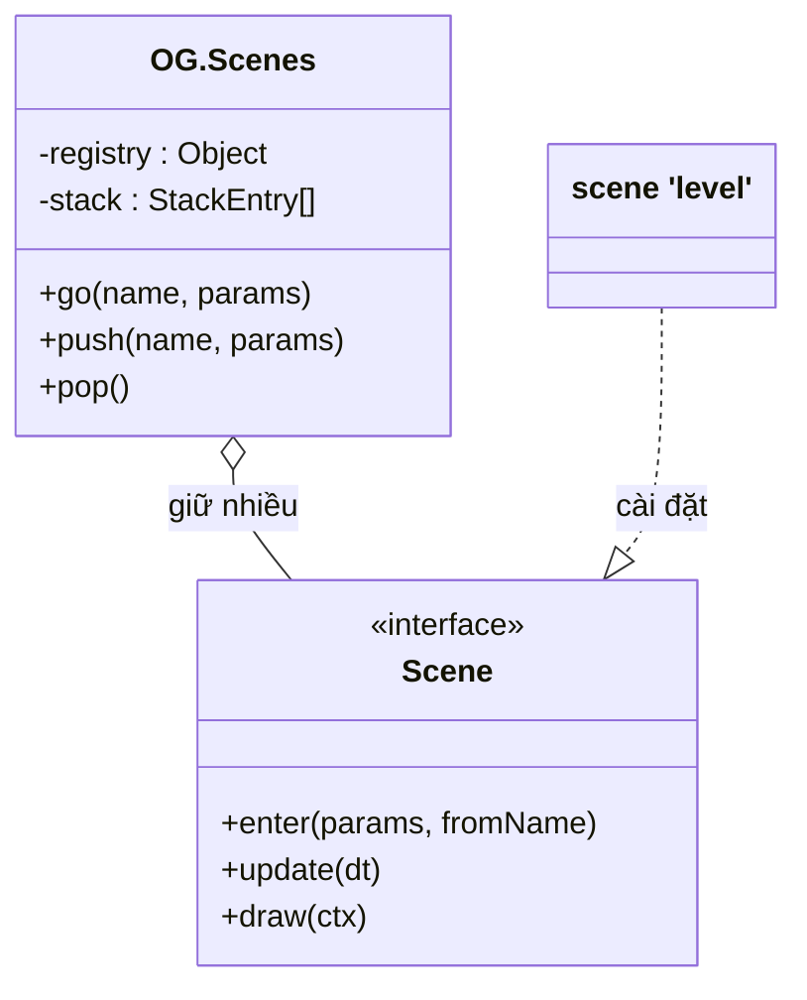
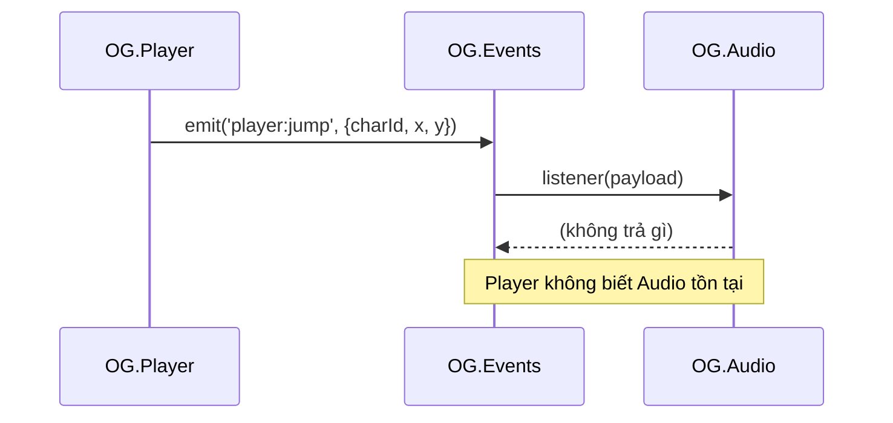
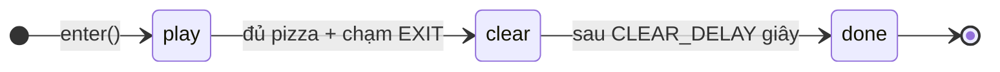
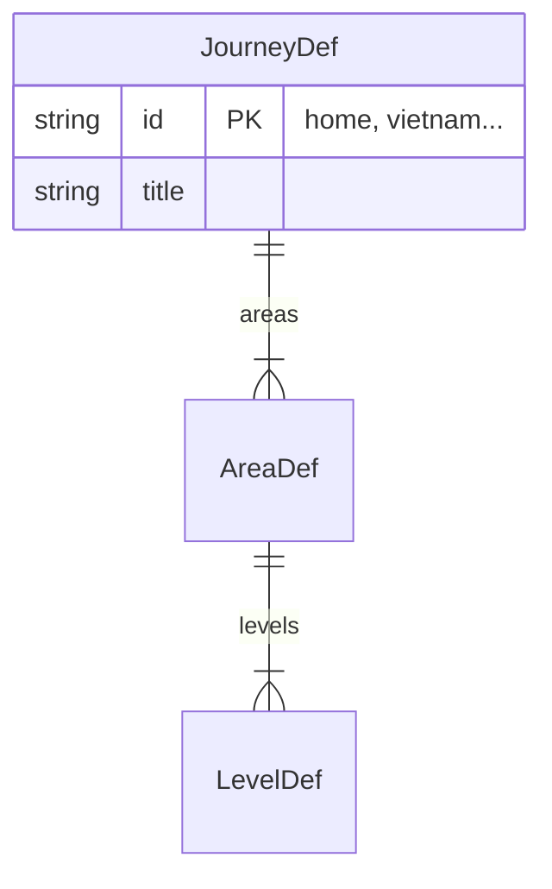
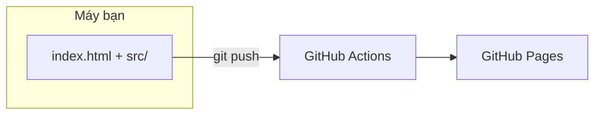

# Sơ đồ thiết kế chi tiết Oggy Adventure

Thư mục này là bộ **sơ đồ thiết kế chi tiết** (design diagrams) của game: dữ liệu trông như thế nào, mỗi module có những
"lớp" (object) và hàm gì, các luồng quan trọng chạy theo thứ tự nào, các máy trạng thái bên trong, cách code được nạp và
đưa lên mạng, và **vì sao** chúng tôi thiết kế như vậy.

> **Bức tranh tổng quan đọc trước:** [`docs/learn/ARCHITECTURE-DIAGRAMS.md`](../learn/ARCHITECTURE-DIAGRAMS.md) có 5 sơ đồ lớn:
> phụ thuộc giữa các module, máy trạng thái **các scene**, luồng event (ai phát ai nghe), vòng đời **một frame**, cây thư mục.
> Bộ sơ đồ ở đây **không vẽ lại** các sơ đồ đó mà đi sâu vào từng phần.
>
> Hợp đồng chính thức (API, payload, thứ tự load) vẫn là [`docs/ARCHITECTURE.md`](../ARCHITECTURE.md) và
> [`docs/STORY.md`](../STORY.md). Sơ đồ khác code thì **code đúng**, sơ đồ cần sửa.

## Mục lục

| File | Nội dung | Loại sơ đồ chính |
|---|---|---|
| [01-data-model.md](01-data-model.md) | Mô hình dữ liệu: hành trình → khu → màn → trang sách/cổng/NPC/checkpoint, thẻ, câu đố, truyện tranh, chủ đề cảnh nền, ảnh, nhân vật/skin/cửa hàng, nhiệm vụ, dữ liệu lưu `localStorage` | ER, class |
| [02-class-diagrams.md](02-class-diagrams.md) | "Lớp" (module/object) của từng namespace `OG.*` và các design pattern | class |
| [03-sequence-flows.md](03-sequence-flows.md) | 8 luồng: khởi động, nhặt trang sách, câu đố mở cổng, một trận trùm, hết mạng ở chế độ Bé chơi, lưu/tải/migrate, tải ảnh lười, chia sẻ điểm | sequence |
| [04-state-machines.md](04-state-machines.md) | Máy trạng thái: hoạt ảnh nhân vật, vòng đời người chơi, trùm (khung chung + từng trùm), scene câu đố/truyện/thẻ, AudioContext, cổng/checkpoint, ảnh | state |
| [05-component-deployment.md](05-component-deployment.md) | Các lớp (layer) và hướng phụ thuộc được phép, thứ tự `<script>`, đường đi từ máy bạn lên GitHub Pages, dây chuyền ảnh | flowchart |
| [06-design-decisions.md](06-design-decisions.md) | 10 bản ghi quyết định thiết kế (ADR): vì sao không build step, vì sao event bus, vì sao vẽ procedural... | flowchart nhỏ |

Gợi ý thứ tự đọc cho người mới: `06` (hiểu **vì sao**) → `05` (bức tranh triển khai) → `01` (dữ liệu) → `02` (module)
→ `03` và `04` (hành vi). Khi đọc một bài trong [`docs/learn/`](../learn/README.md), mở sơ đồ tương ứng bên cạnh.

## Xem sơ đồ ở đâu

- **GitHub** tự vẽ mọi khối ` ```mermaid `. VS Code cần extension xem trước Mermaid (vd "Markdown Preview Mermaid Support").
- **Ngoại tuyến:** dưới mỗi sơ đồ có link **(xem SVG)** trỏ tới bản đã vẽ sẵn trong [`svg/`](svg/). Các file này được vẽ bằng
  [Kroki](https://kroki.io) từ đúng khối Mermaid phía trên (font chữ trong SVG đã đổi sang `"Segoe UI", system-ui, ...` như `OG.FONT`
  để hiện đủ dấu tiếng Việt).
- Muốn sửa thử một sơ đồ: dán khối Mermaid vào <https://mermaid.live>.

## Cách đọc ký hiệu Mermaid (cho người mới)

Mỗi mục dưới đây có một sơ đồ tí hon dùng chính tên trong game, kèm bảng ký hiệu.

### Class diagram (sơ đồ lớp)

Game không dùng `class` của JavaScript, nhưng mỗi namespace `OG.X` là **một object có dữ liệu + hàm**, nên vẫn vẽ được như
một "lớp". Ô có ba phần: tên, thuộc tính, phương thức.


[(xem SVG)](svg/readme-class.svg)

| Ký hiệu | Nghĩa |
|---|---|
| `+` / `-` | công khai (gắn vào `OG.X`) / nội bộ (biến trong IIFE, bên ngoài không thấy) |
| `<<interface>>` | "giao diện": tập hàm mà object phải có (JS không kiểm tra, chỉ là quy ước + `src/types.d.ts`) |
| `A o-- B` | A **giữ** (aggregation) nhiều B nhưng không tạo ra chúng (vd registry giữ scene) |
| `A *-- B` | A **sở hữu** (composition) B: B sinh ra và mất đi cùng A |
| `A ..\|> B` | A **cài đặt** interface B (realization) |
| `A --> B` | A **dùng / gọi** B (association) |
| `A ..> B` | A **phụ thuộc lỏng** vào B (dependency: gọi tuỳ chọn qua `OG.util.call`, nhận làm tham số...) |

### Sequence diagram (sơ đồ tuần tự)

Đọc **từ trên xuống** theo thời gian. Mỗi cột là một bên tham gia (module, scene, trình duyệt).


[(xem SVG)](svg/readme-sequence.svg)

| Ký hiệu | Nghĩa |
|---|---|
| `->>` nét liền | gọi hàm / gửi thông điệp |
| `-->>` nét đứt | trả về |
| `alt / else` | rẽ nhánh (if/else) |
| `loop` | lặp |
| `opt` | chỉ xảy ra nếu điều kiện đúng |
| `Note over` | ghi chú |

### State diagram (sơ đồ trạng thái)

Mỗi ô là **một trạng thái**, mũi tên là **chuyển trạng thái** kèm điều kiện. `[*]` là điểm bắt đầu / kết thúc.


[(xem SVG)](svg/readme-state.svg)

### ER diagram (sơ đồ thực thể – quan hệ)

Dùng cho **dữ liệu**. Mỗi khối là một loại bản ghi, bên trong là field (kiểu, tên, ghi chú). Đường nối có ký hiệu số lượng ở hai đầu.


[(xem SVG)](svg/readme-er.svg)

| Ký hiệu ở đầu đường nối | Nghĩa |
|---|---|
| `\|\|` | đúng một |
| `o\|` | không hoặc một |
| `\|{` | một hoặc nhiều |
| `o{` | không hoặc nhiều |
| `PK` / `FK` | khoá chính (id duy nhất) / khoá ngoại (tham chiếu tới id ở bản ghi khác, vd `pages[].card` → `CardDef.id`) |

Đường liền = quan hệ "chứa trong" (dữ liệu lồng nhau trong cùng object). Đường **đứt** (`..`) = tham chiếu **bằng id chuỗi**
(không lồng, phải tra cứu).

### Flowchart (lưu đồ)

Dùng cho thành phần, thứ tự nạp, triển khai. `subgraph` là một nhóm (khung).


[(xem SVG)](svg/readme-flow.svg)

| Hình | Nghĩa trong bộ sơ đồ này |
|---|---|
| `[chữ nhật]` | module / file / bước |
| `([bo tròn])` | event hoặc scene |
| `{thoi}` | quyết định (if) |
| `[(trụ)]` | nơi lưu dữ liệu (localStorage, thư mục ảnh) |
| `-->` / `-.->` | gọi trực tiếp / gọi tuỳ chọn hoặc lúc chạy |

## Quy ước chung của bộ sơ đồ

- Tên trong sơ đồ (namespace, hàm, scene, event, field, state) **lấy nguyên văn từ code** và được kiểm tra bằng `grep`.
  Hàm nội bộ (không gắn vào `OG`) có dấu `-` hoặc ghi "(nội bộ)".
- Link tới code dạng [src/game/level.js](../../src/game/level.js) kèm **tên hàm** (không ghi số dòng vì code còn thay đổi).
- Đơn vị: **giây** (thời gian game), **px** (toạ độ logic 960×540), giống [`docs/learn/CODE_STYLE.md`](../learn/CODE_STYLE.md).
- Sơ đồ lớn được tách nhỏ (≤ ~25 nút). Chi tiết không vẽ được thì nằm trong phần giải thích ngay dưới sơ đồ.

## Tự kiểm tra sau khi sửa

```bash
# Vẽ lại SVG (cần mạng) và kiểm tra link tương đối trong docs/design/*.md
node <script render của bạn>   # POST từng khối mermaid tới https://kroki.io/mermaid/svg
git grep -nE "Scenes\.(register|go|push)\('" -- src   # đối chiếu tên scene
git grep -nE "setState\('[a-zA-Z]+'" -- src/bosses     # đối chiếu trạng thái trùm
```
