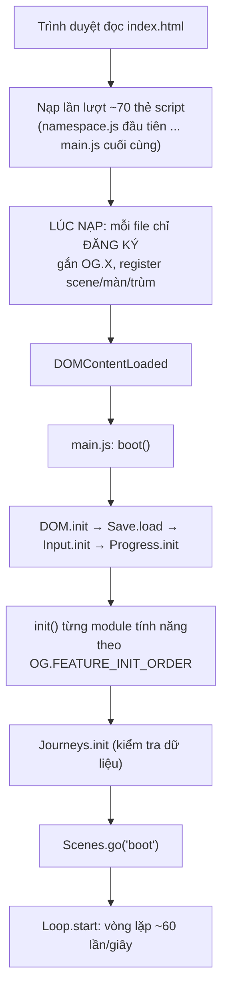

# Bài 00 — Bắt đầu: chạy game, đọc cấu trúc dự án, chạy smoke test

> Thuộc giáo trình **Lập trình game trình duyệt với Oggy Adventure** · [Mục lục](README.md) · Lời giải: [solutions/00-bat-dau.md](solutions/00-bat-dau.md)

## 🎯 Mục tiêu

Sau bài này bạn sẽ:

- Chạy được game bằng cách mở thẳng `index.html` (qua `file://`), không cần cài đặt hay build.
- Hiểu **vì sao** dự án không dùng ES modules, và hệ quả của nó: **thứ tự thẻ `<script>` chính là thứ tự phụ thuộc**.
- Phân biệt hai giai đoạn: **lúc nạp file** (load time) và **lúc khởi động** (boot, trong `main.js`).
- Biết đọc code theo thứ tự nào, và chạy được **smoke test** (`node tests/smoke.js`) để biết mình có làm hỏng gì không.
- Dùng được **DevTools console** để "chọc" vào game đang chạy qua biến toàn cục `OG`.

## 🧠 Khái niệm

### 1. Game này là một trang web tĩnh

Toàn bộ game gồm **một file HTML** ([index.html](../../index.html)) và khoảng 70 file JavaScript trong `src/`. Không có server
riêng, không có bước build (bước "biên dịch/đóng gói" như webpack, Vite), không có thư viện ngoài. Hình vẽ làm bằng
**Canvas 2D**, âm thanh tổng hợp bằng **Web Audio API**.

Cấu trúc thư mục (rút gọn):

| Thư mục | Chứa gì | Bài học liên quan |
|---|---|---|
| `src/core/` | Lõi engine: namespace `OG`, event bus, lưu trữ, input, camera, vật lý, scene, game loop, `main.js` | 01–06, 08, 11 |
| `src/data/` | Dữ liệu nhân vật, skin, 4 màn cổ điển | 12 |
| `src/game/` | Gameplay: người chơi, kẻ địch, vật phẩm, hạt, màn chơi, trận trùm, độ khó | 03, 04, 05, 09 |
| `src/gfx/` | Vẽ nhân vật, cảnh nền, đồ trang trí bằng code (procedural) | 07, 08 |
| `src/audio/` | Hiệu ứng âm thanh và nhạc nền tổng hợp | 10 |
| `src/bosses/` | Bộ khung trùm và 4 trùm | 09 |
| `src/world/`, `src/ui/`, `src/social/`, `src/story/` | Bản đồ, nhiệm vụ, menu, HUD, cửa hàng, bảng xếp hạng, truyện tranh, thẻ học | 05, 06, 12 |
| `src/journeys/` | **Dữ liệu** 4 hành trình học tập | 12 |
| `tests/` | Smoke test chạy bằng Node | 13 |
| `src/*/INTEGRATION.md` | Ghi chú tích hợp của từng thư mục: việc nhóm phụ trách thư mục đó cần **nhóm Tích hợp** làm hộ ở ngoài thư mục (thêm thẻ `<script>`, gắn hook, payload event mới...) | 00, 06 |
| `docs/` | Tài liệu kiến trúc, hợp đồng API, giáo trình này | — |

Hai tài liệu "hợp đồng" bạn sẽ quay lại nhiều lần: [docs/ARCHITECTURE.md](../ARCHITECTURE.md) (kiến trúc, quy ước toạ độ, danh sách
event) và [docs/STORY.md](../STORY.md) (phần hành trình học tập v2).

### 2. Vì sao không dùng `import`/`export`?

Trình duyệt **chặn ES modules khi trang mở qua `file://`** (lỗi CORS — chính sách chặn tải tài nguyên khác nguồn). Muốn bé
nhấp đúp `index.html` là chơi được, dự án chọn cách cũ hơn: mỗi file là một **IIFE** (hàm tự gọi ngay) gắn module của mình vào
một object toàn cục duy nhất là `window.OG`. Bài 01 sẽ mổ xẻ pattern này.

**Đánh đổi:** với `import`, trình duyệt tự tìm và nạp file phụ thuộc trước. Không có `import`, **ta phải tự xếp thẻ `<script>`**:
file nào *đọc* `OG.X` ngay lúc nạp thì phải đứng **sau** file tạo ra `OG.X`.

### 3. Hai giai đoạn: nạp file và khởi động



Quy tắc vàng: **lúc nạp, file chỉ khai báo và đăng ký**. Việc "thật" (tạo DOM, nghe event, đọc dữ liệu đã lưu) chờ tới `init()`, khi
**mọi** file đã có mặt. Nhờ vậy thứ tự giữa các module tính năng ít quan trọng hơn thứ tự trong core.

### 4. Smoke test là gì?

**Smoke test** (kiểm thử "khói") là bài test thô: bật máy lên xem có chỗ nào "bốc khói" không. Ở đây
[tests/smoke.js](../../tests/smoke.js) dựng một DOM giả trong Node, nạp **đúng thứ tự** các script trong `index.html`, rồi tự
"chơi" hàng chục nghìn frame qua mọi màn hình. Có lỗi runtime → test **ĐỎ**. Đây là lưới an toàn của bạn trong suốt giáo trình:
sửa gì xong cũng chạy lại.

## 🔍 Đọc code

### 1. `index.html` — thứ tự nạp script

Mở [index.html](../../index.html), đọc khối comment đầu file rồi kéo xuống phần `THỨ TỰ LOAD SCRIPT`. Quy tắc được ghi ngay
phía trên các thẻ script (tiêu đề mỗi nhóm script ghi "nhóm phụ trách": dự án được viết song song bởi nhiều
nhóm, mỗi nhóm giữ một thư mục; nhóm **Tích hợp** ghép chúng lại và đọc các file `src/*/INTEGRATION.md` để biết cần làm gì):

```html
<!-- ===== THỨ TỰ LOAD SCRIPT (không dùng ES modules để chạy được qua file://) =====
     Quy tắc: tầng dưới trước, tầng trên sau — core → dữ liệu → đồ hoạ/âm thanh → gameplay → tính năng → nội dung
     → khởi động. Trong lúc NẠP, mỗi file chỉ đăng ký (gắn OG.X, registerType, register...); việc thật sự
     (tạo DOM, nghe event, đọc save) chờ tới init() do main.js gọi, khi MỌI file đã có mặt.
```

Ba dòng đầu tiên và dòng cuối cùng là quan trọng nhất:

```html
<script src="src/core/namespace.js"></script>
<script src="src/core/events.js"></script>
<script src="src/core/save.js"></script>
```

```html
<script src="src/core/main.js"></script>
```

- `namespace.js` **phải** đầu tiên: nó tạo `window.OG`, `OG.util`, `OG.Config`.
- `events.js` ngay sau, vì hầu hết file khác dùng `OG.Events` / `OG.EV`.
- `main.js` **luôn cuối**: nó gọi `init()` của mọi module rồi bật vòng lặp.

> ⚠️ Smoke test đọc danh sách script bằng regex, nên mỗi script phải viết đúng dạng một dòng
> `<script src="..."></script>` (nháy kép, không `defer`/`async`). Xem khối `⚠️ Bẫy` trong comment đầu `index.html`.

### 2. `src/core/main.js` — hàm `boot()`

Mở [src/core/main.js](../../src/core/main.js), tìm hàm **`boot`**. Thứ tự khởi tạo được giải thích ngay trong comment:

```js
    // ⚠️ Bẫy: đảo Save.load() xuống dưới Progress.init() → Progress làm việc trên dữ liệu MẶC ĐỊNH rồi
    //   Save.commit() ghi đè lên bản lưu thật trong localStorage → tiến độ của người chơi mất thật sự.
    OG.DOM.init();
    OG.Save.load();
    OG.Input.init(canvas);
    OG.Progress.init();
```

Sau đó là các module tính năng, theo danh sách `OG.FEATURE_INIT_ORDER` khai báo ở đầu file:

```js
    OG.FEATURE_INIT_ORDER.forEach(function (ns) { OG.util.call(ns, 'init'); });
```

Và cuối cùng:

```js
    OG.Scenes.go('boot');
    // Loop start CUỐI CÙNG: frame đầu tiên chạy khi mọi thứ đã init và đã có scene.
    OG.Loop.start(ctx);
```

Cuối file, `boot` không chạy ngay mà chờ DOM sẵn sàng:

```js
  if (document.readyState === 'loading') document.addEventListener('DOMContentLoaded', boot);
  else boot();
```

### 3. Thứ tự nên đọc code

Mỗi file trong `src/` có một **khối đầu file** theo cùng mẫu (xem [CODE_STYLE.md](CODE_STYLE.md) mục 2). Dòng `Đọc tiếp:` chỉ file
nên đọc kế tiếp. Lộ trình gợi ý cho người mới:

1. [src/core/namespace.js](../../src/core/namespace.js) → [src/core/events.js](../../src/core/events.js) → [src/core/main.js](../../src/core/main.js) (bài 00–01, 06)
2. [src/core/loop.js](../../src/core/loop.js) → [src/core/scenes.js](../../src/core/scenes.js) (bài 02, 05)
3. [src/core/input.js](../../src/core/input.js) → [src/game/player.js](../../src/game/player.js) → [src/core/physics.js](../../src/core/physics.js) → [src/game/level.js](../../src/game/level.js) (bài 03–04)

Hai file mẫu đã áp dụng đầy đủ chuẩn comment: `loop.js` và `events.js`. Hãy đọc chúng trước để quen với ba nhãn
`💡 Khái niệm`, `⚠️ Bẫy`, `🧪 Thử` mà bạn sẽ gặp khắp dự án.

## 🧪 Thử ngay

1. **Mở game.** Nhấp đúp `index.html` (Chrome/Edge/Firefox). Nếu trình duyệt chặn `localStorage` qua `file://`, chạy server tĩnh
   ở thư mục gốc rồi mở `http://localhost:8080`:

   ```bash
   python -m http.server 8080
   ```

2. **Mở console** (F12 → tab Console) và gõ từng dòng:

   ```js
   OG.VERSION                 // '2.0.0-dev'
   Object.keys(OG)            // mọi module đã gắn vào namespace
   OG.FEATURE_INIT_ORDER      // thứ tự init module tính năng
   OG.Scenes.current()        // scene đang ở trên cùng, vd 'menu'
   document.scripts.length    // số thẻ script đã nạp
   ```

3. **Xem mọi event của game.** Gõ `OG.Config.DEBUG = true` rồi bấm vào một màn chơi và nhảy vài cái: console in ra từng event
   (`player:jump`, `player:land`, `item:collect`...). Gõ `OG.Config.DEBUG = false` để tắt.

4. **Chạy smoke test** ở thư mục gốc dự án (cần Node 20 trở lên):

   ```bash
   node tests/smoke.js
   ```

   Chờ khoảng 20–60 giây tuỳ máy. Dòng cuối phải là `XANH — không có lỗi runtime.` Thêm `--verbose` để xem từng bước và số lần mỗi
   event được phát.

   Khi sửa tài liệu (`docs/learn/`), chạy thêm `node tests/check-doc-links.js`: nó báo link tương đối nào trỏ tới file không tồn
   tại (in `SẠCH` nếu ổn).

## ✍️ Bài tập

### ⭐ Dễ — Bản đồ namespace

Trong console, liệt kê mọi module trong `OG` **có hàm `init`**, theo thứ tự trong `Object.keys(OG)`. So danh sách đó với
`OG.FEATURE_INIT_ORDER`: module nào có `init` nhưng **không** nằm trong `FEATURE_INIT_ORDER`? Đọc `boot()` để tìm xem ai gọi
`init` của các module đó.

<details><summary>💡 Gợi ý</summary>

Dùng `Object.keys(OG).filter(function (k) { return OG[k] && typeof OG[k].init === 'function'; })`. Các module core
(`DOM`, `Input`, `Progress`...) được `boot()` gọi trực tiếp, không qua danh sách. Còn `Journeys` thì sao?

</details>

### ⭐⭐ Vừa — Cố ý làm sai thứ tự nạp

1. Trong `index.html`, chuyển dòng `<script src="src/core/namespace.js"></script>` xuống **ngay dưới** dòng của `events.js`.
2. Mở game và đọc lỗi đầu tiên trong console. Lỗi nói gì, ở file nào, dòng code nào?
3. Chạy `node tests/smoke.js` và đọc dòng `✗` đầu tiên.
4. Giải thích bằng 2–3 câu vì sao lỗi xảy ra, rồi **trả `index.html` về như cũ** và chạy lại smoke test cho XANH.

<details><summary>💡 Gợi ý</summary>

Dòng đầu IIFE của `events.js` là `var OG = window.OG;`. Lúc đó `namespace.js` chưa chạy thì `window.OG` là gì? Lệnh gán
đầu tiên vào `OG....` sẽ ném lỗi kiểu `TypeError`. Smoke test báo lỗi dạng `Lỗi khi load src/core/events.js: ...`.

</details>

### ⭐⭐⭐ Khó — Thêm một file mới vào đúng chỗ

Tạo file `src/dev/scene-logger.js` in ra console mỗi lần đổi scene, dạng `[scene] menu → modeSelect`. Yêu cầu:

- Viết theo đúng mẫu IIFE + `'use strict'` như các file khác, có khối đầu file rút gọn (Vai trò, Bài học, Phụ thuộc).
- Chỉ dùng API công khai: nghe event `'scene:change'` (payload `{from, to, params, push?, pop?}`, xem `OG.EV.SCENE_CHANGE` trong
  [src/core/events.js](../../src/core/events.js)). `push: true` khi một scene được **đè lên** (vd `pause`), `pop: true` khi scene
  trên cùng được **gỡ xuống**; đổi hẳn scene bằng `go()` thì không có hai field này (khối đầu [src/core/scenes.js](../../src/core/scenes.js)).
  Ghi thêm `(push)`/`(pop)` vào dòng in ra để thấy scene stack hoạt động.
- Chọn vị trí thẻ `<script>` hợp lý trong `index.html` và giải thích vì sao: file này cần gì đã có lúc nạp?
- Smoke test vẫn phải XANH.

<details><summary>💡 Gợi ý</summary>

`OG.Events.on(...)` gọi được ngay lúc nạp, miễn là `events.js` đã chạy trước. Vậy file của bạn chỉ cần đứng sau `events.js`.
Nhưng để dễ đọc, hãy đặt nó cạnh các file "tính năng", **trước** `main.js` (xem `⚠️ Bẫy` ở nhóm 12 trong `index.html`).
`from` có thể là `null` ở lần đổi scene đầu tiên.

</details>

## 📚 Đọc thêm

- MDN — [Thẻ `<script>`](https://developer.mozilla.org/en-US/docs/Web/HTML/Element/script) (thứ tự thực thi, `defer`, `async`).
- MDN — [JavaScript modules](https://developer.mozilla.org/en-US/docs/Web/JavaScript/Guide/Modules), phần "Other differences between
  modules and standard scripts" (vì sao module không chạy qua `file://`).
- MDN — [`DOMContentLoaded`](https://developer.mozilla.org/en-US/docs/Web/API/Document/DOMContentLoaded_event) và
  [`document.readyState`](https://developer.mozilla.org/en-US/docs/Web/API/Document/readyState).
- Chrome for Developers — [Console overview](https://developer.chrome.com/docs/devtools/console).
- [docs/ARCHITECTURE.md](../ARCHITECTURE.md) mục 2 (bảng thứ tự load đầy đủ và các giai đoạn chạy).

## ➡️ Bài tiếp theo

[Bài 01 — Module pattern: IIFE và namespace `OG`](01-module-pattern-iife-namespace.md): bên trong mỗi file trông như thế nào, vì
sao biến riêng không "lọt" ra ngoài, và làm sao một module lỗi không kéo sập cả game.
