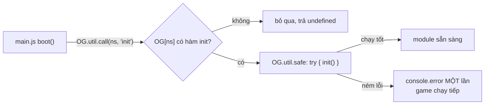

# Bài 01 — Module pattern: IIFE, namespace `OG` và cô lập lỗi

> Thuộc giáo trình **Lập trình game trình duyệt với Oggy Adventure** · [Mục lục](README.md) · Lời giải: [solutions/01-module-pattern-iife-namespace.md](solutions/01-module-pattern-iife-namespace.md)

## 🎯 Mục tiêu

Sau bài này bạn sẽ:

- Viết được một module theo **module pattern IIFE**: có biến riêng (private), chỉ lộ ra API công khai qua `window.OG`.
- Hiểu tác dụng của `'use strict'` trong từng file.
- Hiểu vì sao game dùng **một namespace** (`OG`) thay vì hàng chục biến toàn cục.
- Biết hai kỹ thuật giữ game sống khi một module lỗi: **cô lập lỗi** (`OG.util.safe`) và **gọi mềm** (`OG.util.call`).
- Nhận ra pattern **"stub rồi ghi đè"** (đăng ký bản đơn giản trước, module sau thay bằng bản đầy đủ).

## 🧠 Khái niệm

### 1. IIFE — hàm tự gọi ngay

**IIFE** (Immediately Invoked Function Expression) là một biểu thức hàm được gọi **ngay khi định nghĩa**:

```js
(function () {
  'use strict';
  var secret = 42;            // RIÊNG của module: bên ngoài không đọc được
  window.OG.Demo = {          // CÔNG KHAI: gắn vào namespace
    get: function () { return secret; }
  };
})();
```

Trong JavaScript (với `var` và `function`), **phạm vi biến là hàm**. Bọc cả file trong một hàm nghĩa là mọi biến khai báo bên
trong là biến cục bộ của hàm đó. Chúng không "lọt" ra `window`, không đụng tên với file khác. Nhưng các hàm bên trong vẫn nhớ
được chúng nhờ **closure** (hàm "đóng gói" lại môi trường nơi nó được tạo).

Đây là cách "module hoá" phổ biến trước khi có ES modules, và vẫn là lựa chọn đúng khi game phải chạy qua `file://` (bài 00).

### 2. Namespace toàn cục duy nhất

Thay vì 30 biến toàn cục `Player`, `Physics`, `Audio`..., mọi module gắn vào **một** object: `window.OG`.

| Cách | Ưu | Nhược |
|---|---|---|
| Nhiều biến toàn cục | Viết nhanh | Dễ đụng tên (thư viện khác cũng có `Audio`!), khó biết cái gì thuộc game |
| **Một namespace `OG` + IIFE** | Không đụng tên, gõ `OG.` là thấy hết module, chạy qua `file://` | Phải tự xếp thứ tự nạp |
| ES modules (`import`/`export`) | Trình duyệt tự xử lý phụ thuộc | Không chạy qua `file://` |

### 3. `'use strict'`

Mỗi IIFE mở đầu bằng `'use strict'`. Chế độ nghiêm ngặt biến một số lỗi "im lặng" thành lỗi thật. Ví dụ quan trọng nhất trong
game: gõ sai tên biến (`playr = ...`) sẽ **ném lỗi** thay vì tạo ra một biến toàn cục mới mà không ai hay biết. Đặt trong IIFE thì
nó chỉ áp dụng cho file đó, không ảnh hưởng code khác trên trang.

### 4. Cô lập lỗi và gọi mềm

Game gồm nhiều module viết song song. Nếu module Social có bug, ta **không** muốn cả vòng lặp game đứng hình.



- **Error isolation** (cô lập lỗi): bọc lời gọi trong `try/catch`, log lỗi rồi đi tiếp. Lỗi của một module không lan sang module
  khác.
- **Gọi mềm module tuỳ chọn**: hỏi "module có không, hàm có không?" trước khi gọi. Xoá hẳn một file tính năng thì game chỉ thiếu
  tính năng đó.

### 5. Stub rồi ghi đè

Một **stub** là bản cài đặt tối giản, đủ để chương trình chạy. `src/game/default-scenes.js` đăng ký bản đơn giản của các scene
giao diện (`menu`, `pause`...). File `src/ui/menus.js` nạp **sau**, đăng ký lại cùng tên, và registry chỉ giữ bản sau cùng. Nếu
`menus.js` lỗi hoặc bị xoá, game vẫn còn menu đơn giản. Đây là **graceful degradation** (xuống cấp nhẹ nhàng): hỏng một phần thì
vẫn chạy được, chỉ kém đẹp hơn.

## 🔍 Đọc code

### 1. Khung IIFE và namespace — `src/core/namespace.js`

Mở [src/core/namespace.js](../../src/core/namespace.js). Đây là file **đầu tiên** được nạp:

```js
(function () {
  'use strict';
  // `window.OG || {}`: nếu vì lý do nào đó OG đã có (vd test nạp lại), giữ nguyên thay vì xoá trắng.
  /** @type {any} namespace được dựng dần từng field nên khai `any` (giống src/types.d.ts) */
  var OG = (window.OG = window.OG || {});
```

Mọi file khác chỉ cần `var OG = window.OG;`, vì `namespace.js` đã tạo sẵn. Cùng file còn có **cấu hình tập trung** `OG.Config`
(mọi hằng số vật lý ở một chỗ) và bảng màu `OG.Palette`.

Biến **riêng** của module: `reported` (nhãn lỗi đã in) khai báo bằng `var` bên trong IIFE, không ai bên ngoài đụng được:

```js
  /** @type {Object<string, boolean>} nhãn đã báo lỗi — mỗi nhãn chỉ in console MỘT lần */
  var reported = {};
```

### 2. `OG.util.safe` — cô lập lỗi

Cũng trong `namespace.js`, tìm hàm **`U.safe`**:

```js
  U.safe = function (label, fn, self, args) {
    try {
      return fn.apply(self || null, args || []);
    } catch (err) {
      // ⚠️ Bẫy: lỗi trong hàm gọi mỗi frame sẽ lặp 60 lần/giây → chỉ in lần đầu để console còn đọc được.
      if (!reported[label]) {
        reported[label] = true;
        console.error('[OG] Lỗi trong ' + label + ':', err);
      }
      return undefined;
    }
  };
```

Event bus (`src/core/events.js`), scene stack (`src/core/scenes.js`), level hook (`src/game/level.js`) đều gọi listener/hook qua
hàm này.

### 3. `OG.util.call` — gọi mềm

Tìm hàm **`U.call`** ngay bên dưới:

```js
  U.call = function (ns, method) {
    var mod = OG[ns];
    if (!mod || typeof mod[method] !== 'function') return undefined;
    return U.safe(ns + '.' + method, mod[method], mod, Array.prototype.slice.call(arguments, 2));
  };
```

Ví dụ dùng thật trong [src/game/player.js](../../src/game/player.js) (hàm `update`): Player không cần biết cửa hàng có tồn tại hay
không.

```js
      OG.util.call('Shop', 'tickPlayer', p, dt);
```

### 4. Init theo thứ tự — `src/core/main.js`

Trong [src/core/main.js](../../src/core/main.js), danh sách module tính năng và vòng `forEach` trong hàm `boot`:

```js
  OG.FEATURE_INIT_ORDER = ['Difficulty', 'Audio', 'Sprites', 'Bosses', 'World', 'Quests', 'Menus', 'Shop', 'Social', 'Learn', 'Guide', 'Story'];
```

```js
    OG.FEATURE_INIT_ORDER.forEach(function (ns) { OG.util.call(ns, 'init'); });
```

Một `init` ném lỗi chỉ in `[OG] Lỗi trong Shop.init: ...`, các module sau vẫn được init.

### 5. Stub rồi ghi đè — `src/game/default-scenes.js`

Trong [src/game/default-scenes.js](../../src/game/default-scenes.js), tìm `OG.Scenes.register('menu', ...)`:

```js
  // 💡 Khái niệm: "stub rồi ghi đè" — file này load TRƯỚC src/ui/menus.js; OG.Menus.init() đăng ký lại 'menu' cùng tên
  //   và registry giữ bản sau cùng. Xoá <script src="src/ui/menus.js"> thì panel đơn giản dưới đây hiện ra.
```

Để ý: `default-scenes.js` gọi `OG.Scenes.register` **lúc nạp**, còn `menus.js` gọi trong `init()`, tức là lúc khởi động. Bản
của `menus.js` luôn đến sau nên luôn thắng.

## 🧪 Thử ngay

1. **Biến riêng thật sự riêng.** Trong console gõ `reported` → `ReferenceError: reported is not defined`. Biến đó tồn tại, nhưng
   chỉ bên trong IIFE của `namespace.js`.
2. **Gọi mềm module không tồn tại:**

   ```js
   OG.util.call('KhongCo', 'init')        // undefined, không lỗi
   OG.util.call('Progress', 'totalStars') // gọi được thật
   ```

3. **Cô lập lỗi + chỉ in một lần:**

   ```js
   OG.util.safe('thử', function () { throw new Error('bùm'); }); // in lỗi
   OG.util.safe('thử', function () { throw new Error('bùm'); }); // KHÔNG in nữa (cùng nhãn)
   ```

4. **Xem stub hiện ra.** Comment dòng `<script src="src/ui/menus.js"></script>` trong `index.html` rồi mở game: menu MVP giản dị
   hiện ra, game vẫn chơi được. Nhớ bỏ comment sau khi xem.

5. **Cấu hình tập trung.** Gõ `OG.Config.GRAVITY = 600`, vào một màn và nhảy: Oggy bay như trên Mặt Trăng. Một số ở một chỗ,
   mọi module cùng đọc. Tải lại trang để trả về.

## ✍️ Bài tập

### ⭐ Dễ — Đọc khối đầu file

Chọn 3 file bất kỳ trong `src/core/`. Với mỗi file, ghi ra từ dòng `Phụ thuộc:` của khối đầu file: file đó đọc module nào **lúc
nạp** và module nào **lúc chạy**? Từ đó giải thích vì sao `src/core/physics.js` có thể nằm trước hoặc sau `src/core/camera.js`
mà không sao, nhưng không được nằm trước `namespace.js`.

<details><summary>💡 Gợi ý</summary>

`physics.js` ghi "đọc LÚC CHẠY". Đọc lúc chạy nghĩa là chỉ dùng bên trong hàm, mà hàm được gọi khi game đã boot. Nhưng
dòng `var OG = window.OG;` và `OG.Physics = {...}` thì chạy **lúc nạp**.

</details>

### ⭐⭐ Vừa — Viết module `OG.Counter`

Gõ thẳng vào console (hoặc tạo file `src/dev/counter.js`) một module theo mẫu IIFE:

- Biến riêng `count` (bắt đầu từ 0), không truy cập được từ ngoài.
- API công khai: `OG.Counter.inc(n)` (cộng `n`, mặc định 1), `OG.Counter.get()`.
- Tự đếm số lần nhân vật nhảy bằng cách nghe event `'player:jump'`.

Chứng minh `count` là private: thử `OG.Counter.count`, thử gán `count = 999` ngoài console rồi `OG.Counter.get()`.

<details><summary>💡 Gợi ý</summary>

Trong IIFE: `var count = 0;` và `OG.Events.on('player:jump', function () { count++; });`. Gán `count = 999` ngoài console chỉ
tạo một biến **khác** (ở phạm vi console), không đụng tới biến trong closure.

</details>

### ⭐⭐⭐ Khó — Module tính năng `OG.FpsMeter` và thử cô lập lỗi

1. Tạo `src/dev/fps-meter.js`: module `OG.FpsMeter` có `init()`. Trong `init`, dùng `OG.Level.addHook` gắn một hook có
   `drawScreen(ctx)` vẽ chữ `FPS 60` (lấy `OG.Loop.fps`) ở góc phải dưới màn chơi. Dùng `OG.font(px, weight)` cho font.
2. Thêm thẻ script trước `main.js` và thêm `'FpsMeter'` vào **cuối** `OG.FEATURE_INIT_ORDER` trong `main.js`.
3. Cố ý thêm `throw new Error('thử lỗi');` ở đầu `init()`. Quan sát: console in gì, game còn chạy không, các module khác
   (Menus, Story...) còn hoạt động không? Vì sao?
4. Xoá dòng `throw`, chạy smoke test cho XANH.

<details><summary>💡 Gợi ý</summary>

- Hook là object `{ id: 'fpsMeter', drawScreen: function (ctx, st, t) {...} }`. `drawScreen` vẽ ở **toạ độ màn hình**
  (0..960 × 0..540), xem hợp đồng hook ở khối đầu [src/game/level.js](../../src/game/level.js).
- Bọc phần vẽ trong `ctx.save()` / `ctx.restore()`: smoke test kiểm tra save/restore cân bằng.
- `throw` trong init → `OG.util.call` bắt lỗi → `[OG] Lỗi trong FpsMeter.init: ...`. Smoke test sẽ ĐỎ vì có `console.error`.
  Đó là đúng ý đồ: lỗi phải được nhìn thấy, chỉ là không được kéo sập game.

</details>

## 📚 Đọc thêm

- MDN — [IIFE](https://developer.mozilla.org/en-US/docs/Glossary/IIFE).
- MDN — [Closures](https://developer.mozilla.org/en-US/docs/Web/JavaScript/Closures).
- MDN — [Strict mode](https://developer.mozilla.org/en-US/docs/Web/JavaScript/Reference/Strict_mode).
- Addy Osmani — *Learning JavaScript Design Patterns*, mục
  [The Module Pattern](https://addyosmani.com/resources/essentialjsdesignpatterns/book/#modulepatternjavascript) (đúng dạng IIFE
  dùng trong dự án này).
- Robert Nystrom — *Game Programming Patterns*, chương [Service Locator](https://gameprogrammingpatterns.com/service-locator.html)
  (`OG.util.call` là một biến thể "null service": không có dịch vụ thì lời gọi không làm gì).

## ➡️ Bài tiếp theo

[Bài 02 — Game loop và delta time](02-game-loop-delta-time.md): sau khi `main.js` gọi `OG.Loop.start`, chuyện gì xảy ra 60 lần
mỗi giây?
