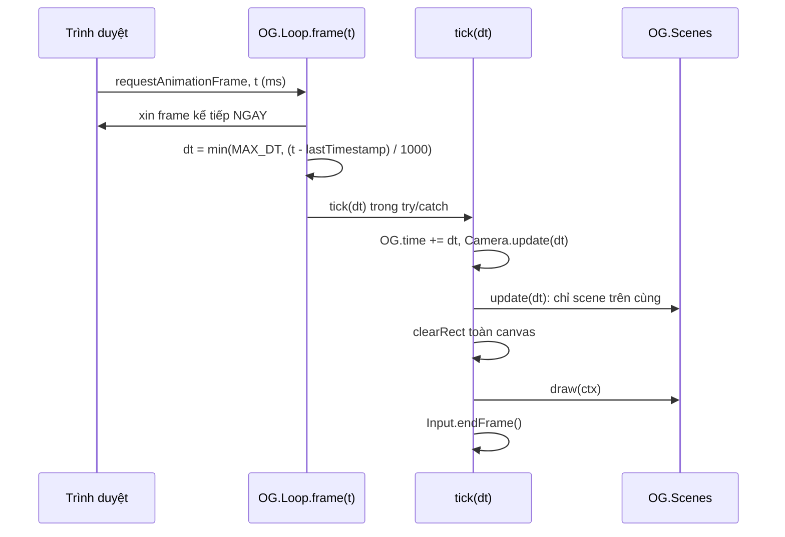

# Bài 02 — Game loop và delta time

> Thuộc giáo trình **Lập trình game trình duyệt với Oggy Adventure** · [Mục lục](README.md) · Lời giải: [solutions/02-game-loop-delta-time.md](solutions/02-game-loop-delta-time.md)

## 🎯 Mục tiêu

Sau bài này bạn sẽ:

- Giải thích được **game loop** (vòng lặp game) và vì sao game vẽ lại **toàn bộ** màn hình mỗi frame.
- Dùng `requestAnimationFrame` đúng cách, và biết vì sao không dùng `setInterval`.
- Viết chuyển động **độc lập tốc độ khung hình** bằng **delta time**, và biết vì sao phải **kẹp** dt.
- Hiểu vì sao tách **update** (tính toán) khỏi **draw** (vẽ), và tách "một bước mô phỏng" khỏi "ai gọi bước đó" để test được.
- Biết giới hạn của tích phân Euler với dt thay đổi, và kỹ thuật **fixed timestep** (bước cố định).

## 🧠 Khái niệm

### 1. Game loop

Một chương trình bình thường chờ người dùng làm gì đó rồi mới phản ứng. Game thì khác: **thời gian tự trôi**. Gián vẫn bò dù
bạn không bấm gì. Vì vậy game chạy một vòng lặp vô tận, mỗi vòng (một **frame**, khung hình) làm hai việc:

1. **update(dt)**: tính trạng thái mới của thế giới sau `dt` giây (vị trí, va chạm, điểm, AI...).
2. **draw(ctx)**: xoá canvas và vẽ lại mọi thứ theo trạng thái vừa tính.

Canvas 2D là kiểu **immediate mode** (vẽ trực tiếp): canvas không nhớ "đây là con gián", nó chỉ nhớ các điểm ảnh. Muốn con gián
di chuyển thì ta phải xoá và vẽ lại cả khung hình ở vị trí mới.



### 2. `requestAnimationFrame` (rAF)

`requestAnimationFrame(cb)` nhờ trình duyệt gọi `cb` **ngay trước lần vẽ màn hình kế tiếp**, thường là 60 lần/giây, hoặc 120/144 trên
màn tần số cao. So với `setInterval(fn, 16)`:

- rAF khớp với nhịp làm tươi màn hình nên không bị xé hình, không vẽ thừa.
- Tab bị ẩn thì rAF **tạm dừng**: tiết kiệm pin, không tốn CPU.
- rAF truyền vào timestamp `t` (ms) chính xác. Ta dùng nó để tính dt.

### 3. Delta time (dt)

**Delta time** là khoảng thời gian giữa 2 frame, tính bằng **giây**. Nếu viết `x += 4` mỗi frame, nhân vật chạy nhanh gấp đôi trên
màn 120 Hz so với 60 Hz. Viết `x += vx * dt` với `vx` tính bằng px/giây thì quãng đường sau 1 giây luôn là `vx` px, bất kể FPS.

| Màn hình | dt mỗi frame | `x += 255 * dt` sau 1 giây |
|---|---|---|
| 30 FPS | 0,033 s | 255 px |
| 60 FPS | 0,0167 s | 255 px |
| 144 FPS | 0,0069 s | 255 px |

### 4. Kẹp dt

Nếu máy khựng 2 giây (tab ẩn rồi mở lại, máy bận), frame kế tiếp có dt = 2. Nhân vật sẽ dịch chuyển hàng trăm px trong **một
bước**, đủ để đi xuyên qua một con gián mà không bao giờ chồng hitbox. Hiện tượng này gọi là **tunneling** (xuyên vật). Vì vậy dt bị
kẹp tối đa `OG.Config.MAX_DT = 0.033` giây. Đánh đổi: khi máy thật sự chậm hơn 30 FPS, game sẽ chạy **chậm lại** (slow motion)
thay vì giật cục.

### 5. Fixed step cho test, và giới hạn của Euler

Tách `tick(dt)` khỏi `frame(t)` cho phép smoke test gọi `OG.Loop.step(1/60)` hàng chục nghìn lần mà không cần trình duyệt, và kết
quả luôn giống nhau (**tất định**, deterministic).

Delta time **không làm mọi thứ độc lập FPS một cách hoàn hảo**. Game cập nhật vận tốc rồi vị trí theo kiểu **semi-implicit Euler**
(bài 04). Với chuyển động có gia tốc (nhảy), kết quả phụ thuộc nhẹ vào dt. Tính với cú nhảy của Oggy (590 px/giây, trọng lực
1500 px/giây²):

| FPS | Độ cao đỉnh nhảy |
|---|---|
| 30 | ≈ 106 px |
| 60 | ≈ 111 px |
| 144 | ≈ 114 px |
| công thức v²/2g | 116 px |

Chênh 8 px là chấp nhận được với game này. Game cần tuyệt đối tất định (đua xe, mạng nhiều người) thì dùng **fixed timestep với
accumulator**: luôn mô phỏng theo bước cố định (vd 1/120 giây) và gom phần dt dư cho frame sau. Bạn sẽ tự cài kỹ thuật này ở
bài tập ⭐⭐⭐.

## 🔍 Đọc code

### 1. `src/core/loop.js` — file mẫu

Mở [src/core/loop.js](../../src/core/loop.js) (một trong hai file mẫu của dự án). Tìm hàm **`frame`**:

```js
  function frame(t) {
    // Xin frame kế tiếp NGAY ĐẦU hàm: nếu tick() bên dưới ném lỗi, vòng lặp vẫn sống.
    requestAnimationFrame(frame);
```

```js
    var dt = Math.min(OG.Config.MAX_DT, (t - lastTimestamp) / MS_PER_SECOND || 0);
    lastTimestamp = t;
    // 💡 Khái niệm: trung bình trượt hàm mũ (EMA) — FPS hiển thị không nhảy loạn từng frame.
    if (dt > 0) Loop.fps = Loop.fps * FPS_OLD_WEIGHT + (1 / dt) * FPS_NEW_WEIGHT;
```

Ba điểm cần để ý:

- `|| 0`: frame đầu tiên `lastTimestamp = 0` nên phép chia cho ra một số rất lớn, bị kẹp về `MAX_DT`. `|| 0` chặn trường hợp
  `NaN` (khi `t` không phải số).
- **EMA** (Exponential Moving Average, trung bình trượt hàm mũ): mỗi frame lấy 95% giá trị cũ + 5% giá trị mới. Số FPS hiển thị
  mượt, không nhảy loạn. Gameplay **không** dùng `Loop.fps`.
- `try { tick(dt); } catch (err) {...}`: một **error boundary** (ranh giới lỗi) cho cả frame.

Tiếp theo là hàm **`tick`**, một bước của game:

```js
  function tick(dt) {
    OG.time += dt;
    OG.Camera.update(dt);
    OG.Scenes.update(dt);
    var ctx = Loop.ctx;
    // 💡 Khái niệm: mỗi frame vẽ lại TỪ ĐẦU (immediate mode). save/restore bao quanh để
    //   scene nào quên reset transform/alpha cũng không làm lệch frame sau.
    ctx.save();
    ctx.clearRect(0, 0, OG.W, OG.H);
    OG.Scenes.draw(ctx);
    ctx.restore();
```

Cuối cùng là `OG.Loop.step`, chính là `tick` công khai cho test:

```js
    step: function (dt) { tick(dt); }
```

### 2. Ai dùng dt? — `src/game/particles.js`

Mở [src/game/particles.js](../../src/game/particles.js), tìm **`OG.Particles.update`**. Đây là ví dụ gọn nhất về "mọi thứ nhân dt":

```js
        p.life -= dt;
        if (p.life <= 0) { list.splice(i, 1); continue; }
        // 💡 Khái niệm: chuyển động theo delta time — v += a·dt, x += v·dt. Nhờ nhân dt, hạt bay cùng quãng đường
        //   dù máy chạy 30 hay 144 FPS.
        p.vy += p.g * dt; p.x += p.vx * dt; p.y += p.vy * dt;
```

Cả **tuổi thọ** (`life -= dt`) cũng tính theo giây. Đừng đếm "số frame", vì 30 frame ở 144 FPS ngắn hơn nhiều so với ở 60 FPS.

### 3. Thời gian chơi là tổng các dt — `src/game/game.js`

Trong [src/game/game.js](../../src/game/game.js), hàm **`tickTime`**: thời gian hiện trên đồng hồ HUD là **tổng dt ở scene chơi**,
không phải `bây giờ − lúc bắt đầu`. Nhờ scene stack (bài 05), khi đang tạm dừng thì scene `level` không được update, nên đồng hồ
tự đứng yên.

## 🧪 Thử ngay

1. **Đo FPS và thời gian game.** Trong console:

   ```js
   var t0 = OG.time, r0 = performance.now();
   setTimeout(function () {
     console.log('game:', (OG.time - t0).toFixed(2), 's · thật:', ((performance.now() - r0) / 1000).toFixed(2),
                 's · fps:', OG.Loop.fps.toFixed(1));
   }, 5000);
   ```

   Máy bình thường: hai số gần bằng nhau. Bây giờ mở DevTools → **Performance** → biểu tượng ⚙️ → **CPU: 6× slowdown** rồi chạy
   lại. Nếu FPS tụt dưới 30, thời gian game trôi **chậm hơn** thời gian thật. Đó chính là tác dụng của `MAX_DT`.

2. **Tạo một cú khựng.** Ta muốn khoá luồng chính 300 ms **trong lúc** Oggy đang chạy. Nhưng bấm vào Console để gõ lệnh thì
   game mất focus: nó tự tạm dừng và nhả mọi phím (xem ô ⚠️ ngay dưới). Vì vậy ta **hẹn giờ** cho cú khựng. Vào màn chơi, gõ
   vào Console:

   ```js
   OG.Config.MAX_DT = 0.5;
   setTimeout(function () { var s = performance.now(); while (performance.now() - s < 300) {} }, 4000);
   ```

   Nhấn Enter, bấm "Tiếp tục" trên màn hình game rồi **giữ phím →** để Oggy chạy. Sau khoảng 4 giây, Oggy "nhảy cóc" một đoạn
   dài. Gõ `OG.Config.MAX_DT = 0.033` và lặp lại: chỉ còn một chút khựng.

   > ⚠️ **Gõ Console khi đang chơi.** Bấm vào DevTools làm cửa sổ phát `blur`: `main.js` (`autoPause`) push scene `pause` và
   > `input.js` gọi `OG.Input.reset()`; bấm "Tiếp tục" thì `Scenes.pop()` lại gọi `reset()` lần nữa. Mọi phím đang giữ (kể cả phím
   > ép bằng `OG.Input.setKey`) đều bị nhả. Thí nghiệm nào cần "đang giữ phím rồi làm gì đó" thì bọc lệnh trong
   > `setTimeout(..., 3000)` như trên. Chi tiết: [README mục 2.3](README.md#23-mở-devtools), [bài 03](03-input.md) "Thử ngay" bước 4.

3. **Bước từng frame bằng tay.** Bấm Esc để tạm dừng, rồi gõ `OG.Loop.step(1)`. Đây là một bước 1 giây (lớn hơn `MAX_DT`, vì `step`
   không kẹp). Scene trên cùng là `pause` nên màn chơi bên dưới không đổi: đó là scene stack đang làm việc.

4. **EMA.** Gõ `OG.Loop.fps = 5` rồi quan sát giá trị trong vài giây (`OG.Loop.fps` liên tục). Nó bò dần về ~60 chứ không nhảy ngay.

## ✍️ Bài tập

### ⭐ Dễ — Đếm frame một giây

Không sửa code game, viết đoạn console đếm **số frame** chạy trong 1 giây và in ra. Gợi ý: tự gọi `requestAnimationFrame` lồng
nhau. So kết quả với `OG.Loop.fps`. Hai số có khớp không?

<details><summary>💡 Gợi ý</summary>

Một hàm `count(t)` tự gọi lại bằng `requestAnimationFrame(count)` cho tới khi `t - start >= 1000`. Vòng lặp của game và vòng lặp
của bạn được trình duyệt gọi **cùng nhịp**, nên số frame phải xấp xỉ `OG.Loop.fps`.

</details>

### ⭐⭐ Vừa — Slow motion bằng time scale

Làm cho gameplay chạy chậm còn 30% (như hiệu ứng "bullet time") **không sửa file nào**, chỉ gõ trong console. Sau đó trả về bình
thường. Trả lời: đồng hồ HUD có chậm theo không? `OG.time` có chậm theo không? Vì sao?

<details><summary>💡 Gợi ý</summary>

`tick` gọi `OG.Scenes.update(dt)` qua thuộc tính của object `OG.Scenes`, mỗi frame tra lại một lần. Bạn có thể giữ hàm gốc trong một
biến rồi gán `OG.Scenes.update` bằng một hàm bọc, nhân `dt` với 0.3 trước khi gọi hàm gốc (nhớ `.call(OG.Scenes, ...)`). Còn
`OG.time += dt` nằm trong `tick`, **trước** khi gọi scene. Kỹ thuật này có tên là **time scale**; trận trùm dùng nó thật
(`bossTimeScale` trong [src/game/difficulty.js](../../src/game/difficulty.js)).

</details>

### ⭐⭐⭐ Khó — Fixed timestep với accumulator

Viết file Node `fixed-step.js` (đặt ngoài `src/`, ví dụ trong thư mục nháp của bạn):

1. Viết hàm `makeFixedStepper(step, fixedDt, maxSteps)` trả về hàm `advance(dt)`. Mỗi lần gọi, cộng `dt` vào accumulator, rồi gọi
   `step(fixedDt)` **nhiều lần** cho tới khi accumulator nhỏ hơn `fixedDt`. Không gọi quá `maxSteps` lần mỗi frame, để tránh
   "vòng xoáy chết" (spiral of death) khi máy chậm.
2. Mô phỏng cú nhảy của Oggy đúng như `OG.Physics.moveBody`: `vy = Math.min(900, vy + 1500*h); y += vy*h;` với `vy` ban đầu là
   `-590`.
3. So độ cao đỉnh nhảy khi frame dt = 1/30, 1/60, 1/144 trong hai trường hợp: (a) gọi thẳng `step(frameDt)`, (b) qua
   `advance(frameDt)` với `fixedDt = 1/120`.
4. Giải thích kết quả. Bạn sẽ ghép `advance` vào chỗ nào trong `src/core/loop.js` nếu muốn game dùng fixed timestep? Phần nào
   phải giữ nguyên dt thật?

<details><summary>💡 Gợi ý</summary>

- Accumulator: `acc += dt; while (acc >= fixedDt && n < maxSteps) { step(fixedDt); acc -= fixedDt; n++; }`.
- Trường hợp (a) cho ba số khác nhau (xem bảng ở phần Khái niệm). Trường hợp (b) cho **cùng một số** ở mọi FPS.
- Trong `loop.js`, chỗ hợp lý là trong `tick`, quanh `OG.Scenes.update(dt)`. Nhưng `Input.endFrame()` xoá cờ "vừa bấm" sau mỗi
  **frame**, chứ không phải sau mỗi bước. Nếu một frame có 2 bước, cú bấm sẽ bị xử lý 2 lần. Nghĩ xem phải xử lý chuyện đó ra sao.

</details>

## 📚 Đọc thêm

- MDN — [`window.requestAnimationFrame()`](https://developer.mozilla.org/en-US/docs/Web/API/Window/requestAnimationFrame).
- MDN — [Anatomy of a video game](https://developer.mozilla.org/en-US/docs/Games/Anatomy) (game loop trên web, rất sát bài này).
- Robert Nystrom — *Game Programming Patterns*, chương [Game Loop](https://gameprogrammingpatterns.com/game-loop.html) và
  [Update Method](https://gameprogrammingpatterns.com/update-method.html).
- Glenn Fiedler — [Fix Your Timestep!](https://gafferongames.com/post/fix_your_timestep/) (bài kinh điển về accumulator).

## ➡️ Bài tiếp theo

[Bài 03 — Input: giữ phím, cạnh lên và phím logic](03-input.md): `Input.endFrame()` ở cuối `tick` để làm gì, và vì sao gọi nó
sớm hơn một dòng là game "mất" mọi cú bấm.
