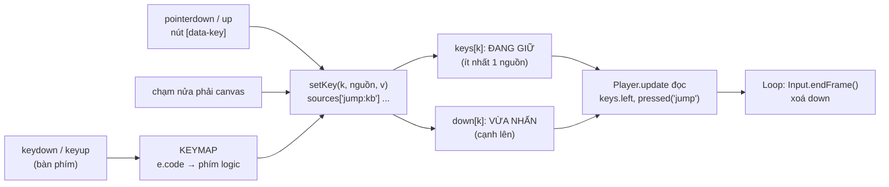

# Bài 03 — Input: giữ phím, cạnh lên, phím logic, coyote time và jump buffer

> Thuộc giáo trình **Lập trình game trình duyệt với Oggy Adventure** · [Mục lục](README.md) · Lời giải: [solutions/03-input.md](solutions/03-input.md)

## 🎯 Mục tiêu

Sau bài này bạn sẽ:

- Phân biệt **held** (đang giữ) với **pressed** (cạnh lên, vừa nhấn đúng frame này) và biết khi nào dùng cái nào.
- Hiểu vì sao game không đọc thẳng `keydown` trong code gameplay mà đi qua **phím logic** và **keymap**.
- Hiểu kỹ thuật **đếm nguồn giữ phím** (bàn phím và nút cảm ứng cùng giữ một phím) và vai trò của `endFrame()`.
- Giải thích được **coyote time** và **jump buffer**, hai mẹo nhỏ làm cú nhảy "dễ chịu" hơn hẳn.
- Thêm được phím mới và hành động mới mà không phải sửa code xử lý sự kiện DOM.

## 🧠 Khái niệm

### 1. Sự kiện DOM ≠ trạng thái game

Trình duyệt báo input bằng **sự kiện** (`keydown`, `keyup`, `pointerdown`...), đến **bất cứ lúc nào** giữa hai frame. Còn
gameplay thì chạy theo **frame**: mỗi frame `Player.update` cần hỏi "lúc này có đang giữ phải không?". Vì vậy module Input làm
trung gian: nó nghe sự kiện, ghi lại vào **trạng thái**, và gameplay chỉ đọc trạng thái đó.



### 2. Held vs pressed

| | **Held** (`OG.Input.keys.left`) | **Pressed** (`OG.Input.pressed('jump')`) |
|---|---|---|
| Đúng khi | phím đang được giữ, **mọi frame** | **một frame duy nhất**, lúc vừa chuyển từ nhả sang giữ |
| Dùng cho | đi trái/phải, giữ nút nhảy để nhảy cao | mở menu, chọn đáp án, bắt đầu cú nhảy |
| Sai lầm nếu dùng nhầm | dùng held cho "tạm dừng" → giữ Esc là menu bật tắt liên tục | dùng pressed cho "đi" → phải bấm liên tục mới đi được |

"Cạnh lên" (rising edge) là thuật ngữ mượn từ điện tử: thời điểm tín hiệu đổi từ 0 lên 1. Cờ "vừa nhấn" phải được **xoá ở cuối mỗi
frame** (`endFrame`), nếu không nó sẽ đúng mãi.

### 3. Phím logic và keymap

Gameplay không biết `KeyW` hay `ArrowUp`, nó chỉ biết **`'jump'`**. Bảng **keymap** dịch mã phím vật lý sang tên hành động. Lợi
ích: đổi phím, thêm phím (WASD và mũi tên cùng lúc), hay thêm nút cảm ứng đều chỉ là thêm **dữ liệu**, không sửa logic.

### 4. Đếm nguồn giữ phím

Bé giữ nút cảm ứng "nhảy" rồi lỡ chạm thêm nửa phải màn hình (cũng là "nhảy"). Nếu chỉ có một cờ `keys.jump`, nhả **một** ngón là cờ
tắt, dù ngón kia vẫn giữ. Input lưu từng **nguồn** riêng (`'jump:kb'`, `'jump:tapR1'`, `'jump:touchab12c'`) và `keys.jump` = "có ít nhất
một nguồn đang giữ".

### 5. Coyote time và jump buffer

Hai mẹo "nới lỏng" thời điểm bấm nhảy. Người chơi không hề thấy chúng, chỉ thấy game "nghe lời":

- **Coyote time**: vẫn cho nhảy thêm một chút (0,06–0,15 giây) **sau khi** chân đã rời mép bục. Tên lấy từ chú sói Coyote trong phim
  hoạt hình, chạy quá mép vực một lúc mới rơi.
- **Jump buffer**: bấm nhảy hơi **sớm**, khi chân chưa chạm đất, thì game "nhớ" cú bấm đó vài phần trăm giây và nhảy ngay khi chạm
  đất.

Cả hai chỉ là **đồng hồ đếm ngược** tính bằng giây, trừ dần theo dt (bài 02).

## 🔍 Đọc code

### 1. Keymap — `src/core/input.js`

Mở [src/core/input.js](../../src/core/input.js), tìm hằng **`KEYMAP`**:

```js
  var KEYMAP = {
    ArrowLeft: ['left'], KeyA: ['left'],
    ArrowRight: ['right'], KeyD: ['right'],
    ArrowUp: ['jump', 'up'], KeyW: ['jump', 'up'], Space: ['jump'],
```

Một mã phím có thể ứng với **nhiều** phím logic: ↑ vừa là `'jump'` trong màn chơi, vừa là `'up'` trên bản đồ.

### 2. Đếm nguồn và cạnh lên — hàm `setKey`

```js
  function setKey(k, src, v) {
    var id = k + ':' + src;
    var was = keys[k];
    if (v) sources[id] = true; else delete sources[id];
```

```js
    var any = false;
    for (var s in sources) if (s.indexOf(k + ':') === 0) { any = true; break; }
    keys[k] = any;
    // Cạnh lên (rising edge): chỉ đánh dấu "vừa nhấn" khi chuyển từ không giữ → giữ.
    if (any && !was) down[k] = true;
```

Mọi nguồn input (bàn phím trong `bindKeyboard`, nút cảm ứng trong `bindTouch`, chạm canvas trong `bindCanvasPointer`) đều đổ về hàm
này. Chỉ có **một** chỗ tính cạnh lên.

### 3. `pressed`, `consume`, `endFrame`

Trong object `OG.Input`:

```js
    pressed: function (k) { return !!down[k]; },
```

```js
    consume: function (k) { delete down[k]; },
```

```js
    endFrame: function () {
      down = {};
      Input.pointer.justPressed = false;
      Input.pointer.justReleased = false;
    },
```

`consume` dùng khi một chỗ đã xử lý cú bấm và không muốn chỗ khác **trong cùng frame** xử lý lại, ví dụ scene `level` bắt phím
`pause` rồi push scene `pause`. `endFrame` được `OG.Loop` gọi ở **cuối** `tick`, sau cả update lẫn draw (xem bài 02).

### 4. Bẫy phím lặp của hệ điều hành — hàm `bindKeyboard`

```js
        if (e.repeat && map[i] !== 'left' && map[i] !== 'right') continue;
        setKey(map[i], 'kb', true);
```

Giữ một phím lâu, hệ điều hành bắn `keydown` lặp lại (`e.repeat = true`). Bình thường `setKey` không tạo cạnh lên mới vì phím vẫn
đang giữ. Nhưng sau `reset()` (đổi scene), một keydown lặp sẽ "giữ lại" phím. Game chỉ cho phép điều đó với trái/phải: đang giữ →
chuyển từ màn sang trận trùm vẫn đi tiếp. Không cho với nhảy/tạm dừng.

### 5. Coyote time và jump buffer — `src/game/player.js`

Mở [src/game/player.js](../../src/game/player.js), hàm **`OG.Player.update`**, phần `---- Nhảy ----`:

```js
      var coyoteT = diff('coyoteTime', 0), bufT = diff('jumpBuffer', 0);
      p.coyote = p.ground ? coyoteT : Math.max(0, p.coyote - dt);
      p.jumpBuf = OG.Input.pressed('jump') ? bufT : Math.max(0, p.jumpBuf - dt);
```

```js
      if (!p.celebrate && ((keys.jump && p.ground) || (p.jumpBuf > 0 && (p.ground || p.coyote > 0)))) {
        if (!p.ground) OG.Input.consume('jump'); // nhảy coyote: không tính là nhảy đôi (Shop)
        p.vy = -p.jumpV;  // y hướng xuống nên nhảy lên = vận tốc ÂM
```

- Đứng trên đất: `p.coyote` luôn được "nạp đầy". Rời đất: nó đếm ngược về 0.
- Mỗi cú **pressed** nạp đầy `p.jumpBuf`, sau đó nó đếm ngược.
- Điều kiện nhảy: (đang **giữ** nhảy và đứng trên đất) **hoặc** (còn buffer và còn đất hoặc còn coyote).

Độ dài hai đồng hồ lấy từ bảng `MODES` trong [src/game/difficulty.js](../../src/game/difficulty.js): chế độ Bé chơi `0.15` giây,
Thử thách `0.06`/`0.08` giây. Đây là ví dụ **data-driven tuning**: cảm giác điều khiển là một bảng số.

Ngay dưới là **variable jump height** (nhảy cao theo thời gian giữ phím): đang bay lên mà vẫn **giữ** nút nhảy thì trọng lực nhẹ hơn.
Đây là chỗ cần **held** chứ không phải pressed:

```js
      if (p.vy < 0 && keys.jump && !p.celebrate) g *= diff('jumpHoldGravityMul', 1);
```

## 🧪 Thử ngay

1. **Điều khiển bằng code.** Vào một màn, gõ `OG.Input.setKey('right', true)`: Oggy tự chạy. Gõ `OG.Input.setKey('right', false)`
   để dừng. Đây chính là cách smoke test "chơi" game (nguồn `'api'`).
2. **Held vs pressed.** Gõ dòng sau rồi giữ Space 2 giây:

   ```js
   var held = 0, presses = 0;
   OG.Level.addHook({ id: 'demoInput', update: function () { if (OG.Input.keys.jump) held++; if (OG.Input.pressed('jump')) presses++; } });
   ```

   Rồi gõ `held + ' frame giữ · ' + presses + ' lần nhấn'`. Gỡ hook bằng `OG.Level.removeHook('demoInput')`.
3. **Coyote time siêu dài.** Gõ:

   ```js
   OG.Difficulty.MODES.kid.coyoteTime = 0.6;
   OG.Difficulty.set('challenge'); OG.Difficulty.set('kid'); // đổi qua lại để tham số được tính lại (cache có version)
   ```

   Chạy khỏi mép bục, đợi một nhịp rồi mới bấm nhảy: Oggy "nhảy trên không khí". Tải lại trang để trả về.
4. **Kẹt phím khi mất focus.** Giữ → rồi Alt+Tab sang cửa sổ khác, quay lại. Game đã tự tạm dừng (`autoPause` trong `main.js`);
   bấm tiếp tục: Oggy **không** tự chạy. Lý do: phím → được nhả khi đang ở cửa sổ khác nên `keyup` không bao giờ tới, nhưng sự
   kiện `blur` của `window` đã gọi `Input.reset()`. Tìm dòng đó trong `Input.init`.

## ✍️ Bài tập

### ⭐ Dễ — Thêm phím K để nhảy và L để tương tác

Sửa `src/core/input.js` để phím **K** cũng nhảy và phím **L** cũng là `'action'`. Không được sửa `player.js`. Kiểm tra trong game,
rồi chạy `node --check src/core/input.js` và smoke test.

<details><summary>💡 Gợi ý</summary>

Chỉ cần thêm dữ liệu vào `KEYMAP`. Mã phím (`e.code`) của chữ cái có dạng `KeyK`, `KeyL`. Có nên thêm chúng vào mảng `PREVENT`
không? Thử trả lời: các phím chữ đó có làm trang cuộn không?

</details>

### ⭐⭐ Vừa — Bảng debug input trên màn chơi

Viết (trong console, hoặc thành file `src/dev/input-debug.js`) một level hook vẽ ở góc trái dưới màn chơi:

- Danh sách phím logic **đang giữ**, ví dụ `GIỮ: right jump`.
- Tổng số lần **pressed** của từng phím từ lúc vào màn, ví dụ `NHẤN: jump×7 action×2`.

Dùng hook `update` để đếm và `drawScreen` để vẽ. Trả lời: vì sao `OG.Input.pressed(...)` gọi trong `drawScreen` vẫn có thể đúng,
dù `drawScreen` chạy sau mọi update?

<details><summary>💡 Gợi ý</summary>

- Duyệt `for (var k in OG.Input.keys)`.
- Thứ tự trong `tick` (bài 02): update → draw → `endFrame()`. Vậy lúc draw, cờ "vừa nhấn" của frame này chưa bị xoá.
- Coi chừng: `Player.update` có thể `consume('jump')` (cú nhảy coyote) **trước** khi hook của bạn chạy, nên hook có thể đếm hụt.
  Xem thứ tự các bước trong scene `level` ở [src/game/level.js](../../src/game/level.js).

</details>

### ⭐⭐⭐ Khó — Thêm phím logic mới `'run'` (chạy nhanh)

Giữ **Shift** (trái hoặc phải) thì nhân vật chạy nhanh gấp 1,6 lần. Yêu cầu:

1. Thêm phím logic `'run'` vào `src/core/input.js` (keymap **và** object `keys` khởi tạo).
2. Sửa `OG.Player.update` để tốc độ ngang nhân với hằng số `RUN_MUL = 1.6` khi đang **giữ** `'run'`. Đặt hằng ở đầu module, có
   comment đơn vị.
3. Thêm một nút cảm ứng `🏃` cho điện thoại **mà không viết thêm JavaScript nào** cho nút đó.
4. Smoke test vẫn XANH. Vì sao test không bị ảnh hưởng dù bạn đổi `player.js`?

<details><summary>💡 Gợi ý</summary>

- Mã phím Shift: `ShiftLeft`, `ShiftRight`.
- `Input.bindTouch(document)` gắn **mọi** phần tử có `data-key` lúc init. Xem các nút trong `#mobileControls` của `index.html`.
- Smoke test không bao giờ giữ Shift, nên `keys.run` luôn `false` và hệ số luôn là 1.

</details>

## 📚 Đọc thêm

- MDN — [`KeyboardEvent.code`](https://developer.mozilla.org/en-US/docs/Web/API/KeyboardEvent/code) (vì sao dùng `code` chứ không
  dùng `key`: `code` là vị trí phím vật lý, không đổi theo bố cục bàn phím hay bộ gõ tiếng Việt).
- MDN — [`KeyboardEvent.repeat`](https://developer.mozilla.org/en-US/docs/Web/API/KeyboardEvent/repeat).
- MDN — [Pointer events](https://developer.mozilla.org/en-US/docs/Web/API/Pointer_events) (một API cho chuột, bút và cảm ứng).
- MDN — [Desktop mouse and keyboard controls](https://developer.mozilla.org/en-US/docs/Games/Techniques/Control_mechanisms/Desktop_with_mouse_and_keyboard).
- Robert Nystrom — *Game Programming Patterns*, chương [Command](https://gameprogrammingpatterns.com/command.html) (tách
  "phím nào" khỏi "làm gì", nâng cấp của ý tưởng phím logic).
- Maddy Thorson — [Celeste and Forgiveness](https://maddythorson.medium.com/celeste-and-forgiveness-df14f0bc2e2f) (coyote time,
  jump buffer trong một game thật).

## ➡️ Bài tiếp theo

[Bài 04 — Vật lý và va chạm AABB](04-vat-ly-va-cham-aabb.md): sau khi `Player.update` đặt vận tốc, `OG.Physics.moveBody` biến
vận tốc thành chuyển động, và quyết định khi nào Oggy đứng được trên bục.
