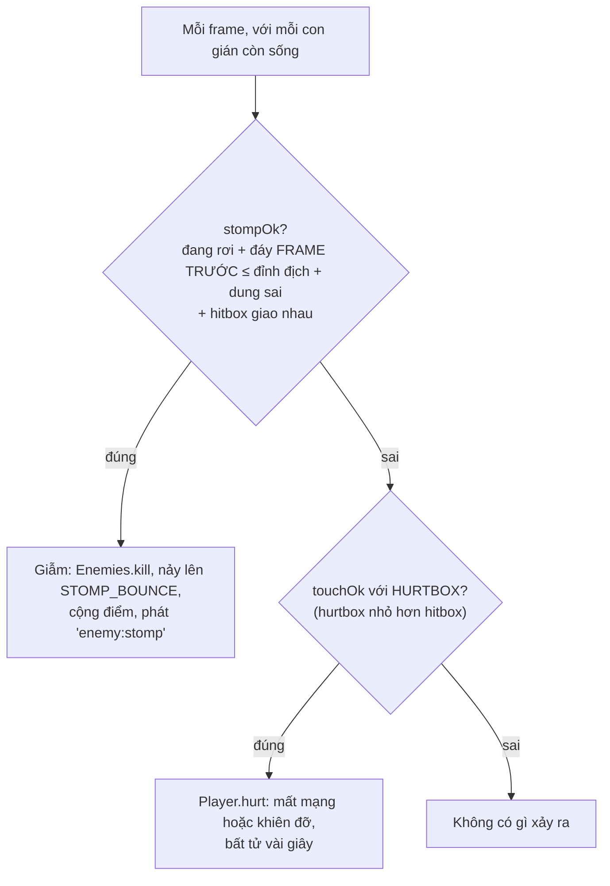

# Bài 04 — Vật lý và va chạm AABB

> Thuộc giáo trình **Lập trình game trình duyệt với Oggy Adventure** · [Mục lục](README.md) · Lời giải: [solutions/04-vat-ly-va-cham-aabb.md](solutions/04-vat-ly-va-cham-aabb.md)

## 🎯 Mục tiêu

Sau bài này bạn sẽ:

- Mô phỏng được **trọng lực** bằng **tích phân Euler** (cập nhật vận tốc rồi vị trí theo dt), và biết **terminal velocity**.
- Viết được phép thử va chạm **AABB** và hiểu vì sao nó chỉ cần 4 phép so sánh.
- Cài được **one-way platform** (bục chỉ đứng được từ trên xuống) mà không bị rơi xuyên khi rơi nhanh.
- Phân biệt **giẫm** và **bị chạm** bằng *hướng đi tới* (đáy hitbox ở frame trước), không chỉ bằng việc chồng nhau.
- Phân biệt **hitbox** với **hurtbox**, và biết cách nới lỏng va chạm cho trẻ em (dung sai, chạm sượt).

## 🧠 Khái niệm

### 1. Hệ toạ độ của game

- Đơn vị là px **thế giới** (world). Gốc ở góc trên-trái, **trục y hướng xuống**. Vì vậy `vy > 0` là đang rơi, còn nhảy lên là
  `vy` **âm**.
- Hitbox `{x, y, w, h}` có `x, y` là **góc trên-trái**. Đáy hitbox là `y + h`.
- Mặt sàn chuẩn ở `y = 480` (`OG.FLOOR_Y`). Xem [docs/ARCHITECTURE.md](../ARCHITECTURE.md) mục 3.

### 2. Trọng lực và tích phân Euler

Trọng lực là **gia tốc** không đổi, `g = 1500` px/giây². Mỗi frame:

```
vy = vy + g · dt        (vận tốc thay đổi theo gia tốc)
y  = y  + vy · dt       (vị trí thay đổi theo vận tốc MỚI)
```

Cách "cộng dồn từng bước nhỏ" này gọi là **tích phân số** (numerical integration). Cập nhật vận tốc **trước** rồi dùng vận tốc mới
cho vị trí gọi là **semi-implicit Euler** (Euler bán ẩn). Nó đơn giản và ổn định hơn Euler "ngây thơ" (dùng vận tốc cũ). Bài 02 đã
cho thấy nó phụ thuộc nhẹ vào dt.

Vận tốc rơi bị kẹp ở `MAX_FALL = 900` px/giây: **terminal velocity** (vận tốc rơi giới hạn). Không có nó, rơi từ trên cao sẽ nhanh vô
hạn và người chơi không kịp điều khiển.

Cú nhảy đặt `vy = −590` px/giây. Đỉnh nhảy theo công thức vật lý là `v² / 2g = 590² / 3000 ≈ 116` px. Mọi bục trong màn phải thấp
hơn mức đó thì mới nhảy lên được.

### 3. AABB

**AABB** (Axis-Aligned Bounding Box) là hình chữ nhật **không xoay**, cạnh song song trục toạ độ. Hai AABB giao nhau khi và chỉ khi
chúng chồng nhau trên **cả** trục x **lẫn** trục y:

```
a.x < b.x + b.w   (mép trái a ở bên trái mép phải b)
a.x + a.w > b.x   (mép phải a ở bên phải mép trái b)
a.y < b.y + b.h   (tương tự theo y)
a.y + a.h > b.y
```

Chỉ 4 phép so sánh nên rất rẻ: đủ để xét hàng trăm cặp mỗi frame. Đánh đổi: hình nhân vật không vuông, nên hitbox luôn là một
**xấp xỉ**. Đây là lý do game tách hitbox và hurtbox (mục 5).

### 4. One-way platform

Bục trong game là **bục một chiều** như trong Mario: nhảy từ **dưới lên** thì đi xuyên qua, rơi từ **trên xuống** thì đứng lại. Điều
kiện đáp xuống bục gồm cả bốn ý:

1. đang rơi (`vy >= 0`);
2. ở frame **trước**, đáy hitbox còn ở **trên** mặt bục;
3. ở frame **này**, đáy đã chạm hoặc xuyên mặt bục;
4. chồng nhau theo trục x.

Điều kiện (2) là mấu chốt. Rơi nhanh 900 px/giây với dt 0,033 giây thì một frame đi được 30 px, dày hơn nhiều bục. Nếu chỉ xét vị
trí **mới** ("đáy có đang nằm trong bục không?"), có frame vật đã **vượt qua** bục mà không bao giờ "nằm trong" nó. So với vị trí
**cũ** thì bắt được trường hợp này. Đây là một dạng đơn giản của **continuous collision detection** (phát hiện va chạm liên tục).

### 5. Giẫm hay bị chạm? Hitbox hay hurtbox?



- **Giẫm được xét trước** (`if ... else if`): cùng một lần chồng hitbox, nếu đủ điều kiện giẫm thì người chơi thắng.
- "Giẫm" được nhận ra bằng **hướng đi tới**: frame trước chân còn ở trên đầu địch. Chỉ hỏi "có giao nhau không" thì không phân biệt
  được rơi xuống đầu với đâm ngang.
- **Hitbox** là hình chữ nhật thật của con gián, dùng để giẫm. **Hurtbox** là vùng làm người chơi đau, **nhỏ hơn** một chút. Nhờ vậy
  chạm sượt mép không bị trừ mạng, và game có cảm giác "công bằng".
- Chế độ Bé chơi nới thêm: dung sai giẫm lớn hơn, hurtbox chỉ còn 70%, chồng nhau dưới 6 px (**graze**, chạm sượt) không tính.

## 🔍 Đọc code

### 1. AABB — `OG.util.overlap` trong `src/core/namespace.js`

Mở [src/core/namespace.js](../../src/core/namespace.js), tìm **`U.overlap`**:

```js
  U.overlap = function (a, b) {
    return a.x < b.x + b.w && a.x + a.w > b.x && a.y < b.y + b.h && a.y + a.h > b.y;
  };
```

Comment phía trên có một `⚠️ Bẫy`: dùng `<` chứ không `<=`, nên hai hộp chỉ **chạm mép** không tính là giao. `OG.Physics.aabb` chỉ
là bí danh của hàm này.

### 2. `OG.Physics.moveBody` — `src/core/physics.js`

Mở [src/core/physics.js](../../src/core/physics.js), tìm **`moveBody`**. Phần tích phân:

```js
      body.vy = Math.min(maxFall, body.vy + g * dt);
      var oldY = body.y;
      var wasGround = body.ground;
      body.x = Math.max(minX, Math.min(maxX - body.w, body.x + body.vx * dt));
      body.y += body.vy * dt;
      body.ground = false;
```

Phần one-way platform, 4 điều kiện tách thành biến có tên:

```js
        var wasAbove = oldY + body.h <= plat.y + LAND_TOLERANCE;
        var reachedTop = body.y + body.h >= plat.y;
        var overlapX = body.x + body.w > plat.x && body.x < plat.x + plat.w;
        if (body.vy >= 0 && wasAbove && reachedTop && overlapX) {
          body.y = plat.y - body.h;  // đặt chân đúng lên mặt bục
          body.vy = 0;
          body.ground = true;
        }
```

Và giá trị trả về:

```js
      return { landed: body.ground && !wasGround, prevBottom: oldY + body.h };
```

- `landed` là một **cạnh lên** (bài 03), nhưng của trạng thái vật lý: đúng một frame, lúc vừa chạm đất. Player dùng nó để phát
  `'player:land'`.
- `prevBottom` (đáy frame trước) được trả ra để **người gọi** dùng cho phép thử giẫm.
- `moveBody` **sửa trực tiếp** `body` và không đổi `vx`. Ai muốn đi ngang thì tự đặt `vx` trước khi gọi.
- `LAND_TOLERANCE = 8` px bù sai số làm tròn. Nhờ nó, nhân vật đứng yên trên bục không bị "rung" giữa đứng và rơi.

### 3. `OG.Physics.isStomp`

```js
    isStomp: function (body, prevBottom, target, tolerance) {
      // 💡 Khái niệm: phân biệt "giẫm" và "bị chạm" bằng HƯỚNG đi tới, không chỉ bằng việc giao nhau:
      //   cùng một lần chồng hitbox, nếu frame trước chân còn ở trên đầu địch thì là giẫm, ngược lại là bị thương.
      return body.vy > 0 && prevBottom <= target.y + (tolerance == null ? DEFAULT_STOMP_TOLERANCE : tolerance) && OG.util.overlap(body, target);
    }
```

### 4. Giẫm trước, chạm sau — `src/game/level.js`

Mở [src/game/level.js](../../src/game/level.js), tìm hàm **`updateEnemies`**:

```js
      if (e.stompable && stompOk(p, res.prevBottom, e, STOMP_TOLERANCE, e.prevY)) {
        OG.Enemies.kill(e);
        // Nảy lên sau khi giẫm: cảm giác "đã" + có thể giẫm liên hoàn con kế tiếp.
        p.vy = -C.STOMP_BOUNCE;
```

```js
      } else if (e.hurts && touchOk(p, OG.Enemies.hurtbox(e))) {
        OG.Player.hurt(p, 'enemy');
```

Hai hàm **`stompOk`** và **`touchOk`** ngay phía trên trong cùng file: ưu tiên phiên bản "rộng lượng" của `OG.Difficulty`, không có
thì dùng phép thử gốc. `stompOk` còn nhận `e.prevY` (đỉnh địch ở frame trước) để bù cho kẻ địch **tự nhảy lên** như Marky:

```js
    var top = prevTop != null ? Math.max(target.y, prevTop) : target.y;
    return p.vy > 0 && prevBottom <= top + (tol == null ? STOMP_TOLERANCE : tol) && U.overlap(p, target);
```

### 5. Hurtbox — `src/game/enemies.js` và `src/game/difficulty.js`

Trong [src/game/enemies.js](../../src/game/enemies.js), hàm **`hurtbox`**: hitbox thu nhỏ `HURTBOX_INSET = 3` px. Có thể thu nhỏ thêm
qua `OG.Difficulty.enemyHurtbox`:

```js
      var box = { x: e.x + HURTBOX_INSET, y: e.y + HURTBOX_INSET, w: e.w - HURTBOX_INSET * 2, h: e.h - HURTBOX_INSET };
```

Trong [src/game/difficulty.js](../../src/game/difficulty.js), hàm **`touches`** đo **độ chồng lấn** theo từng trục, không chỉ
hỏi có/không:

```js
      var ox = Math.min(p.x + p.w, box.x + box.w) - Math.max(p.x, box.x);
      var oy = Math.min(p.y + p.h, box.y + box.h) - Math.max(p.y, box.y);
      return ox > Math.min(g, box.w / 3) && oy > Math.min(g, box.h / 3);
```

### 6. Nhặt đồ không cần AABB — `src/game/collectibles.js`

[src/game/collectibles.js](../../src/game/collectibles.js), hàm **`touches`**: vật phẩm dùng toạ độ **tâm**, nên vùng nhặt viết gọn
thành `|dx| < nửa rộng && |dy| < nửa cao`, tương đương một AABB. Chú ý nó so từ **tâm** người chơi (`p.x + p.w / 2`), vì hitbox
người chơi tính từ góc trên-trái.

## 🧪 Thử ngay

Vào một màn chơi rồi gõ trong console:

1. **Trọng lực Mặt Trăng:** `OG.Config.GRAVITY = 600`. Nhảy thử. Đỉnh nhảy theo công thức giờ là 590² / 1200 ≈ 290 px.
2. **Rơi siêu nhanh mà không xuyên sàn:** `OG.Config.MAX_FALL = 3000`, nhảy từ bục cao nhất xuống. Rơi nhanh hơn hẳn nhưng vẫn đứng
   được trên sàn, nhờ điều kiện `wasAbove` dùng `oldY`.
3. **Xem hitbox người chơi:** `OG.Level.state.player`. Với Oggy, hitbox là `{x, y, w: 34, h: 52}`. Gõ lại vài lần khi chạy và khi
   nhảy: `ground` và `vy` thay đổi thế nào?
4. **Nâng một cái bục:** `OG.Level.state.platforms[1].y -= 60`. Bục được vẽ lại ở chỗ mới ngay frame sau, vì cả vật lý lẫn hàm vẽ
   cùng đọc mảng `platforms`. Nếu bục giờ cao hơn đỉnh nhảy (~111 px tính từ chỗ bạn đứng) thì không nhảy lên được nữa. Đây là
   **trạng thái chạy** (state) nên sửa thoải mái: chơi lại màn là có lại, vì dữ liệu gốc `LevelDef` không bị đổi (xem `buildState`
   trong `level.js`).
5. **Hurtbox cực nhỏ:** `OG.Difficulty.MODES.kid.enemyHitboxScale = 0.2`, rồi `OG.Difficulty.set('challenge'); OG.Difficulty.set('kid');`
   để tham số được tính lại. Bạn phải lao thẳng vào chân gián mới bị đau.

Tải lại trang để trả mọi thứ về như cũ.

## ✍️ Bài tập

### ⭐ Dễ — Đo đỉnh nhảy thật

Viết đoạn console đo **độ cao đỉnh** (px) của mỗi cú nhảy và in ra khi tiếp đất. So với công thức `v² / 2g` cho hai trường hợp:

- chế độ Thử thách (`OG.Difficulty.set('challenge')`), bấm nhảy rồi giữ;
- chế độ Bé chơi (`OG.Difficulty.set('kid')`), **giữ** nút nhảy, rồi lặp lại với **bấm nhanh** rồi thả.

Giải thích vì sao số đo nhỏ hơn công thức một chút, và vì sao chế độ Bé chơi nhảy cao hơn khi giữ nút.

<details><summary>💡 Gợi ý</summary>

- Nghe `'player:jump'` để ghi `startY = OG.Level.state.player.y`. Dùng một level hook `update` để theo dõi `y` nhỏ nhất (y hướng
  xuống, nên **nhỏ nhất** là cao nhất). Nghe `'player:land'` để in `startY - minY`.
- Nhớ lại bảng ở bài 02 (Euler ở 60 FPS).
- Đọc `jumpHoldGravityMul` trong bảng `MODES` (`src/game/difficulty.js`) và dòng `g *= diff('jumpHoldGravityMul', 1)` trong
  `Player.update`.

</details>

### ⭐⭐ Vừa — Chế độ xem hitbox (debug overlay)

Viết một level hook vẽ **khung chữ nhật** quanh:

- hitbox người chơi (xanh lá), đổi sang màu khác khi `ground === true`;
- hitbox của mỗi con gián còn sống (vàng) **và** hurtbox của nó (đỏ, lấy từ `OG.Enemies.hurtbox(e)`);
- mỗi bục (xanh dương, nét mảnh).

Bật ở chế độ Bé chơi rồi Thử thách: hurtbox đổi kích thước thế nào? Vì sao phải vẽ trong `drawFront` (hoặc `drawWorld`) chứ không
phải `drawScreen`?

<details><summary>💡 Gợi ý</summary>

- `ctx.strokeRect(x, y, w, h)`. Nhớ `ctx.save()` / `ctx.restore()`.
- Đọc hợp đồng hook ở khối đầu `level.js` và hàm `drawWorld`: `drawFront` chạy **sau** `OG.Camera.apply(ctx)`, tức là đang ở toạ
  độ **thế giới**. `drawScreen` chạy sau khi đã bỏ camera.
- Gián đã chết vẫn còn trong mảng `st.enemies` (hoạt ảnh bẹp), nên lọc theo `e.alive`.

</details>

### ⭐⭐⭐ Khó — Bục "đụng đầu" (solid platform)

Hiện mọi bục đều một chiều. Thêm loại bục **đặc**: platform có `solid: true` thì nhảy từ dưới lên sẽ **đụng đầu** (dừng lại, bắt đầu
rơi), còn đứng lên từ trên xuống thì vẫn như cũ.

1. Sửa `OG.Physics.moveBody` (`src/core/physics.js`): thêm vòng kiểm tra trần cho bục `solid`, viết theo đúng phong cách 4 điều kiện
   có tên như phần đáp bục.
2. Thử trong game: vào màn, gõ `OG.Level.state.platforms[1].solid = true` rồi nhảy từ ngay dưới bục đó lên.
3. Trả lời: vì sao phần đụng đầu cũng phải so với `oldY` chứ không chỉ `body.y` mới? Thay đổi này có làm hỏng kẻ địch hay trùm
   (cũng dùng `moveBody`) không?
4. `node --check src/core/physics.js`, kiểm tra kiểu (`npx -y -p typescript@5.6.3 tsc -p jsconfig.json --noEmit`, vì file có
   `// @ts-check`) và smoke test đều phải sạch.

<details><summary>💡 Gợi ý</summary>

- Đối xứng với đáp bục: (1) đang **đi lên** `vy < 0`; (2) frame trước **đỉnh** đầu ở **dưới** đáy bục: `oldY >= plat.y + plat.h`;
  (3) frame này đỉnh đầu đã lên quá đáy bục: `body.y < plat.y + plat.h`; (4) chồng theo x. Khi thoả: `body.y = plat.y + plat.h`,
  `body.vy = 0`.
- Kiểu `Platform` trong `src/types.d.ts` chưa có field `solid`. Tham số đang khai là `AABB[]`. Hoặc ép kiểu
  `/** @type {any} */ (plat).solid`, hoặc thêm `solid?: boolean` vào `Platform` và đổi kiểu tham số.
- Không có bục nào trong dữ liệu có `solid`, nên điều kiện luôn sai với mọi vật thể khác.

</details>

## 📚 Đọc thêm

- MDN — [2D collision detection](https://developer.mozilla.org/en-US/docs/Games/Techniques/2D_collision_detection) (AABB, hình tròn,
  SAT).
- Glenn Fiedler — [Integration Basics](https://gafferongames.com/post/integration_basics/) (Euler, semi-implicit Euler, RK4).
- Rodrigo Monteiro — [The guide to implementing 2D platformers](http://higherorderfun.com/blog/2012/05/20/the-guide-to-implementing-2d-platformers/)
  (bục một chiều, dốc, va chạm theo ô).
- Christer Ericson — *Real-Time Collision Detection* (Morgan Kaufmann, 2004), chương 4 "Bounding Volumes": tài liệu chuẩn về
  AABB.
- [docs/ARCHITECTURE.md](../ARCHITECTURE.md) mục 3 (quy ước toạ độ, hitbox, điểm neo khi vẽ).

## ➡️ Bài tiếp theo

[Bài 05 — State machine và scene](05-state-machine-scene.md): `level`, `pause`, `boss`, `gameover` chuyển qua lại thế nào, và vì
sao khi tạm dừng thì vật lý của bài này tự "đóng băng" mà không cần cờ `isPaused`.
