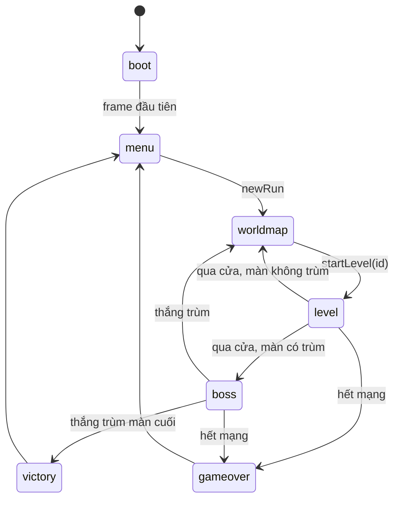
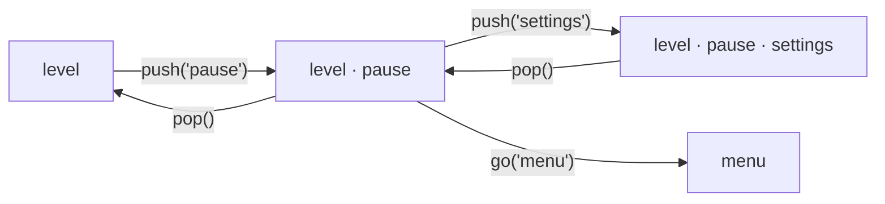
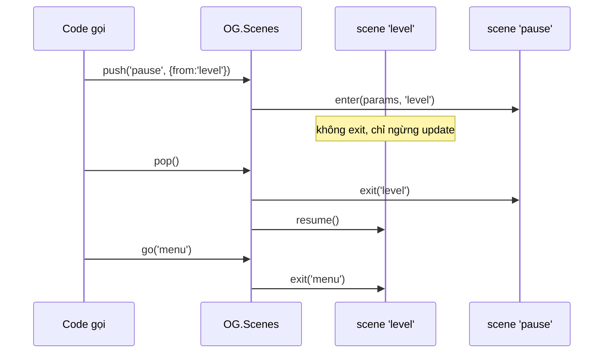
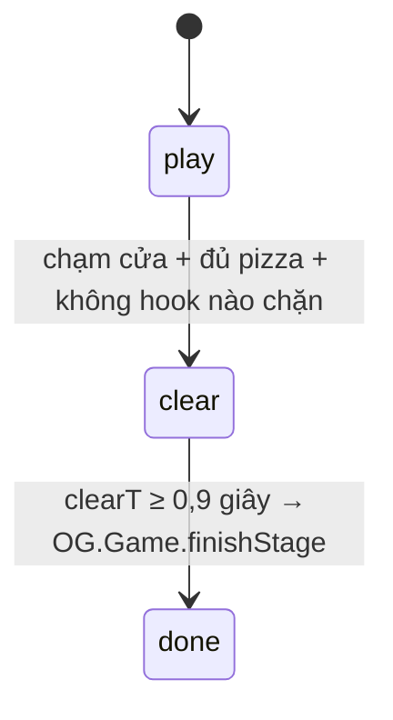

# Bài 05 — State machine và scene

> Thuộc giáo trình **Lập trình game trình duyệt với Oggy Adventure** · [Mục lục](README.md) · Lời giải: [solutions/05-state-machine-scene.md](solutions/05-state-machine-scene.md)

## 🎯 Mục tiêu

Sau bài này bạn sẽ:

- Giải thích được **finite state machine** (FSM, máy hữu hạn trạng thái) và nhận ra nó ở **ba tầng** của game: luồng màn hình
  (scene), pha bên trong một scene (`st.phase`), và AI của trùm (bài 09).
- Dùng được **scene stack** (ngăn xếp scene): `go` thay cả stack, `push` đè lên trên, `pop` gỡ ra.
- Hiểu **vòng đời** (lifecycle) của scene: `enter`, `exit`, `resume`, và cờ `drawBelow`.
- Tự viết một scene thường, một scene **overlay** (lớp phủ) và một scene **chuyển cảnh** (transition).
- Tránh được ba bẫy kinh điển: đổi scene ngay trong `enter`, phím "lọt" sang scene mới, và `pop` sai thứ tự với callback.

## 🧠 Khái niệm

### 1. Vì sao cần state machine?

Thử tưởng tượng game không có khái niệm "scene". Vòng lặp chính sẽ đầy cờ boolean:

```js
// ❌ "boolean soup" — mỗi cờ thêm vào nhân đôi số tổ hợp phải nghĩ tới
if (isMenu) { ... } else if (isPaused && !isGameOver) { ... } else if (isBoss && !isPaused) { ... }
```

`isPaused && isMenu` có hợp lệ không? `isBoss` mà quên tắt khi sang `gameover` thì sao? Với 5 cờ đã có 32 tổ hợp, hầu hết vô nghĩa.

**Finite state machine** giải quyết bằng một quy tắc đơn giản: **tại mỗi thời điểm, hệ thống ở ĐÚNG MỘT trạng thái**, chọn trong
một tập hữu hạn. Mỗi trạng thái tự biết cách cập nhật và vẽ. Muốn sang trạng thái khác thì đi qua một **phép chuyển** (transition)
có tên rõ ràng. Không còn tổ hợp vô nghĩa, vì không thể "vừa ở menu vừa ở màn chơi".

### 2. Scene là một trạng thái cấp cao

Trong Oggy Adventure, mỗi **scene** (một "màn hình" của game: menu, bản đồ, màn chơi, trùm, tạm dừng...) là một trạng thái. Scene
chỉ là một object có vài hàm tuỳ chọn (kiểu `Scene` trong [src/types.d.ts](../../src/types.d.ts)):

```js
scene = { enter(params, fromName), exit(toName), update(dt), draw(ctx), resume(), drawBelow: bool }
```

`OG.Loop` (bài 02) không biết game đang ở đâu. Mỗi frame nó chỉ gọi `OG.Scenes.update(dt)` rồi `OG.Scenes.draw(ctx)`, và
`OG.Scenes` chuyển tiếp lời gọi cho scene hiện tại. Đây cũng là **polymorphism** (đa hình) kiểu JavaScript: cùng lời gọi
`scene.update(dt)`, mỗi scene làm một việc khác.

Luồng chính của chế độ cổ điển (xem [docs/ARCHITECTURE.md](../ARCHITECTURE.md) mục 5):



### 3. Scene stack: go, push, pop

Một FSM "phẳng" chỉ nhớ trạng thái hiện tại. Nhưng khi bấm **P** để tạm dừng, ta muốn sau đó quay lại **đúng** màn đang chơi, với
nguyên vị trí nhân vật, pizza đã nhặt, gián đang đi dở. Lời giải là một **ngăn xếp** (stack) trạng thái, trong tài liệu lý thuyết gọi
là **pushdown automaton**:

| Lệnh | Việc làm | Ví dụ |
|---|---|---|
| `go(name, params)` | `exit()` **mọi** scene trong stack, rồi `enter()` scene mới. Stack còn đúng 1 phần tử. | menu → worldmap, level → boss |
| `push(name, params)` | Đặt scene mới **lên trên**. Scene dưới **không bị exit**, chỉ ngừng nhận `update`. | level → pause |
| `pop()` | Gỡ scene trên cùng (`exit`), gọi `resume()` của scene lộ ra. Không bao giờ pop scene đáy. | pause → level |



Chỉ scene **trên cùng** được `update`, nên khi `pause` nằm trên `level` thì gameplay tự đứng yên. Không cần rải `if (isPaused)` vào
vật lý, kẻ địch, đồng hồ... Đó là lợi ích lớn nhất của scene stack.

### 4. Vòng đời của scene



- **`enter(params, fromName)`**: khởi tạo trạng thái của scene. `params` là cách truyền dữ liệu giữa các scene (vd
  `{levelId: 'kitchen'}`), thay vì dùng biến toàn cục.
- **`exit(toName)`**: dọn dẹp (ẩn panel DOM, huỷ listener...). Ghép đôi với `enter` giống `save`/`restore` của canvas.
- **`resume()`**: scene vừa "lộ ra" sau một `pop`. Ví dụ `pause.resume()` vẽ lại panel của nó sau khi `settings` đóng.
- **`drawBelow`**: khi scene nằm trên, scene bên dưới có được **vẽ** không? `pause` để `true` nên màn chơi đứng yên hiện mờ phía
  sau. Một scene che kín màn hình thì đặt `false` để khỏi vẽ phí.

### 5. State machine nhỏ bên trong một scene

Không phải trạng thái nào cũng đáng thành một scene. Lúc chạm cửa EXIT, màn chơi có **0,9 giây ăn mừng**: kẻ địch thôi gây đau,
nhân vật nhảy múa, rồi mới chuyển màn. Tạo scene riêng cho 0,9 giây này thì quá nặng (phải chép cách vẽ màn chơi sang). Thay vào đó
scene `level` có một FSM mini trong `st.phase`:



Scene `boss` cũng vậy: `battle.phase` là `'fight' → 'end'`, hoặc `'skip'` khi không tạo được trùm.

**Quy tắc chọn:** trạng thái cần **cách vẽ / cách điều khiển khác hẳn** thì thành scene. Trạng thái chỉ đổi vài luật trong cùng một
khung cảnh thì làm pha bên trong scene.

## 🔍 Đọc code

### 1. Bộ máy scene — `src/core/scenes.js`

Mở [src/core/scenes.js](../../src/core/scenes.js). Toàn bộ trạng thái của bộ máy chỉ là hai biến:

```js
  /** @type {Object<string, Scene>} tên scene → object scene */
  var registry = {};
  /** @type {StackEntry[]} phần tử cuối = scene đang hoạt động (top) */
  var stack = [];
```

`registry` là **bảng đăng ký**: `register(name, scene)` lần sau **ghi đè** lần trước. Nhờ vậy `src/game/default-scenes.js` đăng ký
bản MVP của `menu`, `pause`... trước, rồi `OG.Menus.init()` đăng ký lại cùng tên bằng bản đẹp hơn (mẫu "stub rồi ghi đè" ở bài 01).

Tìm hàm **`go`**:

```js
      var from = Scenes.current();
      while (stack.length) {
        var e = stack.pop();
        if (e.scene.exit) OG.util.safe('scene ' + e.name + '.exit', e.scene.exit, e.scene, [name]);
      }
      // ⚠️ Bẫy: không reset input khi đổi scene thì phím đang giữ (vd Enter để bấm nút menu) "lọt" sang
      //   scene mới và bị xử lý thêm lần nữa — vd vừa vào màn đã bấm nhầm nút.
      OG.Input.reset();
      stack.push({ name: name, scene: scene });
      // 💡 Khái niệm: vòng đời (lifecycle) — scene tự khởi tạo trong enter() và dọn dẹp trong exit()
      //   (vd huỷ listener event). Bọc safe để scene lỗi không làm kẹt cả máy trạng thái.
      if (scene.enter) OG.util.safe('scene ' + name + '.enter', scene.enter, scene, [params || {}, from]);
      OG.Events.emit('scene:change', { from: from, to: name, params: params || {} });
```

Để ý thứ tự: **exit hết → reset input → enter → phát event**. Listener của `'scene:change'` (Audio đổi nhạc, Guide xoá lời thoại...)
chạy khi scene mới **đã sẵn sàng**.

Hàm **`pop`**:

```js
      // Không bao giờ pop scene đáy: stack rỗng thì Loop không còn gì để update/draw.
      if (stack.length <= 1) return;
      var e = stack.pop();
      if (e.scene.exit) OG.util.safe('scene ' + e.name + '.exit', e.scene.exit, e.scene, [Scenes.current()]);
      OG.Input.reset();
      var t = topEntry();
      if (t.scene.resume) OG.util.safe('scene ' + t.name + '.resume', t.scene.resume, t.scene, []);
```

Hàm **`update`** chỉ gọi scene trên cùng. Hàm **`draw`** thì đi từ đỉnh xuống để tìm scene thấp nhất còn "nhìn thấy", rồi vẽ từ dưới
lên (vẽ sau đè lên vẽ trước):

```js
      var start = stack.length - 1;
      while (start > 0 && stack[start].scene.drawBelow !== false) start--;
      for (var i = start; i < stack.length; i++) {
        var s = stack[i].scene;
        // save/restore quanh từng scene: scene này đổi transform/alpha cũng không ảnh hưởng scene vẽ sau.
        if (s.draw) { ctx.save(); s.draw(ctx); ctx.restore(); }
      }
```

### 2. Scene chuyển tiếp và scene overlay — `src/game/default-scenes.js`

Mở [src/game/default-scenes.js](../../src/game/default-scenes.js), tìm scene **`'boot'`**:

```js
  OG.Scenes.register('boot', {
    enter: function () { OG.DOM.hidePanel(); this.done = false; },
    update: function () { if (!this.done) { this.done = true; OG.Scenes.go('menu'); } },
    draw: function (ctx) { OG.drawTitleBackdrop(ctx); }
  });
```

`boot` sống đúng **một frame**. Nó đổi scene trong `update`, không phải trong `enter`, vì `enter` đang chạy **bên trong** `Scenes.go()`.
Gọi `go()` lồng trong `go()` sẽ làm thứ tự `exit/enter/'scene:change'` rối tung.

Cùng file, scene **`'pause'`** mặc định có một dòng đáng nhớ:

```js
      // consume trước khi pop: cùng cú bấm P không được scene 'level' lộ ra xử lý tiếp (sẽ push pause lại ngay).
      if (OG.Input.pressed('pause')) { OG.Input.consume('pause'); OG.Scenes.pop(); }
```

### 3. Một scene, hai cách vào — `src/ui/menus.js`

Mở [src/ui/menus.js](../../src/ui/menus.js), tìm hàm **`settingsScene`**. Cài đặt có thể được `go` từ menu (thay hẳn scene) hoặc
`push` từ pause (`{overlay: true}`). Nút "Xong" phải quay về đúng chỗ:

```js
      leave: function () {
        if (S.overlay) { OG.Scenes.pop(); return; }
        OG.Scenes.go(OG.Scenes.has(S.back) ? S.back : 'menu');
      },
```

Ngay dưới, hàm **`pauseScene`** có `resume` để vẽ lại panel tạm dừng khi `settings` đóng:

```js
      // Quay lại từ settings (đã push lên trên pause).
      resume: function () { S.render('[data-act="settings"]'); },
```

### 4. Pha trong scene — `src/game/level.js`

Mở [src/game/level.js](../../src/game/level.js), tìm hàm **`checkExit`**:

```js
      if (stage.pizzas >= st.level.goal && !exitBlocked(st, p)) {
        // 💡 Khái niệm: pha trong scene — 'play' → 'clear' (ăn mừng 0.9 giây, kẻ địch không gây đau nữa) → 'done'.
        //   Một state machine nhỏ BÊN TRONG scene, không cần tạo scene riêng cho mấy giây ăn mừng.
        st.phase = 'clear';
        st.clearT = 0;
```

Và trong `update` của scene `'level'`:

```js
      if (st.phase === 'clear') {
        st.clearT += dt;
        if (st.clearT >= CLEAR_DELAY) { st.phase = 'done'; OG.Game.finishStage(st.level.id); return; }
      }
```

Còn hàm **`updateEnemies`** dùng pha để tắt sát thương: `if (!e.alive || st.phase !== 'play') continue;`.

Cũng trong `update`, dòng đầu tiên là cách màn chơi mở pause:

```js
      if (OG.Input.pressed('pause')) { OG.Input.consume('pause'); OG.Scenes.push('pause', { from: 'level' }); return; }
```

### 5. Luồng game cấp cao — `src/game/game.js`

Mở [src/game/game.js](../../src/game/game.js), tìm **`finishStage`**. Mọi mũi tên của sơ đồ ở mục 2 đều là một lời gọi
`Scenes.go()` nằm tập trung ở file này:

```js
    finishStage: function (levelId) {
      var level = OG.Data.getLevel(levelId);
      if (level && level.boss && OG.util.call('Bosses', 'has', level.boss)) {
        var toBoss = { scene: 'boss', params: { levelId: levelId, bossId: level.boss } };
```

Đọc tiếp **`completeLevel`**: `level:complete` được phát **trước** khi chuyển scene (`victory()` hoặc `go('worldmap')`), nên mọi
listener thấy kết quả khi màn vừa xong.

### 6. Đổi scene an toàn — `src/game/boss-scene.js` và `src/story/`

Trong [src/game/boss-scene.js](../../src/game/boss-scene.js), `update` của scene `'boss'` xử lý pha `'skip'` ở frame đầu tiên,
không phải trong `enter`:

```js
      // ⚠️ Bẫy: bỏ qua trận ở frame update đầu tiên thay vì gọi finish() ngay trong enter(): enter đang chạy bên trong
      //   Scenes.go(), đổi scene lồng vào đó dễ làm thứ tự exit/enter/'scene:change' bị rối.
      if (battle.phase === 'skip') { finish(); return; }
```

Trong [src/story/story.js](../../src/story/story.js), hàm **`pushComic`** giải thích vì sao truyện chen giữa màn phải dùng `push`:

```js
     * ⚠️ Bẫy: dùng push chứ không phải go — go sẽ exit() màn chơi và mất toàn bộ trạng thái (vị trí, pizza đã nhặt).
```

Còn [src/story/scenes.js](../../src/story/scenes.js), hàm **`finish`** của scene `comic`, có thứ tự "pop **trước**, callback **sau**":

```js
        // ⚠️ Bẫy: pop TRƯỚC rồi mới gọi cb — cb có thể push scene khác; làm ngược lại sẽ pop nhầm scene mới.
        OG.Scenes.pop(); // exit() bật lại HUD khi về màn chơi
        if (cb) cb();
```

## 🧪 Thử ngay

Mở game, nhấn **F12** để mở DevTools, chọn tab **Console**. Mọi module nằm trong biến toàn cục `OG`.

1. **Xem stack:** vào một màn chơi, gõ `OG.Scenes.stackNames()` (được `['level']`). Bấm **P**, gõ lại (được `['level', 'pause']`).
   Bấm ⚙️ Cài đặt trong panel tạm dừng rồi gõ lại lần nữa.
2. **Theo dõi mọi phép chuyển:**
   ```js
   OG.Events.on('scene:change', function (e) {
     console.log(e.from, '→', e.to, e.push ? '(push)' : e.pop ? '(pop)' : '(go)');
   });
   ```
   Chơi một vòng: menu → bản đồ → màn → tạm dừng → tiếp tục. Đếm xem bao nhiêu lần là `go`, bao nhiêu lần là `push/pop`.
3. **Tắt drawBelow:** đang chơi, gõ `OG.Scenes.get('pause').drawBelow = false` rồi bấm P. Nền màn chơi biến mất vì
   `Scenes.draw` dừng ở scene `pause`. Gõ `... = true` để trả lại.
4. **Đi tắt qua cửa:** trong màn **Nhà bếp** (chế độ cổ điển), gõ `OG.Game.finishStage(OG.Level.state.level.id)`. Bạn vào thẳng trận
   Dee Dee, đúng như khi chạm cửa. Mũi tên "level → boss" của sơ đồ chỉ là một lời gọi hàm.
5. **Xem pha trong scene:** chạy tới gần cửa EXIT khi đã đủ pizza, gõ liên tục `OG.Level.state.phase`. Bạn sẽ thấy `'play'` rồi
   `'clear'` trong khoảng 0,9 giây trước khi scene đổi.

Tải lại trang (F5) để xoá mọi thứ đã gõ.

## ✍️ Bài tập

> Mọi bài làm được bằng cách dán code vào Console (hoặc tạo file `src/dev/*.js` và thêm thẻ `<script>` ngay trước `src/core/main.js`
> trong `index.html`). Đọc khối đầu file `src/game/level.js` để biết hợp đồng **level hook** (`OG.Level.addHook`).
>
> ⚠️ **Tính năng làm đổi luồng scene sẽ làm smoke test ĐỎ.** Smoke test kiểm tra từng bước đổi scene (`expectScene`, bài 13). Nếu
> bạn để countdown (⭐⭐) hay fade (⭐⭐⭐) thành file thật trong `index.html`, mỗi lần vào màn đều có thêm một scene chen vào, và
> test báo hàng chục lỗi kiểu `Mong đợi scene "level" ... thực tế: level>countdown`. Luật chung vẫn là smoke test phải XANH, nên
> hãy chọn một trong hai cách:
>
> - Chỉ **dán vào Console** để thử (mất khi tải lại trang), hoặc
> - Làm file thật nhưng **bật bằng cờ**: chỉ đăng ký hook / bọc `go` khi `OG.Config.DEBUG` đang bật, vd trong hook kiểm tra
>   `if (!OG.Config.DEBUG) return;` trước khi `push('countdown')`. Smoke test không bật cờ này nên luồng scene không đổi.
>
> Bài ⭐ (scene `'hello'`) không đổi luồng có sẵn nên làm file thật vẫn XANH.

### ⭐ Dễ — Scene "Xin chào"

Đăng ký một scene mới tên `'hello'` vẽ hoàn toàn bằng canvas:

- nền tối phủ kín 960 × 540, dòng chữ "Xin chào, Oggy!" nhún lên xuống theo thời gian;
- hiện tên scene đã chuyển tới đây (`fromName`) và số giây đã ở trong scene;
- nhấn **Enter** hoặc **Esc** thì `go('menu')`.

Gọi `OG.Scenes.go('hello')` từ menu để thử. Câu hỏi: nếu bạn không `consume` phím Enter trước khi `go('menu')` thì có chuyện gì
không? (Gợi ý: đọc lại `go` ở mục Đọc code 1.)

<details><summary>💡 Gợi ý</summary>

- Khung: `OG.Scenes.register('hello', { enter: function (params, fromName) {...}, update: function (dt) {...}, draw: function (ctx) {...} })`.
- Lưu trạng thái của scene trên `this` (vd `this.t`), và đặt lại trong `enter` để mỗi lần vào đều bắt đầu từ 0.
- Menu cũ dùng panel DOM, nên trong `enter` hãy `OG.DOM.hidePanel()` (và ẩn HUD, nút cảm ứng nếu đi từ màn chơi sang).
- Chữ: `ctx.font = OG.font(56, 'bold')`, `ctx.textAlign = 'center'`. Phím: `OG.Input.pressed('confirm')`, `OG.Input.pressed('back')`.

</details>

### ⭐⭐ Vừa — Đếm ngược 3-2-1 trước khi vào màn

Mỗi khi vào một màn, game hiện số **3 → 2 → 1** to giữa màn hình, màn chơi phía sau **đứng yên nhưng vẫn nhìn thấy**, hết đếm ngược
thì chơi tiếp bình thường.

1. Viết scene overlay `'countdown'` (nhận `params.seconds`), tự `pop()` khi đếm xong.
2. Mở nó tự động bằng một **level hook**. Không được sửa `level.js`.
3. Kiểm tra: trong lúc đếm, giữ phím → có làm nhân vật đi không? `OG.Level.state.t` có tăng không?

<details><summary>💡 Gợi ý</summary>

- Scene overlay cần `drawBelow: true`. Hiệu ứng "số to rồi co lại" lấy phần lẻ của thời gian: `k = Math.ceil(left) - left`.
- Đừng `push` trong hook `enter`: `enter` của hook chạy bên trong `enter` của scene `level`, tức là bên trong `Scenes.go()` (xem bẫy ở
  `boss-scene.js`). Hãy `push` ở frame `update` đầu tiên của hook rồi `return true` để dừng frame.
- Đánh dấu "đã đếm" bằng một field trên `st` (state của màn), vd `st.countdownDone`. Chơi lại màn thì `st` được dựng mới (hàm
  `buildState`) nên cờ tự mất.
- `pop()` gọi `level.resume()`. Đọc `resume` của scene `'level'` để biết nó làm gì.

</details>

### ⭐⭐⭐ Khó — Chuyển cảnh mờ dần (fade transition)

Viết scene `'fade'` và hàm `fadeTo(to, params)` để mọi lần đổi scene có hiệu ứng: màn hình **tối dần** trong 0,4 giây, đổi scene
lúc màn hình đen kịt, rồi **sáng dần** 0,4 giây trên scene mới.

Yêu cầu:

- `fadeTo('menu')` chạy được từ màn chơi; `fadeTo(function () { OG.Game.startLevel('garden'); })` cũng phải chạy được (vào màn
  phải qua `OG.Game.startLevel`, không `go('level')` trần, xem `goNext` trong `src/story/story.js`).
- Trong lúc chuyển cảnh, người chơi không điều khiển được scene bên dưới.
- Bấm `fadeTo` hai lần liên tiếp không làm hỏng stack.
- Trả lời: (a) vì sao panel DOM của menu **không** mờ theo? (b) cùng một object scene `fade` có lúc nằm trong stack hai lần không?
  Nếu có thì nguy hiểm ở đâu?

<details><summary>💡 Gợi ý</summary>

- Hai nửa = hai **pha** của cùng scene: `this.mode = 'out' | 'in'`. Pha `out`: khi hết giờ thì đổi scene thật rồi `push('fade', {mode: 'in'})`.
  Pha `in`: hết giờ thì `pop()`.
- Sau `go()`, stack chỉ còn scene mới; `push` ngay sau đó là hợp lệ vì `go()` đã chạy xong (đồng bộ).
- Chặn input "miễn phí": scene dưới không nhận `update` khi `fade` nằm trên.
- Câu (a): đọc khối đầu `src/ui/menus.js` (DOM overlay vs canvas). Câu (b): `registry` lưu **một object** cho mỗi tên; `enter` ghi
  đè `this.t`, `this.mode`...

</details>

## 📚 Đọc thêm

- Robert Nystrom — *Game Programming Patterns*, chương [State](https://gameprogrammingpatterns.com/state.html): FSM, hierarchical
  state machine, và mục "Pushdown Automata" (chính là scene stack).
- Wikipedia — [Finite-state machine](https://en.wikipedia.org/wiki/Finite-state_machine) (định nghĩa hình thức, bảng chuyển trạng thái).
- Wikipedia — [Pushdown automaton](https://en.wikipedia.org/wiki/Pushdown_automaton).
- MDN — [Anatomy of a video game](https://developer.mozilla.org/en-US/docs/Games/Anatomy) (vòng lặp chính và chỗ của "trạng thái
  game").
- [docs/ARCHITECTURE.md](../ARCHITECTURE.md) mục 5 (bảng scene và luồng game đầy đủ), [docs/STORY.md](../STORY.md) mục 6.5 (scene
  của chế độ hành trình).

## ➡️ Bài tiếp theo

[Bài 06 — Event bus và observer](06-event-bus-observer.md): `'scene:change'` bạn vừa nghe ở phần Thử ngay là một **event**. Bài sau
giải thích vì sao Audio đổi nhạc được mà `scenes.js` không hề biết Audio tồn tại.
