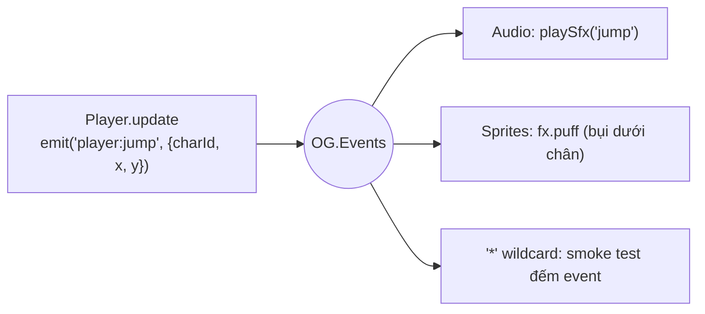
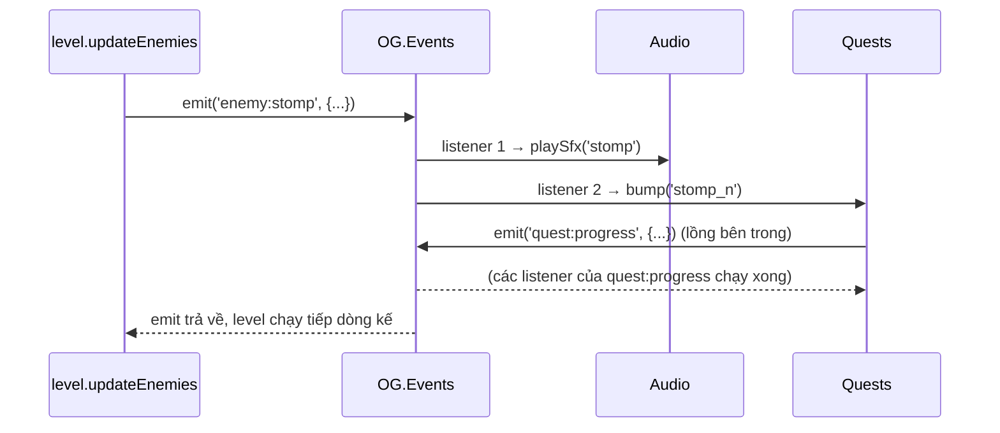

# Bài 06 — Event bus và observer

> Thuộc giáo trình **Lập trình game trình duyệt với Oggy Adventure** · [Mục lục](README.md) · Lời giải: [solutions/06-event-bus-observer.md](solutions/06-event-bus-observer.md)

## 🎯 Mục tiêu

Sau bài này bạn sẽ:

- Giải thích được **observer pattern** / **publish–subscribe** (phát–đăng ký) và vì sao nó giúp các module **ít phụ thuộc nhau**
  (loose coupling).
- Đọc và dùng được `OG.Events.on / off / once / emit`, hằng tên event `OG.EV`, và listener **wildcard** `'*'`.
- Hiểu emit là **đồng bộ** (synchronous): thứ tự phát event là một phần của hợp đồng.
- Nhận ra và sửa ba lỗi kinh điển: **quên huỷ đăng ký** (memory leak, xử lý trùng), **đăng ký hai lần**, và **vòng lặp phản hồi**
  (event A sinh event A).
- Tự thiết kế một event mới cho tính năng của mình mà không sửa code người khác.

## 🧠 Khái niệm

### 1. Vấn đề: ai cần biết "Oggy vừa nhảy"?

Khi Oggy nhảy, game cần: phát tiếng "boing" (Audio), tung bụi dưới chân (Sprites), có thể tính nhiệm vụ (Quests). Cách ngây thơ
là để Player gọi thẳng từng nơi:

```js
// ❌ Player phải biết mọi module quan tâm tới cú nhảy
OG.Audio.sfx('jump'); OG.Sprites.fx.puff(x, y, 4); OG.Quests.onJump(); OG.Social.track('jump');
```

Mỗi lần thêm một tính năng mới quan tâm tới cú nhảy, ta lại phải **sửa `player.js`**. Module tính năng chưa nạp (hoặc bị lỗi) thì
Player cũng hỏng theo. Đây là **tight coupling** (phụ thuộc chặt).

### 2. Lời giải: một "bảng tin" chung

**Event bus** (kênh sự kiện) là một bảng tin mà ai cũng có thể dán thông báo (**emit / publish**) và ai cũng có thể đăng ký nhận
thông báo theo chủ đề (**on / subscribe**). Player chỉ nói "tôi vừa nhảy", còn ai làm gì với thông tin đó là việc của họ:



- **Bên phát không biết bên nghe.** Thêm module mới = thêm một `on(...)`, không sửa code cũ. Đây là nguyên lý **open/closed**: mở
  cho mở rộng, đóng với sửa đổi.
- **Bên nghe không biết bên phát.** Audio nghe `'enemy:stomp'` mà không cần biết event đó đến từ scene `level` hay scene `boss`.
- **Đánh đổi.** Khó lần ngược "ai xử lý event này?". Dự án bù lại bằng bảng `OG.EV` ở `src/core/events.js` và bảng event đầy đủ ở
  [docs/ARCHITECTURE.md](../ARCHITECTURE.md) mục 6. Tìm tên event (vd `'player:jump'`) trong toàn dự án là thấy hết người nghe.

### 3. Hợp đồng của một event

Một event gồm **tên** và **payload** (object dữ liệu đi kèm):

- Tên theo quy ước `'<chủ thể>:<việc vừa xảy ra>'`, ở thì quá khứ: `'item:collect'`, `'boss:defeated'`. Event báo **điều đã xảy
  ra**, không phải mệnh lệnh. `'player:jump'` nghĩa là "đã nhảy", không phải "hãy nhảy".
- Hằng `OG.EV.PLAYER_JUMP === 'player:jump'`. Gõ sai hằng (`OG.EV.PLAYER_JUMPP`) thì ra `undefined` và dễ phát hiện. Gõ sai chuỗi
  (`'player:jumpp'`) thì im lặng không ai nghe.
- Payload là **API công khai**: đổi tên field là làm hỏng mọi người nghe. Vì vậy payload được ghi ở comment cuối mỗi dòng `OG.EV`.

### 4. Emit là đồng bộ

`emit()` gọi **lần lượt từng listener, ngay lập tức**, chạy xong hết mới `return`. Hệ quả:



- **Thứ tự là hợp đồng.** Nếu code phát event **trước** khi cập nhật dữ liệu, người nghe đọc phải số cũ. Ví dụ `completeLevel`
  cộng xu vào ví **rồi mới** phát `'level:complete'`.
- **Event lồng nhau** (emit bên trong listener) là bình thường, nhưng có thể gây **vòng lặp vô hạn** nếu A sinh A (mục 6).
- Muốn "để sau mới xử lý" thì dùng **event queue** (hàng đợi sự kiện). Dự án này không cần, vì mọi xử lý đều nhỏ.

### 5. Vòng đời của listener và memory leak

`on()` trả về hàm **huỷ đăng ký** (unsubscribe). Mọi listener đăng ký trong một thứ **có vòng đời** (scene, hook, màn chơi) phải được
huỷ khi thứ đó kết thúc:

```js
var off = OG.Events.on('player:jump', onJump);   // trong enter()
off();                                            // trong exit()
```

Quên `off()` thì mỗi lần vào scene lại có thêm một listener. Lần 1 xử lý event 1 lần, lần 2 thành 2 lần, lần 3 thành 3 lần... Hàm cũ
còn giữ tham chiếu tới object của scene cũ, nên garbage collector (bộ dọn bộ nhớ) không giải phóng được. Đó là **memory leak**.

Lỗi "anh em" của nó là **gọi `init()` hai lần** làm mọi listener đăng ký đôi. Nhiều module trong dự án chặn bằng cờ `inited`.

### 6. Vòng lặp phản hồi (feedback loop)

Quests nghe `'coins:change'` để tính nhiệm vụ "kiếm N xu". Nhưng hoàn thành nhiệm vụ thì **được thưởng xu**, mà thưởng xu lại phát
`'coins:change'`... Không chặn thì: xong nhiệm vụ → được xu → tiến độ "kiếm xu" tăng → có thể xong nhiệm vụ khác → lại được xu. Cách
chặn: payload mang **lý do** (`reason: 'quest'`) để người nghe bỏ qua chính hệ quả của mình.

## 🔍 Đọc code

### 1. Bộ máy — `src/core/events.js` (file mẫu)

Mở [src/core/events.js](../../src/core/events.js). Toàn bộ trạng thái là **một object**: tên event → mảng listener.

```js
  /** @type {Object<string, OGListener[]>} tên event -> danh sách listener (theo thứ tự đăng ký) */
  var listeners = {};
```

Hàm **`on`** trả về hàm huỷ đăng ký:

```js
    on: function (name, fn) {
      (listeners[name] = listeners[name] || []).push(fn);
      // ⚠️ Bẫy: scene/module đăng ký trong enter() mà không off() trong exit() → mỗi lần vào scene
      //   lại thêm 1 listener, event bị xử lý 2, 3, 4 lần (memory leak). Giữ hàm off trả về để huỷ.
      return function () { OG.Events.off(name, fn); };
    },
```

Hàm **`once`** được xây trên `on`. Listener bọc ngoài tự huỷ trước khi gọi hàm thật:

```js
    once: function (name, fn) {
      var off = OG.Events.on(name, function (p) { off(); fn(p); });
      return off;
    },
```

Hàm **`emit`**, đoạn quan trọng nhất:

```js
        // ⚠️ Bẫy: listener có thể off() chính nó (vd once) trong lúc đang duyệt mảng → splice làm
        //   bỏ sót listener kế tiếp. Duyệt trên BẢN SAO (slice) để tránh.
        arr = arr.slice();
        for (var i = 0; i < arr.length; i++) {
          // 💡 Khái niệm: cô lập lỗi — một listener ném lỗi không chặn listener khác và không làm sập frame.
          OG.util.safe('listener ' + name, arr[i], null, [payload || {}]);
        }
```

Ba quyết định thiết kế đáng nhớ: duyệt trên **bản sao**, bọc từng listener bằng `OG.util.safe` (bài 01), và luôn đưa `{}` khi thiếu
payload để người nghe khỏi kiểm tra `undefined`. Cuối hàm là listener wildcard `'*'`, nhận thêm **tên** event.

### 2. Bên phát — `src/game/player.js`

Mở [src/game/player.js](../../src/game/player.js), tìm **`hurt`**:

```js
      // ⚠️ Bẫy: phát player:hurt TRƯỚC loseLife để thứ tự event là hurt -> (die -> game:over).
      //   Vì vậy payload phải "đoán trước" số mạng còn lại (predicted) thay vì đọc sau khi trừ.
      var predicted = Math.max(0, (OG.Game.run ? OG.Game.run.lives : 1) - 1);
      OG.Events.emit('player:hurt', { lives: predicted, cause: cause, shielded: false });
      var lives = OG.Game.loseLife(cause);
```

Thứ tự event là thứ người nghe nhìn thấy. Người nghe nhận `'player:hurt'` trước `'player:die'` và `'game:over'`, đúng trình tự
"trúng đòn → gục → thua" của câu chuyện. Cái giá phải trả: lúc phát event, số mạng **chưa** bị trừ, nên payload phải tự tính trước
`predicted`.

### 3. Bên nghe thuần tuý — `src/audio/audio.js`

Mở [src/audio/audio.js](../../src/audio/audio.js), tìm hàm **`bindEvents`**. Audio **không được ai gọi** trong lúc chơi; nó chỉ nghe:

```js
    function on(name, fn) {
      E.on(name, function (p) { try { fn(p || {}); } catch (e) { /* không bao giờ làm hỏng gameplay */ } });
    }
```

```js
    on('player:jump', function (p) { playSfx('jump', { pitch: CHAR_PITCH[p.charId] || 1 }); });
    on('player:land', function () { playSfx('land', { vol: 0.8 }); });
```

Gameplay không gọi Audio để phát hiệu ứng âm thanh. Chỗ hiếm hoi còn gọi Audio (nút tắt tiếng, thanh âm lượng trong `menus.js`)
cũng đi qua `U.call` hoặc kiểm tra hàm tồn tại trước. Vì vậy thiếu Audio thì game chỉ mất tiếng chứ không hỏng. Đó là loose
coupling hoạt động.

### 4. Người nghe có logic — `src/world/quests.js`

Mở [src/world/quests.js](../../src/world/quests.js), tìm **`attach`**:

```js
  function attach() {
    var E = OG.Events;
    E.on('level:start', function () { lastProgress = {}; });
    E.on('item:collect', function (p) {
      if (!p) return;
      if (p.type === 'pizza') bump('pizza_n', 1);
      emitLevelProgress();
    });
    E.on('enemy:stomp', function () { bump('stomp_n', 1); emitLevelProgress(); });
```

Và ngay dưới là chỗ chặn vòng lặp phản hồi:

```js
      // ⚠️ Bẫy: thưởng nhiệm vụ cũng phát coins:change. Không lọc reason 'quest' thì xong nhiệm vụ →
      //   được xu → cộng vào nhiệm vụ "kiếm xu" → có thể xong tiếp → vòng lặp thưởng chồng thưởng.
      if (p.reason === 'quest') return;
```

Hàm **`emitProgress`** chỉ phát khi số **thật sự đổi**. Không có nó, mỗi lần nhặt xu đều kéo theo một loạt `'quest:progress'` thừa:

```js
  function emitProgress(id, progress, target) {
    if (lastProgress[id] === progress) return;
    lastProgress[id] = progress;
    OG.Events.emit('quest:progress', { questId: id, progress: progress, target: target });
  }
```

Hàm **`awardQuest`** cho thấy "dữ liệu trước, event sau": `rec.done = true`, `commit()`, cộng xu, rồi mới `emit('quest:complete', ...)`.

### 5. Chống đăng ký hai lần — `src/social/social.js` và `src/bosses/bosses.js`

Trong [src/social/social.js](../../src/social/social.js), hàm **`S.init`**:

```js
    // Cờ inited: init() lỡ bị gọi 2 lần sẽ đăng ký listener 2 lần → mỗi lượt lưu điểm 2 lần (xem bài 06).
    if (inited) return;
    inited = true;
```

Trong [src/bosses/bosses.js](../../src/bosses/bosses.js), hàm **`bindListeners`** dùng cùng ý tưởng và có thêm một mẹo: **đổi event
thành bộ đếm**:

```js
    OG.Events.on('player:action', function () { K.actionSeq++; });
```

Mỗi trùm nhớ số đã thấy (`b._seenAction`) và tự so trong `update` (hàm **`tryReflect`**). Trùm không phải đăng ký/huỷ listener theo
vòng đời của mình, mà cũng không phụ thuộc `OG.Input`. Đây là cách nối giữa thế giới **push** (event đẩy tới) và thế giới
**poll** (mỗi frame tự hỏi).

### 6. Dọn dẹp theo scene — `src/story/learn.js`

[src/story/learn.js](../../src/story/learn.js), hàm **`init`** của `OG.Learn`:

```js
      // push/pop (mở thẻ, câu đố) KHÔNG xoá thông báo — chỉ xoá khi thật sự rời màn chơi.
      OG.Events.on('scene:change', function (e) { if (e && !e.push && !e.pop && e.to !== 'level') toasts.length = 0; });
```

`'scene:change'` (bài 05) mang cờ `push`/`pop`, nên người nghe phân biệt được "tạm rời" với "rời hẳn".

## 🧪 Thử ngay

Mở game, F12 → Console.

1. **Nghe trộm mọi thứ:** `OG.Config.DEBUG = true`, rồi chơi vài giây. Mỗi event được in kèm payload. Tắt bằng `... = false`.
2. **Wildcard có lọc:**
   ```js
   var offAll = OG.Events.on('*', function (name, p) {
     if (name !== 'score:change') console.log(name, p);
   });
   ```
   Nhặt pizza, giẫm gián, bị thương. Một hành động sinh ra **bao nhiêu** event? Gõ `offAll()` để tắt.
3. **Giả làm gameplay:** đang trong màn, gõ
   ```js
   var p = OG.Level.state.player;
   OG.Events.emit('enemy:stomp', { type: 'roach', x: p.x, y: p.y - 40, score: 0 });
   ```
   Bạn nghe tiếng "bốp", thấy sao và chữ "BỐP!" trên đầu Oggy, dù **không có con gián nào chết**. Audio, Sprites và Quests chỉ tin vào
   event. (Lệnh này cũng cộng tiến độ nhiệm vụ "giẫm gián" thật vào save.)
4. **Xem bảng hằng:** `Object.keys(OG.EV).length` và `OG.EV.BOSS_DEFEATED`.
5. **once:** `OG.Events.once('item:collect', function (e) { console.log('món đầu tiên:', e.type); })`. Nhặt hai món: chỉ in một lần.

## ✍️ Bài tập

### ⭐ Dễ — Đếm cú nhảy, chúc mừng cú giẫm đầu tiên

1. Đếm số lần nhảy. Cứ mỗi 10 lần thì hiện toast "Bạn đã nhảy N lần!" (`OG.DOM.toast(text)`).
2. Lần **đầu tiên** giẫm gián thì hiện toast có tên loại gián và số điểm. Những lần sau không hiện nữa.
3. Viết lệnh để **thôi đếm** nhảy. Kiểm tra lại bằng cách nhảy tiếp.

<details><summary>💡 Gợi ý</summary>

- Dùng hằng: `OG.EV.PLAYER_JUMP`, `OG.EV.ENEMY_STOMP`. Payload xem ở comment cuối dòng trong `OG.EV`.
- (2) là đúng việc của `once`.
- (3): giữ giá trị trả về của `on` trong một biến.

</details>

### ⭐⭐ Vừa — Combo giẫm liên hoàn và event của riêng bạn

Giẫm con gián tiếp theo trong vòng **1,5 giây** thì combo tăng (x2, x3...). Bị thương hoặc vào màn mới thì combo về 0. Yêu cầu
thiết kế:

- Phần đếm combo chỉ **phát** một event mới `'combo:up'` với payload `{count, x, y}`. Nó không tự vẽ, không tự cộng điểm.
- Hai listener **độc lập** của `'combo:up'`: một cái hiện chữ bay "COMBO x3" (`OG.Particles.floatText(x, y, text, color)`), một cái
  thưởng `25 × count` điểm (`OG.Game.addScore(n)`).
- Trả lời: nếu listener thưởng điểm ném lỗi thì chữ bay có còn hiện không? Vì sao?

<details><summary>💡 Gợi ý</summary>

- Đồng hồ: `OG.time` (giây kể từ khi khởi động). Lưu `lastT` lúc giẫm gần nhất; khởi tạo `-Infinity` để lần đầu luôn là combo 1.
- Reset khi nghe `OG.EV.PLAYER_HURT` và `OG.EV.LEVEL_START`.
- Payload `'enemy:stomp'` có `x, y` là góc trên-trái hitbox gián.
- Câu hỏi cuối: đọc lại vòng `for` trong `emit`.

</details>

### ⭐⭐⭐ Khó — Bảng log event trên màn chơi, không rò rỉ

Viết một **level hook** hiện 6 event gần nhất ở góc trái màn hình (mỗi dòng mờ dần trong 4 giây), bỏ qua các event quá ồn như
`'score:change'`, `'quest:progress'`.

- Đăng ký listener `'*'` trong `enter` của hook. Hook **không có `exit`**: hãy tự lo để mỗi lần vào màn (kể cả "Chơi lại màn") chỉ
  có **đúng một** listener sống.
- Rời hẳn màn chơi (về menu, bản đồ) thì **thôi nghe**. Tạm dừng hay truyện chen giữa màn (push/pop) thì vẫn nghe.
- Chứng minh không rò rỉ: chơi lại màn 3 lần, phát `OG.Events.emit('door:enter', {levelId: 'x'})` một lần, kiểm tra log chỉ có
  **một** dòng `door:enter`. Rồi cố ý xoá dòng dọn dẹp, lặp lại thí nghiệm và giải thích kết quả.

<details><summary>💡 Gợi ý</summary>

- Giữ `off` (hàm huỷ) trong biến của closure. Đầu `enter`: `if (off) off();`.
- Để biết "rời hẳn": nghe `OG.EV.SCENE_CHANGE`, giống `OG.Learn.init` ở mục Đọc code 6.
- Thêm hook giữa chừng thì `enter` chưa chạy cho màn hiện tại. Gọi `OG.Game.restartLevel()` để vào lại màn.
- Vẽ ở `drawScreen(ctx, st, t)` (toạ độ màn hình, `t = OG.time`), nhớ `save/restore`, font `OG.font(14, 'bold')`.

</details>

## 📚 Đọc thêm

- Robert Nystrom — *Game Programming Patterns*, chương [Observer](https://gameprogrammingpatterns.com/observer.html) (kể cả phần "lapsed
  listener problem", chính là memory leak ở mục 5) và chương [Event Queue](https://gameprogrammingpatterns.com/event-queue.html) (khi
  nào cần xử lý bất đồng bộ).
- MDN — [EventTarget.addEventListener](https://developer.mozilla.org/en-US/docs/Web/API/EventTarget/addEventListener): event bus có
  sẵn của DOM, so sánh với `OG.Events` (DOM có capture/bubble, `once`, `signal` để huỷ).
- MDN — [Memory management](https://developer.mozilla.org/en-US/docs/Web/JavaScript/Memory_management) (vì sao closure còn được tham
  chiếu thì không bị thu hồi).
- Refactoring.Guru — [Observer pattern](https://refactoring.guru/design-patterns/observer).
- [docs/ARCHITECTURE.md](../ARCHITECTURE.md) mục 6 (bảng event và payload), [docs/STORY.md](../STORY.md) mục 7 (event của chế độ
  hành trình).

## ➡️ Bài tiếp theo

[Bài 07 — Vẽ procedural bằng Canvas và cache](07-ve-canvas-procedural-cache.md): sao và chữ "BỐP!" bạn vừa làm hiện ra bằng một event giả
được vẽ thế nào, mà không có một file ảnh nào trong dự án?
