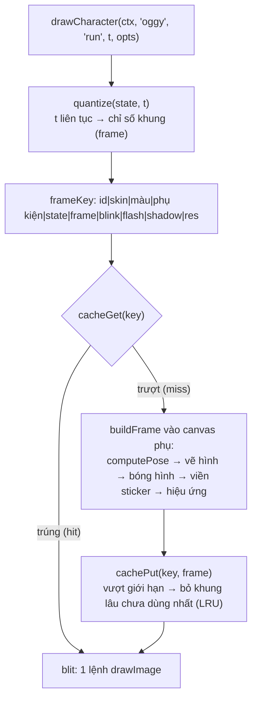

# Bài 07 — Vẽ procedural bằng Canvas và cache khung hình

> Thuộc giáo trình **Lập trình game trình duyệt với Oggy Adventure** · [Mục lục](README.md) · Lời giải: [solutions/07-ve-canvas-procedural-cache.md](solutions/07-ve-canvas-procedural-cache.md)

## 🎯 Mục tiêu

Sau bài này bạn sẽ:

- Vẽ được hình bằng **Canvas 2D API**: path, `fill`/`stroke`, gradient, và dùng **transform** (`translate`, `rotate`, `scale`) với
  `save()`/`restore()` đúng cách.
- Hiểu **vẽ procedural** (vẽ bằng code, không dùng ảnh) và kỹ thuật **hoạt ảnh theo thời gian**: tư thế là một **hàm của `t`**.
- Áp dụng hai nguyên lý hoạt hình: **squash & stretch** (co bẹp và giãn dài) và **easing** (hàm làm mượt).
- Hiểu vì sao vẽ procedural mỗi frame thì tốn, và cách **cache** khung hình vào **offscreen canvas** (canvas phụ không hiển thị).
- Thiết kế được **khoá cache**, **lượng tử hoá** thời gian để cache được, và tự cài một cache **LRU** bằng `Map`.

## 🧠 Khái niệm

### 1. Procedural thay vì sprite sheet

Game 2D thường dùng **sprite sheet**: một file ảnh chứa sẵn mọi khung hình. Oggy Adventure không có file ảnh nhân vật nào. Mỗi con
mèo, con gián, NPC đều được **vẽ bằng lệnh Canvas** mỗi khi cần (`src/gfx/sprites.js`, khoảng 3200 dòng).

| | Sprite sheet | Procedural |
|---|---|---|
| Cần hoạ sĩ vẽ từng khung | có | không, chỉ cần viết hàm |
| Đổi màu skin, thêm phụ kiện | vẽ lại cả bộ | đổi một tham số |
| Phóng to | vỡ hạt | nét ở mọi kích thước |
| Chi phí CPU mỗi frame | 1 lệnh `drawImage` | hàng trăm lệnh path |

Dòng cuối là cái giá phải trả. Phần sau của bài học là cách **lấy lại** tốc độ đó bằng cache.

### 2. Transform và ngăn xếp trạng thái

Canvas giữ một **ma trận biến đổi hiện tại** (current transform matrix). `translate`, `rotate`, `scale` **nhân dồn** vào ma trận
đó, nên **thứ tự** có ý nghĩa:

```js
ctx.translate(chânX, chânY);   // 1) dời gốc toạ độ tới chân nhân vật
ctx.scale(1.2, 0.8);           // 2) bẹp người QUANH CHÂN → chân vẫn dính đất
```

Đảo thứ tự (scale trước, translate sau) thì phép bẹp áp quanh gốc canvas, và cả nhân vật trượt đi chỗ khác.

`ctx.save()` cất **toàn bộ** trạng thái vẽ (ma trận, `fillStyle`, `globalAlpha`, `lineWidth`, vùng `clip`...) vào một ngăn xếp.
`ctx.restore()` lấy lại trạng thái vừa cất. Quy tắc của dự án: **mọi hàm vẽ tự `save()` đầu và `restore()` cuối, luôn theo cặp**.
Smoke test kiểm tra điều này sau **mỗi frame** (bài 13). Một `restore` bị thiếu làm phép xoay của cái quạt "rò" sang cả HUD.

Một kỹ thuật hay dùng: **xoay quanh một điểm bất kỳ** = dời gốc tới điểm đó → xoay → dời ngược lại.

### 3. Hoạt ảnh theo thời gian

Thay vì lưu "khung số 3 của animation chạy", mỗi trạng thái animation là một **hàm** `Pose(t)`:

```
t (giây trong trạng thái 'run')  →  computePose  →  { sx, sy, legA, legB, armA, lean, eyes, mouth, ... }  →  bộ vẽ
```

- `computePose` chỉ tính **số**, không gọi `ctx`. Mọi bộ vẽ (mèo, gián, 15 NPC) đọc **cùng** một Pose, nên thêm nhân vật mới là có
  ngay đủ 14 animation.
- Chuyển động tuần hoàn dùng **sóng sin**: `Math.sin(t * 2π / chu_kỳ)`. Hai chân lệch pha nửa vòng (`s` và `-s`).
- Pose là **hàm thuần** (pure function) của `t`, không nhớ gì giữa các frame. Tua tới bất kỳ `t` nào cũng vẽ được, và kết quả lặp
  lại y hệt. Đây là chìa khoá để cache ở mục 6.

### 4. Squash & stretch và easing

**Squash & stretch** là nguyên lý đầu tiên trong "12 nguyên lý hoạt hình" của Disney. Vật đàn hồi **giãn dài** khi chuyển động nhanh
và **bẹp** khi va chạm. Bí quyết là **giữ thể tích**: giãn dọc `sy` lần thì hẹp ngang `1/sy` lần. Nhờ vậy nhân vật trông như có khối
lượng, chứ không như đang phóng to thu nhỏ.

**Easing** biến tiến độ tuyến tính `k ∈ [0, 1]` thành đường cong:

```
easeOut(k) = 1 − (1 − k)²   nhanh rồi chậm dần (bật nhảy, tung đòn)
easeIn(k)  = k²             chậm rồi nhanh dần (rơi do trọng lực)
```

### 5. Painter's algorithm và globalCompositeOperation

Canvas không có "chiều sâu": thứ vẽ **sau** đè lên thứ vẽ **trước**. Muốn tay ở sau lưng thì vẽ tay trước thân. Đây gọi là
**painter's algorithm** (thuật toán của hoạ sĩ, vẽ xa trước gần sau).

`globalCompositeOperation` đổi luật "đè" đó. Ví dụ `'source-in'` chỉ giữ phần **trùng** với điểm ảnh đã có. Dự án dùng nó để tạo
bóng hình (silhouette) màu mực, rồi đóng dấu bóng hình lệch theo 8–12 hướng thành **viền sticker** dày đều quanh nhân vật.

### 6. Cache khung hình



- **Offscreen canvas**: `document.createElement('canvas')` nhưng **không gắn vào trang**. Vẽ một lần vào đó, các frame sau
  `ctx.drawImage(canvasPhụ, ...)`.
- **Lượng tử hoá thời gian** (quantize): `t` là số thực, có vô số giá trị nên không cache được. Làm tròn `t` về đầu khung gần nhất
  (vd 12 khung cho chu kỳ chạy 0,36 giây) thì chỉ còn 12 giá trị. Mỗi giá trị vẽ một lần rồi tái dùng.
- **Khoá cache** phải chứa **mọi** thứ làm hình khác đi. Thiếu một thứ (vd màu skin) thì hai nhân vật khác nhau dùng chung một
  khung. Thừa thứ đổi liên tục (vd `t` chưa làm tròn) thì mỗi frame một khoá mới, cache vô dụng và phình mãi.
- **Giới hạn bộ nhớ**: cache không thể lớn vô hạn. **LRU** (Least Recently Used) bỏ khung **lâu chưa dùng nhất**. **FIFO** (First
  In First Out) bỏ khung **thêm vào sớm nhất**. LRU tốt hơn khi có khung được dùng liên tục, FIFO đơn giản hơn.
- **Cái gì KHÔNG nên cache**: thứ đổi mỗi frame theo kiểu không lượng tử hoá được (chữ "BỐP!" bay lên, độ mờ theo vật lý thật). Dự
  án áp chúng **lúc blit** (một phép `ctx.scale` hay `globalAlpha` rẻ tiền) hoặc vẽ **ngoài** cache.

## 🔍 Đọc code

### 1. Bảng animation và lượng tử hoá — `src/gfx/sprites.js`

Mở [src/gfx/sprites.js](../../src/gfx/sprites.js), tìm **`ANIM_INFO`**:

```js
  // 💡 Khái niệm: animation theo thời gian — không có "danh sách ảnh"; mỗi trạng thái chỉ là một hàm Pose(t).
  //   Bảng này chỉ quyết định cắt hàm liên tục đó thành BAO NHIÊU khung để cache.
  //   Đánh đổi: nhiều khung = mượt hơn nhưng tốn bộ nhớ cache; idle chậm nên 20 khung/2.4 s là đủ.
  // 🧪 Thử: đổi run.frames 12 → 4 rồi chạy: chân Oggy giật cục như phim hoạt hình rẻ tiền.
  var ANIM_INFO = {
    idle: { loop: 2.4, frames: 20 },
    walk: { loop: 0.62, frames: 12 },
    run: { loop: 0.36, frames: 12 },
```

Ngay dưới là hàm **`quantize`**:

```js
    if (a.loop) {
      var loop = (kind === 'crawler' && CRAWLER_LOOP[state]) || a.loop;
      // ⚠️ Bẫy: `%` của JS giữ dấu số bị chia (-0.1 % 1 = -0.1) → cộng thêm loop rồi % lần nữa để pha luôn ≥ 0.
      var ph = ((t % loop) + loop) % loop;
      var f = Math.floor((ph / loop) * a.frames) % a.frames;
      return { frame: f, t: (f / a.frames) * loop, loop: loop, raw: ph };
    }
```

Nó trả về **cả hai**: `t` đã làm tròn (để vẽ khung cache) và `raw` (để vẽ mượt khi tắt cache).

### 2. Tư thế là hàm của t — `computePose`

Cùng file, hàm **`computePose`**, nhánh `case 'jump'`:

```js
        k = clamp(t / 0.2, 0, 1); e = easeOut(k);
        P.sy = 1.24 - 0.2 * e; P.sx = 0.82 + 0.16 * e;     // giãn dọc mạnh khi bật lên
```

Lúc vừa bật (`t = 0`), nhân vật **giãn** 1,24 lần theo chiều dọc và **hẹp** còn 0,82 theo chiều ngang, rồi `easeOut` về gần bình
thường trong 0,2 giây. Nhánh `case 'idle'` cho thấy "thở" bằng sóng sin, với `sx` ngược pha `sy` để giữ thể tích:

```js
        // sy tăng thì sx giảm (và ngược lại) → "giữ thể tích", nhìn như hít vào/thở ra chứ không như phóng to.
        P.sy = 1 + s * 0.03; P.sx = 1 - s * 0.022; P.headY = s * 0.7;
```

Cú **bẹp lúc tiếp đất** không nằm trong Pose. Nó ở hàm **`computeLandSquash`**, áp **lúc blit** theo sự kiện vật lý thật:

```js
      // gsx = 1/gsy: giữ "diện tích" không đổi → giãn dài thì phải gầy đi, nhìn như có khối lượng thật.
      gsy = 1 + clamp(opts.vy / FALL_STRETCH_VY, 0, 1) * FALL_STRETCH_MAX; gsx = 1 / gsy;
```

### 3. Bộ phận vẽ nhỏ, tái sử dụng — `limb`, `blob`, `applyBase`, `leanAt`

Mẹo viền rẻ nhất trong Canvas, hàm **`limb`**: vẽ nét mực **dày** trước, rồi nét màu **mảnh** hơn đè lên:

```js
  function limb(ctx, x1, y1, x2, y2, w, color) {
    seg(ctx, x1, y1, x2, y2, w + LW * 2, INK);
    seg(ctx, x1, y1, x2, y2, w, color);
  }
```

Hàm **`blob`** tạo khối tròn có chiều sâu bằng **radial gradient lệch tâm** về góc trên-trái:

```js
        var g = ctx.createRadialGradient(x - rx * 0.35, y - ry * 0.45, R * 0.05, x, y, R * 1.12);
        g.addColorStop(0, shade(color, 0.28)); g.addColorStop(0.55, color); g.addColorStop(1, shade(color, -0.2));
```

Hàm **`applyBase`** có comment giải thích thứ tự transform:

```js
  // 💡 Khái niệm: transform tích luỹ — translate/rotate/scale nhân dồn vào ma trận hiện tại của ctx, nên
  //   scale(sx, sy) đặt SAU translate tới chân sẽ co giãn quanh CHÂN: bẹp người mà chân vẫn dính đất.
  //   Đổi thứ tự (scale trước) thì cả người trượt lên xuống khi co giãn.
```

Và **`leanAt`** là "xoay quanh một điểm" trong một dòng:

```js
  function leanAt(ctx, P, hipY) { ctx.translate(0, hipY); ctx.rotate(P.lean); ctx.translate(0, -hipY); }
```

### 4. Dựng một khung vào canvas phụ — `buildFrame`

Hàm **`buildFrame`**, bước tạo bóng hình bằng `'source-in'`:

```js
      bc.globalCompositeOperation = 'source-over';
      bc.drawImage(a, 0, 0);
      bc.globalCompositeOperation = 'source-in';
      bc.fillStyle = INK; bc.fillRect(0, 0, W, H);
      // ⚠️ Bẫy: phải trả về 'source-over' — canvas b được dùng lại, quên dòng này thì lần sau drawImage(a)
      //   chỉ vẽ được vào phần trùng với nội dung cũ.
      bc.globalCompositeOperation = 'source-over';
```

Rồi viền sticker: đóng dấu bóng hình lệch `o` điểm ảnh theo `n` hướng, vẽ hình thật đè lên giữa:

```js
      var o = OUTLINE * res, n = res >= 4 ? 12 : 8;
      for (var i = 0; i < n; i++) {
        var ang = (i / n) * TAU;
        fc.drawImage(b, Math.cos(ang) * o, Math.sin(ang) * o);
      }
      fc.drawImage(a, 0, 0);
```

Chỉ riêng viền đã tốn 8–12 lệnh `drawImage` cỡ lớn. Đây là lý do khung **phải** được cache.

### 5. Cache LRU bằng Map — `cacheGet`, `cachePut`, `frameKey`

```js
    if (fr) {
      // 💡 Khái niệm: Map làm LRU — Map của JS luôn duyệt khoá theo THỨ TỰ CHÈN. Xoá rồi set lại = dời khoá
      //   xuống cuối ("mới dùng nhất"); khoá đầu tiên của map.keys() luôn là khoá lâu chưa dùng nhất.
      //   Không cần danh sách liên kết hay timestamp như LRU kinh điển.
      cache.map.delete(key); cache.map.set(key, fr);
      cache.hits++;
    }
```

`cachePut` loại bỏ theo **hai** giới hạn: số khung (`CACHE_MAX = 320`) và tổng điểm ảnh (`CACHE_MAX_PX`), vì vài khung trùm phóng
to đã tốn hàng chục MB:

```js
    // `size > 1`: luôn giữ lại khung vừa thêm, kể cả khi riêng nó đã vượt ngân sách điểm ảnh.
    while (cache.map.size > 1 && (cache.map.size > CACHE_MAX || cache.px > CACHE_MAX_PX)) {
      var k = cache.map.keys().next().value, old = cache.map.get(k);
      cache.px -= (old && old.px) || 0;
      cache.map.delete(k);
    }
```

Và **`frameKey`** với lời cảnh báo quan trọng nhất của cả hệ thống cache:

```js
  // Khoá cache = ghép MỌI thứ làm khung trông khác đi. ⚠️ Bẫy: thêm một tuỳ chọn ảnh hưởng hình vẽ mà quên
  //   đưa vào khoá → hai cách vẽ khác nhau dùng chung một khung, nhân vật "nhảy" giữa hai bộ đồ.
  function frameKey(info, opts, acc, drawState, q, blink, flash, shadow, res) {
    return [info.id, info.kind, opts.skin || '', opts.colors ? JSON.stringify(opts.colors) : '', acc.key,
      drawState, q.frame, blink ? 1 : 0, flash ? 1 : 0, shadow ? 1 : 0, res].join('|');
  }
```

Để ý `q.frame` (chỉ số khung đã lượng tử hoá) chứ không phải `t`. Còn `res` chỉ có 3 mức (hàm **`pickResolution`**: 2, 4 hoặc 6 điểm
ảnh cho mỗi đơn vị thiết kế), để nhân vật phóng 1,0 hay 1,2 lần vẫn dùng chung khung.

Trong **`S.drawCharacter`**, ba phép scale nhân dồn rồi mới tra cache:

```js
      ctx.scale(face * scale, scale);
      ctx.scale(gsx, gsy);
      ctx.scale(kx, ky);
```

Lật hướng nhìn (`face = -1`) và squash tiếp đất (`gsx, gsy`) **không** nằm trong khoá. Chúng áp lên khung có sẵn lúc blit, nên
không sinh khung mới.

### 6. Cache thứ hai: FIFO cho đồ trang trí — `src/gfx/decor.js`

Mở [src/gfx/decor.js](../../src/gfx/decor.js), tìm **`remember`**:

```js
  // Ghi vào cache và giới hạn kích thước: quá max thì xoá mục THÊM VÀO SỚM NHẤT (FIFO — first in, first out).
  // Đơn giản hơn LRU (least recently used: xoá mục lâu không DÙNG) vì lần trúng cache không phải xếp lại thứ tự;
  // đủ tốt ở đây vì mỗi màn chỉ dùng vài chục ảnh. (Cache nhân vật ở src/gfx/sprites.js dùng LRU thật — so sánh hai cách.)
  function remember(store, order, max, key, val) {
    store[key] = val; order.push(key);
    while (order.length > max) delete store[order.shift()];
  }
```

Hàm **`sprite`** phân biệt ba trạng thái của một mục cache: object (đã có ảnh), `false` (đã thử và **thất bại**, đừng thử lại mỗi
frame), `undefined` (chưa thử). Hàm **`drawSprite`** có `@example` chạy được và một `⚠️ Bẫy` về `drawImage` ở toạ độ lẻ.

### 7. Hạt (particles) — `src/game/particles.js`

[src/game/particles.js](../../src/game/particles.js), hàm **`update`**: chuyển động theo dt và xoá khi hết tuổi, duyệt **ngược**:

```js
      for (var i = list.length - 1; i >= 0; i--) {
        var p = list[i];
        p.life -= dt;
        if (p.life <= 0) { list.splice(i, 1); continue; }
```

Hàm **`draw`** làm hạt mờ dần theo tuổi bằng `ctx.globalAlpha = Math.max(0, p.life / p.max)`.

## 🧪 Thử ngay

1. **Xem tất cả nhân vật và animation:** mở [docs/sprites-demo.html](../sprites-demo.html) bằng trình duyệt (chạy được qua `file://`).
2. **Đo cache:** đang chơi, gõ `OG.Sprites.cacheStats()` vài lần. `hits` tăng nhanh hơn `misses` rất nhiều, nghĩa là cache đang có
   ích. Tỉ lệ trúng: `var s = OG.Sprites.cacheStats(); (s.hits / (s.hits + s.misses) * 100).toFixed(1) + '%'`.
3. **Tắt cache:** `OG.Sprites.setCacheEnabled(false)`, chơi ở màn nhiều gián rồi xem `OG.Loop.fps`. Bật lại bằng
   `OG.Sprites.setCacheEnabled(true)`. Trên máy mạnh, chênh lệch có thể nhỏ. Thử bật chế độ giả lập CPU chậm trong DevTools
   (Performance → CPU throttling 4×) để thấy rõ.
4. **Cache quá nhỏ:** `OG.Sprites.setCacheLimit(16)`, chơi vài giây rồi xem `cacheStats()`. `misses` tăng liên tục vì khung bị đẩy ra
   trước khi được dùng lại (hiện tượng **thrashing**). Trả lại: `OG.Sprites.setCacheLimit(320)`.
5. **Vẽ thẳng bằng API:** dán đoạn sau để có một Jack to đứng múa ở góc phải màn hình:
   ```js
   OG.Level.addHook({ id: 'bigJack', drawScreen: function (ctx, st, t) {
     ctx.save();
     ctx.translate(840, 470);                       // điểm CHÂN, toạ độ màn hình
     OG.Sprites.drawCharacter(ctx, 'jack', 'victory', t, { scale: 2.5, face: -1 });
     ctx.restore();
   } });
   ```
   Xem lại `cacheStats()`: `pixels` tăng vọt, vì Jack phóng khoảng 2,65 lần nên `pickResolution` chọn mức nét cao nhất (`res` = 6
   thay vì 2), mỗi khung tốn khoảng (6/2)² = 9 lần điểm ảnh. Gỡ bằng
   `OG.Level.removeHook('bigJack')`.
6. **Cache của đồ trang trí:** `OG.Decor.cacheStats()`, chờ vài giây rồi gọi lại. `tileHit` tăng mỗi frame, `tileMiss` gần như đứng
   yên.

## ✍️ Bài tập

> Các bài vẽ bằng **level hook** (`OG.Level.addHook`): `drawWorld(ctx, st, t)` vẽ ở toạ độ **thế giới** (camera đã áp), còn
> `drawScreen(ctx, st, t)` vẽ ở toạ độ **màn hình**. `t` là `OG.time` (giây).

### ⭐ Dễ — Ngôi sao xoay và đập nhịp

Vẽ một ngôi sao 5 cánh vàng viền mực tại toạ độ màn hình (900, 110). Sao **xoay** đều theo thời gian và **đập nhịp** (phóng to thu nhỏ
±15%). Không dùng ảnh, không dùng hàm vẽ có sẵn của dự án.

<details><summary>💡 Gợi ý</summary>

- Ngôi sao n cánh = đa giác 2n đỉnh, bán kính xen kẽ ngoài/trong. Góc đỉnh thứ i: `i * Math.PI / n - Math.PI / 2` (bắt đầu từ đỉnh
  trên cùng). Tham khảo hàm `starPath` trong `sprites.js`.
- Vẽ quanh gốc (0, 0), rồi dùng `translate` → `rotate` → `scale`. Thứ tự này đảm bảo xoay và phóng **quanh tâm sao**.
- Viền kiểu hoạt hình: `stroke` nét dày **trước**, `fill` **sau** (xem `inkFill` trong `decor.js`).

</details>

### ⭐⭐ Vừa — Quả bóng nảy có squash & stretch

Vẽ một quả bóng đỏ nảy tại chỗ, cách điểm xuất phát của màn 220 px (toạ độ thế giới), kèm bóng đổ dưới đất. Yêu cầu:

- Viết hàm **thuần** `ballPose(t)` trả về `{h, sx, sy}` (độ cao và hệ số co giãn), không dùng biến nào thay đổi giữa các frame.
- Bay lên/rơi xuống theo **parabol**. Bay nhanh thì **giãn** dọc, chạm đất thì **bẹp** rồi bung lại. Luôn **giữ diện tích**.
- Bóng co giãn quanh **điểm chạm đất**, không phải quanh tâm.
- Kiểm tra `ballPose(-0.3)` vẫn trả kết quả hợp lệ.

<details><summary>💡 Gợi ý</summary>

- Pha `k = ((t % P) + P) % P / P` chạy 0..1, an toàn với `t` âm (xem `⚠️ Bẫy` trong `quantize`).
- Parabol đi qua 0 ở hai đầu và đạt `H` ở giữa: `h = 4·H·u·(1 − u)`. Độ lớn vận tốc tỉ lệ `|1 − 2u|`.
- Dành một phần nhỏ đầu chu kỳ (vd 16%) cho pha "dính đất": `h = 0`, `sy = 1 − 0.35·sin(π·k/0.16)`.
- `sx = 1 / sy`. Vẽ: `translate(chânX, FLOOR_Y − h)` → `scale(sx, sy)` → `arc(0, −R, R, ...)` (tâm cao hơn chân một bán kính).

</details>

### ⭐⭐⭐ Khó — Huy hiệu procedural với cache LRU tự viết

Vẽ một **huy hiệu** cầu kỳ ở góc dưới bên phải màn hình: 12 tia nắng, nền gradient tròn viền mực, chữ "pizza đã nhặt / cần" ở giữa.
Huy hiệu xanh khi đủ pizza, cam khi chưa đủ, và **đập nhịp** theo thời gian. Yêu cầu:

1. Viết `makeLRU(max)` dùng `Map`, có `get(key, build)` (chưa có thì gọi `build()` rồi cất) và `stats()` (`size, hits, misses,
   evictions`).
2. Mỗi huy hiệu được vẽ **một lần** vào canvas phụ, các frame sau chỉ `drawImage`.
3. Hệ số đập nhịp đổi liên tục, nhưng cache chỉ được có **vài** khoá. Hãy lượng tử hoá nó.
4. Viết `badgeBenchmark(n)` so thời gian vẽ trực tiếp `n` lần với vẽ qua cache `n` lần (dùng `performance.now()`, vẽ lên một canvas
   phụ để không ảnh hưởng game).
5. Trả lời: khoá cache của bạn gồm những gì? Nếu quên đưa **màu** vào khoá thì thấy lỗi gì khi nhặt đủ pizza?

<details><summary>💡 Gợi ý</summary>

- LRU bằng Map: trúng thì `delete` rồi `set` lại (dời xuống cuối). Quá giới hạn thì xoá `map.keys().next().value` (khoá đầu tiên).
  Đúng như `cacheGet`/`cachePut` của `sprites.js`.
- Lượng tử hoá: `s = Math.round(scale * 10) / 10` cho bước 0,1. Kích thước canvas phụ theo `s`, vẽ với `g.scale(s, s)`.
- Canvas phụ: `var c = document.createElement('canvas'); c.width = ...; var g = c.getContext('2d');`. Dời gốc ra giữa canvas phụ
  trước khi vẽ.
- `drawImage` ở toạ độ **nguyên** (`Math.round`) để ảnh không bị nhoè.

</details>

## 📚 Đọc thêm

- MDN — [Canvas tutorial](https://developer.mozilla.org/en-US/docs/Web/API/Canvas_API/Tutorial), đặc biệt các mục
  [Transformations](https://developer.mozilla.org/en-US/docs/Web/API/Canvas_API/Tutorial/Transformations) và
  [Compositing](https://developer.mozilla.org/en-US/docs/Web/API/Canvas_API/Tutorial/Compositing).
- MDN — [Optimizing canvas](https://developer.mozilla.org/en-US/docs/Web/API/Canvas_API/Tutorial/Optimizing_canvas) (mục "Pre-render
  similar primitives or repeating objects on an offscreen canvas" chính là kỹ thuật của bài này).
- MDN — [CanvasRenderingContext2D.globalCompositeOperation](https://developer.mozilla.org/en-US/docs/Web/API/CanvasRenderingContext2D/globalCompositeOperation)
  (có ảnh minh hoạ từng chế độ).
- MDN — [Map](https://developer.mozilla.org/en-US/docs/Web/JavaScript/Reference/Global_Objects/Map) (thứ tự duyệt theo thứ tự chèn).
- Wikipedia — [Twelve basic principles of animation](https://en.wikipedia.org/wiki/Twelve_basic_principles_of_animation) (squash &
  stretch, anticipation, slow in & slow out).
- [easings.net](https://easings.net/) — bảng các hàm easing kèm đồ thị.
- Wikipedia — [Cache replacement policies](https://en.wikipedia.org/wiki/Cache_replacement_policies) (LRU, FIFO và các chiến lược khác).

## ➡️ Bài tiếp theo

[Bài 08 — Camera và parallax](08-camera-parallax.md): quả bóng của bạn vẽ ở toạ độ **thế giới** mà vẫn nằm yên một chỗ khi Oggy
chạy. Bài sau giải thích cái `ctx.translate` đứng sau chuyện đó, và vì sao dãy núi phía xa lại trôi chậm hơn.
