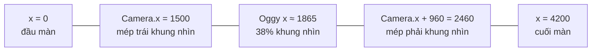

# Bài 08 — Camera và parallax

> Thuộc giáo trình **Lập trình game trình duyệt với Oggy Adventure** · [Mục lục](README.md) · Lời giải: [solutions/08-camera-parallax.md](solutions/08-camera-parallax.md)

## 🎯 Mục tiêu

Sau bài này bạn sẽ:

- Phân biệt **toạ độ thế giới** (world) và **toạ độ màn hình** (screen), và đổi qua lại giữa hai hệ.
- Hiểu **camera** trong game 2D chỉ là **một phép `ctx.translate`**. Biết vì sao camera bám nhân vật ở 38% bề ngang, vì sao phải kẹp
  trong biên thế giới, và vì sao phải làm tròn.
- Cài được **screen shake** (rung màn hình) tắt dần và **camera mượt** (smoothing) độc lập FPS.
- Hiểu **parallax** (thị sai): lớp càng xa càng cuộn chậm, và công thức `độ lệch = (camX × hệ số) mod chu kỳ`.
- Áp dụng **culling** (chỉ vẽ phần nhìn thấy) để một màn dài 6000 px vẫn chỉ tốn công vẽ khoảng 960 px.

## 🧠 Khái niệm

### 1. Hai hệ toạ độ

Màn chơi rộng vài nghìn px, nhưng canvas chỉ rộng **960 × 540**. **Camera** quyết định "khung nhìn" đang nằm ở đâu trong thế giới.

```
screenX = worldX − Camera.x        (Camera.x = mép TRÁI khung nhìn, toạ độ thế giới)
worldX  = screenX + Camera.x       (OG.Camera.toWorld)
```



Ai dùng hệ nào (theo hợp đồng ở [docs/ARCHITECTURE.md](../ARCHITECTURE.md) mục 3 và 8.1):

| Toạ độ **thế giới** (sau `Camera.apply`) | Toạ độ **màn hình** (không áp camera) |
|---|---|
| bục, decor, vật phẩm, kẻ địch, người chơi, hạt, trùm | nền trời và lớp parallax (`drawBackground`), lớp phủ, HUD, panel |
| level hook `drawWorld`, `drawFront` | level hook `drawScreen`, sự kiện `'input:tap'` |

### 2. Camera là một phép dịch

Thay vì trừ `Camera.x` ở **mọi** lệnh vẽ, ta dịch **cả hệ toạ độ** một lần:

```js
ctx.save();
OG.Camera.apply(ctx);     // ctx.translate(-Camera.x, 0)
//   ... vẽ mọi thứ bằng toạ độ thế giới ...
ctx.restore();            // quay về toạ độ màn hình để vẽ HUD
```

Camera **bám** nhân vật: `Camera.x = player.x − 960 × 0,38`. Vì sao 38% mà không phải 50%? Game chạy chủ yếu sang phải, nên để nhân
vật lệch trái cho người chơi thấy **nhiều đường phía trước** hơn. Camera cũng bị **kẹp** trong `[0, worldW − 960]` để không bao giờ
nhìn ra ngoài mép thế giới.

### 3. Screen shake

Rung màn hình là cộng thêm một **độ lệch ngẫu nhiên** nhỏ `(ox, oy)` vào phép dịch, mỗi frame một giá trị mới. Hai chi tiết làm nó
"ngon":

- **Tắt dần** (decay): biên độ giảm về 0 ở cuối, không dừng đột ngột.
- **Không cộng dồn**: nhiều cú rung chồng nhau thì lấy cú **lớn nhất**, không cộng lại (nếu cộng thì ba cú giẫm liên tiếp làm màn
  hình văng tung toé).

### 4. Camera mượt (smoothing)

Bám cứng (`Camera.x = mục tiêu`) thì mọi cú giật của nhân vật đều truyền nguyên vẹn sang màn hình. Camera **mượt** mỗi frame chỉ đi
một **phần** quãng còn lại:

```
camX += (goal − camX) × min(1, dt × RATE)
```

Xa thì đi nhanh, gần thì chậm dần, không bao giờ vượt đích. Nhân với `dt` để tốc độ không phụ thuộc FPS (bài 02). Bản đồ hành
trình (`src/world/journey-map.js`) dùng đúng công thức này. Màn chơi thì bám cứng, vì người chơi cần thấy ngay phía trước khi chạy
nhanh.

Biến thể hay gặp là **dead zone** (vùng chết): nhân vật nhích qua lại trong một khoảng nhỏ quanh điểm neo thì camera đứng yên. Cách
này giảm say màn hình khi người chơi lắc qua lắc lại.

### 5. Parallax

Ngồi trên xe nhìn ra cửa sổ: cột điện vụt qua, núi xa trôi rất chậm, mặt trăng như đứng yên. **Parallax scrolling** mô phỏng điều
đó: mỗi lớp nền có một **hệ số** (parallax factor) nhân với `camX`:

```
độ lệch của lớp = camX × hệ số
   hệ số 0     : đứng yên như dán trên kính (bầu trời)
   hệ số 0,03  : mặt trời, sao — gần như đứng yên
   hệ số 0,1–0,5 : đồi, rừng, dãy nhà phía xa
   hệ số 1     : trôi cùng thế giới (chính là bục và sàn)
   hệ số > 1   : TIỀN CẢNH, gần người xem hơn mặt sàn
```

Các lớp được vẽ từ **xa tới gần** (hệ số tăng dần), và vẽ sau đè lên vẽ trước (painter's algorithm, bài 07).

Nền chỉ rộng 960 px nhưng thế giới thì dài. Lời giải là để hoạ tiết **lặp lại** mỗi `span` px và lấy phần dư:

```
off = (camX × hệ số) mod span      →  luôn trong [0, span)
vẽ các ô ở x = i·span − off, với i từ −1 cho tới khi phủ hết 960 px
```

Camera chạy bao xa cũng không "hết hình", và mỗi frame chỉ vẽ vài ô.

⚠️ `%` của JavaScript giữ dấu số bị chia (`-5 % 100 = -5`). Phải dùng "modulo luôn dương": `((x % span) + span) % span`.

### 6. Culling

**Culling** (loại bỏ phần không thấy) nghĩa là chỉ vẽ những gì nằm trong khung nhìn, cộng một khoảng **lề** (padding) để vật to nhô
vào mép không bị "bật" ra đột ngột:

```
vẽ vật nếu  vật.phải > Camera.x − lề   VÀ   vật.trái < Camera.x + 960 + lề
```

Với vật đặt **đều nhau** (decor mỗi `every` px), còn rẻ hơn nữa: tính thẳng chỉ số đầu tiên trong khung nhìn
`n0 = floor((Camera.x − start) / every)` thay vì duyệt từ đầu màn.

## 🔍 Đọc code

### 1. Camera — `src/core/camera.js`

Mở [src/core/camera.js](../../src/core/camera.js). Hàm **`follow`**:

```js
    follow: function (target, worldW) {
      // ⚠️ Bẫy: màn hẹp hơn màn hình (worldW < 960) → worldW − 960 âm; Math.max(0, …) giữ camera ở 0
      //   thay vì để clamp nhận cận trên nhỏ hơn cận dưới.
      var maxX = Math.max(0, worldW - OG.W);
      // 🧪 Thử: đổi FOLLOW_ANCHOR 0.38 → 0.5 — nhân vật đứng giữa màn, thấy ít đường phía trước hơn.
      Camera.x = OG.util.clamp(target.x - OG.W * FOLLOW_ANCHOR, 0, maxX);
    },
```

Hàm **`update`** (OG.Loop gọi mỗi frame) làm rung tắt dần:

```js
        // 💡 Khái niệm: screen shake tắt dần — độ lệch ngẫu nhiên mỗi frame trong [−m, m], m giảm tuyến tính
        //   về 0 ở 0.25 giây cuối. Rung dừng đột ngột trông "giật"; tắt dần thì mượt và đỡ chóng mặt.
        var m = Camera.shakeMag * Math.max(0, Math.min(1, Camera.shakeTime * SHAKE_FADE_RATE));
        Camera.ox = (Math.random() * 2 - 1) * m;
        Camera.oy = (Math.random() * 2 - 1) * m;
```

Hàm **`shake`** lấy `Math.max` chứ không cộng: `Camera.shakeMag = Math.max(Camera.shakeMag, mag || DEFAULT_SHAKE_MAG);`.

Hàm **`apply`** là toàn bộ "camera":

```js
    apply: function (ctx) {
      // ⚠️ Bẫy: làm tròn Camera.x — dịch theo số lẻ (vd 103.4 px) làm mọi hình bị khử răng cưa lệch nửa pixel,
      //   viền nhoè và "rung rinh" khi cuộn chậm.
      ctx.translate(-Math.round(Camera.x) + Camera.ox, -Math.round(Camera.y) + Camera.oy);
    },
```

### 2. Thứ tự vẽ một màn — `src/game/level.js`

Mở [src/game/level.js](../../src/game/level.js), hàm **`drawWorld`**:

```js
      OG.Sprites.drawBackground(ctx, theme, OG.Camera.x, t);
      ctx.save();
      OG.Camera.apply(ctx);
      for (var i = 0; i < st.platforms.length; i++) OG.Sprites.drawPlatform(ctx, st.platforms[i], theme, t);
      OG.Sprites.drawDecor(ctx, theme, st.width, t);
```

```js
      OG.Player.draw(ctx, st.player, t);
      runHooks('drawFront', [ctx, st, t]);
      ctx.restore();
```

Nền vẽ **trước** khi áp camera (nó tự tính parallax từ `OG.Camera.x`). Thế giới vẽ **giữa** cặp `save/restore` có `apply`. Lớp phủ,
hook màn hình và HUD vẽ **sau** `restore`. Cuối hàm `update` của scene `'level'` có một 🧪: comment dòng `OG.Camera.follow(p, st.width)`
thì camera đứng yên và nhân vật chạy mất khỏi màn hình.

### 3. Parallax — `src/gfx/scenery.js`

Mở [src/gfx/scenery.js](../../src/gfx/scenery.js), phần hằng số đầu module:

```js
  // 💡 Khái niệm: parallax — hệ số nhân với camX. 0 = đứng yên như dán trên kính, 1 = trôi cùng thế giới.
  // Vật càng xa (mặt trời, sao) hệ số càng nhỏ → mắt người cảm nhận chiều sâu dù tất cả chỉ là hình 2D.
  var SKY_PARALLAX = 0.03;          // mặt trời, mặt trăng, sao: gần như đứng yên
```

Hàm **`drawSun`** dùng nó trực tiếp: `var x = (sun.x == null ? 790 : sun.x) - cam * SKY_PARALLAX, ...`.

Hàm **`drawLayer`** (bản dự phòng khi không có sổ đăng ký lớp) là công thức parallax cốt lõi, gói trong vài dòng:

```js
    // 💡 Khái niệm: công thức parallax cốt lõi — độ lệch = (camX × parallax) mod span. Lớp lặp lại mỗi span px
    // nên chỉ cần vẽ đủ số ô phủ màn hình, dịch đi "off" px; camera chạy mãi vẫn không hết hình.
    var y = L.y == null ? 420 : L.y, span = L.spacing || 320, off = wrap(cam * (L.parallax || 0.3), span);
    ctx.fillStyle = L.color || '#9fd88a';
    for (var i = -1; i * span - off < W + span; i++) { ctx.beginPath(); ctx.ellipse(i * span - off + span / 2, y, span * 0.6, L.height || 60, 0, Math.PI, TAU); ctx.fill(); }
```

`wrap` là modulo luôn dương, khai ở đầu file: `function wrap(x, span) { return ((x % span) + span) % span; }`.

Hàm **`drawThemeBackground`** vẽ theo thứ tự chiều sâu: gradient trời → sao → cầu vồng → mặt trời → trăng → mây → `layers[]`. Ngay
trên khai báo `BUILTIN` (các chủ đề gốc) có một 🧪: đổi hệ số lớp `'forest'` của `garden` từ 0,22 lên 0,9 thì rừng trôi gần bằng tốc độ
sàn, mất cảm giác ở xa.

### 4. Parallax + cache — `src/gfx/decor.js`

Lớp nền tĩnh (đồi, núi, dãy nhà) được cache thành một **dải** ảnh rồi ghép. Mở [src/gfx/decor.js](../../src/gfx/decor.js), hàm
**`drawTiled`**:

```js
    // 💡 Khái niệm: parallax với dải lặp — độ lệch = (camX × parallax) mod stripW, luôn nằm trong 0..stripW.
    var off = wrap((cam || 0) * px, stripW);
```

```js
      // Ghép 2 bản dải liền nhau: bản 1 lệch -off, bản 2 nối tiếp ngay sau khi bản 1 không còn phủ hết màn hình.
      ctx.drawImage(strip.canvas, -off, strip.top);
      if (stripW - off < W) ctx.drawImage(strip.canvas, stripW - off, strip.top);
```

Mỗi frame, cả một dãy núi chỉ tốn tối đa **2 lệnh `drawImage`**. Đây là bài 07 (cache) và bài 08 (parallax) gặp nhau.

### 5. Culling — `visibleRange` và decor

Trong `scenery.js`, hàm **`visibleRange`** đọc ngược khoảng x thế giới đang thấy từ **ma trận biến đổi** của canvas:

```js
      var m = ctx.getTransform && ctx.getTransform();
      var cw = (ctx.canvas && ctx.canvas.width) || W;
      // ⚠️ Bẫy: chỉ suy được khi ma trận không xoay (b ≈ 0) và không lật (a > 0); ngoài ra trả khoảng "vô hạn" để vẽ hết cho an toàn.
      if (m && m.a > 0 && Math.abs(m.b) < 1e-6) { var x0 = -m.e / m.a; return [x0 - pad, x0 + cw / m.a + pad]; }
```

Nhờ vậy hàm vẽ decor không cần ai truyền `Camera.x` vào: nó tự hỏi canvas "gốc toạ độ đang bị dịch bao nhiêu?". Hàm **`drawThemeDecor`**
dùng kết quả đó để nhảy thẳng tới decor đầu tiên trong khung nhìn:

```js
      // Culling bằng số học: nhảy thẳng tới chỉ số n0 của decor đầu tiên trong khung nhìn thay vì duyệt từ x = start.
      var n0 = Math.max(0, Math.floor((vr[0] - start) / every));
```

### 6. Camera mượt và culling trên bản đồ — `src/world/journey-map.js`

Mở [src/world/journey-map.js](../../src/world/journey-map.js), trong `update` của scene bản đồ:

```js
      var goal = S.manualCam ? S.camTarget : U.clamp(o.x - OG.W / 2, 0, S.width - OG.W);
      S.camX += (goal - S.camX) * Math.min(1, dt * CAM_FOLLOW_RATE);
```

Và hàm **`drawZone`** là culling đơn giản nhất có thể:

```js
    if (z.x + z.w < S.camX - 10 || z.x > S.camX + OG.W + 10) return; // ngoài màn hình
```

## 🧪 Thử ngay

Vào một màn chơi, mở Console:

1. **Động đất:** `OG.Camera.shake(25, 1.5)`. Gọi `OG.Camera.shake(5, 0.2)` ngay sau đó: biên độ **không** giảm, vì `shake` lấy giá
   trị lớn nhất.
2. **Đổi toạ độ:** đứng yên ở giữa màn, gõ `OG.Camera.x` và `OG.Level.state.player.x`. Hiệu của chúng xấp xỉ 365 (38% của 960)? Gõ
   `OG.Camera.toWorld(480, 270)` để biết điểm giữa màn hình ứng với toạ độ thế giới nào.
3. **Camera "đông cứng":** `var f = OG.Camera.follow; OG.Camera.follow = function () {};` rồi chạy sang phải. Nhân vật chạy khỏi
   màn hình, còn nền parallax cũng đứng yên vì `camX` không đổi. Trả lại: `OG.Camera.follow = f;`.
4. **Đổi hệ số parallax lúc chạy:** chơi chế độ **Phiêu lưu học tập**, hành trình Ngôi nhà, tới khu **Khu vườn**, rồi gõ
   `OG.Scenery.getTheme('home-garden').layers[1].parallax = 1`. Dãy đồi giờ trôi cùng tốc độ với sàn. Đặt `0` thì đồi đứng yên như
   tranh dán. Lưu ý: các lớp `kind: 'custom'` trong theme này **tự** nhân `camX` bên trong hàm vẽ, nên đổi `parallax` của chúng
   không có tác dụng (xem `⚠️ Bẫy` ngay trên `registerTheme('home-kitchen', ...)` trong `src/journeys/home/theme.js`).
5. **Xem parallax tách riêng:** mở [docs/scenery-demo.html](../scenery-demo.html) (chạy qua `file://`) để xem từng chủ đề nền cuộn.

## ✍️ Bài tập

### ⭐ Dễ — Chạm vào đâu, sao bắn ra đó

Khi người chơi chạm/nhấp chuột lên canvas trong màn chơi, bắn một chùm sao (`OG.Particles.spawn(x, y, opts)`) **đúng chỗ vừa
chạm**, và in ra Console cả toạ độ màn hình lẫn toạ độ thế giới. Thử nhấp cùng một điểm trên màn hình ở đầu màn và cuối màn: toạ độ
nào đổi, toạ độ nào không?

<details><summary>💡 Gợi ý</summary>

- Nghe `OG.EV.INPUT_TAP`. Payload `{x, y}` là toạ độ **logic màn hình** (0..960, 0..540), đã quy đổi từ pixel CSS (bài 03).
- `OG.Particles` dùng toạ độ **thế giới** (hạt được vẽ sau `Camera.apply`). Dùng `OG.Camera.toWorld(sx, sy)`.
- `opts`: `{ color: '#ffc94a', count: 14, shape: 'star' }`. Chỉ xử lý khi `OG.Scenes.current() === 'level'`.
- Nếu bật "Chạm để nhảy" trong Cài đặt, nhấp nửa phải màn hình cũng làm Oggy nhảy. Đó là chuyện bình thường.

</details>

### ⭐⭐ Vừa — Camera mượt có vùng chết

Ghi đè `OG.Camera.follow` để camera màn chơi:

- **mượt**: đuổi theo mục tiêu với tốc độ `RATE = 5` (1/giây), độc lập FPS;
- có **dead zone** ±60 px quanh điểm neo 38%: nhân vật lắc qua lắc lại trong vùng đó thì camera đứng yên;
- vẫn kẹp trong `[0, worldW − 960]`;
- **nhảy thẳng** (không trượt) khi lệch quá một màn hình, vd vừa vào màn hoặc vừa hồi sinh ở checkpoint xa.

Có hàm `restoreCamera()` để trả bản gốc. Trả lời: vì sao `follow` của bạn phải tự tính `dt`, và tính bằng gì?

<details><summary>💡 Gợi ý</summary>

- Giữ bản gốc: `var original = OG.Camera.follow;`.
- `follow(target, worldW)` không nhận `dt`. Nó được gọi mỗi frame trong `update` của scene `level`, nên lấy `OG.time` hiện tại trừ
  `OG.time` lần gọi trước. Nhớ **kẹp** `dt` (vd ≤ 0,05 giây), vì `OG.time` vẫn chạy trong lúc tạm dừng.
- Vùng chết: `wanted = target.x − 960·0,38`. Nếu `wanted > camX + 60` thì `goal = wanted − 60`; nếu `wanted < camX − 60` thì
  `goal = wanted + 60`; còn lại `goal = camX`.
- Lerp: `camX += (goal − camX) · min(1, dt · RATE)`.

</details>

### ⭐⭐⭐ Khó — Lớp tiền cảnh parallax > 1, có culling

Thêm một lớp **tiền cảnh** (foreground): các khóm cỏ to, sẫm màu ở mép dưới màn hình, **gần người xem hơn** mặt sàn, nên trôi
**nhanh hơn** thế giới (hệ số 1,35). Yêu cầu:

1. Vẽ bằng level hook `drawScreen` (toạ độ màn hình), tự tính vị trí từ `OG.Camera.x`.
2. Khóm cỏ đặt mỗi khoảng 240 px (toạ độ của lớp), lệch vị trí và kích thước "ngẫu nhiên" nhưng **không nhấp nháy** giữa các frame.
   Bỏ trống khoảng 35% số ô.
3. **Culling**: chỉ duyệt các ô có thể lọt vào khung nhìn. Viết `foregroundDrawn()` trả về số khóm đã vẽ ở frame gần nhất, và kiểm
   tra nó luôn nhỏ (dưới 8) dù màn dài bao nhiêu.
4. Lá cỏ đung đưa theo thời gian.
5. Trả lời: lớp này **không** dùng `wrap` như `drawLayer`. Vì sao không cần? Khi nào thì bắt buộc phải dùng `wrap`?

<details><summary>💡 Gợi ý</summary>

- Vị trí lớp: `off = Camera.x × 1,35`. Khóm thứ `i` ở `sx = i·SPACING + lệch(i) − off` trên màn hình.
- "Ngẫu nhiên ổn định": dùng hàm `hash(n)` như trong `scenery.js` (`Math.sin(n·127.1 + 311.7)·43758.5453`, lấy phần lẻ). Cùng `i`
  luôn cho cùng số.
- Culling: `first = floor((off − lệch_tối_đa − nửa_rộng) / SPACING)`, `last = ceil((off + 960 + nửa_rộng) / SPACING)`.
- Lá cỏ: `quadraticCurveTo` hai lần cho mỗi lá, ngọn lá lệch `Math.sin(t·2 + i)·6` px.
- Đặt chân khóm cỏ thấp hơn mép dưới canvas một chút (vd `OG.H + 8`) để không che chân nhân vật đứng trên sàn `y = 480`.

</details>

## 📚 Đọc thêm

- Itay Keren — [Scroll Back: The Theory and Practice of Cameras in Side-Scrollers](https://www.gamedeveloper.com/design/scroll-back-the-theory-and-practice-of-cameras-in-side-scrollers)
  (dead zone, lerp, dự đoán hướng chạy... với ví dụ từ hàng chục game kinh điển).
- MDN — [Square tilemaps: scrolling maps](https://developer.mozilla.org/en-US/docs/Games/Techniques/Tilemaps/Square_tilemaps_implementation:_Scrolling_maps)
  (camera, toạ độ thế giới và chỉ vẽ ô nhìn thấy).
- MDN — [CanvasRenderingContext2D.getTransform](https://developer.mozilla.org/en-US/docs/Web/API/CanvasRenderingContext2D/getTransform)
  (ma trận `{a, b, c, d, e, f}` mà `visibleRange` đọc).
- Wikipedia — [Parallax scrolling](https://en.wikipedia.org/wiki/Parallax_scrolling) (lịch sử, từ máy quay multiplane của Disney
  tới game 16-bit).
- Rory Driscoll — [Frame Rate Independent Damping Using Lerp](https://www.rorydriscoll.com/2016/03/07/frame-rate-independent-damping-using-lerp/)
  (vì sao `min(1, dt·RATE)` chỉ là xấp xỉ, và công thức chính xác `1 − e^(−RATE·dt)`).

## ➡️ Bài tiếp theo

[Bài 09 — AI kẻ địch và trùm](09-ai-ke-dich-boss.md): camera đã sẵn sàng, giờ là lúc làm cho lũ gián trong khung hình biết tuần tra,
báo trước đòn đánh và chừa khoảng hở cho người chơi phản công.
