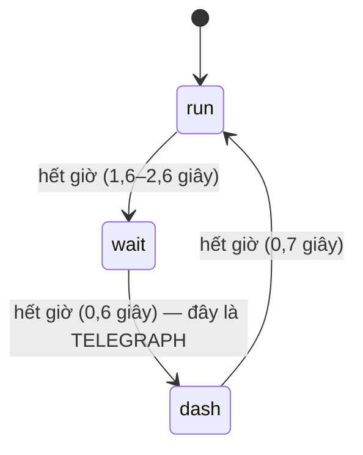
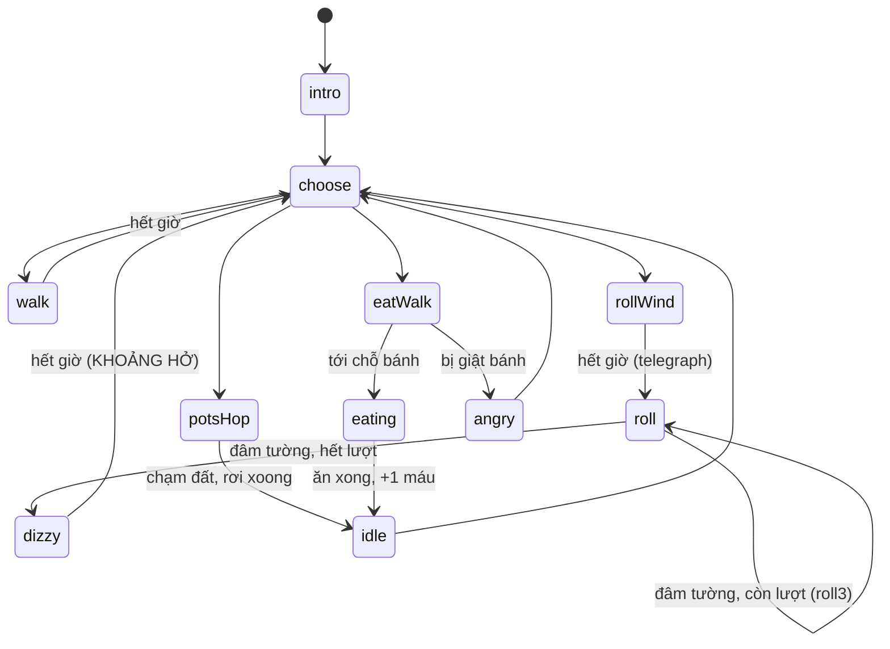
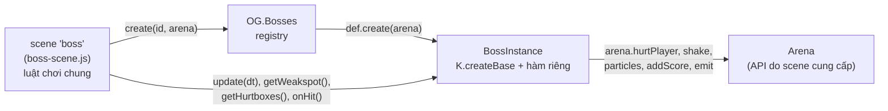
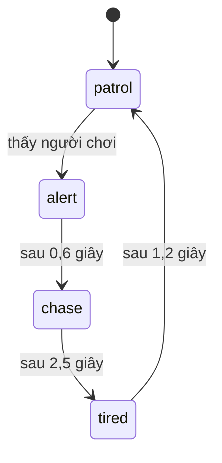

# Bài 09 — AI kẻ địch và trùm

> Thuộc giáo trình **Lập trình game trình duyệt với Oggy Adventure** · [Mục lục](README.md) · Lời giải: [solutions/09-ai-ke-dich-boss.md](solutions/09-ai-ke-dich-boss.md)

## 🎯 Mục tiêu

Sau bài này bạn sẽ:

- Viết được **AI tuần tra** (patrol) và hiểu vì sao "AI" trong game platformer thường cố ý **đơn giản và dễ đoán**.
- Dùng **registry + strategy pattern** để thêm loại kẻ địch mới mà không sửa code gọi.
- Thiết kế AI bằng **finite state machine** (bài 05) với **bộ đếm giờ**, có **telegraph** (báo hiệu trước đòn) và **khoảng hở**
  (lúc kẻ địch sơ hở để người chơi phản công).
- Đọc được khung trùm `K.createBase`: `setState/stateDone`, **pattern xoay vòng**, **phase theo máu**, **i-frames**, **weakspot** vs
  **hurtbox**, và **template method**.
- Hiểu cách game **điều chỉnh độ khó** bằng dữ liệu: time scale, kéo dài telegraph, nghỉ thở, và **DDA** (dynamic difficulty
  adjustment, tự dễ dần khi người chơi thua nhiều).

## 🧠 Khái niệm

### 1. AI trong game không phải để "thắng"

AI của cờ vua muốn thắng bạn. AI của con gián trong platformer muốn **tạo ra một thử thách có thể học được**. Ba tính chất quan trọng:

- **Dễ đoán**: người chơi quan sát vài lần là thấy nhịp. Gián tuần tra qua lại, trùm ra đòn theo một **pattern** cố định.
- **Báo trước** (telegraph): trước mỗi đòn nguy hiểm có một tín hiệu rõ ràng (đứng khựng lại, dấu "!", vùng đỏ trên sàn). Người chơi
  thua vì phản ứng chậm, không phải vì "bị lừa".
- **Có khoảng hở**: sau đòn mạnh, kẻ địch phải **sơ hở** (choáng, thở dốc, kẹt búa) để người chơi phản công.

Game này dành cho trẻ em, nên còn có cả AI **"nhường"**: Dee Dee thấy bé tới gần thì đứng yên ăn bánh, cho bé dễ giẫm.

### 2. Registry + strategy

Mọi loại kẻ địch có cùng **giao diện**: `{w, h, score, init(e, src), update(e, dt, world), draw(ctx, e, t)}`. Bảng `types` ánh xạ tên
loại sang object đó. Code gọi chỉ viết:

```js
var T = types[e.type] || types.roach;   // tra bảng, không if/else theo loại
T.update(e, dt, world);
```

Đây là **strategy pattern**: hành vi (chiến lược) được "cắm" vào qua một object, chọn lúc chạy theo dữ liệu (`e.type`). Thêm loại
mới = `registerType('snail', {...})`, không phải sửa `level.js` hay `enemies.js`. Robert Nystrom gọi biến thể này là **type object**:
loại kẻ địch là dữ liệu, không phải một lớp con.

### 3. AI là một state machine với bộ đếm giờ

Joey (kẻ địch thường) có ba trạng thái. `mode` là trạng thái hiện tại, `modeT` là thời gian còn lại:



Trùm phức tạp hơn nhưng cùng ý tưởng. Đây là đồ thị của Dee Dee (rút gọn từ khối đầu file `src/bosses/deedee.js`):



`choose` không phải trạng thái mà là **quyết định**: lấy đòn kế tiếp trong pattern của pha hiện tại. Ngoài ra còn các trạng thái
chung do khung lo: `roar` (gầm khi đổi pha), `recoil` (bị đẩy lùi khi trúng đòn), `breather` (nghỉ thở ở chế độ Bé chơi), `wait`
(trận ba trùm, chờ tới lượt).

### 4. Phase theo máu, i-frames, weakspot vs hurtbox

- **Phase** (giai đoạn): ngưỡng máu `phaseAt: [3, 1]` (của Dee Dee) nghĩa là còn ≤ 3 máu thì sang pha 2, ≤ 1 thì pha 3. Pha cao dùng **bộ đòn khó
  hơn** và telegraph **ngắn hơn**. Sang pha mới thì trùm gầm (bất tử ngắn) để người chơi kịp nhận ra.
- **i-frames** (invulnerability frames, khoảng bất tử): một cú giẫm có thể chạm điểm yếu **nhiều frame liên tiếp**. Có `b.inv > 0`
  nên chỉ frame đầu bị trừ máu.
- **Weakspot** (điểm yếu, một dải mỏng trên đầu, **chỉ tồn tại khi trùm sơ hở**) khác **hurtbox** (vùng gây đau, thân dưới). Scene
  xét weakspot trước, không giẫm được mới xét hurtbox. Sau khi trúng đòn, hurtbox **tắt** một lúc (stagger) để người chơi vừa nảy lên
  không rơi lại trúng đòn ngay.

### 5. Template method và dependency injection



- **Template method**: `b.update()` là một **khung cố định** (đếm giờ → xử lý trạng thái chung → gọi `b.think()` riêng → vật lý →
  đạn). File trùm chỉ lấp phần riêng (`think`, `startAction`, `isVulnerable`...).
- **Dependency injection** (tiêm phụ thuộc): trùm **không** gọi thẳng `OG.Player`, `OG.Camera`, `OG.Game`. Nó nhận một `arena` có sẵn
  các hàm cần dùng. Muốn test trùm thì chỉ cần đưa một arena giả.

### 6. Độ khó là dữ liệu

Chế độ **Bé chơi** và **Thử thách** chỉ là hai **bảng số** (`MODES` trong `src/game/difficulty.js`). Với trùm, bảng có:

| Tham số | Bé chơi | Thử thách | Tác dụng |
|---|---|---|---|
| `bossHpMul` | 0,6 | 1 | máu trùm |
| `bossSpeedMul` | 0,75 | 1 | **time scale**: `dt` của trùm bị nhân hệ số này |
| `bossTelegraphMul` | 1,3 | 1 | trạng thái tên kết thúc bằng `Wind` kéo dài hơn |
| `bossStunMul` | 1,35 | 1 | trạng thái choáng (`dizzy`, `stuck`, `rest`) kéo dài hơn |
| `bossRest` | 0,9 | 0 | giây nghỉ thở sau mỗi đòn |

**Time scale** là mẹo đẹp nhất: nhân `dt` của trùm với 0,75 thì **mọi** bộ đếm giờ của trùm (telegraph, choáng, tốc độ) chậm lại
đồng loạt, trong khi người chơi vẫn chạy ở tốc độ thật. Không phải sửa một dòng nào trong file trùm.

**DDA** (dynamic difficulty adjustment, điều chỉnh độ khó động): thua cùng một màn 2 lần thì game tự bật **trợ giúp** (gián chậm hơn,
trùm ít máu hơn, có khiên). Thắng màn thì xoá bộ đếm.

## 🔍 Đọc code

### 1. Registry và AI tuần tra — `src/game/enemies.js`

Mở [src/game/enemies.js](../../src/game/enemies.js), tìm **`registerType`**:

```js
    /**
     * Đăng ký (hoặc ghi đè) một loại kẻ địch.
     * 💡 Khái niệm: strategy pattern — mỗi loại là một object có cùng "giao diện" (init/update/draw). Code gọi
     *   chỉ biết Enemies.update(e) và tra types[e.type]; thêm loại mới KHÔNG phải sửa if/else ở đâu cả.
```

Hàm **`create`** biến một dòng dữ liệu màn (`{type, x, range?, speed?}`) thành một kẻ địch, rồi gọi `T.init` và
`OG.Difficulty.scaleEnemy` (chỉnh tốc độ theo độ khó). Hàm **`update`** lưu `e.prevY` (đỉnh frame trước, dùng cho phép giẫm ở bài 04)
rồi giao việc cho `T.update`.

AI gián con, toàn bộ chỉ hai dòng:

```js
    update: function (e, dt) {
      e.x += e.dir * e.speed * dt;
      // 💡 Khái niệm: AI tuần tra — chỉ cần một điểm gốc (base), bán kính (range) và hướng (dir). Ra quá biên thì
      //   quay đầu. Không tìm đường, không nhìn người chơi, nhưng đủ tạo "chướng ngại di động" để canh nhịp nhảy.
      if (Math.abs(e.x - e.base) > e.range) e.dir *= -1;
    },
```

Hàm **`patrol`** là bản an toàn hơn, dùng cho bộ ba gián:

```js
  function patrol(e, dt, speed) {
    e.x += e.dir * speed * dt;
    if (e.x - e.base > e.range) { e.x = e.base + e.range; e.dir = -1; }
    else if (e.base - e.x > e.range) { e.x = e.base - e.range; e.dir = 1; }
  }
```

Khác biệt: `patrol` **kẹp** x về đúng biên và **gán** hướng (không đảo `*= -1`). Với `*= -1`, nếu tốc độ đổi giữa chừng (Joey vừa lao
×2 đi quá biên rồi về tốc độ thường) hoặc `dt` dao động, gián có thể **vẫn ở ngoài biên** ở frame sau. Khi đó nó bị đảo hướng lần
nữa, rung qua lại tại chỗ hoặc trôi dần khỏi vùng tuần tra. Gán hướng theo **phía** của biên thì không bao giờ đảo sai.

### 2. State machine bằng bộ đếm giờ — loại `'joey'`

```js
      // 💡 Khái niệm: state machine bằng bộ đếm giờ — mode là trạng thái, modeT là thời gian còn lại.
      //   Hết giờ thì sang trạng thái kế: run → wait → dash → run. Khoảng "wait" chính là telegraph
      //   (báo hiệu trước) để người chơi kịp phản ứng trước cú lao.
      e.modeT -= dt;
      if (e.modeT <= 0) {
        e.mode = e.mode === 'run' ? 'wait' : (e.mode === 'wait' ? 'dash' : 'run');
        e.modeT = e.mode === 'wait' ? JOEY_WAIT_TIME : e.mode === 'dash' ? JOEY_DASH_TIME : JOEY_RUN_TIME + Math.random();
      }
```

Hàm vẽ chọn animation **theo trạng thái**: `wait → 'idle'`, `dash → 'attack'`, còn lại `'run'`. Người chơi **thấy** được trạng thái
của AI. Đó là điều kiện để telegraph có tác dụng.

Loại **`'deedee'`** là ví dụ AI phản ứng với người chơi, nhưng theo hướng **làm game dễ hơn**:

```js
      // 💡 Khái niệm: AI "nhường" người chơi — kẻ địch phản ứng với vị trí người chơi theo hướng làm game DỄ hơn
      //   (đứng yên cho bé giẫm), ngược với AI đuổi bắt thông thường. Độ khó là một quyết định thiết kế.
      var near = p && Math.abs(p.x + p.w / 2 - (e.x + e.w / 2)) < DEEDEE_NEAR_X && p.y + p.h > e.y - DEEDEE_NEAR_Y;
```

### 3. Khung trùm — `K.createBase` trong `src/bosses/bosses.js`

Mở [src/bosses/bosses.js](../../src/bosses/bosses.js), tìm **`K.createBase`**. Trạng thái FSM nằm ngay trong object trùm:

```js
      // Trạng thái FSM: state = tên trạng thái, stateT = giây đã ở trong trạng thái, stateDur = thời lượng dự kiến.
      state: 'intro', stateT: 0, stateDur: 1.2, anim: 'idle', animT: 0, t: 0,
```

**`b.setState`** và **`b.stateDone`**:

```js
    b.setState = function (s, dur) {
      dur = dur || 0;
      // Độ khó: báo trước đòn (…Wind) lâu hơn, sơ hở (choáng/kẹt búa/nghỉ) lâu hơn.
      // ⚠️ Bẫy: dựa vào QUY ƯỚC TÊN — trạng thái báo trước phải kết thúc bằng "Wind". Đặt tên khác (vd 'rollPrep')
      //   thì chế độ kid không kéo dài telegraph và không vẽ vòng đếm ngược cho đòn đó.
      if (/Wind$/.test(s)) dur *= dz.telegraph;
      else if (STUN_STATES.indexOf(s) >= 0) dur *= dz.stun;
      b.state = s; b.stateT = 0; b.stateDur = dur;
    };
    b.stateDone = function () { return b.stateT >= b.stateDur; };
```

Một quy ước đặt tên thay cho cả một hệ thống cấu hình: độ khó không cần biết trùm có những đòn gì, chỉ cần nhìn đuôi tên trạng thái.

**`b.computePhase`** (phase theo máu) và **`b.choose`** (pattern xoay vòng):

```js
    b.computePhase = function () {
      var ph = 1;
      for (var i = 0; i < b.phaseAt.length; i++) if (b.hp <= b.phaseAt[i]) ph = i + 2;
      return Math.max(b.phase, ph); // pha không lùi lại (kể cả khi hồi máu)
    };
```

```js
      var list = b.patterns[b.p()] || b.patterns[1] || ['idle'];
      var a = list[b.step % list.length];
      b.step++;
      b._acted = CALM_ACTIONS.indexOf(a) < 0;
      if (typeof b.startAction === 'function') b.startAction(a, arena);
```

Đầu `choose` còn có nhánh **nghỉ thở** cho chế độ Bé chơi: sau mỗi đòn (trừ `walk`, `idle`), trùm `setState('breather', dz.rest)`.

**`b.onHit`**: i-frames và đổi pha:

```js
      // 💡 Khái niệm: i-frames (invulnerability frames — khoảng bất tử). Một cú giẫm có thể chạm weakspot
      //   nhiều frame liên tiếp; nhờ b.inv > 0 nên chỉ frame đầu tiên bị trừ máu.
      if (b.dead || b.inv > 0) return false;
```

```js
      if (np > b.phase) {
        // Sang pha mới: reset pattern về đòn đầu, gầm (bất tử) để người chơi kịp thở và nhận ra trùm đã đổi.
        b.phase = np;
        b.step = 0;
        if (b.emitPhase) {
          K.emit(arena, 'boss:phase', { bossId: b.id, phase: np });
```

**`b.getWeakspot`** và **`b.getHurtboxes`**:

```js
    b.getWeakspot = function () {
      if (b.dead || b.inv > 0) return null;
      if (b.state === 'roar' || b.state === 'recoil' || b.state === 'intro') return null;
      var breathing = b.state === 'breather' && b.ground;
      if (!breathing && typeof b.isVulnerable === 'function' && !b.isVulnerable()) return null;
      return { x: b.x + b.w * 0.1, y: b.y - 6, w: b.w * 0.8, h: Math.max(16, b.h * 0.35) + 6 };
    };
```

```js
      // ⚠️ Bẫy: phải trả [] trong lúc stagger. Người chơi vừa giẫm xong nảy lên rồi rơi lại đúng lên thân trùm;
      //   nếu hurtbox vẫn bật thì giẫm trúng xong lại bị thương ngay → cảm giác "bị lừa".
      if (b.dead || b.stagger > 0 || b.state === 'intro') return [];
```

Trong `b.draw`, mũi tên "GIẪM!" được vẽ **đúng khi** `getWeakspot()` khác `null`. Hình ảnh và luật va chạm đọc **cùng một hàm**, nên
không bao giờ lệch nhau.

### 4. Một trùm cụ thể — `src/bosses/deedee.js`

Mở [src/bosses/deedee.js](../../src/bosses/deedee.js). Thông số là **dữ liệu**:

```js
    // Bộ đòn theo pha: mỗi lần choose() lấy phần tử kế tiếp, hết mảng thì quay lại đầu.
    patterns: {
      1: ['walk', 'roll', 'walk', 'roll'],
      2: ['roll', 'eat', 'walk', 'roll', 'pots'],
      3: ['roll3', 'eat', 'pots', 'roll3']
    }
```

**`b.startAction`** chỉ đặt **trạng thái đầu tiên** của một đòn (thường là `...Wind`):

```js
          // Telegraph ngắn dần theo pha; chia speedMul (tối thiểu 0.5) để trùm nhanh hơn cũng báo trước ngắn hơn.
          b.setState('rollWind', b.byPhase([0.9, 0.75, 0.6]) / Math.max(0.5, b.speedMul));
```

**`b.think`** là một `switch` theo `b.state`. Ba case tạo thành chuỗi "telegraph → đòn → khoảng hở":

```js
        case 'rollWind':
          // Telegraph: đứng yên gồng người, bụi tung sau lưng; vùng đỏ + mũi tên vẽ ở drawBehind/drawFront.
          b.vx = 0; b.setAnim('attack');
          b.face = b.rollDir;
          if (Math.random() < dt * 16) K.puff(arena, b.cx() - b.rollDir * b.w * 0.45, floorY - 4, '#e8d7b0', 2, 80);
          if (b.stateDone()) { b.rollAngle = 0; b.setState('roll', 4); }
          break;
```

```js
          // stateDone() (4 s) là lưới an toàn: lỡ không bao giờ chạm tường thì vẫn thoát khỏi trạng thái lăn.
          if (b.hitWall === b.rollDir || b.stateDone()) endRollAtWall(arena);
```

Và hàm **`endRollAtWall`** kết thúc bằng khoảng hở: `b.setState('dizzy', b.byPhase([1.9, 1.6, 1.3]) / b.speedMul);`. Mỗi trạng thái
đều có một **lối thoát theo giờ**. Đó là cách phòng thủ chống "kẹt" FSM khi điều kiện chính (chạm tường) không bao giờ xảy ra.

Để ý cả `Math.random() < dt * 16`: xác suất mỗi frame tỉ lệ với `dt`, nên trung bình 16 lần mỗi giây dù FPS là bao nhiêu.

### 5. Scene dùng trùm — `src/game/boss-scene.js`

Mở [src/game/boss-scene.js](../../src/game/boss-scene.js), hàm **`makeArena`** có 💡 về dependency injection. Một phần API trùm nhận:

```js
      // --- API cho boss ---
      hurtPlayer: function (cause) { return OG.Player.hurt(arena.player, cause || 'boss'); },
      // Đạn/bẫy của trùm: chạm sượt không tính (chế độ kid).
      overlapsPlayer: function (rect) { return touch(arena.player, rect); },
      shake: function (mag, dur) { OG.Camera.shake(mag, dur); },
```

Trong `update` của scene `'boss'`, time scale:

```js
        // 💡 Khái niệm: time scale — trùm nhận dt đã nhân hệ số (< 1 ở chế độ 'kid') nên MỌI bộ đếm giờ của trùm
        //   (telegraph, thời gian choáng, tốc độ) chậm lại đồng loạt, mà người chơi vẫn chạy ở tốc độ thật.
        // 🧪 Thử: trong console gõ  OG.Difficulty.bossTimeScale = function () { return 0.3; }  rồi vào trận trùm — trùm như quay chậm.
        var bdt = dt * (U.call('Difficulty', 'bossTimeScale') || 1);
```

Hàm **`stompBossOrGetHurt`** xét weakspot trước, hurtbox sau. Nó dùng `prevWeakTop` (đỉnh điểm yếu frame trước) để trùm đang nhảy vẫn
giẫm được.

### 6. Độ khó — `src/game/difficulty.js`

Mở [src/game/difficulty.js](../../src/game/difficulty.js). Bảng `MODES` (xem mục Khái niệm 6) mở đầu bằng:

```js
  // 💡 Khái niệm: data-driven tuning — "độ khó" là MỘT BẢNG SỐ, không phải code. Thêm chế độ 'easy' chỉ cần thêm
  //   một object cùng khoá; người thiết kế game chỉnh cảm giác chơi mà không đụng logic.
```

Hàm **`assistLevel`** (DDA):

```js
     * 💡 Khái niệm: dynamic difficulty adjustment — game tự dễ dần khi người chơi kẹt (kid: thua 2 lần → cấp 1,
     *   4 lần → cấp 2), thắng màn thì xoá đếm. Bé không bao giờ bị "kẹt mãi" ở một màn.
```

Và **`bossTimeScale`** chỉ một dòng: `bossTimeScale: function () { return D.get('bossSpeedMul'); },`.

## 🧪 Thử ngay

Mở Console. Lưu ý: thắng trận trùm sẽ ghi tiến độ màn vào save như chơi thật.

1. **Vào thẳng trận trùm:** từ menu, gõ

   ```js
   OG.Game.ensureRun();   // tạo lượt chơi (OG.Game.run) nếu chưa có
   OG.Scenes.go('boss', { levelId: 'kitchen', bossId: 'deedee' });
   ```

   > ⚠️ Dòng `ensureRun()` là bắt buộc nếu bạn vừa tải trang và chưa bấm "Chơi": khi đó `OG.Game.run` còn là `null`, và
   > `boss.enter` gọi `OG.Game.beginStage` (ghi vào `run.levelId`) sẽ báo lỗi
   > `[OG] Lỗi trong scene boss.enter: TypeError: Cannot set properties of null (setting 'levelId')`. Trận trùm không được tạo nên
   > `OG.BossScene.getBoss()` trả `null` và bước 2 cũng hỏng. Đi qua màn bình thường thì `startLevel` đã gọi `ensureRun()` hộ.
2. **Nhìn state machine chạy:** trong trận, gõ
   ```js
   var b = OG.BossScene.getBoss(), oldSet = b.setState;
   b.setState = function (s, d) { oldSet(s, d); console.log(b.state, b.stateDur.toFixed(2) + ' s'); };
   ```
   Console in ra chuỗi `walk → rollWind → roll → dizzy → ...`. Ghi đè được vì mọi chỗ đều gọi `b.setState(...)` qua object.
3. **So độ khó:** ra menu, chạy `OG.Difficulty.set('challenge')`, vào lại trận và xem thời lượng `rollWind` (0,90 s). Đổi
   `OG.Difficulty.set('kid')`: `rollWind` thành 1,17 s (× 1,3), `dizzy` thành khoảng 2,57 s (× 1,35), và xuất hiện thêm `breather`
   sau mỗi đòn.
4. **Quay chậm:** `OG.Difficulty.bossTimeScale = function () { return 0.3; }`. Trùm như phim quay chậm, Oggy vẫn chạy bình thường.
5. **Xem điểm yếu:** gõ liên tục `OG.BossScene.getBoss().getWeakspot()`. Khi Dee Dee lăn thì `null`, khi choáng thì là một hình chữ
   nhật trên đầu. Đối chiếu với mũi tên "GIẪM!".
6. **Liệt kê loại kẻ địch:** `Object.keys(OG.Enemies.types)`.

## ✍️ Bài tập

> Thả kẻ địch vào màn đang chơi: `var st = OG.Level.state; st.enemies.push(OG.Enemies.create({ type: 'tên', x: st.player.x + 300 }, st.enemies.length));`.
> Scene `level` tự cập nhật, vẽ và xét va chạm cho mọi phần tử của `st.enemies`.

### ⭐ Dễ — Loại kẻ địch mới: ốc sên

Đăng ký loại `'snail'` bằng `OG.Enemies.registerType`: chậm (khoảng 40% tốc độ gián), tuần tra **có kẹp biên**, 30 điểm. Tự vẽ ốc sên
bằng Canvas (thân, vỏ xoắn, mắt trên cọng), quay mặt theo hướng đi, và **bẹp + mờ dần** khi bị giẫm. Thả một con trước mặt Oggy và
giẫm thử.

<details><summary>💡 Gợi ý</summary>

- Khung: `{ w, h, score, init: function (e) {...}, update: function (e, dt) {...}, draw: function (ctx, e, t) {...} }`. Chỉnh tốc
  độ trong `init` (`e.speed *= 0.4`). `OG.Difficulty.scaleEnemy` sẽ nhân thêm theo độ khó **sau** `init`.
- Tuần tra: chép ý tưởng hàm `patrol` (kẹp + gán hướng).
- Vẽ: `translate(e.x + e.w/2, e.y + e.h)` (điểm chân), `scale(e.dir, 1)` để lật. Chết: `globalAlpha = 1 − e.deadT × 2`,
  `scale(1.3, 0.3)`. Xem hàm vẽ của `'roach'`.
- `e.t` (giây, tự tăng trong `Enemies.update`) dùng làm đồng hồ hoạt ảnh.

</details>

### ⭐⭐ Vừa — Gián "đuổi bắt" có telegraph và khoảng hở

Đăng ký loại `'chaser'` với state machine bốn trạng thái:



- `patrol`: tuần tra như thường. "Thấy" = người chơi cách < 260 px theo ngang **và** chân lệch < 120 px theo dọc.
- `alert` (**telegraph**): đứng yên, quay về phía người chơi, hiện dấu "!" nhấp nháy trên đầu.
- `chase`: lao về phía người chơi với tốc độ × 2,2, không chạy ra ngoài màn.
- `tired` (**khoảng hở**): đứng thở, **không gây đau** khi chạm. Hết mệt thì tuần tra quanh **chỗ mới**.

Mỗi trạng thái dùng một animation khác (`run`, `idle`, `attack`, `stunned`) để người chơi **nhìn** ra trạng thái.

<details><summary>💡 Gợi ý</summary>

- Viết hàm `setMode(e, mode)` đặt `e.mode`, `e.modeT = 0`, và `e.hurts = mode !== 'tired'`. `updateEnemies` trong `level.js` chỉ
  xét gây đau khi `e.hurts` đúng.
- `update(e, dt, world)`: `world` là `OG.Level.state`, có `world.player` và `world.width`.
- Vẽ bằng `OG.Sprites.drawCharacter(ctx, 'roach', anim, e.t, { face: e.dir, w: e.w, h: e.h, colors: { body: '#c0392b' } })`.
  Dấu "!" vẽ **sau** `ctx.restore()` để không bị lật theo `face`.
- Đặt lại `e.base = e.x` khi về `patrol`, nếu không gián sẽ chạy một mạch về chỗ cũ.

</details>

### ⭐⭐⭐ Khó — Trùm mới trên khung `K.createBase`

Viết trùm **"Gián Khổng Lồ"** (`id: 'bigroach'`, dùng hình `'roach'` phóng 2,6 lần), đăng ký vào `OG.Bosses` và đánh thử bằng
`OG.Game.ensureRun(); OG.Scenes.go('boss', { levelId: 'kitchen', bossId: 'bigroach' })` (cần `ensureRun()` nếu chưa bấm "Chơi", xem "Thử ngay" bước 1).

- 4 máu, 2 pha (`phaseAt: [2]`), có câu toast khi sang pha 2.
- Đòn `'walk'`: đi về phía người chơi 1,5 giây, **giẫm được**.
- Đòn `'charge'`: **telegraph** `chargeWind` (0,9 giây ở pha 1, 0,6 giây ở pha 2) có **vùng đỏ trên sàn** theo hướng sắp lao và mũi
  tên → `charge` lao ngang (cả thân gây đau) → đâm tường thì rung màn hình và **choáng** 1,6 giây (giẫm được).
- Pattern: pha 1 `['walk', 'charge']`, pha 2 `['charge', 'charge', 'walk']`.
- Ở chế độ Bé chơi, telegraph và thời gian choáng phải **tự** dài ra, không cần viết thêm code nào. Hãy giải thích vì sao.

<details><summary>💡 Gợi ý</summary>

- Mẫu: `var K = OG.Bosses.kit; var b = K.createBase(SPEC, arena);` rồi gán `b.isVulnerable`, `b.isFullHurt`, `b.startAction`,
  `b.think`, `b.drawBehind`, `b.drawFront`. Đăng ký: `OG.Bosses.register({ id, name, maxHp, create: function (arena) {...} })`.
- `think` phải tự xử lý `'intro'` (`if (b.stateDone()) b.choose(arena)`). Đọc case `'intro'` của Dee Dee.
- Tiện ích có sẵn: `b.faceToPlayer(arena)`, `b.dirToPlayer(arena)`, `b.byPhase([a, b])`, `b.hitWall` (−1/1 khi vừa đụng tường),
  `K.call(arena, 'shake', mag, dur)`, `K.puff(...)`, `K.drawWarnZone(ctx, x, w, K.floorY(arena), t, tiến_độ)`,
  `K.drawArrow(ctx, x, y, dir, t)`, `K.width(arena)`.
- Đặt tên trạng thái **theo quy ước**: `chargeWind`, và dùng `'dizzy'` cho trạng thái choáng (xem `STUN_STATES`).
- Luôn có "lưới an toàn": `if (b.hitWall === dir || b.stateDone())`.

</details>

## 📚 Đọc thêm

- Robert Nystrom — *Game Programming Patterns*: [State](https://gameprogrammingpatterns.com/state.html),
  [Type Object](https://gameprogrammingpatterns.com/type-object.html) (registry loại kẻ địch),
  [Subclass Sandbox](https://gameprogrammingpatterns.com/subclass-sandbox.html) (họ hàng gần của template method ở `K.createBase`),
  [Update Method](https://gameprogrammingpatterns.com/update-method.html).
- Refactoring.Guru — [Strategy](https://refactoring.guru/design-patterns/strategy) và
  [Template Method](https://refactoring.guru/design-patterns/template-method).
- [Game AI Pro](http://www.gameaipro.com/) — tuyển tập bài viết miễn phí của các nhà làm game chuyên nghiệp, có nhiều chương về FSM,
  behavior tree và thiết kế AI "có thể đọc được".
- Wikipedia — [Dynamic game difficulty balancing](https://en.wikipedia.org/wiki/Dynamic_game_difficulty_balancing).
- [docs/ARCHITECTURE.md](../ARCHITECTURE.md) mục 8.3 (hợp đồng `BossInstance` và `Arena`), [docs/STORY.md](../STORY.md) mục 5 (chế
  độ Bé chơi / Thử thách).

## ➡️ Bài tiếp theo

[Bài 10 — Âm thanh với Web Audio](10-web-audio.md): tiếng "bốp" khi giẫm trùm không phải file `.mp3` nào cả. Nó được tổng hợp ngay
lúc chạy từ oscillator và noise, kích hoạt bởi chính các event bạn đã học ở bài 06.
