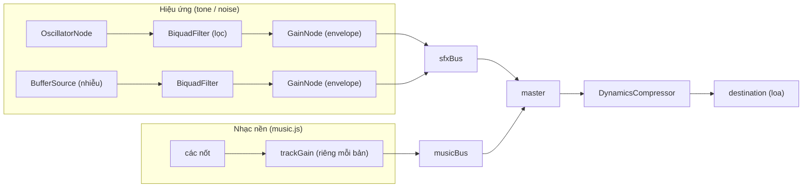
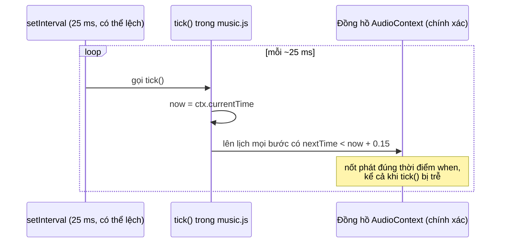

# Bài 10 — Âm thanh tổng hợp bằng Web Audio API

> Thuộc giáo trình **Lập trình game trình duyệt với Oggy Adventure** · [Mục lục](README.md) · Lời giải: [solutions/10-web-audio.md](solutions/10-web-audio.md)

> Oggy Adventure không có **một file âm thanh nào**. Tiếng nhảy, tiếng xu, trống, nhạc nền đều được tạo ra từ sóng âm ngay lúc chạy. Bài này giải thích cách làm điều đó và vì sao nhạc nền vẫn đều nhịp dù trình duyệt đang bận.

## 🎯 Mục tiêu

Sau bài này bạn có thể:

1. Giải thích **audio graph** (đồ thị node âm thanh) và vai trò của `AudioContext`, `OscillatorNode`, `GainNode`, `BiquadFilterNode`.
2. Hiểu **autoplay policy** (chính sách chặn tự phát âm) và vì sao game chỉ tạo `AudioContext` sau thao tác đầu tiên.
3. Tự viết một hiệu ứng âm thanh (SFX) bằng **oscillator + envelope**, và một tiếng trống bằng **noise buffer**.
4. Đổi số MIDI thành tần số (Hz) và soạn một bản nhạc dạng dữ liệu chữ.
5. Hiểu **lookahead scheduling** (lên lịch trước một khoảng ngắn): kỹ thuật giữ nhịp chính xác khi `setInterval` chạy lệch.

Đọc trước: [Bài 06 — Event bus](06-event-bus-observer.md), vì Audio chỉ **nghe** event, gameplay không gọi Audio trực tiếp.

---

## 🧠 Khái niệm

### 1. Audio graph: âm thanh là một dây chuyền node

Web Audio không "phát file" mà **nối các node** thành dây chuyền. Một node *nguồn* tạo tín hiệu (sóng sine, sóng vuông, nhiễu), các node *xử lý* lọc hoặc đổi âm lượng, và cuối cùng tín hiệu tới `destination` (loa).

Trong game, mọi tiếng đi qua hai **bus** (một `GainNode` dùng chung cho cả một nhóm âm thanh). Muốn chỉnh âm lượng nhạc thì chỉ cần vặn *một núm* là `musicBus`:



- **master** dùng để tắt tiếng (mute): chỉ cần đặt gain của master về 0, mức của music/sfx vẫn được giữ.
- **compressor** (bộ nén) ở cuối dây chuyền: khi nhiều tiếng chồng nhau, nó nén bớt đỉnh để tổng không vượt 1.0 và bị méo (clipping).
- **trackGain** riêng cho từng bản nhạc giúp **crossfade** (bản cũ nhỏ dần trong lúc bản mới to dần) mà hai bản không ảnh hưởng nhau.

### 2. Autoplay policy

Trình duyệt **chặn** trang web tự phát tiếng khi người dùng chưa tương tác. Nếu tạo `AudioContext` lúc load trang, nó nằm ở trạng thái `'suspended'` và console in cảnh báo. Vì vậy game chờ event `'input:firstGesture'` (lần bấm phím, click hay chạm đầu tiên) rồi mới tạo context hoặc gọi `resume()`.

### 3. Oscillator và envelope

- **Oscillator** tạo sóng tuần hoàn có tần số `f` (Hz). Dạng sóng đổi "màu" của tiếng: `sine` tròn, `triangle` mềm, `square` kiểu máy game 8-bit, `sawtooth` chói.
- **Envelope** (đường bao âm lượng) điều khiển gain theo thời gian: tăng từ im lặng lên đỉnh trong *attack* giây, rồi giảm dần về im lặng (*decay*). Nếu bật/tắt sóng đột ngột, bạn sẽ nghe tiếng "tách" ở đầu và cuối mỗi nốt.

```
gain
 vol ┤   ╱╲__
     │  ╱    ╲___
     │ ╱         ╲____
 ~0  ┼╱               ╲___  → thời gian
     t0  t0+a              t0+dur
```

### 4. Lên lịch theo đồng hồ âm thanh

Mọi lệnh `start`, `stop`, `setValueAtTime`... nhận một **thời điểm** (giây, theo `ctx.currentTime`), không phải "ngay bây giờ". Đồng hồ âm thanh chạy trong luồng riêng và chính xác tới từng mẫu âm thanh, nên ta có thể xếp lịch sẵn cả chuỗi nốt.

### 5. MIDI → tần số

Nốt MIDI 69 là La4 = 440 Hz. Mỗi nửa cung nhân tần số với 2^(1/12), nên lên 12 nửa cung (một quãng tám) thì tần số gấp đôi:

```
f = 440 × 2^((m − 69) / 12)
```

### 6. Sequencer và lookahead scheduling

**Sequencer** (bộ phát tuần tự) đọc lưới nốt và phát đúng lúc. Cách ngây thơ là `setInterval(phátNốt, 125)`, nhưng `setInterval` có thể lệch vài chục ms (và còn bị làm chậm ở tab nền), nên nhịp sẽ bị "lảo đảo".

Cách đúng là **lookahead scheduling**: cứ mỗi `TICK_MS` (25 ms) ta nhìn trước `LOOKAHEAD` giây (0,15 s) và giao cho Web Audio *mọi nốt rơi vào khoảng đó*, kèm thời điểm chính xác `when`. `setInterval` có lệch thì cũng chỉ làm việc *xếp lịch* sớm hay muộn một chút, còn thời điểm *phát* vẫn chính xác.



Điều kiện bắt buộc: `LOOKAHEAD > TICK_MS` (0,15 s > 0,025 s). Nếu không, sẽ có những khoảng thời gian chưa được lên lịch nốt nào, và nhạc bị hụt.

---

## 🔍 Đọc code

Hai file chính:

- [src/audio/audio.js](../../src/audio/audio.js): engine (context, bus, `tone`, `noise`), thư viện SFX, ánh xạ event → âm thanh.
- [src/audio/music.js](../../src/audio/music.js): dữ liệu bản nhạc (`TRACKS`), `compile`, sequencer (`tick`).

### 3.1 `createContext`: tạo đồ thị một lần

Tìm hàm `createContext` trong audio.js. Lưu ý thứ tự nối dây: compressor → destination, master → compressor, rồi hai bus → master:

```js
      compressor.connect(ctx.destination);

      master = ctx.createGain();
      master.connect(compressor);
      musicBus = ctx.createGain();
      musicBus.connect(master);
      sfxBus = ctx.createGain();
      sfxBus.connect(master);
```

Ngay sau đó là **noise buffer**: 1 giây nhiễu trắng tạo **một lần** rồi dùng mãi. Mỗi tiếng trống chỉ tạo một `AudioBufferSourceNode` nhỏ đọc lại buffer này:

```js
      noiseBuf = ctx.createBuffer(1, ctx.sampleRate, ctx.sampleRate);
      var ch = noiseBuf.getChannelData(0);
      for (var i = 0; i < ch.length; i++) ch[i] = Math.random() * 2 - 1;
```

### 3.2 `unlock`: mở khoá theo autoplay policy

Hàm `unlock` được gọi từ listener của `'input:firstGesture'` (xem `bindEvents`). Nó chỉ coi là "đã mở" khi Promise của `resume()` thành công, và có một mẹo cho iOS là phát một buffer im lặng dài 1 mẫu ngay trong cử chỉ đó:

```js
      if (ctx.state === 'suspended' && !document.hidden) {
        // resume() trả Promise: chỉ coi là "đã mở" khi trình duyệt thật sự cho chạy.
        var p = ctx.resume();
        if (p && p.then) p.then(onUnlocked, function () { /* bỏ qua */ });
        else onUnlocked();
      } else {
        onUnlocked();
      }
```

`onUnlocked` phát lại bản nhạc đã được yêu cầu *trước* khi mở khoá (`Audio.currentTrack`). Nhờ vậy menu có thể gọi `playMusic('menu')` ngay lúc boot mà không bị mất lệnh.

### 3.3 `tone`: một nốt có envelope

Đây là hàm quan trọng nhất của engine. Tìm `function tone(o)`:

```js
      var t0 = o.when != null ? o.when : ctx.currentTime + (o.at || 0);
```

`when` là thời điểm **tuyệt đối** (sequencer dùng), `at` là độ trễ so với "bây giờ" (SFX dùng). Phần envelope:

```js
      g.gain.setValueAtTime(SILENCE, t0);
      g.gain.linearRampToValueAtTime(vol, t0 + a);
      if (o.hold) {
        // Nốt ngân: giảm chậm (tuyến tính) từ đỉnh xuống 75% ở mốc 70% độ dài, rồi mới tắt dần theo hàm mũ.
        g.gain.linearRampToValueAtTime(vol * 0.75, t0 + dur * 0.7);
        g.gain.exponentialRampToValueAtTime(SILENCE, t0 + dur);
      } else {
        g.gain.exponentialRampToValueAtTime(SILENCE, t0 + dur);
      }
```

> ⚠️ **Bẫy:** `exponentialRampToValueAtTime` **không nhận 0**, vì hàm mũ không bao giờ chạm 0. Trình duyệt ném `RangeError` và phần code phía sau không chạy. Game dùng `SILENCE = 0.0001` (≈ −80 dB, tai không nghe thấy). DOM giả của smoke test cũng ném lỗi giống hệt (xem [Bài 13](13-kiem-thu-ci.md)).

Cuối hàm `tone` có một chi tiết dễ bỏ qua: oscillator **chỉ dùng được một lần**. Sau khi `start` rồi `stop`, nó bị huỷ, nên nốt sau phải tạo node mới. Việc tạo node rất rẻ, và đó là cách dùng chuẩn.

```js
      osc.start(t0);
      // Oscillator chỉ dùng được MỘT lần: start → stop rồi bị huỷ. Nốt sau tạo node mới (rẻ, đó là cách dùng chuẩn).
      osc.stop(t0 + dur + STOP_PAD);
```

### 3.4 `mtof` và thư viện SFX (data-driven)

```js
  function mtof(m) { return 440 * Math.pow(2, (m - 69) / 12); }
```

Bảng `SFX` là một object, mỗi khoá là một "công thức" ghép vài `tone`/`noise`. `p` là hệ số cao độ, `v` là hệ số âm lượng:

```js
    jump: function (p, v) {
      tone({ type: 'square', f: 280 * p, f2: 640 * p, dur: 0.16, vol: 0.13 * v, count: C, filter: { type: 'lowpass', f: 3200 } });
      tone({ type: 'sine', f: 560 * p, f2: 1200 * p, dur: 0.1, vol: 0.06 * v, count: C });
    },
```

`f2` làm cao độ **trượt** từ `f` lên `f2`, tạo tiếng nhảy "vút lên".

### 3.5 `playSfx`: ba lớp bảo vệ

Tìm `function playSfx`. Trước khi phát, hàm kiểm tra:

1. **Giới hạn voice**: `activeVoices > MAX_VOICES` (40) thì bỏ, tránh vỡ tiếng và tốn CPU.
2. **Chống dồn tiếng** (rate limit): cùng một SFX phát lại trong khoảng `MIN_GAP[name]` giây thì bỏ. Nhờ vậy 10 đồng xu nhặt trong 1 frame chỉ kêu một lần, thay vì 10 tiếng chồng lên nhau to gấp 10.
3. **Lệch cao độ ngẫu nhiên** ±2% (`PITCH_JITTER`): nghe tự nhiên hơn, không như máy.

```js
    var gap = MIN_GAP[name] || DEFAULT_SFX_GAP;
    if (lastPlayed[name] != null && now - lastPlayed[name] < gap) return false;
    lastPlayed[name] = now;
```

### 3.6 `bindEvents`: Audio chỉ là một observer

```js
    function on(name, fn) {
      E.on(name, function (p) { try { fn(p || {}); } catch (e) { /* không bao giờ làm hỏng gameplay */ } });
    }
```

Mọi listener đều được bọc `try/catch`: lỗi âm thanh tuyệt đối không được lan sang code gameplay đang `emit`. Ví dụ ánh xạ:

```js
    on('player:jump', function (p) { playSfx('jump', { pitch: CHAR_PITCH[p.charId] || 1 }); });
```

Bạn có thể xoá cả thư mục `src/audio/` thì game vẫn chạy được, chỉ là im lặng. Đó chính là **loose coupling** (ghép lỏng) của [Bài 06](06-event-bus-observer.md).

### 3.7 music.js: bản nhạc là dữ liệu chữ

```js
    menu: {
      bpm: 120, loop: true, swing: 0.08,
      lead: { wave: 'square', vol: 0.085, cutoff: 3200 },
      bass: { wave: 'triangle', vol: 0.2, style: 'bounce' },
      pad: { wave: 'triangle', vol: 0.035 },
      chords: ['C', 'Am', 'F', 'G'],
      melody: [
        'E5 . G5 . C6 - . G5 . E5 . G5 - - . .',
```

Mỗi ô nhịp có đúng **16 token**: `'C5'` là một nốt, `'.'` là nghỉ, `'-'` là ngân nốt trước thêm một bước. Bass, pad và arpeggio được **sinh tự động** từ hợp âm (`compileHarmonyBar`), nên người soạn chỉ cần viết giai điệu và tên hợp âm.

**`compile(id)`** biên dịch chuỗi chữ thành mảng `steps` **một lần** rồi cache vào `compiled[id]`. `tick()` chạy 40 lần/giây chỉ đọc mảng có sẵn:

```js
  function compile(id) {
    if (compiled[id]) return compiled[id];
```

Cuối hàm, `stepDur` được tính sẵn từ `bpm`:

```js
    compiled[id] = { id: id, def: def, steps: steps, total: total, stepDur: 60 / (def.bpm || 120) / 4 };
```

> ⚠️ **Bẫy (cache):** sau khi một bản đã được biên dịch, sửa `bpm` hay `melody` của nó sẽ **không có tác dụng** vì sequencer đọc bản trong cache. Ngược lại, `swing` và `lead.vol` được đọc lại *mỗi lần* `tick`/`playEvent` chạy, nên đổi là nghe thấy ngay. Ô "Thử ngay" bên dưới cho bạn kiểm chứng điều này.

### 3.8 `tick()`: lookahead scheduling

```js
  var LOOKAHEAD = 0.15;      // lên lịch trước bao nhiêu giây
  var TICK_MS = 25;          // ms giữa 2 lần tick() kiểm tra
```

Phần lõi của `tick`:

```js
      if (cur.nextTime < now - LATE_TOLERANCE) cur.nextTime = now + RESYNC_DELAY;
      var song = cur.song;
      while (cur.nextTime < now + LOOKAHEAD) {
        var evs = song.steps[cur.step];
        // Swing: đẩy chậm các bước lẻ (8th-note feel).
        var sw = (song.def.swing || 0) * song.stepDur * 2;
        var t = cur.nextTime + (cur.step % 2 === 1 ? sw : 0);
        for (var i = 0; i < evs.length; i++) playEvent(evs[i], t, song, cur.gain);
        cur.nextTime += song.stepDur;
        cur.step++;
```

Dòng đầu là **cơ chế nhảy tới**: nếu `tick()` bị chặn vài giây (luồng chính nghẽn), ta không xả dồn mấy giây nốt vào "quá khứ" (trình duyệt sẽ phát tất cả cùng lúc thành một tràng ồn), mà bỏ qua và bắt đầu lại ngay sau "bây giờ".

### 3.9 `playEvent`: trống cũng chỉ là tone/noise

```js
      case 'kick':
        // Trống bass = sóng sine trượt nhanh 150 → 42 Hz trong 0,12 s ("bùm").
        eng.tone({ type: 'sine', f: 150, f2: 42, slideDur: 0.12, when: t, dur: 0.2, vol: ev.acc > 1 ? 0.42 : 0.34, bus: bus });
        break;
```

Snare là nhiễu **bandpass** cộng một tone ngắn, hi-hat là nhiễu **highpass** rất ngắn. Chỉ với hai khối `tone` và `noise`, ta có đủ một bộ trống.

---

## 🧪 Thử ngay

Mở `index.html`, **bấm vào game một lần** để mở khoá âm thanh, rồi mở DevTools → Console (F12).

1. **Kiểm tra trạng thái và danh sách tiếng:**
   ```js
   OG.Audio.isReady();      // true sau khi đã bấm
   OG.Audio.listSfx();      // ['jump', 'land', 'collect', ...]
   OG.Audio.listTracks();   // ['menu', 'worldmap', 'kitchen', ...]
   ```
2. **Đổi cao độ SFX:**
   ```js
   OG.Audio.sfx('jump', { pitch: 2 });     // cao gấp đôi (lên 1 quãng tám)
   OG.Audio.sfx('jump', { pitch: 0.5 });   // trầm như nhân vật khổng lồ
   ```
   Gõ liền `OG.Audio.sfx('coin')` nhiều lần thật nhanh: một số lần trả về `false` vì bị `MIN_GAP` chặn.
3. **Tự phát một nốt bằng engine:**
   ```js
   var E = OG.Audio._engine;
   E.tone({ type: 'sine', f: E.mtof(69), dur: 1, vol: 0.2 });              // La4 = 440 Hz
   E.tone({ type: 'sawtooth', f: E.mtof(57), dur: 1, vol: 0.15 });         // thấp hơn 1 quãng tám, chói hơn
   E.tone({ type: 'square', f: 440, dur: 1, vol: 0.15, a: 0.6 });          // attack 0,6 s: tiếng "phồng" lên từ từ
   E.noise({ dur: 0.4, type: 'highpass', f: 6000, vol: 0.2 });             // "xì" như hi-hat mở
   E.noise({ dur: 0.6, type: 'lowpass', f: 2000, f2: 100, vol: 0.3 });     // tiếng nổ trầm
   ```
4. **Lên lịch cả chuỗi nốt mà không cần setTimeout:**
   ```js
   var now = E.ctx().currentTime;
   [60, 64, 67, 72].forEach(function (m, i) {
     E.tone({ type: 'triangle', f: E.mtof(m), when: now + i * 0.15, dur: 0.3, vol: 0.2 });
   });
   ```
5. **Kiểm chứng cache của compile** (đang ở menu chính, nhạc menu đang phát):
   ```js
   OG.Audio.tracks.menu.bpm = 200;     // KHÔNG đổi gì: bản 'menu' đã biên dịch, stepDur nằm trong cache
   OG.Audio.tracks.menu.swing = 0.3;   // đổi NGAY: swing được đọc lại mỗi lần tick()
   OG.Audio.tracks.menu.lead.vol = 0.2; // giai điệu to hẳn lên ngay
   ```
   Tải lại trang (F5) để mọi thứ trở về như cũ.
6. **Xem dữ liệu đã biên dịch:**
   ```js
   var song = OG.Audio._music._compile('menu');
   song.stepDur;      // 0.125 giây = 60 / 120 / 4
   song.steps[0];     // các sự kiện ở bước đầu: lead, pad × 3, bass, kick, hat, crash...
   ```
7. **Bus và mute:** `OG.Audio.setVolume('music', 0.1)` rồi `OG.Audio.setVolume('music', 0.6)`. Bấm phím **M** để bật/tắt tiếng (hàm `bindDom`).

🧪 Thử thêm trong code (nhớ trả lại sau khi xem): ở [src/audio/music.js](../../src/audio/music.js), đổi `transpose: 2` của `bossFinal` thành `-5` rồi vào trận cuối: cùng giai điệu nhưng trầm và "đáng sợ" hơn hẳn.

---

## ✍️ Bài tập

### ⭐ Dễ — Tiếng "boing" khi giẫm địch

Thêm một SFX mới tên `boing` vào bảng `SFX` trong `audio.js` (tiếng lò xo: cao độ trượt lên và rung mạnh), rồi cho nó kêu khi giẫm kẻ địch thay cho `'stomp'`. Kiểm tra bằng `OG.Audio.sfx('boing')` và `OG.Audio.listSfx()`.

<details>
<summary>💡 Gợi ý</summary>

- Copy công thức `jump` làm điểm xuất phát. Hai tham số tạo cảm giác "lò xo" là `f2` (trượt cao độ) và `vib`/`vibRate` (vibrato, xem phần LFO trong `tone`).
- Nhớ dấu phẩy sau phần tử cuối cũ của object `SFX`.
- Ánh xạ event nằm trong `bindEvents`, tìm dòng `on('enemy:stomp', ...)`.
- Nếu có thể giẫm nhiều địch liên tiếp, cân nhắc thêm `boing` vào `MIN_GAP`.

</details>

### ⭐⭐ Vừa — Soạn bản nhạc bãi biển

Soạn bản nhạc `beach` (khoảng 90–100 BPM, giọng trưởng, swing nhiều) và dùng nó làm nhạc nền cho **một khu** của một hành trình (field `music` của AreaDef, xem [Bài 12](12-data-driven-man-cau-do-hanh-trinh.md)). Thử trước trong console bằng `OG.Audio.tracks.beach = {...}` rồi `OG.Audio.playMusic('beach')`, sau đó chuyển vào `TRACKS` trong `music.js`.

<details>
<summary>💡 Gợi ý</summary>

- Copy bản `worldmap` hoặc `garden` rồi sửa. Mỗi chuỗi `melody` phải có **đúng 16 token**; số chuỗi = số ô nhịp.
- Hợp âm trưởng: `'F'`, `'C'`, `'Bb'`; thứ: `'Dm'`, `'Am'`. Giai điệu nghe "khớp" khi nốt nhấn (đầu ô nhịp) thuộc hợp âm của ô đó.
- Trong console, nếu đã `playMusic('beach')` rồi sửa nốt thì không nghe khác (cache của `compile`). Hãy đặt id mới (`beach2`, `beach3`...) mỗi lần thử.
- Token sai cú pháp (vd `'H5'`, `'C#'` thiếu quãng tám) bị `noteToMidi` trả `null` và **bỏ qua trong im lặng**. [Bài 13](13-kiem-thu-ci.md) có bài tập viết test bắt lỗi này.

</details>

### ⭐⭐⭐ Khó — Máy đếm nhịp có lookahead

Viết một **metronome** (máy đếm nhịp) chạy trong console, chỉ dùng `OG.Audio._engine` (`ctx()`, `ready()`, `tone()`), theo đúng kỹ thuật lookahead của `tick()`: phách mạnh đầu mỗi ô 4/4 cao hơn các phách còn lại; có `start(bpm)`, `stop()`, `setBpm(bpm)`.

Sau đó so sánh với bản ngây thơ `setInterval(function () { E.tone({ f: 880, dur: 0.05 }); }, 500)` khi luồng chính bị làm bận bằng:

```js
var busy = setInterval(function () { var t = performance.now(); while (performance.now() - t < 20) {} }, 30);
// ... nghe một lúc, rồi: clearInterval(busy);
```

Bản nào giữ nhịp đều? Giải thích bằng số liệu `LOOKAHEAD`, `TICK_MS` và thời gian bị chặn.

<details>
<summary>💡 Gợi ý</summary>

- Trạng thái cần giữ: `nextTime` (thời điểm phách kế tiếp, giây theo `ctx.currentTime`), `beat` (đếm phách), `timer`.
- Mỗi tick: `while (nextTime < now + LOOKAHEAD) { lên lịch tone với when: nextTime; nextTime += 60 / bpm; beat++; }`.
- Đừng quên trường hợp bị tụt lại (tab nền, máy bận): `if (nextTime < now - 0.05) nextTime = now + 0.03;`.
- Kiểm tra `ctx.state === 'running'` trước khi lên lịch (audio.js `suspend()` context khi ẩn tab).

</details>

Lời giải: [solutions/10-web-audio.md](solutions/10-web-audio.md). Hãy tự làm trước khi xem.

---

## 📚 Đọc thêm

- MDN: [Web Audio API](https://developer.mozilla.org/en-US/docs/Web/API/Web_Audio_API) và [Basic concepts behind Web Audio API](https://developer.mozilla.org/en-US/docs/Web/API/Web_Audio_API/Basic_concepts_behind_Web_Audio_API)
- MDN: [Autoplay guide for media and Web Audio APIs](https://developer.mozilla.org/en-US/docs/Web/Media/Autoplay_guide)
- MDN: [AudioParam](https://developer.mozilla.org/en-US/docs/Web/API/AudioParam) (`setValueAtTime`, `linearRampToValueAtTime`, `exponentialRampToValueAtTime`, `setTargetAtTime`)
- Chris Wilson, web.dev: [A Tale of Two Clocks](https://web.dev/articles/audio-scheduling), bài gốc về lookahead scheduling mà `music.js` áp dụng
- MDN: [Advanced techniques: Creating and sequencing audio](https://developer.mozilla.org/en-US/docs/Web/API/Web_Audio_API/Advanced_techniques)
- Hợp đồng API của module: [docs/ARCHITECTURE.md](../ARCHITECTURE.md), mục 8.2 (OG.Audio)

## ➡️ Bài tiếp theo

[Bài 11 — Lưu trữ & migrate dữ liệu](11-luu-tru-migrate.md): âm lượng bạn vừa chỉnh được lưu ở đâu, và làm sao để save cũ vẫn chạy khi game lên phiên bản mới.
