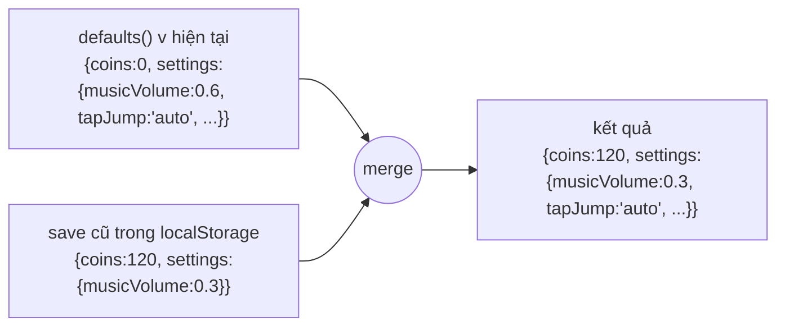
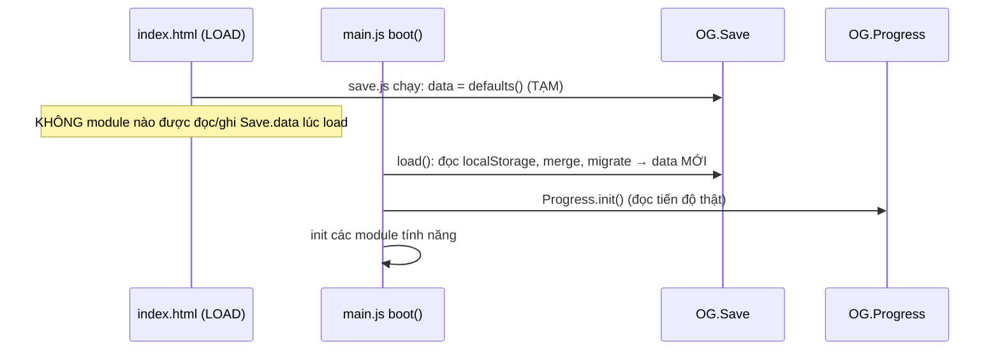

# Bài 11 — Lưu trữ bền vững & migrate dữ liệu

> Thuộc giáo trình **Lập trình game trình duyệt với Oggy Adventure** · [Mục lục](README.md) · Lời giải: [solutions/11-luu-tru-migrate.md](solutions/11-luu-tru-migrate.md)

> Người chơi tắt trình duyệt, một tuần sau mở lại, và mong thấy đủ xu, đủ sao, đúng âm lượng đã chỉnh. Trong lúc đó game có thể đã lên phiên bản mới với nhiều field mới. Bài này giải thích cách `OG.Save` giữ dữ liệu an toàn qua mọi thay đổi đó.

## 🎯 Mục tiêu

1. Dùng `localStorage` đúng cách: luôn bọc `try/catch`, lưu dạng JSON, biết khi nào nó không dùng được.
2. Hiểu kỹ thuật **giá trị mặc định + deep merge** (gộp sâu) để nâng cấp save cũ mà không viết code riêng cho từng field.
3. Hiểu **migrate** (chuyển đổi dữ liệu từ định dạng cũ sang mới) và khi nào thực sự cần nó.
4. Dùng **namespace dữ liệu** (`OG.Save.ns`) để mỗi module có "ngăn" riêng trong save.
5. Viết code chịu được **dữ liệu hỏng**: JSON sai cú pháp, field thiếu, field sai kiểu.

Đọc trước: [Bài 06 — Event bus](06-event-bus-observer.md), vì Save phát `'coins:change'`, `'settings:change'` và `'save:reset'`.

---

## 🧠 Khái niệm

### 1. `localStorage`: tiện nhưng không đáng tin tuyệt đối

`localStorage` lưu cặp **chuỗi → chuỗi** theo từng origin (với `file://`, mỗi trình duyệt xử lý một kiểu). Nó có thể:

- **Bị chặn** (chế độ riêng tư, chính sách bảo mật, `file://` trên vài trình duyệt): mọi lệnh truy cập đều có thể *ném lỗi*.
- **Đầy** (thường khoảng 5 MB mỗi origin): `setItem` ném `QuotaExceededError`.
- **Bị sửa tay** trong DevTools, hoặc chứa dữ liệu từ phiên bản game cũ.

Vì vậy mọi truy cập phải được bọc lại. Nếu không dùng được thì game vẫn chạy, chỉ là dữ liệu sống trong bộ nhớ.

### 2. Mặc định + deep merge

Thay vì kiểm tra từng field ("save có `tapJump` chưa? chưa thì gán `'auto'`"), ta làm ngược lại:

1. Tạo một bản **mặc định đầy đủ** của phiên bản hiện tại.
2. **Gộp sâu** dữ liệu đã lưu đè lên: field nào save có thì lấy của save, field nào save thiếu (field mới) thì giữ giá trị mặc định.



Với cách này, thêm một field mới chỉ cần sửa `defaults()`.

### 3. Khi nào cần migrate thật sự?

Merge chỉ xử lý được việc **thêm** field. Các thay đổi sau thì cần code **migrate** riêng:

| Thay đổi định dạng | Merge có tự lo được không? |
|---|---|
| Thêm field mới | ✅ có |
| Đổi tên field (`best` → `bestScore`) | ❌ không, field cũ nằm "mồ côi" còn field mới nhận giá trị mặc định |
| Đổi kiểu (số → object), đổi ý nghĩa giá trị | ❌ không |
| Chuyển dữ liệu sang key `localStorage` khác | ❌ không |

Cách làm chuẩn là lưu **số phiên bản** (`v`) trong save và viết các bước migrate *nối tiếp*: v1 → v2 → v3. Mỗi bước chỉ cần biết hai phiên bản liền nhau.

### 4. Namespace dữ liệu

Nếu mọi module cùng ghi vào gốc `Save.data`, sớm muộn sẽ có hai module trùng tên field. `OG.Save.ns('quests')` trả về `Save.data.ext.quests`, một "ngăn" riêng của module Quests. Thêm module mới thì không phải sửa `defaults()`.

### 5. Thứ tự khởi động

`Save.load()` **thay** `OG.Save.data` bằng một object mới. Mọi module đọc hoặc ghi save phải làm việc *sau* lúc đó:



---

## 🔍 Đọc code

File chính: [src/core/save.js](../../src/core/save.js). Ví dụ dùng: [src/game/progress.js](../../src/game/progress.js), [src/world/quests.js](../../src/world/quests.js), [src/story/learn.js](../../src/story/learn.js), [src/social/leaderboard.js](../../src/social/leaderboard.js).

### 4.1 Khoá lưu và key cũ

```js
  var KEY = 'oggyAdventure.save.v1';
  var LEGACY_BEST_KEY = 'oggyBest'; // key của bản MVP (chỉ lưu một con số kỷ lục)
  var PROBE_KEY = 'oggyAdventure.probe'; // key tạm để thử localStorage có ghi được không
```

Tên key có hậu tố `.v1`. Nếu một ngày định dạng đổi quá nhiều, ta có thể chuyển sang key `.v2` và giữ nguyên key cũ làm bản sao lưu.

### 4.2 `defaults()`: một hàm, không phải một hằng

```js
  function defaults() {
    return {
      v: 1,
      coins: 0,
```

> ⚠️ **Bẫy:** nếu `defaults` là một object hằng dùng chung, thì sau `reset()` mọi chỉnh sửa trên `Save.data` cũng sửa luôn "bản mặc định", và lần reset sau sẽ không còn sạch. Hàm tạo một object **mới** mỗi lần gọi.

### 4.3 `merge()`: gộp sâu, nhưng mảng được thay nguyên

```js
  function merge(base, saved) {
    if (!saved || typeof saved !== 'object' || Array.isArray(saved)) return base;
    for (var k in saved) {
      if (!Object.prototype.hasOwnProperty.call(saved, k)) continue;
      var b = base[k], s = saved[k];
      if (b && typeof b === 'object' && !Array.isArray(b) && s && typeof s === 'object' && !Array.isArray(s)) {
        base[k] = merge(b, s);
      } else {
        base[k] = s;
      }
    }
    return base;
  }
```

- Chỉ đệ quy khi **cả hai bên** đều là object thường. Nhờ vậy, nếu save hỏng có `settings: 5` thì kết quả là `settings: 5` (sai kiểu); các module đọc settings đều kiểm tra kiểu (xem `settings()` trong audio.js).
- **Mảng được thay nguyên.** Nếu gộp `unlockedChars` theo chỉ số, `['oggy']` (mặc định) gộp với `['jack', 'olivia']` (đã lưu) sẽ ra kết quả sai ngay khi độ dài hai mảng khác nhau.
- `hasOwnProperty` để không chép thuộc tính kế thừa từ prototype.

### 4.4 `load()`: ba lớp bảo vệ

```js
    load: function () {
      // Thử ghi một key tạm: cách chắc chắn nhất để biết localStorage có dùng được không.
      Save.available = storageSet(PROBE_KEY, '1');
      storageRemove(PROBE_KEY);
      var d = defaults();
      var raw = storageGet(KEY);
      if (raw) {
        // 💡 Khái niệm: bảo vệ dữ liệu hỏng — JSON sửa tay sai cú pháp thì JSON.parse ném lỗi; ta bắt lại và
        //   dùng mặc định thay vì để game trắng màn hình ngay lúc khởi động.
        try { d = merge(d, JSON.parse(raw)); } catch (e) { console.warn('[OG.Save] dữ liệu hỏng, dùng mặc định'); }
      }
      // 💡 Khái niệm: migrate — bản MVP chỉ lưu kỷ lục ở key 'oggyBest'. Đọc nó và giữ số lớn hơn,
      //   nên người chơi bản cũ không mất kỷ lục khi lên bản mới.
      var legacy = +(storageGet(LEGACY_BEST_KEY) || 0);
      if (legacy > d.bestScore) d.bestScore = legacy;
      Save.data = d;
      return d;
    },
```

1. **Probe** (thăm dò): thử ghi một key tạm để biết `localStorage` có dùng được không.
2. **try/catch quanh `JSON.parse`**: chuỗi hỏng thì dùng bản mặc định.
3. **Migrate từ bản MVP**: đọc key cũ `oggyBest` và giữ số lớn hơn. Đây là một migrate thật, chỉ một dòng, vì dữ liệu cũ rất đơn giản.

Các hàm `storageGet`, `storageSet`, `storageRemove` bọc `try/catch` ở mức thấp nhất, nên mọi chỗ khác dùng chúng mà không phải lo bị ném lỗi.

### 4.5 `commit()`: ghi xuống, kèm key cũ

```js
    commit: function () {
      var ok = false;
      try { ok = storageSet(KEY, JSON.stringify(Save.data)); } catch (e) { ok = false; }
      // Vẫn ghi key cũ để bản MVP (nếu người chơi mở lại) thấy kỷ lục mới.
      if (Save.data.bestScore) storageSet(LEGACY_BEST_KEY, String(Save.data.bestScore));
      return ok;
    },
```

Mỗi `commit` chạy `JSON.stringify` cho **toàn bộ** save. Rẻ nếu chỉ làm thỉnh thoảng (xong màn, mua đồ), nhưng phí nếu làm mỗi frame hay mỗi cú nhảy. Bài tập ⭐⭐ sẽ cho bạn thực hành chọn thời điểm commit.

### 4.6 `ns()`: namespace cho module

```js
    ns: function (name) {
      if (!Save.data.ext[name] || typeof Save.data.ext[name] !== 'object') Save.data.ext[name] = {};
      return Save.data.ext[name];
    },
```

Module dùng `ns` rồi **tự chữa** field thiếu. Ví dụ hàm `store()` trong [src/world/quests.js](../../src/world/quests.js):

```js
  function store() {
    var s = OG.Save.ns('quests');
    if (!s.levels || typeof s.levels !== 'object') s.levels = {};
    if (!s.global || typeof s.global !== 'object') s.global = {};
    if (!s.daily || typeof s.daily !== 'object') s.daily = { date: '', ids: [], prog: {} };
    if (!Array.isArray(s.daily.ids)) s.daily.ids = [];
    if (!s.daily.prog || typeof s.daily.prog !== 'object') s.daily.prog = {};
    return s;
  }
```

Hàm này được gọi **mỗi lần cần**, không lưu thành biến dài hạn. Lý do: `Save.reset()` thay cả `Save.data`, nên một tham chiếu cũ sẽ trỏ vào object không còn được lưu.

Cùng file có một **migrate một lần** bằng cờ: `seedFromStats` lấy giá trị ban đầu cho thành tựu từ `Save.data.stats` (dữ liệu có trước khi module Quests ra đời), và cờ `seeded` đảm bảo việc đó chỉ chạy một lần.

```js
  function seedFromStats() {
    var s = store();
    if (s.seeded) return;
    s.seeded = true;
```

### 4.7 "Đừng tin dữ liệu bên ngoài": `sanitize` của bảng xếp hạng

[src/social/leaderboard.js](../../src/social/leaderboard.js) chuẩn hoá mọi entry (dữ liệu cục bộ lẫn dữ liệu từ máy chủ) qua `sanitize`: chuỗi bị cắt độ dài và bỏ ký tự điều khiển, số bị kẹp khoảng, id chỉ nhận ký tự an toàn. `local.submitSync` còn sanitize lại dữ liệu *đã lưu* mỗi lần đọc, nên save bị sửa tay vẫn tự chữa được:

```js
      // Sanitize lại dữ liệu đã lưu mỗi lần đọc → save cũ / bị sửa tay vẫn dùng được (tự chữa).
      var res = insertSorted(ns.leaderboard.map(sanitize), entry, MAX_ENTRIES);
```

### 4.8 Progress: commit trước, emit sau

Trong `complete` của [src/game/progress.js](../../src/game/progress.js):

```js
      // ⚠️ Bẫy: commit TRƯỚC khi phát event — listener (vd Menus) có thể đọc lại Save ngay trong lúc nghe.
      OG.Save.commit();
      chars.forEach(function (c) { OG.Events.emit('char:unlock', { charId: c, reason: 'level' }); });
```

`maxStars()` cũng đáng chú ý: tổng sao tối đa là **dữ liệu dẫn xuất**, được tính lại mỗi lần (`levels().length * STARS_PER_LEVEL`) chứ không lưu. Thêm màn mới thì không phải sửa save.

### 4.9 Thứ tự trong `boot()`

[src/core/main.js](../../src/core/main.js):

```js
    OG.DOM.init();
    OG.Save.load();
    OG.Input.init(canvas);
    OG.Progress.init();
```

> ⚠️ **Bẫy:** đảo `Save.load()` xuống dưới `Progress.init()` thì Progress làm việc trên dữ liệu **mặc định** rồi `Save.commit()` ghi đè lên bản lưu thật. Người chơi mất tiến độ thật sự.

---

## 🧪 Thử ngay

Mở game, DevTools → Console.

1. **Đọc dữ liệu:**
   ```js
   OG.Save.available;                         // true nếu localStorage dùng được
   OG.Save.data;                              // toàn bộ save
   OG.Save.get('settings.musicVolume', 0.6);  // đọc theo đường dẫn chấm
   OG.Save.get('khong.co.dau', 'mặc định');   // trả fallback
   ```
   Xem bản lưu thật: DevTools → **Application** → **Local Storage** → key `oggyAdventure.save.v1`.

2. **Sao lưu trước khi phá** (bắt buộc làm trước bước 3 và 4):
   ```js
   localStorage.setItem('oggy.bak', localStorage.getItem('oggyAdventure.save.v1'));
   ```

3. **Save hỏng:**
   ```js
   localStorage.setItem('oggyAdventure.save.v1', '{hỏng');
   location.reload();
   ```
   Console in `[OG.Save] dữ liệu hỏng, dùng mặc định`, và game vẫn chạy với dữ liệu mới tinh.

4. **Save cũ thiếu field:**
   ```js
   localStorage.setItem('oggyAdventure.save.v1', JSON.stringify({ coins: 999, settings: { musicVolume: 0.1 } }));
   location.reload();
   // sau khi tải lại:
   OG.Save.data.coins;                  // 999  (lấy từ save)
   OG.Save.data.settings.musicVolume;   // 0.1  (lấy từ save)
   OG.Save.data.settings.tapJump;       // 'auto' (save thiếu → merge lấy mặc định)
   ```

5. **Migrate từ bản MVP:**
   ```js
   localStorage.setItem('oggyBest', '123456');
   location.reload();
   // sau khi tải lại:
   OG.Save.data.bestScore;   // 123456 nếu lớn hơn kỷ lục hiện có
   ```

6. **Khôi phục bản sao lưu:**
   ```js
   localStorage.setItem('oggyAdventure.save.v1', localStorage.getItem('oggy.bak'));
   location.reload();
   ```

7. **Namespace:**
   ```js
   var my = OG.Save.ns('demo'); my.x = (my.x || 0) + 1; OG.Save.commit();
   OG.Save.data.ext.demo;    // { x: 1 }, tải lại trang vẫn còn
   ```

8. **Dữ liệu dẫn xuất** (chỉ đọc): `OG.Progress.totalStars() + '/' + OG.Progress.maxStars()`.

---

## ✍️ Bài tập

### ⭐ Dễ — Thêm một cài đặt mới mà không phá save cũ

Thêm cài đặt `settings.showFps` (mặc định `false`) vào `defaults()`. Chứng minh bằng console rằng:

1. Người chơi có save cũ (không có `showFps`) sau khi tải lại nhận được `false`.
2. `OG.Save.setSetting('showFps', true)` rồi tải lại trang thì giá trị vẫn là `true`.
3. Event `'settings:change'` được phát với đúng `{key, value}`.

<details>
<summary>💡 Gợi ý</summary>

- Chỉ cần sửa object `settings` trong `defaults()`. Nhớ cập nhật `@typedef SaveSettings` ở đầu file cho đúng.
- Nghe event trong console: `OG.Events.on('settings:change', function (e) { console.log(e); });`.
- Mô phỏng save cũ bằng bước 4 của "Thử ngay".

</details>

### ⭐⭐ Vừa — Module thống kê số lần nhảy

Viết file mới `src/game/jump-stats.js` (nhớ thêm `<script>` vào `index.html`) tạo `OG.JumpStats` với:

- `total()`: tổng số lần nhảy từ trước tới nay (lưu bền vững).
- `fewest(levelId)`: số lần nhảy **ít nhất** khi qua màn đó (`null` nếu chưa qua).

Yêu cầu: dữ liệu nằm trong `OG.Save.ns('jumpStats')`; **không** commit mỗi cú nhảy; tự chữa nếu save bị sửa tay thành dữ liệu sai kiểu; vẫn đúng sau khi người chơi bấm "Xoá dữ liệu" (`Save.reset()`).

<details>
<summary>💡 Gợi ý</summary>

- Event có sẵn: `'player:jump'`, `'level:start'`, `'level:complete'` (payload có `levelId`), `'game:over'`.
- Đăng ký listener lúc load thì được (`OG.Events` đã có), nhưng **không** gọi `OG.Save.ns()` lúc load. Hãy suy nghĩ: lúc đó `Save.data` là object nào, và `Save.load()` sẽ làm gì với nó?
- Viết hàm `store()` giống `quests.js` và gọi nó mỗi lần cần.
- Nên commit ở mốc quan trọng (xong màn, thua). Hãy cân nhắc đánh đổi: tắt tab giữa màn thì mất bao nhiêu dữ liệu?
- Đặt `<script>` sau `src/game/progress.js` là hợp lý. Smoke test tự đọc danh sách script từ `index.html` nên sẽ chạy cả file mới.

</details>

### ⭐⭐⭐ Khó — Migrate có phiên bản

Giả sử phiên bản tới của game (save `v: 2`) có hai quy tắc mới:

- `settings.difficulty` chỉ được là `'kid'` hoặc `'challenge'`; giá trị khác (save sửa tay, bản thử nghiệm) phải đổi thành `'kid'`.
- `unlockedChars` và `progress.unlocked` không được có phần tử trùng.

Viết hệ thống migrate trong `save.js`: hằng `SAVE_VERSION = 2`, bảng `MIGRATIONS` (mỗi bước nâng `v` lên 1), hàm `migrate(d)` chạy nối tiếp các bước, gọi trong `load()`. Xử lý được: save `v: 1`, save rất cũ **không có** `v`, save đã là `v: 2`, và save từ phiên bản **mới hơn** (`v: 3`). Thêm một bản **sao lưu** chuỗi gốc trước khi migrate.

<details>
<summary>💡 Gợi ý</summary>

- `defaults()` phải trả `v: SAVE_VERSION`, vì save mới tạo thì không cần migrate.
- ⚠️ `merge` chép `saved.v` đè lên `v` mặc định. Nhưng nếu save **không có** `v` thì kết quả vẫn mang `v` mặc định (= 2) và bị bỏ qua migrate. Hãy đọc `v` từ dữ liệu *đã lưu*, trước khi merge.
- Save từ phiên bản mới hơn: đừng "hạ cấp" nó, chỉ `console.warn` và giữ nguyên.
- Đừng để một bug trong migrate xoá sạch dữ liệu: bọc riêng bước migrate bằng `try/catch`, và sao lưu `raw` vào key khác (vd `KEY + '.bak.v1'`) trước khi biến đổi.
- Kiểm thử bằng console (bước 2 → 4 của "Thử ngay" với dữ liệu `v: 1` có `difficulty: 'easy'`), hoặc bằng một script Node nhỏ nạp `save.js` vào `vm` với `makeStorage()` của `tests/fake-dom.js`.

</details>

Lời giải: [solutions/11-luu-tru-migrate.md](solutions/11-luu-tru-migrate.md). Hãy tự làm trước khi xem.

> Ghi chú: [CODE_STYLE.md](CODE_STYLE.md) **cấm** đổi định dạng save khi refactor code của dự án. Bài tập ⭐⭐⭐ là bài luyện tập trên bản sao (fork/nhánh) của bạn. Trong dự án thật, đổi `SAVE_VERSION` là một quyết định cần cả nhóm đồng ý và cập nhật tài liệu hợp đồng ([docs/ARCHITECTURE.md](../ARCHITECTURE.md) mục 7, [docs/STORY.md](../STORY.md) mục 8).

---

## 📚 Đọc thêm

- MDN: [Window.localStorage](https://developer.mozilla.org/en-US/docs/Web/API/Window/localStorage) và [Using the Web Storage API](https://developer.mozilla.org/en-US/docs/Web/API/Web_Storage_API/Using_the_Web_Storage_API) (có ví dụ kiểm tra storage dùng được bằng `try/catch`)
- MDN: [Storage quotas and eviction criteria](https://developer.mozilla.org/en-US/docs/Web/API/Storage_API/Storage_quotas_and_eviction_criteria)
- MDN: [JSON.parse()](https://developer.mozilla.org/en-US/docs/Web/JavaScript/Reference/Global_Objects/JSON/parse), lỗi `SyntaxError` khi chuỗi hỏng
- Martin Fowler: [Evolutionary Database Design](https://martinfowler.com/articles/evodb.html), ý tưởng migrate từng bước có đánh số phiên bản (áp dụng cho cả save game)
- Hợp đồng định dạng save: [docs/ARCHITECTURE.md](../ARCHITECTURE.md) mục 7 (OG.Save) và [docs/STORY.md](../STORY.md) mục 8

## ➡️ Bài tiếp theo

[Bài 12 — Data-driven: thêm màn, câu đố, hành trình mới](12-data-driven-man-cau-do-hanh-trinh.md): tiến độ của màn hành trình cũng nằm trong `progress.levels`, vì vậy id màn phải có tiền tố. Bài sau giải thích vì sao.
