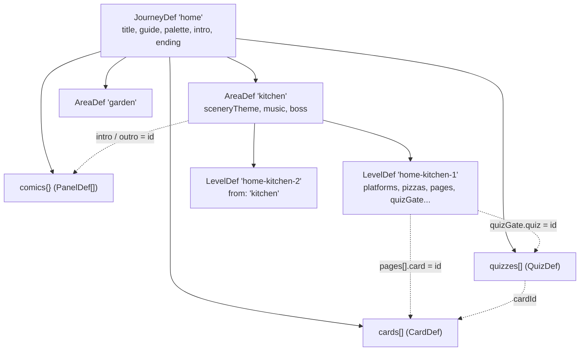
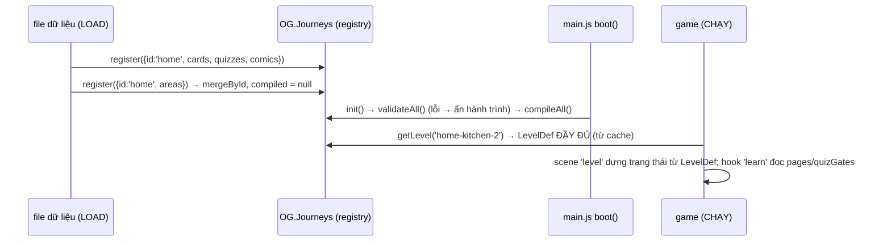

# Bài 12 — Data-driven: thêm màn, câu đố, hành trình mới

> Thuộc giáo trình **Lập trình game trình duyệt với Oggy Adventure** · [Mục lục](README.md) · Lời giải: [solutions/12-data-driven-man-cau-do-hanh-trinh.md](solutions/12-data-driven-man-cau-do-hanh-trinh.md)

> Bốn hành trình học tập của Oggy Adventure gồm hàng chục màn, gần trăm thẻ kiến thức và câu đố, nhưng engine không có một dòng `if (journey === 'vietnam')` nào. Toàn bộ nội dung là **dữ liệu**. Bài này giải thích cách engine "chạy" dữ liệu, rồi bạn tự thêm câu đố, màn và cả một hành trình mới.

## 🎯 Mục tiêu

1. Hiểu **data-driven design** (thiết kế hướng dữ liệu): tách *nội dung* khỏi *engine* để thêm nội dung mà không sửa engine.
2. Đọc được pattern **registry** (sổ đăng ký) và **đăng ký nhiều lần, gộp theo id**.
3. Hiểu bước **compile** (biên dịch dữ liệu gọn thành dữ liệu đầy đủ): điền mặc định, kế thừa bằng `from`, **cache lười + invalidate**.
4. Hiểu vì sao cần **validate** dữ liệu lúc boot, và đọc được thông báo lỗi có đường dẫn.
5. Biết **hook** (điểm cắm mở rộng) giúp `level.js` chạy thẻ học, câu đố, checkpoint mà không biết chúng tồn tại.
6. Tự thêm thẻ + câu đố, một màn mới, và một hành trình mới, giữ smoke test XANH.

Đọc trước: [Bài 04](04-vat-ly-va-cham-aabb.md) (platforms, toạ độ) và [Bài 05](05-state-machine-scene.md) (scene).

---

## 🧠 Khái niệm

### 1. Data-driven design

So sánh hai cách viết màn chơi:

| Hard-code (viết cứng trong code) | Data-driven |
|---|---|
| `if (level === 3) { taoBuc(300, 400); ... }` | `{ id: 'home-roof-1', platforms: [[300, 400, 150, 18], ...] }` |
| Thêm màn = sửa engine, dễ làm hỏng màn khác | Thêm màn = thêm một object |
| Chỉ lập trình viên làm được | Người viết nội dung, giáo viên cũng sửa được |

Engine chỉ cần biết **định dạng** dữ liệu (hợp đồng nằm ở [docs/STORY.md](../STORY.md) mục 2 và [src/types.d.ts](../../src/types.d.ts): `JourneyDef`, `AreaDef`, `LevelDef`, `CardDef`, `QuizDef`, `PanelDef`).

### 2. Cấu trúc một hành trình



Các phần **tham chiếu nhau bằng id** (đường nét đứt). Nếu gõ sai một id, tham chiếu bị gãy, và đó là việc của **validate**.

### 3. Một hành trình, bốn file

Mỗi thư mục `src/journeys/<id>/` có 4 file, nạp theo thứ tự **theme → content → extras → journey**:

| File | Nội dung | Ai sửa |
|---|---|---|
| `theme.js` | chủ đề cảnh nền (`OG.Scenery.registerTheme`), decor | người vẽ |
| `content.js` | thẻ, câu đố, truyện tranh | người viết nội dung |
| `extras.js` | kẻ địch / trùm / NPC riêng (extension point) | lập trình viên |
| `journey.js` | khung: khu, màn, hình học | người thiết kế màn |

`content.js` và `journey.js` **cùng** gọi `OG.Journeys.register({ id: 'home', ... })`. Registry **gộp** hai lần đăng ký lại.

### 4. Vòng đời dữ liệu



---

## 🔍 Đọc code

File lõi: [src/core/journeys.js](../../src/core/journeys.js). Dữ liệu mẫu: [src/journeys/home/journey.js](../../src/journeys/home/journey.js), [src/journeys/home/content.js](../../src/journeys/home/content.js), [src/journeys/home/extras.js](../../src/journeys/home/extras.js).

### 1. `register` và `mergeById`: đăng ký nhiều lần

```js
    register: function (def) {
      if (!def || !isStr(def.id)) { console.warn('[OG.Journeys] register cần id'); return null; }
      /** @type {any} */
      var cur = defs[def.id];
      if (!cur) { cur = defs[def.id] = /** @type {any} */ ({ id: def.id, areas: [], cards: [], quizzes: [], comics: {} }); }
      for (var k in def) {
        if (!Object.prototype.hasOwnProperty.call(def, k)) continue;
        if (k === 'areas' || k === 'cards' || k === 'quizzes') cur[k] = mergeById(cur[k], def[k]);
        else if (k === 'comics') { for (var c in def.comics) cur.comics[c] = def.comics[c]; }
        else cur[k] = def[k];
      }
      compiled = null;
      return cur;
    },
```

Ba loại gộp khác nhau:

- `areas`, `cards`, `quizzes` là **mảng có id**: gộp bằng `mergeById`. Phần tử cùng id bị **thay**, phần tử mới được nối vào cuối.
- `comics` là **object theo khoá**: gộp từng khoá.
- Field khác (`title`, `palette`...): lần sau **ghi đè** lần trước.

```js
  function mergeById(base, add) {
    var out = (base || []).slice();
    (add || []).forEach(function (it) {
      if (!it) return;
      var i = -1;
      for (var k = 0; k < out.length; k++) if (out[k] && out[k].id === it.id) { i = k; break; }
      if (i >= 0) out[i] = it; else out.push(it);
    });
    return out;
  }
```

Nhờ vậy `extras.js` có thể **ghi đè đúng một thẻ** bằng cách đăng ký lại thẻ cùng id, mà không phải chép lại cả file nội dung.

> ⚠️ **Bẫy:** gộp theo id là *thay cả phần tử*, không gộp sâu. Nếu bạn đăng ký lại một **AreaDef** chỉ để đổi `music`, cả mảng `levels` của khu đó sẽ mất. Muốn sửa một khu, hãy sửa trực tiếp trong `journey.js`.

Cuối hàm là `compiled = null`, tức **invalidate** (vô hiệu hoá) cache biên dịch.

### 2. `getCompiled`: cache lười

```js
  function getCompiled() { return compiled || compileAll(); }
```

Có 20 lần `register` lúc load thì cũng chỉ đặt `compiled = null` 20 lần. Chỉ lần *đọc* đầu tiên mới biên dịch thật, một lần duy nhất.

### 3. `compileLevel`: dữ liệu gọn → dữ liệu đầy đủ

Tác giả màn được phép viết rất gọn. `compileLevel` lo phần còn lại:

**(a) Kế thừa hình học bằng `from`:**

```js
  var GEOMETRY = ['width', 'spawn', 'goal', 'platforms', 'pizzas', 'coins', 'enemies', 'exit'];
```

```js
    if (lv.from) {
      var src = null;
      var list = (OG.Data && OG.Data.levels) || [];
      for (var i = 0; i < list.length; i++) if (list[i].id === lv.from) { src = list[i]; break; }
      if (src) GEOMETRY.forEach(function (k) { if (src[k] != null) L[k] = clone(src[k]); });
    }
    for (var key in lv) if (Object.prototype.hasOwnProperty.call(lv, key)) L[key] = lv[key];
```

Thứ tự là quan trọng: chép hình học của màn gốc **trước**, rồi chép field của màn hành trình **đè lên**. `clone()` (sao chép sâu bằng JSON) để sửa `L` không làm hỏng màn v1 gốc.

Ví dụ thật trong home/journey.js: màn chỉ ghi `from`, `goal`, `enemies` và phần học tập, còn bục/pizza/cửa ra mượn của màn v1 `'kitchen'`:

```js
            id: 'home-kitchen-2', name: 'Bếp nóng, bé an toàn', icon: '🍲', from: 'kitchen', goal: 4,
            enemies: [roach(640, 60, 45), roach(1460, 60, 45)],
```

**(b) Điền mặc định theo thứ tự ưu tiên màn → khu → hành trình → giá trị cứng:**

```js
    L.name = L.name || area.name;
    L.icon = L.icon || area.emoji || j.emoji || '📍';
    L.theme = L.theme || area.sceneryTheme || 'garden';
    L.music = L.music || area.music || null;
```

```js
    L.exit = L.exit || { x: L.width - DEFAULT_EXIT_MARGIN };
    L.goal = L.goal != null ? L.goal : Math.min(DEFAULT_GOAL_MAX, L.pizzas.length);
```

`goal` dùng `!= null` chứ không dùng `||`, vì `goal: 0` là giá trị hợp lệ và không được bị thay bằng mặc định.

**(c) Gắn trùm vào màn cuối khu:**

```js
    if (L.boss === undefined) L.boss = (isLastOfArea && area.boss && area.boss.bossId) || null;
```

Trùm của khu tự gắn vào **màn cuối** khu. Màn nào ghi `boss: null` thì tự tắt trùm (so sánh `=== undefined`, không phải falsy).

### 4. Viết tắt cổng câu đố: `normalizeGates`

```js
    return arr.map(function (g, i) {
      // Cho phép viết tắt quizGate: 'q_id' thay vì { quiz: 'q_id' }.
      if (typeof g === 'string') g = { quiz: g };
      return { id: g.id || ('gate' + i), quiz: g.quiz || g.quizId, x: g.x == null ? 'exit' : g.x };
    });
```

`quizGate` (một cổng) và `quizGates` (mảng) được gộp lại thành một dạng chuẩn. Không ghi `x` thì cổng nằm ở cửa EXIT. Đây là kỹ thuật **chuẩn hoá ở cửa vào** (normalize at the boundary): bên trong engine chỉ phải xử lý *một* dạng.

### 5. `validateDef`: bắt lỗi dữ liệu lúc boot

```js
    validateHeader(j, V);
    validateComics(j, V);
    validateAreas(j, V);
    // Thẻ phải kiểm tra TRƯỚC câu đố và màn: hai bước sau tra V.cards / V.quizzes để bắt tham chiếu sai.
    validateCards(j, V);
    validateQuizzes(j, V);
```

Mỗi lỗi có **đường dẫn**, giúp bạn biết ngay phải sửa dòng nào. Ví dụ trong `validateLevel`:

```js
    // ⚠️ Bẫy: goal > số pizza → người chơi KHÔNG BAO GIỜ mở được cửa ra; lỗi này bắt buộc phải chặn.
    if (L.goal > L.pizzas.length) V.err(lp + '.goal', 'goal (' + L.goal + ') lớn hơn số pizza (' + L.pizzas.length + ')');
```

Một số quy tắc đáng nhớ (đều nằm trong các hàm `validate*`):

| Quy tắc | Lý do |
|---|---|
| id màn bắt đầu bằng `'<idHànhTrình>-'` | `progress.levels` trong save dùng chung với màn cổ điển; tiền tố tránh trùng id. |
| `choices` có 2–3 lựa chọn | khớp phím số 1–3 và ba nút lớn cho trẻ em. |
| `answer` là chỉ số hợp lệ | sai chỉ số thì đáp án "đúng" bị chấm sai. |
| cổng giữa màn có `x < exit.x` | cổng nằm sau cửa ra thì vô nghĩa. |
| `fact` ≤ 160 ký tự, thoại ≤ 90 ký tự | chỉ là **cảnh báo**: nội dung cho trẻ nhỏ nên ngắn. |

Có hai mức: **lỗi** (`err`) làm hành trình bị ẩn khỏi màn chọn (`def.invalid = true` trong `validateAll`), còn **cảnh báo** (`wrn`) thì vẫn chơi được.

`validateLevel` kiểm tra trên **bản đã biên dịch**, nhờ vậy bắt được cả lỗi sinh ra từ giá trị mặc định hoặc từ hình học mượn qua `from`.

### 6. Tra cứu "rơi" sang nguồn thứ hai

[src/data/levels.js](../../src/data/levels.js) giữ chiến dịch cổ điển. Màn hành trình **không** nằm trong `OG.Data.levels`, nhưng mọi chỗ gọi `OG.Data.getLevel(id)` vẫn tìm được nhờ fallback (tra cứu dự phòng):

```js
  Data.getLevel = function (idOrIndex) {
    if (typeof idOrIndex === 'number') return Data.levels[idOrIndex] || null;
    for (var i = 0; i < Data.levels.length; i++) if (Data.levels[i].id === idOrIndex) return Data.levels[i];
    if (OG.Journeys && OG.Journeys.getLevel) return OG.Journeys.getLevel(idOrIndex);
    return null;
  };
```

### 7. Hook: `level.js` không biết gì về thẻ học

[src/game/level.js](../../src/game/level.js) mở sẵn các điểm cắm `enter / update / canExit / drawWorld / drawFront / drawScreen` (kiểu `LevelHook` trong `types.d.ts`):

```js
    addHook: function (hook) {
      if (!hook || !hook.id) return null;
      Level.removeHook(hook.id);
      hooks.push(hook);
      hooks.sort(function (a, b) { return (a.order || DEFAULT_HOOK_ORDER) - (b.order || DEFAULT_HOOK_ORDER); });
      return hook;
    },
```

Các module tự cắm vào: `checkpoints` (order 10, [src/game/difficulty.js](../../src/game/difficulty.js)), `learn` (order 20, [src/story/learn.js](../../src/story/learn.js), trang sách + cổng câu đố), `guide` (order 30, [src/story/guide.js](../../src/story/guide.js), người dẫn đường), `story-comics` (order 40, [src/story/story.js](../../src/story/story.js), truyện tranh bật lên giữa màn khi Oggy chạy qua một mốc `x`). Mỗi hook đọc **field dữ liệu** của LevelDef (`pages`, `quizGates`, `guideSpots`, `checkpoints`, `comicTriggers`). Đó là cách dữ liệu "chảy" vào gameplay.

Hook chặn cửa ra trả `false`. Trong `exitBlocked` của level.js:

```js
      // So sánh === false (không phải falsy): hook không trả gì (undefined) nghĩa là "không ý kiến", không chặn.
      if (U.safe('levelHook ' + h.id + '.canExit', h.canExit, h, [st, p]) === false) return true;
```

### 8. Extension point: `extras.js`

[src/journeys/home/extras.js](../../src/journeys/home/extras.js) hiện để trống, nhưng ghi rõ cách cắm thêm loại kẻ địch riêng:

```js
  // 💡 Khái niệm: extension point — muốn có kẻ địch riêng thì thêm ở đây, ví dụ:
  //   OG.Enemies.registerType('home-ant', { ... });   rồi trong journey.js dùng { type: 'home-ant', x: 900 }.
  //   Engine tra loại địch theo tên trong registry nên không phải sửa src/game/enemies.js.
```

Xem ví dụ có code thật ở [src/journeys/science/extras.js](../../src/journeys/science/extras.js) và [Bài 09](09-ai-ke-dich-boss.md).

### 9. Nối hành trình vào trang

Hành trình mới chỉ cần thêm các thẻ `<script>` vào [index.html](../../index.html), đúng thứ tự quy ước:

```html
<script src="src/journeys/science/theme.js"></script>
<script src="src/journeys/science/content.js"></script>
<script src="src/journeys/science/extras.js"></script>
<script src="src/journeys/science/journey.js"></script>
```

Deploy ([.github/workflows/pages.yml](../../.github/workflows/pages.yml)) chép nguyên thư mục `src` và `assets`, nên file mới trong hai thư mục này được đưa lên GitHub Pages mà không phải sửa workflow.

---

## 🧪 Thử ngay

Mở game, DevTools → Console.

1. **Xem registry:**
   ```js
   OG.Journeys.ids();                         // ['home', 'vietnam', 'world', 'science']
   OG.Journeys.get('home').areas.length;      // 4
   OG.Journeys.levelIds('home');              // ['home-kitchen-1', 'home-kitchen-2', ...]
   ```
2. **Xem kết quả compile và `from`:**
   ```js
   var L = OG.Journeys.getLevel('home-kitchen-2');
   L.platforms.length, L.exit, L.theme, L.boss;          // mượn từ 'kitchen'; theme của khu; trùm vì là màn cuối khu
   L.platforms === OG.Data.getLevel('kitchen').platforms; // false: clone() tạo bản sao
   L.quizGates;                                          // [{id:'gate0', quiz:'q_vitc', x:960}, {id:'gate1', quiz:'q_safe', x:'exit'}]
   ```
3. **Validate:**
   ```js
   OG.Journeys.validate('home');                         // {ok: true, errors: [], warnings: []} (warnings có thể có vài mục)
   OG.Journeys.validate({ id: 'Bad', areas: [] });       // nhiều lỗi kèm đường dẫn
   ```
4. **Đăng ký "nóng" và xem trước thẻ/câu đố mà không cần chơi** (nên gõ khi đang ở bản đồ hành trình Nhà hoặc trong một màn):
   ```js
   OG.Journeys.register({ id: 'home', cards: [{ id: 'k_test', areaId: 'kitchen', title: 'Thẻ thử', icon: '🧪', fact: 'Xin chào, mình là thẻ thử!' }] });
   OG.Learn.openCard('home', 'k_test', { isNew: true });   // Esc để đóng
   OG.Learn.openQuiz('home', 'q_vitc');                    // xem câu đố có sẵn
   ```
   Tải lại trang thì thẻ thử biến mất, vì nó chỉ sống trong bộ nhớ.
5. **Hook:**
   ```js
   OG.Level.hookIds();     // ['checkpoints', 'learn', 'guide', 'story-comics'] theo thứ tự order (mục Đọc code 7)
   OG.Level.addHook({ id: 'demo', order: 60,
     drawScreen: function (ctx, st) { ctx.fillStyle = '#000'; ctx.font = OG.font(20); ctx.fillText('Pizza: ' + OG.Game.stage.pizzas, 20, 520); } });
   // vào một màn bất kỳ: góc dưới trái hiện số pizza. Gỡ: OG.Level.removeHook('demo');
   ```
6. 🧪 Thử trong code (nhớ trả lại): trong [src/journeys/home/content.js](../../src/journeys/home/content.js), đổi id `'k_veggie'` thành `'k_veggie2'` rồi chạy `node tests/smoke.js`. Validate báo lỗi "thẻ không tồn tại" ở `pages[]` của màn `home-kitchen-1`.

---

## ✍️ Bài tập

> Trước khi làm, đọc phần ⚠️ trong `home/journey.js` (sàn `platforms[0]` y = 480; cổng câu đố đặt **sau** trang sách chứa đáp án). Sau mỗi bước: `OG.Journeys.validate('<id>')` trong console và `node tests/smoke.js`.

### ⭐ Dễ — Thêm một thẻ và một câu đố

Thêm vào hành trình `home` (khu `kitchen`):

- Thẻ `k_teeth` "Răng trắng tinh": đánh răng hai lần mỗi ngày (sáng và tối trước khi ngủ).
- Câu đố `q_teeth` 2 lựa chọn, gắn `cardId: 'k_teeth'`.
- Đặt trang sách `k_teeth` và cổng `q_teeth` vào màn `home-kitchen-2`, sao cho cổng nằm **sau** trang sách và **trước** cửa ra.

<details>
<summary>💡 Gợi ý</summary>

- Thẻ và câu đố thêm trong `content.js` (mảng `cards` và `quizzes`). Icon nhanh nhất là emoji, ví dụ `icon: '🪥'` (IconSpec dạng chuỗi).
- `answer` đếm từ 0. Đổi thứ tự `choices` thì nhớ sửa `answer`.
- Trong `journey.js`, `home-kitchen-2` đã có `quizGates` (một cổng giữa màn ở x = 960 và một cổng ở EXIT). Thêm phần tử `{ quiz: 'q_teeth', x: ... }`.
- `home-kitchen-2` mượn hình học của màn `'kitchen'`: cửa ra ở `x = 1780`. Xem `OG.Journeys.getLevel('home-kitchen-2').exit`.
- Trang sách đặt trên sàn thì `y: 440` (tâm trang, sàn ở y = 480).

</details>

### ⭐⭐ Vừa — Thêm một màn tự thiết kế

Thêm màn `home-kitchen-3` "Tráng miệng trái cây" **ở cuối khu `kitchen`**, tự vẽ hình học (không dùng `from`): rộng 1800 px, 5–6 bục, 6 pizza, `goal: 4`, 2 con gián, 1 trang sách, 1 cổng câu đố ở EXIT, 1 người dẫn đường, 1 checkpoint.

Trả lời thêm hai câu hỏi:

1. Sau khi thêm, trận Dee Dee nằm ở màn nào? Vì sao không phải sửa dòng nào về trùm?
2. Một người chơi **đã** qua `home-kitchen-2` và đang chơi khu vườn. Cập nhật game xong, `home-garden-1` có còn mở không? (Gợi ý: đọc `isLevelUnlocked`.)

<details>
<summary>💡 Gợi ý</summary>

- Đỉnh nhảy ≈ 116 px theo công thức (`JUMP_VELOCITY` 590, `GRAVITY` 1500; đo thật ở chế độ Thử thách ≈ 111 px). Chế độ Bé chơi mà **giữ** nút nhảy thì cao hơn, ≈ 150 px (`jumpHoldGravityMul` 0,72, bài 04), nhưng đừng thiết kế màn dựa vào con số đó: trẻ em thường bấm nhanh rồi thả (≈ 119 px). Bục cao hơn chỗ đứng 60–80 px là vừa sức trẻ em. Từ sàn (y = 480) lên bục y = 400 là 80 px.
- `platforms[0]` phải là sàn `[0, 480, 1800, 60]`.
- Pizza/xu là toạ độ **tâm** `[x, y]`. Pizza trên bục y = 400 nên đặt ở y ≈ 360.
- Dùng lại thẻ và câu đố có sẵn cũng được (vd thẻ `k_water`, câu đố `q_wash`).
- Câu 1: đọc `compileLevel`, tham số `isLastOfArea`.
- Câu 2: `isLevelUnlocked` mở màn khi **màn liền trước** trong thứ tự hành trình đã xong.

</details>

### ⭐⭐⭐ Khó — Một hành trình mới hoàn chỉnh

Tạo hành trình `ocean` "Đại dương xanh": 2 khu (bãi biển, rạn san hô) × 3 màn, ít nhất 6 thẻ, 2 câu đố, 1 truyện mở đầu, một chủ đề cảnh nền mới `ocean-beach` (chỉ dùng dữ liệu `ThemeDef`, không vẽ tay), và trùm Dee Dee ở cuối khu thứ hai. Mọi màn mượn hình học màn cổ điển bằng `from`. **Smoke test phải XANH.**

<details>
<summary>💡 Gợi ý</summary>

- Bắt đầu bằng cách chép cấu trúc thư mục `src/journeys/home/`. Hành trình có thể chỉ cần `theme.js`, `content.js`, `journey.js` (`extras.js` không bắt buộc).
- Màn có thể mượn: `kitchen`, `garden`, `roof`, `lair` ([src/data/levels.js](../../src/data/levels.js)) và `basement`, `bathroom`, `attic` ([src/world/extraLevels.js](../../src/world/extraLevels.js)). Ghi đè `goal` (vd 3) và `enemies` cho dễ.
- `ThemeDef` mẫu: JSDoc của `registerTheme` trong [src/core/scenery-registry.js](../../src/core/scenery-registry.js), và theme `science-ocean` trong [src/journeys/science/theme.js](../../src/journeys/science/theme.js). Decor của hành trình khác dùng lại được nếu file đó nạp trước.
- Chạy smoke test **ngay khi** thêm `<script>` vào `index.html`: test sẽ đỏ ở `journey:setup` với thông báo "Danh sách hành trình khác mong đợi". Đọc hàm `journeyChecks` và `photoChecks` trong [tests/smoke.js](../../tests/smoke.js) để biết hành trình mới phải thoả **hợp đồng** nào: hằng `JOURNEYS`, số màn tối thiểu, truyện mở đầu, file `assets/photos/<id>/credits.js` (được phép rỗng), dòng nạp file đó trong `index.html` *và* trong `docs/credits.html`.
- `playJourney` trong smoke test kiểm tra HUD 📖 ở **mọi** màn. Màn có `pages: []` sẽ làm test đỏ.

</details>

Lời giải: [solutions/12-data-driven-man-cau-do-hanh-trinh.md](solutions/12-data-driven-man-cau-do-hanh-trinh.md). Hãy tự làm trước khi xem.

---

## 📚 Đọc thêm

- Robert Nystrom, *Game Programming Patterns*: [Type Object](https://gameprogrammingpatterns.com/type-object.html) (định nghĩa "loại" bằng dữ liệu thay vì bằng lớp con)
- Robert Nystrom: [Component](https://gameprogrammingpatterns.com/component.html), cùng ý tưởng "cắm thêm hành vi" như level hook
- Martin Fowler: [Registry](https://martinfowler.com/eaaCatalog/registry.html) (*Patterns of Enterprise Application Architecture*)
- MDN: [Working with JSON](https://developer.mozilla.org/en-US/docs/Learn_web_development/Core/Scripting/JSON), vì sao dữ liệu thuần sao chép sâu được bằng `JSON.parse(JSON.stringify(...))` (và giới hạn: mất hàm, mất `undefined`)
- Hợp đồng dữ liệu: [docs/STORY.md](../STORY.md) mục 2 (định dạng), 2.6 (kiểm tra), 2.8 (`extras.js`), 6.1 (level hooks)

## ➡️ Bài tiếp theo

[Bài 13 — Kiểm thử & CI](13-kiem-thu-ci.md): smoke test đã bắt lỗi cho bạn suốt bài này. Bài sau mở "hộp đen" đó ra: cách chạy cả game trong Node mà không cần trình duyệt, và cách GitHub Actions chặn deploy khi test đỏ.
