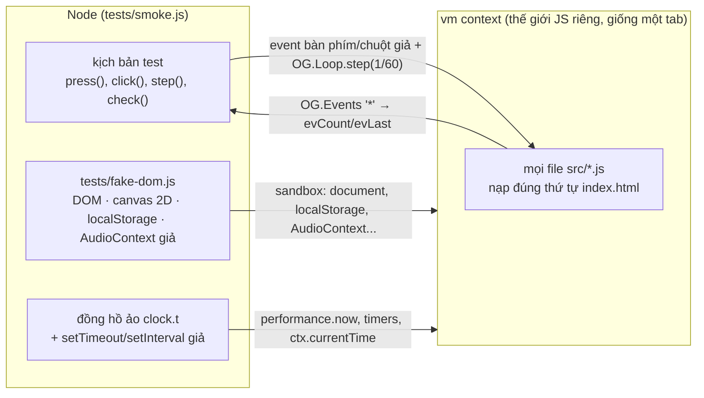
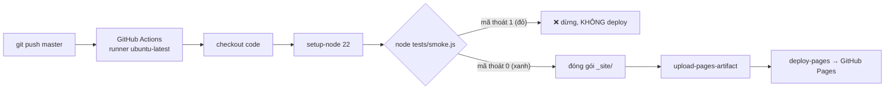

# Bài 13 — Kiểm thử tự động & CI với GitHub Actions

> Thuộc giáo trình **Lập trình game trình duyệt với Oggy Adventure** · [Mục lục](README.md) · Lời giải: [solutions/13-kiem-thu-ci.md](solutions/13-kiem-thu-ci.md)

> Mỗi lần push lên `master`, một máy chủ của GitHub tự tải code về, **chơi trọn cả game** (hơn 40 000 frame, mọi màn, mọi trùm, mọi hành trình) trong khoảng nửa phút, và chỉ deploy khi không có lỗi nào. Không trình duyệt, không thư viện ngoài, chỉ cần `node`. Bài này mở "hộp đen" đó ra.

## 🎯 Mục tiêu

1. Hiểu **smoke test** (kiểm thử "khói") và vị trí của nó so với unit test.
2. Hiểu cách chạy code trình duyệt trong Node: **vm sandbox**, **test double** (DOM giả), **đồng hồ ảo**.
3. Điều khiển game bằng **event giả** + `OG.Loop.step` (fixed step), và viết test **tất định** (deterministic: chạy 100 lần cho cùng một kết quả).
4. Viết **kiểm tra bất biến** (invariant) và **kiểm tra tĩnh** (static check).
5. Đọc và viết workflow **CI** (Continuous Integration: tích hợp liên tục) bằng GitHub Actions.
6. Dùng **JSDoc + tsc** để bắt lỗi kiểu mà không cần build step.

Đọc trước: [Bài 02](02-game-loop-delta-time.md) (`OG.Loop.step`) và [Bài 06](06-event-bus-observer.md) (wildcard `'*'`).

---

## 🧠 Khái niệm

### 1. Smoke test

Tên gọi đến từ ngành điện tử: cắm điện vào mạch mới, nếu không bốc khói thì mới đo đạc kỹ hơn. Smoke test **chạy thử toàn bộ hệ thống** theo các luồng chính, và bắt mọi lỗi runtime (ngoại lệ, `console.error`, scene không chuyển như mong đợi).

| | Unit test | Smoke test / end-to-end (đầu-cuối) |
|---|---|---|
| Phạm vi | một hàm, một module | cả game, theo luồng người chơi |
| Tốc độ | rất nhanh | chậm hơn (ở đây khoảng nửa phút) |
| Khi đỏ | biết ngay hàm nào sai | biết *luồng* nào hỏng, phải đọc thêm để tìm nguyên nhân |
| Bắt được | lỗi logic chi tiết | lỗi tích hợp: thứ tự `<script>`, event sai tên, scene quên gỡ listener... |

Dự án này chọn smoke test làm lớp kiểm thử chính, vì phần lớn lỗi của một game nhiều module nằm ở chỗ **ghép nối**.

### 2. Chạy code trình duyệt trong Node

Game cần `window`, `document`, canvas, `localStorage`, `AudioContext`. Node không có những thứ đó, nên test tự dựng **bản giả**:



- **vm sandbox**: `vm.createContext(sandbox)` biến object `sandbox` thành `globalThis` của một thế giới JS riêng. Code game thấy `document`, `localStorage`... là bản giả, và **không** đụng được biến của test (`require`, `process`, `fs`).
- **Test double / fake**: vật thay thế có hành vi *tối thiểu đủ dùng*. DOM giả không vẽ pixel, không layout, nhưng có `querySelector`, event capture/bubble, `classList`...
- **Đồng hồ ảo**: `performance.now()`, `setTimeout`, `setInterval` và `AudioContext.currentTime` cùng đọc một biến `clock.t` do test tự tăng. Hơn 10 phút chơi ảo chạy xong trong nửa phút, và test không bao giờ phải `sleep`.

### 3. Tất định (deterministic)

Test chỉ có giá trị khi **chạy lại cho cùng kết quả**. Ba nguồn "may rủi" bị khử:

| Nguồn may rủi | Cách khử |
|---|---|
| Tốc độ máy (dt thật dao động) | fixed step: mỗi frame đúng `DT = 1/60` giây ảo |
| Thời gian thật (setTimeout) | timer giả chạy theo đồng hồ ảo |
| Input ngẫu nhiên của "người chơi" | PRNG có seed (bộ sinh số giả ngẫu nhiên có hạt giống) |

### 4. Bất biến và kiểm tra tĩnh

- **Bất biến** (invariant): điều *phải luôn đúng*. Ví dụ: sau mỗi frame, số `ctx.save()` bằng số `ctx.restore()`; chơi lại 3 lượt thì số listener không tăng.
- **Kiểm tra tĩnh**: đọc mã nguồn **như văn bản**, không chạy. Ví dụ: cấm một font cụ thể, cấm `import/export`. Rẻ, nhanh, giống ý tưởng của lint.

### 5. CI: test là "cổng" chặn deploy



Cơ chế nối test với CI chỉ là **mã thoát** (exit code) của tiến trình: 0 là thành công, khác 0 là thất bại.

---

## 🔍 Đọc code

File chính: [tests/smoke.js](../../tests/smoke.js), [tests/fake-dom.js](../../tests/fake-dom.js), [.github/workflows/pages.yml](../../.github/workflows/pages.yml), [jsconfig.json](../../jsconfig.json), [src/types.d.ts](../../src/types.d.ts).

### 6.1 Sandbox: trình duyệt "vừa đủ"

Trong smoke.js, tìm `const sandbox = {`. Vài dòng đáng chú ý:

```js
  performance: { now: () => clock.t * 1000 },
  // rAF giả không bao giờ gọi callback: vòng lặp thật của OG.Loop đứng yên, test tự "bơm" frame bằng step().
  requestAnimationFrame: () => 1,
  cancelAnimationFrame: () => {},
  setTimeout: (fn, ms, ...args) => addTimer(fn, ms, false, args),
```

```js
  // Hộp thoại chặn của trình duyệt bị hợp đồng cấm (làm đứng game, xấu trên điện thoại) → gọi là LỖI.
  alert: () => fail('Gọi alert() — hợp đồng cấm'),
```

Sandbox chỉ chứa những gì game *có dùng*. Thiếu thứ gì thì game ném `ReferenceError` lúc load, và test báo "Lỗi khi load <file>" (rất dễ thấy). `console` của game cũng là bản giả: `console.error` trong game được tính là **LỖI** test, `console.warn` là cảnh báo.

```js
const context = vm.createContext(sandbox);
const win = vm.runInContext('globalThis', context);
// Trong trình duyệt window === self === globalThis; game viết window.OG nên phải nối các tên này lại.
win.window = win;
win.self = win;
```

### 6.2 Nạp script đúng thứ tự `index.html`

```js
const scripts = Array.from(indexHtml.matchAll(/<script\s+src="([^"]+)"\s*><\/script>/g)).map((m) => m[1]);
```

> ⚠️ **Bẫy:** regex chỉ nhận đúng dạng `<script src="..."></script>` (nháy kép, không thuộc tính khác). Thêm `defer`, `async` hay viết nháy đơn thì script bị **bỏ qua** trong test, dù trình duyệt vẫn chạy nó.

Hàm `loadGameScripts` chạy lần lượt từng file trong **cùng** context, giống trình duyệt chạy lần lượt các thẻ `<script>` trong một trang:

```js
    // Hợp đồng: không ES modules (file:// chặn import). Bắt ngay ở đây cho thông báo rõ ràng.
    if (/^\s*(import|export)\s/m.test(code)) fail('Có import/export (ES module) trong ' + src);
    // filename giúp stack trace của lỗi ghi đúng tên file game thay vì "evalmachine".
    try { vm.runInContext(code, context, { filename: src }); } catch (e) { fail('Lỗi khi load ' + src + ': ' + errText(e)); }
```

Ngay sau đó, test đăng ký **wildcard listener** để đếm mọi event mà không phải sửa code game:

```js
  OG.Events.on('*', (name, payload) => { evCount[name] = (evCount[name] || 0) + 1; evLast[name] = payload; });
```

### 6.3 `step()`: fixed step + bất biến sau mỗi frame

```js
function step(n) {
  n = n || 1;
  for (let i = 0; i < n; i++) {
    clock.t += DT;
    runTimers();
    // Frame lỗi: ghi lỗi rồi vẫn gọi endFrame() để trạng thái phím "vừa bấm" không kẹt sang frame sau.
    try { OG.Loop.step(DT); } catch (e) { fail('Lỗi frame (scene ' + safeScene() + '): ' + errText(e)); try { OG.Input.endFrame(); } catch (e2) { /* bỏ qua */ } }
    frames++;
    // 💡 Khái niệm: kiểm tra bất biến (invariant) — điều PHẢI luôn đúng sau mỗi frame. Mỗi ctx.save() phải có
    //   một ctx.restore(); lệch là transform/alpha của hình này rò sang hình khác (lỗi vẽ rất khó tìm bằng mắt).
    if (mainCtx.depth !== 0 || mainCtx.underflow) {
```

`depth` và `underflow` đến từ canvas giả trong fake-dom.js. Canvas này là một **Proxy làm "null object"** (đối tượng rỗng): mọi hàm vẽ lạ (`arc`, `bezierCurveTo`...) đều là hàm rỗng, chỉ `save`/`restore` là được đếm:

```js
  const fns = {
    save() { state.depth++; },
    restore() { if (state.depth <= 0) state.underflow++; else state.depth--; },
```

> ⚠️ **Bẫy (giới hạn của fake):** vì hàm lạ nào cũng "chạy được", gõ sai tên hàm vẽ (vd `ctx.fillRectt`) **không** bị smoke test bắt. Mỗi test double đều có vùng mù như vậy.

AudioContext giả thì ngược lại: nó cố tình **ném lỗi giống trình duyệt** ở những chỗ hay viết sai:

```js
        if (k === 'exponentialRampToValueAtTime' && !(val > 0 || val < 0)) throw new RangeError('exponentialRamp tới 0 / NaN');
```

Đây là lý do `audio.js` dùng `SILENCE = 0.0001` (xem [Bài 10](10-web-audio.md)).

### 6.4 Điều khiển như người chơi

```js
async function press(code, hold) { keyDown(code); step(hold || 1); keyUp(code); await stepAsync(1); }
```

`keyDown` gửi `FakeEvent('keydown', {code, key})` vào phần tử đang focus, và event nổi bọt lên `window`, nơi `OG.Input` đang nghe. Các công cụ khẳng định (assert):

```js
function check(cond, msg) { if (!cond) fail(msg); return !!cond; }
```

```js
function expectScene(name, label) {
  if (cur() !== name) { fail('Mong đợi scene "' + name + '"' + (label ? ' (' + label + ')' : '') + ', thực tế: ' + safeScene()); return false; }
  return true;
}
```

`fail()` **không ném ngoại lệ**: nó ghi lỗi kèm nhãn `stage` hiện tại rồi để test chạy tiếp, nhờ vậy một lần chạy gom được nhiều lỗi.

> 💡 Test **không cố chơi giỏi** như người. Phần chạy tự do dùng input thật để thử AI/vật lý; phần cần kết quả chắc chắn (nhặt đồ, giẫm địch) thì **dịch chuyển** người chơi tới đúng chỗ (`p.x = ...`) rồi để game tự xử lý va chạm.

### 6.5 PRNG có seed trong `fightBoss`

```js
  let seed = 7;
  const rnd = () => { seed = (seed * 16807) % 2147483647; return seed / 2147483647; };
```

Đây là công thức Park–Miller. Cùng seed thì cùng dãy số, nên mỗi lần chạy, "người chơi ảo" bấm phím y hệt nhau và lỗi luôn tái hiện được. Test không dùng `Math.random()` vì nó dùng chung với game và không đặt seed được.

### 6.6 Phát hiện memory leak bằng cách đếm

Mục 13 của `qaChecks`:

```js
  stage = 'qa:leaks';
  const l0 = listenerCount();
  for (let k = 0; k < 3; k++) {
```

```js
  check(listenerCount() === l0, 'Số listener window/document tăng sau 3 lượt chơi lại: ' + l0 + ' → ' + listenerCount());
  check(intervalCount() <= 1, 'Còn ' + intervalCount() + ' setInterval sau khi chơi lại');
```

Scene nào `addEventListener` trong `enter()` mà quên gỡ trong `exit()` sẽ làm số listener tăng sau mỗi lượt. `intervalCount() <= 1` thì bắt lỗi **nhạc phát chồng**: sequencer của music.js chỉ dùng đúng một `setInterval`.

### 6.7 Kiểm tra tĩnh: `fontChecks`

```js
  let scanned = 0;
  files.forEach((f) => {
    if (!/\.(js|css|html|md|json|txt)$/i.test(f)) return;
    scanned++;
```

```js
  // Tự kiểm tra chính check: nếu đường dẫn/regex hỏng mà quét 0 file thì check trên "xanh giả".
  check(scanned > 60, 'Quét font quá ít file (' + scanned + ')');
```

Dòng cuối là một kỹ thuật quan trọng: **test cho chính test**. Một check không quét được file nào sẽ luôn "xanh", và đó là kiểu "xanh giả" nguy hiểm nhất.

### 6.8 Mã thoát: nối test với CI

```js
  if (errors.length) {
    console.log('\nTHẤT BẠI — ' + errors.length + ' lỗi:');
    errors.forEach((e) => console.log('  - ' + e));
    process.exitCode = 1;
  } else {
    console.log('\nXANH — không có lỗi runtime.');
  }
```

Dùng `process.exitCode = 1` thay vì `process.exit(1)`, để Node in hết log rồi mới thoát.

### 6.9 Workflow `pages.yml`

```yaml
on:
  push:
    branches: [master]
  workflow_dispatch:
```

```yaml
      - name: Smoke test
        run: node tests/smoke.js

      - name: Đóng gói site
        # assets/ = ảnh chụp thẻ kiến thức + credits.js. KHÔNG đóng gói tools/ (công cụ chỉ dùng lúc soạn nội dung).
        run: |
          mkdir _site
          cp -r index.html src docs assets CNAME .nojekyll robots.txt sitemap.xml llms.txt site.webmanifest _site/
          rm -f _site/assets/photos/*/_entries.json
```

- `on.push.branches: [master]`: chỉ chạy khi push vào `master`. `workflow_dispatch` cho phép bấm chạy tay trong tab Actions.
- Các bước trong một job chạy **tuần tự**. Bước "Smoke test" đỏ thì các bước sau bị bỏ qua, nên site không được đóng gói và không được deploy.
- Job `deploy` có `needs: build`: chỉ chạy khi job `build` thành công.
- `permissions` chỉ cấp đúng quyền cần (`pages: write`, `id-token: write`), theo nguyên tắc **least privilege** (quyền tối thiểu).
- `concurrency: group: pages` + `cancel-in-progress`: push liên tiếp thì huỷ lần deploy cũ đang chạy.
- File **mới ở gốc repo** (vd một trang `.html` mới) phải được thêm vào lệnh `cp`, nếu không sẽ không lên site. File mới trong `src/`, `docs/`, `assets/` thì tự đi theo.

> ⚠️ Workflow này chỉ test khi push vào `master`. Một Pull Request hỏng sẽ không bị chặn trước khi merge. Bài tập ⭐⭐⭐ sửa điều đó.

### 6.10 Kiểm tra kiểu bằng JSDoc + tsc, không build step

[jsconfig.json](../../jsconfig.json):

```jsonc
    "checkJs": false,         // xem 💡 ở trên: chỉ file có // @ts-check mới bị báo lỗi
    "noEmit": true,           // chỉ KIỂM TRA, không sinh file nào (game chạy thẳng file .js gốc)
```

`checkJs: false` + `// @ts-check` ở dòng 1 của từng file là chiến lược **opt-in** (bật dần từng file). Kiểu dùng chung nằm ở [src/types.d.ts](../../src/types.d.ts), ví dụ:

```ts
interface LevelHook {
  id: string;
  order?: number;
  enter?(st: any): void;
```

Lệnh kiểm tra (không in gì + mã thoát 0 = sạch):

```
npx -y -p typescript@5.6.3 tsc -p jsconfig.json --noEmit
```

Smoke test và tsc bắt **hai loại lỗi khác nhau**. Hãy thử ở bài tập ⭐.

---

## 🧪 Thử ngay

1. **Chạy test:**
   ```
   node tests/smoke.js
   node tests/smoke.js --verbose
   ```
   Bản `--verbose` in từng bước, log của game (`[game] ...`) và số lần phát mỗi event.

2. **Fixed step và dt:** trong `tests/smoke.js`, đổi `const DT = 1 / 60;` thành `1 / 30` rồi chạy. Những check bắt đầu đỏ chính là chỗ game nhạy với delta time. Nhớ trả lại.

3. **Thứ tự script:** trong `index.html`, chuyển dòng nạp `src/core/namespace.js` xuống dưới `src/core/events.js` rồi chạy test. Lỗi ở stage `load` chỉ đúng file đọc `window.OG` khi nó chưa tồn tại. Nhớ trả lại.

4. **Kiểm tra tĩnh hoạt động:** thêm vào cuối một file bất kỳ trong `src/` một dòng comment có tên font cấm (xem `fontChecks`), chạy test: đỏ, kèm tên file. Xoá dòng đó.

5. **Kiểm tra kiểu:** chạy lệnh `tsc` ở mục 6.10 → không in gì. Xem tab **Actions** trên trang GitHub của repo để thấy lịch sử các lần chạy `pages.yml`.

---

## ✍️ Bài tập

### ⭐ Dễ — Đọc lỗi như một kỹ sư

Làm hai thí nghiệm (nhớ trả lại code sau mỗi thí nghiệm):

1. Trong `src/journeys/home/journey.js`, đổi `goal: 5` của màn `home-kitchen-1` thành `goal: 99`. Chạy smoke test. Có bao nhiêu lỗi? Lỗi nào là **nguyên nhân gốc**, lỗi nào là **hệ quả**?
2. Trong `src/game/progress.js` (hàm `complete`), gõ sai `result.levelScore` thành `result.levelScor`. Chạy smoke test, rồi chạy `tsc`. Công cụ nào phát hiện lỗi? Vì sao công cụ kia bỏ sót?

<details>
<summary>💡 Gợi ý</summary>

- Đọc lỗi **đầu tiên** trước. Nhãn trong ngoặc vuông (`[journey:setup]`) là `stage`, cho biết lỗi xảy ra ở giai đoạn nào của kịch bản.
- Hành trình có lỗi dữ liệu thì bị đánh dấu `invalid` và **ẩn** khỏi màn chọn. Những bước test sau cần tới nó sẽ hỏng dây chuyền.
- `undefined | 0` bằng bao nhiêu? Có check nào trong smoke test đọc `bestScore` của từng màn không?
- `progress.js` có `// @ts-check` ở dòng 1, và tham số `result` có JSDoc `{levelScore: number, stars: number, time: number}`.

</details>

### ⭐⭐ Vừa — Viết check mới: dữ liệu nhạc nền

Token nhạc sai cú pháp (vd `'H5'`, `'C#'` thiếu quãng tám) bị `noteToMidi` trong `music.js` **bỏ qua trong im lặng**. Ô nhịp thiếu hay thừa token làm lệch nhịp. Không lỗi runtime nào xảy ra, nên smoke test hiện tại không bắt được.

Viết hàm `musicChecks()` trong `tests/smoke.js` (gọi trong `main()` sau `difficultyChecks()`), kiểm tra với **mọi** bản nhạc trong `OG.Audio.listTracks()`:

- biên dịch được (`OG.Audio._music._compile(id)` khác `null`, `total > 0`);
- mỗi ô nhịp `melody` có đúng 16 token;
- mỗi token là `'.'`, `'-'` hoặc một nốt hợp lệ;
- có ít nhất một nốt giai điệu (`ch === 'lead'`).

Chứng minh check hoạt động: cố tình sửa một token thành `'H5'`, thấy test đỏ với thông báo rõ ràng, rồi sửa lại.

<details>
<summary>💡 Gợi ý</summary>

- Làm theo công thức 4 bước ở khối "CÁCH VIẾT MỘT CHECK MỚI" đầu smoke.js: đặt `stage`, dựng tình huống, tác động, khẳng định.
- Đây là kiểm tra trên **dữ liệu đã nạp**, không cần `step()` hay `await`.
- Bản `bossFinal` dùng `extend: 'boss'` nên không có `melody` riêng. Hãy đọc `song.def` của bản đã biên dịch (đã gộp `extend`).
- Regex nốt: chép từ `noteToMidi` (`/^([A-G])(#|b)?(-?\d)$/`). Vì sao *chép* chứ không gọi thẳng hàm của game? (Hàm đó là nội bộ trong IIFE, không gắn vào `OG`.)
- Thông báo lỗi nên nói rõ **bản nào, ô nhịp nào, token nào**.

</details>

### ⭐⭐⭐ Khó — CI cho Pull Request

Viết workflow mới `.github/workflows/ci.yml`:

- chạy khi có **Pull Request** và khi push vào mọi nhánh **khác** `master` (`master` đã có `pages.yml`);
- chỉ cần quyền **đọc** code;
- chạy song song trên **Node 20 và 22** (matrix);
- ba bước: `node --check` cho mọi file `.js` trong `src/` và `tests/`; smoke test; kiểm tra kiểu bằng `tsc` (chỉ cần chạy trên một bản Node);
- đẩy commit mới lên cùng nhánh thì huỷ lần chạy cũ.

Trả lời thêm: vì sao không gộp luôn vào `pages.yml`? Nên bật gì trong *Settings → Branches* của GitHub để PR đỏ không merge được?

<details>
<summary>💡 Gợi ý</summary>

- Trigger: `on: pull_request:` và `push: branches-ignore: [master]`.
- `permissions: contents: read`.
- Matrix: `strategy: matrix: node: [20, 22]`, rồi `node-version: ${{ matrix.node }}`. Đặt `fail-fast: false` để bản Node này đỏ không huỷ bản kia (bạn sẽ biết lỗi chỉ ở một bản hay ở cả hai).
- Chạy bước có điều kiện: `if: matrix.node == 22`.
- Vòng lặp shell: `for f in $(git ls-files 'src/*.js' 'tests/*.js'); do node --check "$f" || exit 1; done`.
- `concurrency: group: ci-${{ github.ref }}` + `cancel-in-progress: true`.
- Về câu hỏi: nghĩ tới quyền `pages: write` và chuyện "mỗi PR có nên deploy không".

</details>

Lời giải: [solutions/13-kiem-thu-ci.md](solutions/13-kiem-thu-ci.md). Hãy tự làm trước khi xem.

---

## 📚 Đọc thêm

- Node.js: [VM (executing JavaScript)](https://nodejs.org/api/vm.html), cùng cảnh báo quan trọng: `vm` **không** phải cơ chế bảo mật để chạy code không tin cậy
- Node.js: [Process](https://nodejs.org/api/process.html), mục `process.exitCode` (vì sao nên đặt mã thoát thay vì gọi `process.exit()`)
- MDN: [Proxy](https://developer.mozilla.org/en-US/docs/Web/JavaScript/Reference/Global_Objects/Proxy), kỹ thuật dựng canvas và AudioContext giả
- Martin Fowler: [Test Double](https://martinfowler.com/bliki/TestDouble.html), [The Practical Test Pyramid](https://martinfowler.com/articles/practical-test-pyramid.html), [Continuous Integration](https://martinfowler.com/articles/continuousIntegration.html)
- GitHub Docs: [Workflow syntax for GitHub Actions](https://docs.github.com/en/actions/writing-workflows/workflow-syntax-for-github-actions), [Using a matrix for your jobs](https://docs.github.com/en/actions/writing-workflows/choosing-what-your-workflow-does/running-variations-of-jobs-in-a-workflow), [About protected branches](https://docs.github.com/en/repositories/configuring-branches-and-merges-in-your-repository/managing-protected-branches/about-protected-branches)
- TypeScript: [JS Projects Utilizing TypeScript](https://www.typescriptlang.org/docs/handbook/intro-to-js-ts.html) và [JSDoc Reference](https://www.typescriptlang.org/docs/handbook/jsdoc-supported-types.html)
- Quy ước kiểm tra kiểu của dự án: [CODE_STYLE.md](CODE_STYLE.md) mục 7; phần kiểm thử trong [docs/ARCHITECTURE.md](../ARCHITECTURE.md) mục 10 và [docs/STORY.md](../STORY.md) mục 11

## ➡️ Bài tiếp theo

Đây là bài cuối của giáo trình. Quay về [mục lục](README.md) để chọn một hướng đào sâu, hoặc tự đặt cho mình một "dự án cuối khoá": một hành trình mới (Bài 12) có nhạc riêng (Bài 10), lưu thống kê riêng (Bài 11), và có check riêng chạy trong CI (Bài 13).
