# Sơ đồ kiến trúc Oggy Adventure

Trang này vẽ lại kiến trúc của game bằng **sơ đồ Mermaid**, để bạn nắm được "bức tranh lớn" trước khi đọc từng file.
GitHub, GitLab và VS Code (khi cài thêm extension xem trước Mermaid) đều tự vẽ các khối ` ```mermaid `.
Nếu trình xem của bạn chỉ hiện chữ, hãy dán khối đó vào <https://mermaid.live>.

- **Hợp đồng chính thức** (API, payload event, thứ tự load) vẫn nằm ở [`docs/ARCHITECTURE.md`](../ARCHITECTURE.md) và [`docs/STORY.md`](../STORY.md).
  Nếu sơ đồ ở đây khác hai tài liệu đó hoặc khác code thì **code và hợp đồng đúng**, sơ đồ cần sửa.
- Mọi tên (namespace `OG.*`, tên scene, tên event) trong trang này được đối chiếu bằng `grep` trên mã nguồn hiện tại.
  Cách tự kiểm tra lại nằm ở [mục 6](#6-tự-kiểm-tra-sơ-đồ-còn-khớp-code-không).
- Lộ trình học: [`README.md`](README.md) · Quy ước comment: [`CODE_STYLE.md`](CODE_STYLE.md).

Mục lục:
1. [Module và phụ thuộc giữa các namespace `OG`](#1-module-và-phụ-thuộc-giữa-các-namespace-og)
2. [State machine các scene](#2-state-machine-các-scene)
3. [Luồng event: ai phát, ai nghe](#3-luồng-event-ai-phát-ai-nghe)
4. [Vòng đời một frame (sequence diagram)](#4-vòng-đời-một-frame-sequence-diagram)
5. [Cây thư mục có chú thích](#5-cây-thư-mục-có-chú-thích)
6. [Tự kiểm tra sơ đồ còn khớp code không](#6-tự-kiểm-tra-sơ-đồ-còn-khớp-code-không)

---

## 1. Module và phụ thuộc giữa các namespace `OG`

### 1.1 Ý tưởng chính: mọi module treo lên một object toàn cục

Game không dùng ES modules (`import`/`export`), vì trình duyệt chặn chúng khi mở trang qua `file://`.
Thay vào đó, mỗi file là một **IIFE** (Immediately Invoked Function Expression, hàm tự gọi ngay khi nạp) và gắn module của mình vào
**namespace** (không gian tên) dùng chung `window.OG`, ví dụ `OG.Events`, `OG.Player`. Muốn dùng module khác thì chỉ cần đọc `OG.X`.

Hệ quả: trình duyệt **không tự sắp thứ tự phụ thuộc** như `import`. Thứ tự các thẻ `<script>` trong `index.html` chính là thứ tự phụ thuộc
lúc nạp. Vì vậy cần phân biệt hai loại phụ thuộc:

- **Phụ thuộc lúc LOAD**: file đọc `OG.X` ngay khi được nạp (ví dụ `src/journeys/*/journey.js` gọi `OG.Journeys.register(...)`).
  File tạo `OG.X` **phải** đứng trước trong `index.html`.
- **Phụ thuộc lúc CHẠY**: file chỉ đọc `OG.X` bên trong hàm (`init()`, `update()`, `draw()`...). Thứ tự `<script>` không quan trọng,
  chỉ cần `OG.X` có mặt khi hàm đó chạy. Phần lớn phụ thuộc trong game thuộc loại này.

### 1.2 Sơ đồ tầng (layer)

Mũi tên `A --> B` nghĩa là "A gọi trực tiếp API của B". Mũi tên nét đứt là **lời gọi tuỳ chọn** qua `OG.util.call('Tên', 'hàm', ...)`:
module đích có thể vắng mặt mà game vẫn chạy. Số trong ngoặc là nhóm nạp trong `index.html` (xem [`ARCHITECTURE.md` mục 2](../ARCHITECTURE.md)).

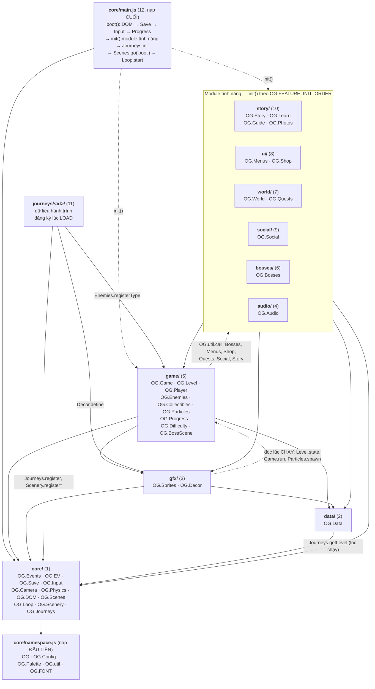

**Cách đọc sơ đồ:**
- `core/` là tầng thấp nhất: không gọi `game/`, `gfx/` hay module tính năng nào. Riêng `core/journeys.js` đọc `OG.Bosses` và
  `OG.Progress` **lúc chạy** để kiểm tra dữ liệu hành trình.
- `game/` gọi module tính năng **chỉ qua `OG.util.call`** (nét đứt). Bạn có thể xoá thẻ `<script>` của `src/ui/menus.js`, game vẫn
  chạy với menu mặc định trong `src/game/default-scenes.js` (pattern "stub rồi ghi đè", xem bài 01).
- Phần lớn liên lạc **giữa các module tính năng** không đi qua mũi tên nào cả, mà qua **event bus** `OG.Events` (mục 3).
  Ví dụ `OG.Audio` không được gameplay gọi trực tiếp: nó tự nghe `player:jump`, `item:collect`... rồi phát âm thanh.

### 1.3 Chi tiết bên trong `core/`

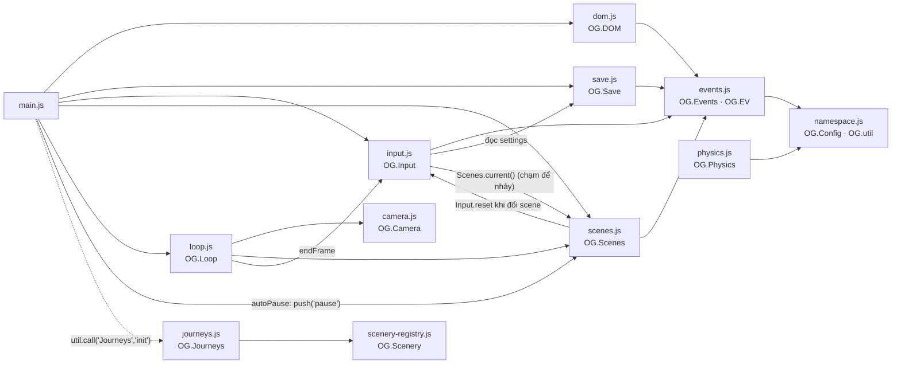

### 1.4 Bảng phụ thuộc theo thư mục (lúc CHẠY, lấy từ `grep "OG\.[A-Z]"`)

| Thư mục | Namespace tạo ra | Namespace gọi tới (ngoài chính mình; `?` = qua `OG.util.call`) |
|---|---|---|
| `core/` | `OG`, `Config`, `Palette`, `FONT`, `Events`, `EV`, `Save`, `Input`, `Camera`, `Physics`, `DOM`, `Scenes`, `Loop`, `Scenery`, `Journeys` | `Bosses`, `Data`, `Progress` (chỉ `journeys.js`, `main.js`), `Journeys?` |
| `data/` | `Data` | `Palette`, `Journeys` |
| `gfx/` | `Sprites`, `Decor` | `Camera`, `Data`, `Events`, `FONT`, `Game`, `Level`, `Palette`, `Particles`, `Scenery`, `Scenes` |
| `audio/` | `Audio` | `DOM`, `Events`, `Level`, `Save`, `Scenes` |
| `game/` | `Game`, `Level`, `Player`, `Enemies`, `Collectibles`, `Particles`, `Progress`, `Difficulty`, `BossScene` | `Camera`, `Config`, `DOM`, `Data`, `Events`, `Input`, `Physics`, `Save`, `Scenes`, `Sprites`, `Story`, `Bosses?`, `Menus?`, `Quests?`, `Shop?`, `Social?`, `Story?`, `Difficulty?` |
| `bosses/` | `Bosses` | `Camera`, `Config`, `DOM`, `Data`, `Enemies`, `Events`, `Game`, `Palette`, `Particles`, `Physics`, `Player`, `Sprites` |
| `world/` | `World`, `Quests` | `DOM`, `Data`, `Events`, `FONT`, `Game`, `Guide`, `Input`, `Journeys`, `Learn`, `Palette`, `Progress`, `Save`, `Scenery`, `Scenes`, `Sprites`, `Story` |
| `ui/` | `Menus`, `Shop` | `Audio`, `BossScene`, `Config`, `DOM`, `Data`, `Difficulty`, `Events`, `FONT`, `Game`, `Input`, `Journeys`, `Learn`, `Level`, `Palette`, `Photos`, `Quests`, `Save`, `Scenes`, `Sprites` |
| `social/` | `Social` | `Config`, `DOM`, `Data`, `Events`, `FONT`, `Game`, `Input`, `Palette`, `Progress`, `Save`, `Scenes`, `Sprites` |
| `story/` | `Story`, `Learn`, `Guide`, `Photos` | `Camera`, `DOM`, `Data`, `Difficulty`, `Events`, `FONT`, `Game`, `Input`, `Journeys`, `Level`, `Menus`, `Particles`, `Progress`, `Save`, `Scenery`, `Scenes`, `Sprites` |
| `journeys/` | `JourneyArt` (chỉ `world/theme.js`) | `Decor`, `Enemies`, `FONT`, `Journeys`, `Scenery`, `Sprites` |

> 💡 Nhận xét cho bài 01: thư mục càng "cao" (ui, story, world) thì gọi càng nhiều namespace. Tầng thấp (`core`, `data`) gần như
> không biết tầng trên tồn tại. Đây là **dependency direction** (hướng phụ thuộc) lành mạnh: sửa UI không làm vỡ vật lý.

---

## 2. State machine các scene

Mỗi **scene** (cảnh: menu, bản đồ, màn chơi, trùm...) là một **trạng thái** của **FSM** (finite state machine, máy hữu hạn trạng thái)
do `OG.Scenes` (`src/core/scenes.js`) quản lý. Có hai kiểu chuyển (xem bài 05):

- `OG.Scenes.go(name, params)`: **thay cả stack** (scene cũ `exit`, scene mới `enter`). Sơ đồ 2.1 vẽ các chuyển kiểu này.
- `OG.Scenes.push(name, params)` / `pop()`: **chồng** một scene lên trên (scene dưới đứng yên nhưng vẫn được vẽ nếu `drawBelow`).
  Sơ đồ 2.2 vẽ các chuyển kiểu này.

### 2.0 Scene nào do file nào đăng ký

`register()` lần sau **ghi đè** lần trước. Các scene mặc định trong `src/game/default-scenes.js` bị module tính năng thay thế trong `init()`.

| Scene | Đăng ký mặc định (stub) | Bản thật (ghi đè trong `init()`) |
|---|---|---|
| `boot` | `src/game/default-scenes.js` | — |
| `menu` | `src/game/default-scenes.js` | `src/ui/menus.js` |
| `modeSelect`, `notebookHub`, `charselect`, `settings` | — | `src/ui/menus.js` |
| `pause`, `gameover`, `victory` | `src/game/default-scenes.js` | `src/ui/menus.js` |
| `worldmap` | `src/game/default-scenes.js` | `src/world/world.js` |
| `level` | `src/game/level.js` | — |
| `boss` | `src/game/boss-scene.js` | — |
| `shop` | — | `src/ui/shop.js` |
| `leaderboard` | — | `src/social/leaderboard.js` |
| `journeyMap` | `src/story/scenes.js` (bản DOM dự phòng) | `src/world/journey-map.js` (bản canvas) |
| `journeySelect`, `comic`, `card`, `quiz`, `notebook`, `journeyEnd` | — | `src/story/scenes.js` |

### 2.1 Chuyển scene bằng `go` (thay cả stack)

**(a) Menu và chiến dịch cổ điển**

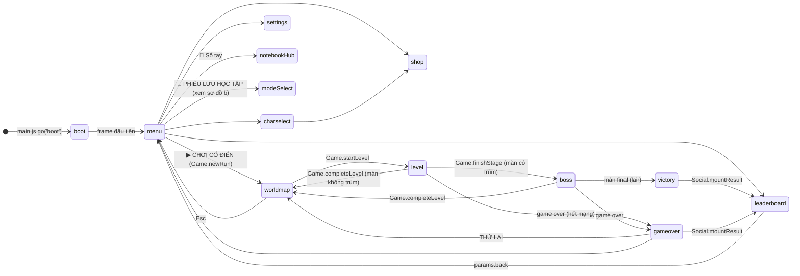

**(b) Phiêu lưu học tập (v2)** — luồng chi tiết ở [`STORY.md` mục 3](../STORY.md)

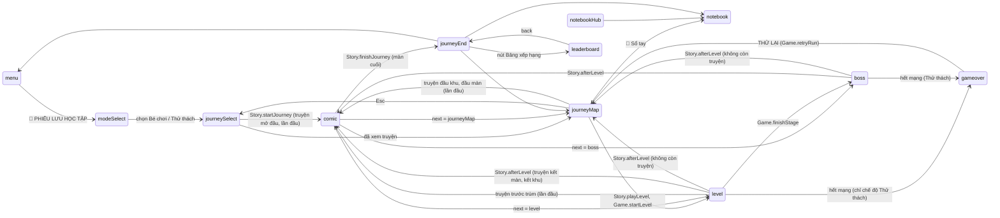

Ghi chú:
- Các mũi tên "quay lại" dùng `params.back` (vd `shop{back:'worldmap'}`, `leaderboard{back:'journeyEnd'}`) không vẽ hết để sơ đồ gọn.
- Ở chế độ **Bé chơi** (`kid`), hết mạng **không** sang `gameover`: `OG.Difficulty.softFail` hồi mạng và đưa về checkpoint (`player:respawn`).
- Luồng màn → trùm → bản đồ được quyết định **tập trung** trong `src/game/game.js` (`finishStage`, `completeLevel`, `backToMap`, `retryRun`).
  Đây là ví dụ "state machine cấp cao" của bài 05.

### 2.2 Scene chồng bằng `push` / `pop`

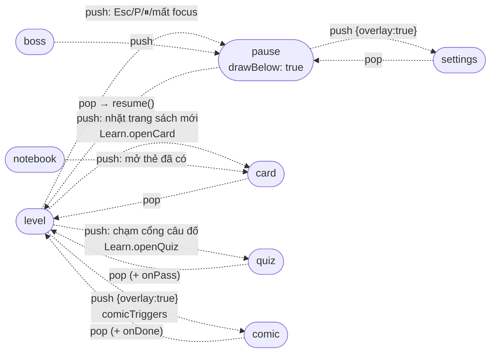

Trong lúc một scene bị đè, nó **không được `update`** nên thời gian chơi (`Game.tickTime`) cũng không tăng. Đó là lý do tạm dừng
không bị tính vào thời gian màn.

### 2.3 Trạng thái con bên trong scene `level`

Scene `level` có FSM nhỏ của riêng nó trong `Level.state.phase` (`src/game/level.js`):

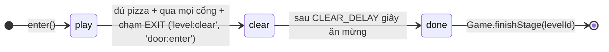

---

## 3. Luồng event: ai phát, ai nghe

`OG.Events` là **event bus** (kênh sự kiện) theo pattern **observer / publish–subscribe**: module phát (`emit`) không cần biết ai nghe (`on`).
Tên chuẩn của mọi event nằm trong `OG.EV` (`src/core/events.js`), dạng `'<chủ thể>:<việc vừa xảy ra>'`.

### 3.1 Gameplay trong màn

**(a) Event của người chơi**

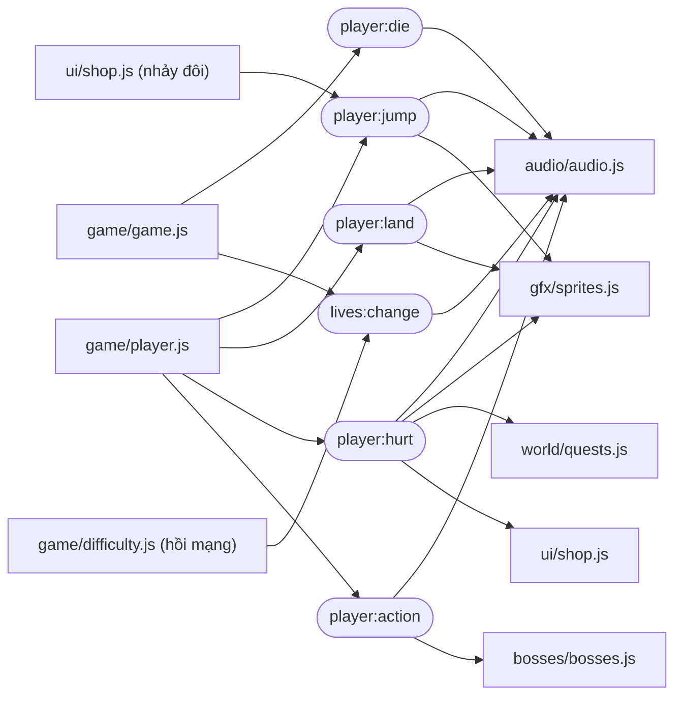

**(b) Event của màn chơi**

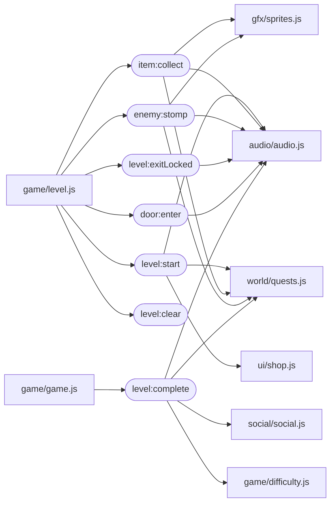

`level:clear` chưa có module nào trong `src/` nghe (smoke test vẫn đếm mọi event qua listener wildcard `'*'`). Đây là chỗ tốt để làm bài tập bài 06.

### 3.2 Trận trùm

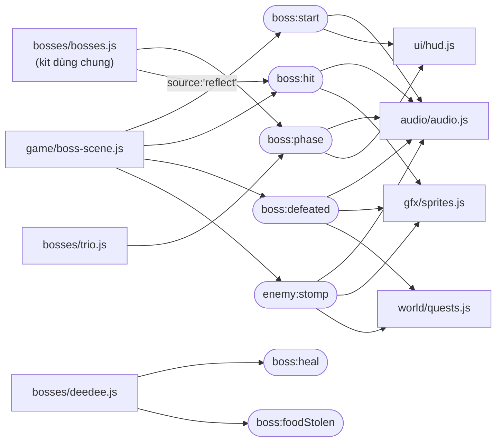

### 3.3 Lượt chơi, scene, kinh tế, lưu trữ

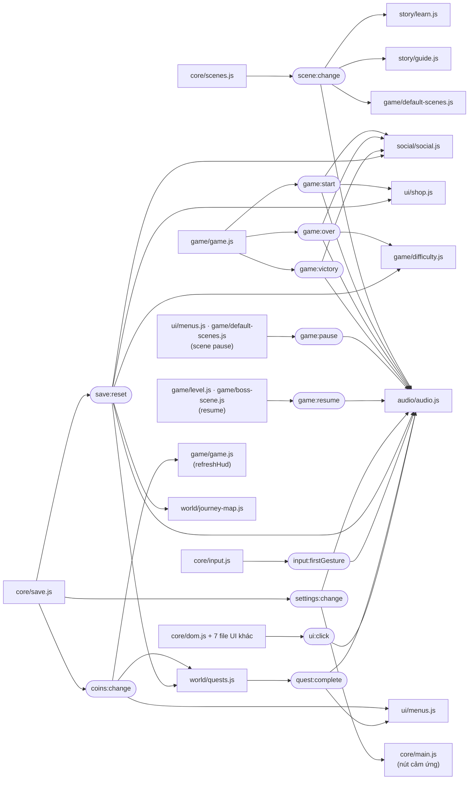

### 3.4 Hành trình học tập (v2)

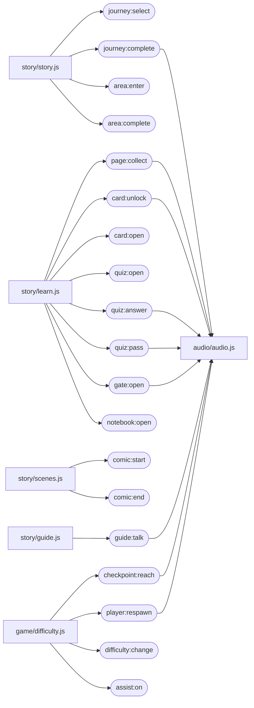

Các event không có mũi tên ra (`journey:select`, `comic:end`, `assist:on`...) hiện **chỉ smoke test nghe** (qua listener wildcard `'*'`),
hoặc để dành cho tính năng sau. Đó là một lợi ích của event bus: thêm người nghe mới mà **không sửa** nơi phát.

### 3.5 Bảng đầy đủ mọi hằng trong `OG.EV`

Sinh tự động bằng cách tìm `emit(OG.EV.X` / `emit('tên'` và `on(OG.EV.X` / `on('tên'` trong `src/` (đã bỏ comment).
Trùm phát event qua `K.emit(arena, ...)` → `arena.emit` → `OG.Events.emit`, nên được thêm tay. Payload chi tiết: [`ARCHITECTURE.md` mục 6](../ARCHITECTURE.md) và [`STORY.md` mục 7](../STORY.md).

| Hằng `OG.EV` | Chuỗi | Ai phát (`src/...`) | Ai nghe (`src/...`) |
|---|---|---|---|
| `SCENE_CHANGE` | `scene:change` | `core/scenes.js` | `audio/audio.js`, `game/default-scenes.js`, `story/guide.js`, `story/learn.js` |
| `GAME_START` | `game:start` | `game/game.js` | `audio/audio.js`, `social/social.js`, `ui/shop.js` |
| `GAME_PAUSE` | `game:pause` | `game/default-scenes.js`, `ui/menus.js` | `audio/audio.js` |
| `GAME_RESUME` | `game:resume` | `game/boss-scene.js`, `game/level.js` | `audio/audio.js` |
| `GAME_OVER` | `game:over` | `game/game.js` | `audio/audio.js`, `game/difficulty.js`, `social/social.js` |
| `GAME_VICTORY` | `game:victory` | `game/game.js` | `audio/audio.js`, `social/social.js` |
| `LEVEL_START` | `level:start` | `game/level.js` | `audio/audio.js`, `ui/shop.js`, `world/quests.js` |
| `LEVEL_EXIT_LOCKED` | `level:exitLocked` | `game/level.js` | `audio/audio.js` |
| `LEVEL_CLEAR` | `level:clear` | `game/level.js` | — *(chỉ test / mở rộng)* |
| `LEVEL_COMPLETE` | `level:complete` | `game/game.js` | `audio/audio.js`, `game/difficulty.js`, `social/social.js`, `world/quests.js` |
| `DOOR_ENTER` | `door:enter` | `game/level.js` | `audio/audio.js` |
| `PLAYER_JUMP` | `player:jump` | `game/player.js`, `ui/shop.js` | `audio/audio.js`, `gfx/sprites.js` |
| `PLAYER_LAND` | `player:land` | `game/player.js` | `audio/audio.js`, `gfx/sprites.js` |
| `PLAYER_HURT` | `player:hurt` | `game/player.js` | `audio/audio.js`, `gfx/sprites.js`, `ui/shop.js`, `world/quests.js` |
| `PLAYER_ACTION` | `player:action` | `game/player.js` | `audio/audio.js`, `bosses/bosses.js` |
| `PLAYER_DIE` | `player:die` | `game/game.js` | `audio/audio.js` |
| `ITEM_COLLECT` | `item:collect` | `game/level.js` | `audio/audio.js`, `gfx/sprites.js`, `world/quests.js` |
| `ENEMY_STOMP` | `enemy:stomp` | `game/boss-scene.js`, `game/level.js` | `audio/audio.js`, `gfx/sprites.js`, `world/quests.js` |
| `SCORE_CHANGE` | `score:change` | `game/game.js` | — *(chỉ test / mở rộng)* |
| `COINS_CHANGE` | `coins:change` | `core/save.js` | `game/game.js`, `ui/menus.js`, `world/quests.js` |
| `LIVES_CHANGE` | `lives:change` | `game/difficulty.js`, `game/game.js` | `audio/audio.js` |
| `BOSS_START` | `boss:start` | `game/boss-scene.js` | `audio/audio.js`, `ui/hud.js` |
| `BOSS_HIT` | `boss:hit` | `game/boss-scene.js`, `bosses/bosses.js` | `audio/audio.js`, `gfx/sprites.js` |
| `BOSS_PHASE` | `boss:phase` | `bosses/bosses.js`, `bosses/trio.js` | `audio/audio.js`, `ui/hud.js` |
| `BOSS_DEFEATED` | `boss:defeated` | `game/boss-scene.js` | `audio/audio.js`, `gfx/sprites.js`, `world/quests.js` |
| `QUEST_PROGRESS` | `quest:progress` | `world/quests.js` | — *(chỉ test / mở rộng)* |
| `QUEST_COMPLETE` | `quest:complete` | `world/quests.js` | `audio/audio.js`, `ui/menus.js` |
| `SHOP_PURCHASE` | `shop:purchase` | `ui/shop.js` | `audio/audio.js` |
| `CHAR_SELECT` | `char:select` | `ui/menus.js`, `ui/shop.js` | `audio/audio.js` |
| `CHAR_UNLOCK` | `char:unlock` | `game/progress.js`, `ui/shop.js` | `audio/audio.js`, `ui/menus.js` |
| `SKIN_EQUIP` | `skin:equip` | `ui/menus.js`, `ui/shop.js` | `audio/audio.js` |
| `SETTINGS_CHANGE` | `settings:change` | `core/save.js` | `audio/audio.js`, `core/main.js` |
| `LEADERBOARD_SUBMIT` | `leaderboard:submit` | `social/leaderboard.js` | `audio/audio.js` |
| `UI_CLICK` | `ui:click` | `core/dom.js`, `core/main.js`, `social/leaderboard.js`, `social/social.js`, `story/scenes.js`, `ui/menus.js`, `world/journey-map.js`, `world/world.js` | `audio/audio.js` |
| `UI_TOAST` | `ui:toast` | `core/dom.js` | — *(chỉ test / mở rộng)* |
| `INPUT_TAP` | `input:tap` | `core/input.js` | — *(chỉ test / mở rộng)* |
| `INPUT_FIRST_GESTURE` | `input:firstGesture` | `core/input.js` | `audio/audio.js` |
| `SAVE_RESET` | `save:reset` | `core/save.js` | `audio/audio.js`, `game/difficulty.js`, `social/social.js`, `ui/shop.js`, `world/journey-map.js`, `world/quests.js` |
| `BOSS_HEAL` | `boss:heal` | `bosses/deedee.js` | — *(chỉ test / mở rộng)* |
| `BOSS_FOOD_STOLEN` | `boss:foodStolen` | `bosses/deedee.js` | — *(chỉ test / mở rộng)* |
| `WORLD_SELECT` | `world:select` | `world/world.js` | — *(chỉ test / mở rộng)* |
| `WORLD_ARRIVE` | `world:arrive` | `world/world.js` | — *(chỉ test / mở rộng)* |
| `SHOP_USE` | `shop:use` | `ui/shop.js` | — *(chỉ test / mở rộng)* |
| `SOCIAL_SHARE` | `social:share` | `social/social.js` | — *(chỉ test / mở rộng)* |
| `SOCIAL_NAME_CHANGE` | `social:nameChange` | `social/social.js` | — *(chỉ test / mở rộng)* |
| `SOCIAL_ONLINE_SUBMIT` | `social:onlineSubmit` | `social/leaderboard.js` | — *(chỉ test / mở rộng)* |
| `LEADERBOARD_CLEAR` | `leaderboard:clear` | `social/leaderboard.js` | — *(chỉ test / mở rộng)* |
| `JOURNEY_SELECT` | `journey:select` | `story/story.js` | — *(chỉ test / mở rộng)* |
| `JOURNEY_COMPLETE` | `journey:complete` | `story/story.js` | `audio/audio.js` |
| `AREA_ENTER` | `area:enter` | `story/story.js` | — *(chỉ test / mở rộng)* |
| `AREA_COMPLETE` | `area:complete` | `story/story.js` | — *(chỉ test / mở rộng)* |
| `PAGE_COLLECT` | `page:collect` | `story/learn.js` | `audio/audio.js` |
| `CARD_UNLOCK` | `card:unlock` | `story/learn.js` | `audio/audio.js` |
| `CARD_OPEN` | `card:open` | `story/learn.js` | — *(chỉ test / mở rộng)* |
| `QUIZ_OPEN` | `quiz:open` | `story/learn.js` | — *(chỉ test / mở rộng)* |
| `QUIZ_ANSWER` | `quiz:answer` | `story/learn.js` | `audio/audio.js` |
| `QUIZ_PASS` | `quiz:pass` | `story/learn.js` | `audio/audio.js` |
| `GATE_OPEN` | `gate:open` | `story/learn.js` | `audio/audio.js` |
| `COMIC_START` | `comic:start` | `story/scenes.js` | — *(chỉ test / mở rộng)* |
| `COMIC_END` | `comic:end` | `story/scenes.js` | — *(chỉ test / mở rộng)* |
| `GUIDE_TALK` | `guide:talk` | `story/guide.js` | `audio/audio.js` |
| `NOTEBOOK_OPEN` | `notebook:open` | `story/learn.js` | — *(chỉ test / mở rộng)* |
| `CHECKPOINT_REACH` | `checkpoint:reach` | `game/difficulty.js` | `audio/audio.js` |
| `PLAYER_RESPAWN` | `player:respawn` | `game/difficulty.js` | `audio/audio.js` |
| `DIFFICULTY_CHANGE` | `difficulty:change` | `game/difficulty.js` | — *(chỉ test / mở rộng)* |
| `ASSIST_ON` | `assist:on` | `game/difficulty.js` | — *(chỉ test / mở rộng)* |

> ⚠️ Bẫy (bài 06): đổi chuỗi của một hằng (vd `'item:collect'` thành `'item:pickup'`) **không** gây lỗi cú pháp, nhưng mọi người nghe
> dùng chuỗi cũ sẽ im lặng ngừng hoạt động. Vì thế giá trị chuỗi trong `OG.EV` là **API công khai**, không được đổi.

---

## 4. Vòng đời một frame (sequence diagram)

Ví dụ dưới đây là một frame khi scene trên cùng là `level`, người chơi vừa bấm Space để nhảy.
Sự kiện bàn phím của trình duyệt đến **không đồng bộ** (bất cứ lúc nào giữa hai frame); `OG.Input` chỉ ghi lại trạng thái phím,
còn game đọc trạng thái đó ở frame kế tiếp. Xem bài 02 (game loop), 03 (input), 04 (vật lý), 06 (event), 07–08 (vẽ, camera).

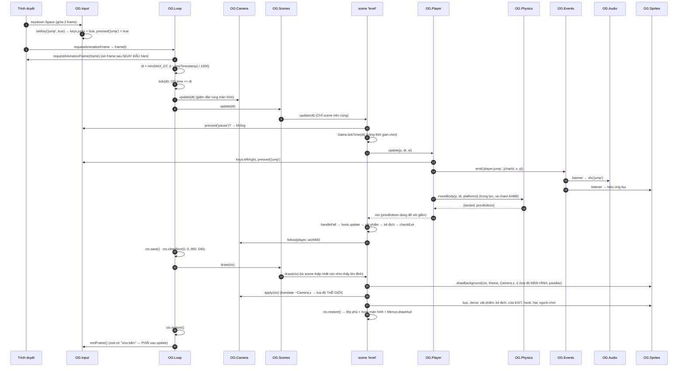

Ba bất biến rút ra từ sơ đồ:
1. **Update trước, draw sau**, và draw vẽ lại toàn bộ khung hình từ đầu (immediate mode).
2. **Chỉ scene trên cùng được update**, nhưng nhiều scene có thể cùng được vẽ (`drawBelow`).
3. **`Input.endFrame()` luôn cuối frame**, kể cả khi frame ném lỗi (khối `catch` trong `frame()` cũng gọi nó).

Smoke test (`tests/smoke.js`) bỏ qua bước 3–4 (không có `requestAnimationFrame`) và gọi thẳng `OG.Loop.step(dt)`, tức `tick(dt)`,
hàng chục nghìn lần với dt cố định. Đây là **fixed step** để test (bài 02, bài 13).

---

## 5. Cây thư mục có chú thích

### 5.1 Sơ đồ

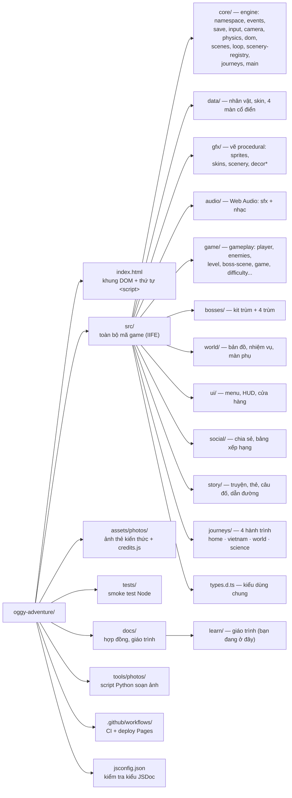

### 5.2 Chi tiết từng file

```text
oggy-adventure/
├── index.html                  Trang duy nhất: canvas 960×540, HUD, nút cảm ứng, ~70 thẻ <script> THEO THỨ TỰ PHỤ THUỘC   [bài 00, 01]
├── jsconfig.json               Cấu hình tsc/VS Code: chỉ kiểm tra file có // @ts-check (checkJs: false)                    [bài 13]
├── README.md                   Giới thiệu game, cách chơi, cách chạy, deploy
├── src/
│   ├── types.d.ts              Kiểu dùng chung cho JSDoc: AABB, Scene, LevelDef, BossInstance, ThemeDef...                  [bài 13]
│   ├── core/                   ENGINE — không biết gì về Oggy, dùng lại được cho game khác
│   │   ├── namespace.js        Tạo window.OG, OG.Config (hằng vật lý), OG.Palette, OG.util (safe, call, overlap...)     [bài 01]
│   │   ├── events.js           OG.Events (on/off/once/emit) + OG.EV (tên event chuẩn)  ← FILE MẪU                      [bài 06]
│   │   ├── save.js             OG.Save: localStorage + defaults + deep merge + migrate                                   [bài 11]
│   │   ├── input.js            OG.Input: phím logic, giữ vs vừa bấm, cảm ứng, firstGesture                              [bài 03]
│   │   ├── camera.js           OG.Camera: follow, apply (translate), shake, toWorld                                      [bài 08]
│   │   ├── physics.js          OG.Physics: moveBody (trọng lực + one-way platform), aabb, isStomp                        [bài 04]
│   │   ├── dom.js              OG.DOM: panel, button, toast — lớp UI HTML phủ lên canvas
│   │   ├── scenes.js           OG.Scenes: FSM + scene stack (go/push/pop, drawBelow)                                     [bài 05]
│   │   ├── loop.js             OG.Loop: requestAnimationFrame, delta time, step() cho test  ← FILE MẪU                  [bài 02]
│   │   ├── scenery-registry.js OG.Scenery: sổ đăng ký chủ đề cảnh nền / lớp parallax                                     [bài 08, 12]
│   │   ├── journeys.js         OG.Journeys: đăng ký, biên dịch (compile), validate dữ liệu hành trình                    [bài 12]
│   │   └── main.js             Khởi động: thứ tự init, go('boot'), Loop.start — nạp CUỐI CÙNG                           [bài 00, 01]
│   ├── data/
│   │   ├── characters.js       OG.Data: nhân vật (hitbox, tốc độ, màu), skin                                            [bài 12]
│   │   └── levels.js           4 màn cổ điển dạng LevelDef (dữ liệu thuần)                                               [bài 12]
│   ├── gfx/                    VẼ PROCEDURAL — mọi hình vẽ bằng Canvas 2D, không có file ảnh
│   │   ├── sprites.js          OG.Sprites.drawCharacter: pose theo t, squash & stretch, cache LRU                        [bài 07]
│   │   ├── skins.js            Phụ kiện skin (dữ liệu + hàm vẽ)                                                          [bài 07, 12]
│   │   ├── scenery.js          drawBackground/drawPlatform/drawDecor: đọc ThemeDef, parallax, culling                    [bài 08]
│   │   └── decor.js, decor-places.js, decor-home.js   OG.Decor: thư viện đồ trang trí + lớp nền lát gạch, cache        [bài 07, 08]
│   ├── audio/
│   │   ├── audio.js            OG.Audio: AudioContext, bus GainNode, tone/noise, nghe event phát SFX                     [bài 10, 06]
│   │   └── music.js            Sequencer nhạc nền: lookahead scheduling, MIDI → Hz                                       [bài 10]
│   ├── game/                   GAMEPLAY
│   │   ├── particles.js        OG.Particles: hạt bụi/sao cập nhật theo dt                                                [bài 02, 07]
│   │   ├── progress.js         OG.Progress: mở khoá màn, sao, kỷ lục                                                     [bài 11]
│   │   ├── difficulty.js       OG.Difficulty: Bé chơi / Thử thách, checkpoint, soft fail, DDA                           [bài 09]
│   │   ├── game.js             OG.Game: lượt chơi, điểm, mạng, luồng màn → trùm → bản đồ                                 [bài 05]
│   │   ├── player.js           OG.Player: coyote time, jump buffer, i-frames, knockback                                  [bài 03, 04]
│   │   ├── enemies.js          OG.Enemies: registry loại địch (strategy), AI tuần tra                                    [bài 09]
│   │   ├── collectibles.js     OG.Collectibles: pizza, xu, vật phẩm                                                      [bài 04]
│   │   ├── level.js            Scene 'level' + OG.Level (hook mở rộng, pha play → clear → done)                          [bài 04, 05, 12]
│   │   ├── boss-scene.js       Scene 'boss': arena, giẫm điểm yếu, dependency injection cho trùm                         [bài 09]
│   │   └── default-scenes.js   Scene mặc định (stub) — bị module tính năng ghi đè                                       [bài 01, 05]
│   ├── bosses/
│   │   ├── bosses.js           OG.Bosses: registry + kit dùng chung (setState, telegraph, phase, i-frames)               [bài 09]
│   │   └── deedee.js, marky.js, joey.js, trio.js      4 trùm (FSM riêng, ngắm bắn parabol, boomerang...)               [bài 09]
│   ├── world/
│   │   ├── extraLevels.js      3 màn phụ đăng ký lúc LOAD                                                                [bài 12]
│   │   ├── world.js            Scene 'worldmap' (cổ điển): đồ thị, BFS tìm đường, Bézier                                [bài 05, 12]
│   │   ├── journey-map.js      Scene 'journeyMap' canvas: camera mượt, culling, cache ảnh thu nhỏ                        [bài 08, 07]
│   │   └── quests.js           OG.Quests: nghe event để đếm nhiệm vụ                                                     [bài 06, 11]
│   ├── ui/
│   │   ├── menus.js            OG.Menus: menu DOM, cài đặt, pause, kết quả; điều hướng bằng phím                        [bài 05]
│   │   ├── hud.js              HUD 2 lớp: DOM (số liệu) + canvas (thanh máu trùm)                                       [bài 06]
│   │   ├── shop.js             OG.Shop: cửa hàng, modifier vật phẩm                                                      [bài 12]
│   │   └── ui.css              Style .ui-* (nút ≥ 44 px, :focus-visible, prefers-reduced-motion)
│   ├── social/
│   │   ├── social.js           OG.Social: thẻ thành tích, Web Share API, canvas → PNG                                    [bài 06]
│   │   ├── leaderboard.js      Bảng xếp hạng: adapter local / HTTP, scene 'leaderboard'                                  [bài 11]
│   │   └── social.css
│   ├── story/
│   │   ├── story.js            OG.Story: điều phối hành trình, chuỗi truyện tranh                                       [bài 05, 12]
│   │   ├── learn.js            OG.Learn: trang sách, thẻ kiến thức, câu đố (level hook 'learn')                          [bài 12]
│   │   ├── guide.js            OG.Guide: người dẫn đường (level hook 'guide')                                           [bài 12]
│   │   ├── photos.js           OG.Photos: registry ảnh nạp lười (lazy load)                                             [bài 12]
│   │   ├── scenes.js           Scene journeySelect, comic, card, quiz, notebook, journeyEnd                             [bài 05, 07]
│   │   ├── story.css
│   │   └── story-demo.html     Trang thử riêng các scene truyện
│   └── journeys/<home|vietnam|world|science>/   MỖI HÀNH TRÌNH = 1 THƯ MỤC DỮ LIỆU                                 [bài 12]
│       ├── theme.js            ThemeDef: cảnh nền, decor, lớp parallax của từng khu
│       ├── content.js          CardDef, QuizDef, PanelDef (truyện tranh)
│       ├── extras.js           Loại kẻ địch / NPC riêng của hành trình
│       └── journey.js          JourneyDef: khu, màn (kế thừa `from`), checkpoint — gọi OG.Journeys.register
├── assets/photos/<hành trình>/ Ảnh WebP + credits.js (gọi OG.Photos.register; dùng .js để chạy được qua file://)
├── tests/
│   ├── fake-dom.js             DOM, canvas 2D, localStorage, AudioContext GIẢ cho Node (test double)                    [bài 13]
│   └── smoke.js                Nạp mọi script bằng vm, chơi hết game bằng OG.Loop.step, kiểm tra bất biến               [bài 13]
├── tools/photos/fetch_commons.py   Tải ảnh Wikimedia Commons, thu nhỏ, sinh credits.js (không deploy)
├── docs/
│   ├── ARCHITECTURE.md         HỢP ĐỒNG v1: thứ tự load, toạ độ, scene, event, API từng module
│   ├── STORY.md                HỢP ĐỒNG v2: dữ liệu hành trình, OG.Journeys/Scenery/Difficulty/Story/Learn
│   ├── learn/                  GIÁO TRÌNH: README.md (lộ trình), CODE_STYLE.md, trang này, 00…13-*.md
│   ├── credits.html            Ghi công ảnh
│   ├── sprites-demo.html, scenery-demo.html    Trang xem thử nhân vật và cảnh nền
│   └── screenshots/
├── legacy/index.mvp.html       Bản MVP một file ban đầu (chỉ tham khảo)
└── .github/workflows/pages.yml CI: chạy smoke test, đóng gói, deploy GitHub Pages                                    [bài 13]
```

---

## 6. Tự kiểm tra sơ đồ còn khớp code không

Code thay đổi thì sơ đồ dễ "cũ". Các lệnh sau (chạy ở thư mục gốc, Git Bash / macOS / Linux) giúp bạn đối chiếu nhanh:

```bash
# Mọi tên scene đã đăng ký (sơ đồ mục 2.0)
git grep -nE "Scenes\.register\('[a-zA-Z]+'" -- src

# Mọi chuyển scene bằng go/push (sơ đồ mục 2.1, 2.2)
git grep -nE "Scenes\.(go|push)\('[a-zA-Z]+'" -- src

# Mọi hằng tên event (bảng mục 3.5)
git grep -nE "^\s+[A-Z_]+: '[a-z]+:[a-zA-Z]+'" -- src/core/events.js

# Ai phát / ai nghe một event cụ thể, vd item:collect
git grep -nE "emit\w*\((OG\.EV\.ITEM_COLLECT|'item:collect')" -- src
git grep -nE "on\((OG\.EV\.ITEM_COLLECT|'item:collect')" -- src

# Thứ tự nạp script thật (sơ đồ mục 1.2)
git grep -n "<script src=" -- index.html
```

> 🧪 Thử: thêm một listener vào console trình duyệt rồi chơi một màn, so với sơ đồ mục 3.1:
> `var off = OG.Events.on('*', function (name, payload) { console.log(name, payload); });` — chơi xong gọi `off()` để huỷ đăng ký.
