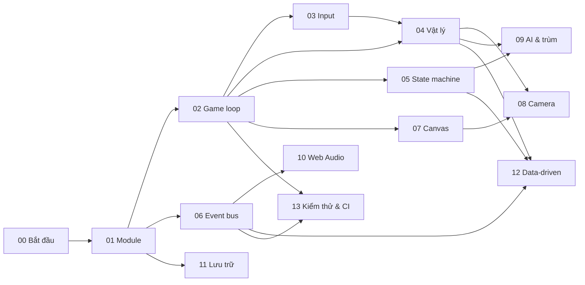

# 📚 Học lập trình game với Oggy

Giáo trình này dùng chính mã nguồn của **Oggy Adventure** (game đi cảnh 2D chạy trên trình duyệt) để dạy
**khái niệm làm game** và **design pattern** (mẫu thiết kế). Bạn sẽ đọc code thật của một game hoàn chỉnh, chạy thí nghiệm nhỏ,
rồi tự viết thêm tính năng.

**Dành cho ai:** sinh viên đại học đã biết **JavaScript cơ bản**: biến, hàm, mảng, object, vòng lặp, callback, DOM
(`document.getElementById`, `addEventListener`). Giáo trình **không** dạy lại cú pháp JS. Nó dạy những thứ sách JS thường bỏ qua:
vì sao game cần **game loop** (vòng lặp game), làm sao nhân vật nhảy đúng như nhau trên màn 60 Hz và 144 Hz, vì sao một
module âm thanh có thể "nghe" người chơi nhảy mà không ai gọi nó...

**Vì sao học bằng game này:**
- **Không build step, không thư viện ngoài.** Mở `index.html` là chạy. Mọi dòng code đều do dự án tự viết, không có "hộp đen".
- **Đủ lớn để giống dự án thật** (khoảng 70 file JS, 38 màn, 4 trùm, nhạc tổng hợp, lưu trữ, bảng xếp hạng, test tự động),
  nhưng chia module rõ ràng nên đọc từng phần được.
- **Code đã được chú thích để dạy học**: mỗi file có khối đầu file ghi vai trò, khái niệm, bài học liên quan; trong code có các nhãn
  `💡 Khái niệm:`, `⚠️ Bẫy:`, `🧪 Thử:` (xem [mục 6](#6-cách-đọc-code-có-chú-thích)).

---

## Mục lục

1. [Lộ trình 14 bài](#1-lộ-trình-14-bài)
2. [Chuẩn bị: chạy game và mở DevTools](#2-chuẩn-bị-chạy-game-và-mở-devtools)
3. [Dùng VS Code: gợi ý kiểu với JSDoc và `@ts-check`](#3-dùng-vs-code-gợi-ý-kiểu-với-jsdoc-và-ts-check)
4. [Quy tắc làm bài tập](#4-quy-tắc-làm-bài-tập)
5. [Mỗi bài học gồm những gì](#5-mỗi-bài-học-gồm-những-gì)
6. [Cách đọc code có chú thích](#6-cách-đọc-code-có-chú-thích)
7. [Bảng thuật ngữ nhanh](#7-bảng-thuật-ngữ-nhanh)
8. [Sự cố thường gặp](#8-sự-cố-thường-gặp)
9. [Tài liệu liên quan](#9-tài-liệu-liên-quan)

---

## 1. Lộ trình 14 bài

Thời lượng là **ước tính cho một sinh viên trung bình**, đã gồm đọc bài, đọc code, làm thí nghiệm 🧪 và bài tập.
Tổng cộng khoảng **36 giờ**, tức chừng 6–8 tuần nếu học 5 giờ mỗi tuần.

| Bài | Nội dung | Khái niệm chính | Code minh hoạ chính | Thời lượng | Cần học trước |
|---|---|---|---|---|---|
| **00** | [Bắt đầu](00-bat-dau.md) | Chạy game qua `file://`, cấu trúc thư mục, đọc code theo thứ tự `<script>`, chạy smoke test | `index.html`, `src/core/main.js` | 1 giờ | JS cơ bản, dùng terminal và Git ở mức cơ bản |
| **01** | [Module pattern: IIFE và namespace](01-module-pattern-iife-namespace.md) | IIFE, namespace `window.OG`, `'use strict'`, thứ tự load, cô lập lỗi module, "stub rồi ghi đè" | `src/core/namespace.js`, `src/game/default-scenes.js` | 1,5 giờ | 00 |
| **02** | [Game loop và delta time](02-game-loop-delta-time.md) | `requestAnimationFrame`, delta time, kẹp dt, tách update/draw, fixed step để test | `src/core/loop.js` *(file mẫu)*, `src/game/particles.js` | 2 giờ | 01 |
| **03** | [Xử lý input](03-input.md) | Giữ phím vs vừa bấm, phím logic, đếm nguồn giữ phím, `endFrame`, coyote time, jump buffer | `src/core/input.js`, `src/game/player.js` | 2 giờ | 02 |
| **04** | [Vật lý và va chạm](04-vat-ly-va-cham-aabb.md) | Trọng lực, tích phân Euler, AABB, one-way platform, xét giẫm bằng đáy frame trước, hitbox vs hurtbox | `src/core/physics.js`, `src/game/level.js` | 3 giờ | 02, 03 |
| **05** | [State machine và scene](05-state-machine-scene.md) | FSM, scene stack `go/push/pop`, vòng đời `enter/exit/resume`, `drawBelow`, pha trong scene | `src/core/scenes.js`, `src/game/game.js` | 2,5 giờ | 02 |
| **06** | [Event bus (observer)](06-event-bus-observer.md) | Publish–subscribe, loose coupling, hằng tên event, huỷ đăng ký và memory leak, wildcard | `src/core/events.js` *(file mẫu)*, `src/audio/audio.js`, `src/world/quests.js` | 2 giờ | 01 |
| **07** | [Vẽ bằng Canvas](07-ve-canvas-procedural-cache.md) | Vẽ procedural, transform, `save/restore`, hoạt ảnh theo thời gian, squash & stretch, cache canvas phụ, LRU | `src/gfx/sprites.js`, `src/gfx/decor.js` | 4 giờ | 02 |
| **08** | [Camera và parallax](08-camera-parallax.md) | Toạ độ thế giới ↔ màn hình, camera theo nhân vật, rung màn hình, parallax nhiều lớp, culling | `src/core/camera.js`, `src/gfx/scenery.js` | 2,5 giờ | 04, 07 |
| **09** | [AI kẻ địch và trùm](09-ai-ke-dich-boss.md) | AI tuần tra, registry + strategy, boss state machine, telegraph, phase theo máu, điều chỉnh độ khó | `src/game/enemies.js`, `src/bosses/bosses.js`, `src/bosses/deedee.js` | 4 giờ | 04, 05 |
| **10** | [Âm thanh với Web Audio](10-web-audio.md) | `AudioContext`, autoplay policy, oscillator + envelope, noise, `GainNode`, sequencer lookahead, MIDI → Hz | `src/audio/audio.js`, `src/audio/music.js` | 3 giờ | 06 |
| **11** | [Lưu trữ và migrate dữ liệu](11-luu-tru-migrate.md) | `localStorage` + try/catch, giá trị mặc định, deep merge, migrate bản cũ, dữ liệu hỏng | `src/core/save.js`, `src/game/progress.js` | 2 giờ | 01 |
| **12** | [Thiết kế hướng dữ liệu (data-driven)](12-data-driven-man-cau-do-hanh-trinh.md) | Registry, gộp theo id, compile, validate, hook mở rộng; thực hành thêm màn / câu đố / thẻ / hành trình | `src/core/journeys.js`, `src/journeys/home/`, `src/game/level.js` | 4 giờ | 04, 05, 06 |
| **13** | [Kiểm thử và CI](13-kiem-thu-ci.md) | Smoke test Node + DOM giả, `vm`, điều khiển bằng `OG.Loop.step`, kiểm tra bất biến, GitHub Actions, JSDoc + tsc | `tests/smoke.js`, `tests/fake-dom.js`, `.github/workflows/pages.yml` | 3 giờ | 02, 06 |

### Đi theo thứ tự nào?

Bài 00–02 là **bắt buộc** và nên học đúng thứ tự. Từ bài 03 trở đi, bạn có thể đi theo mũi tên "cần học trước":



Gợi ý ba hướng học nếu không đủ thời gian làm hết:
- **Gameplay** (khoảng 15 giờ): 00 → 01 → 02 → 03 → 04 → 05 → 09.
- **Đồ hoạ và âm thanh** (khoảng 15 giờ): 00 → 01 → 02 → 06 → 07 → 08 → 10.
- **Kiến trúc phần mềm** (khoảng 16 giờ): 00 → 01 → 02 → 05 → 06 → 11 → 12 → 13.

---

## 2. Chuẩn bị: chạy game và mở DevTools

### 2.1 Cần cài gì

| Công cụ | Dùng để | Bắt buộc? |
|---|---|---|
| Trình duyệt Chrome, Edge hoặc Firefox bản mới | Chạy game, mở DevTools | Có |
| [Git](https://git-scm.com/) | Lấy code, tạo nhánh làm bài tập | Có |
| [Node.js](https://nodejs.org/) 20 trở lên (CI dùng Node 22) | Chạy smoke test `node tests/smoke.js` | Có (từ bài 00) |
| [VS Code](https://code.visualstudio.com/) | Đọc code, gợi ý kiểu, nhảy tới định nghĩa | Khuyên dùng |
| Python 3 | Chạy server tĩnh `python -m http.server` | Không (có cách khác) |

Dự án **không** có `package.json` và không cần `npm install`. Node chỉ dùng để chạy test.

### 2.2 Chạy game

```bash
git clone <địa chỉ repo của lớp> oggy-adventure
cd oggy-adventure
```

**Cách 1: mở trực tiếp.** Nhấp đúp `index.html`. Game chạy qua `file://` vì không dùng ES modules (bài 01 giải thích lý do).

**Cách 2: server tĩnh (khuyên dùng khi học).** Một số trình duyệt chặn `localStorage` với `file://`, nên tiến độ không được lưu.
Chạy một trong hai lệnh rồi mở <http://localhost:8080>:

```bash
python -m http.server 8080
# hoặc (cần mạng lần đầu để tải gói serve)
npx serve -l 8080 .
```

Dừng server bằng `Ctrl + C` trong cửa sổ terminal đã mở nó.

**Chạy smoke test** (kiểm thử tự động chơi hết game, mất khoảng 20–60 giây tuỳ máy):

```bash
node tests/smoke.js            # ổn thì in "XANH — không có lỗi runtime." và thoát mã 0; có lỗi thì thoát mã 1
node tests/smoke.js --verbose  # in từng bước và số lần phát mỗi event
node --check src/core/loop.js  # chỉ kiểm tra cú pháp một file
node tests/check-doc-links.js  # kiểm tra mọi link tương đối trong docs/learn/ (in "SẠCH" nếu không có link gãy)
```

### 2.3 Mở DevTools

DevTools (công cụ cho nhà phát triển có sẵn trong trình duyệt) là "phòng thí nghiệm" chính của giáo trình.

| Hệ điều hành | Phím tắt |
|---|---|
| Windows / Linux | `F12` hoặc `Ctrl + Shift + I` (mở thẳng Console: `Ctrl + Shift + J`) |
| macOS | `Cmd + Option + I` (Console: `Cmd + Option + J`) |

Các tab bạn sẽ dùng:

| Tab | Dùng trong giáo trình để |
|---|---|
| **Console** | Gõ lệnh trực tiếp vào game (mọi module nằm trong biến toàn cục `OG`), xem lỗi màu đỏ |
| **Sources** (Firefox: Debugger) | Mở file trong `src/`, đặt **breakpoint** (điểm dừng), chạy từng dòng. Thử đặt breakpoint trong hàm `tick` của `src/core/loop.js` |
| **Performance** | Ghi lại vài giây chơi để xem mỗi frame tốn bao nhiêu ms (bài 02, 07) |
| **Application** (Firefox: Storage) | Xem `Local Storage` → khoá `oggyAdventure.save.v1`: dữ liệu lưu của game (bài 11) |

**Lệnh Console hay dùng** (gõ khi game đang chạy):

```js
OG.Scenes.stackNames()                 // scene stack hiện tại, vd ["level", "pause"]
OG.Loop.fps                            // FPS ước lượng
OG.Config.GRAVITY = 600                // trọng lực thấp: nhảy như trên Mặt Trăng (bài 04)
OG.Config.DEBUG = true                 // OG.Events in mọi event ra Console (bài 06)
var off = OG.Events.on('*', function (name, payload) { console.log(name, payload); });
off();                                 // huỷ đăng ký listener ở dòng trên
OG.Sprites.setCacheEnabled(false)      // tắt cache khung hình rồi xem OG.Loop.fps (bài 07)
OG.Save.data                           // toàn bộ dữ liệu lưu (bài 11)
OG.Journeys.validate('home')           // kiểm tra dữ liệu hành trình (bài 12)
```

> ⚠️ Thay đổi gõ trong Console chỉ sống tới khi tải lại trang (F5). Muốn thay đổi lâu dài thì sửa file trong `src/`.

> ⚠️ **Gõ Console khi đang chơi: game tự tạm dừng và xoá phím.** Bấm chuột vào DevTools để gõ lệnh thì cửa sổ game mất focus
> (phát event `blur`; có thể xảy ra cả khi DevTools gắn liền cửa sổ). Lúc đó hai việc xảy ra:
>
> 1. `src/core/main.js` (hàm `autoPause`) **push** scene `pause` nếu đang ở `level`/`boss` → stack thành `["level", "pause"]`.
> 2. `src/core/input.js` gọi `OG.Input.reset()` → mọi phím đang giữ bị nhả. Bấm "Tiếp tục" thì `OG.Scenes.pop()` lại gọi
>    `OG.Input.reset()` thêm lần nữa.
>
> Hậu quả: lệnh như `OG.Input.setKey('right', true)` gõ thẳng vào Console sẽ **không** làm Oggy tự chạy (phím bị xoá khi bạn bấm
> "Tiếp tục"), và thí nghiệm "giữ phím rồi làm gì đó" không làm được. Đây là hành vi **cố ý** của game (bài 03 mục 4, bài 05),
> không phải lỗi của bạn. Cách làm thí nghiệm:
>
> - **Hẹn giờ:** bọc lệnh trong `setTimeout(..., 3000)`, nhấn Enter, rồi trong vòng 3 giây bấm "Tiếp tục" trên màn hình game
>   (bấm vào game để trang có lại focus). Lệnh chạy khi bạn đã quay lại chơi:
>
>   ```js
>   setTimeout(function () { OG.Input.setKey('right', true); }, 3000);   // dừng: OG.Input.setKey('right', false)
>   ```
>
> - **Tách DevTools ra cửa sổ riêng** (menu ⋮ của DevTools → Dock side → Undock) cũng vẫn làm game mất focus, nên vẫn cần hẹn giờ.
> - Lệnh chỉ **đọc** trạng thái (`OG.Scenes.stackNames()`, `OG.Loop.fps`, `OG.Sprites.cacheStats()`) hay đổi cấu hình
>   (`OG.Config.GRAVITY = 600`) thì không bị ảnh hưởng: gõ xong bấm "Tiếp tục" là được.

---

## 3. Dùng VS Code: gợi ý kiểu với JSDoc và `@ts-check`

Mở **cả thư mục** dự án trong VS Code (`File → Open Folder...`), không mở từng file lẻ, để VS Code đọc được `jsconfig.json`.

**JSDoc** là comment dạng `/** ... */` mô tả kiểu tham số và giá trị trả về. VS Code dùng nó để gợi ý code và báo lỗi kiểu,
dù code vẫn là JavaScript thuần (không cần TypeScript, không cần build).

- [`jsconfig.json`](../../jsconfig.json): đặt `checkJs: false`, nghĩa là **chỉ** file có dòng đầu `// @ts-check` mới bị kiểm tra kiểu.
  Đây là cách bật kiểm tra **từng file một** (opt-in) để dự án lớn chuyển dần sang có kiểu mà không bị ngập lỗi.
- [`src/types.d.ts`](../../src/types.d.ts): các kiểu dùng chung (`AABB`, `Scene`, `LevelDef`, `BossInstance`, `ThemeDef`...).
  Trong file JS, bạn viết `/** @type {Player} */ var p = st.player;` để VS Code biết `p` có những field nào.

Thao tác nên tập ngay ở bài 00:

| Thao tác | Phím tắt (Windows / macOS) |
|---|---|
| Xem JSDoc của hàm | rê chuột lên tên hàm |
| Nhảy tới định nghĩa | `F12` hoặc `Ctrl/Cmd + Click` |
| Tìm mọi chỗ dùng | `Shift + F12` |
| Tìm trong toàn dự án (vd tên event `'item:collect'`) | `Ctrl + Shift + F` / `Cmd + Shift + F` |
| Mở nhanh file theo tên | `Ctrl + P` / `Cmd + P` |
| Xem lỗi kiểu | tab **Problems** (`Ctrl + Shift + M` / `Cmd + Shift + M`) |

Kiểm tra kiểu cho cả dự án bằng dòng lệnh (không in gì và mã thoát 0 nghĩa là sạch):

```bash
npx -y -p typescript@5.6.3 tsc -p jsconfig.json --noEmit
```

Lệnh này tải TypeScript tạm thời để **kiểm tra**, không thêm thư viện nào vào dự án và không sinh file nào.

Extension VS Code tuỳ chọn (không bắt buộc, dự án không phụ thuộc vào chúng):
- Một extension xem trước Mermaid cho Markdown, để thấy sơ đồ trong [`ARCHITECTURE-DIAGRAMS.md`](ARCHITECTURE-DIAGRAMS.md) ngay trong VS Code.
- Một extension "live server" để chạy server tĩnh thay cho `python -m http.server`.

---

## 4. Quy tắc làm bài tập

### 4.1 Mỗi bài tập một nhánh Git riêng

Không làm bài tập thẳng trên nhánh chính (`master`). Mỗi bài tập là một **nhánh** (branch) riêng để dễ nộp, dễ chấm và dễ bỏ đi làm lại.

```bash
# 1. Bắt đầu từ nhánh chính sạch sẽ, mới nhất
git switch master
git pull
git status                       # phải báo "nothing to commit, working tree clean"

# 2. Tạo nhánh cho bài tập. Quy ước tên: bt/<số bài>-<tên ngắn>-<mã sinh viên>
git switch -c bt/04-nhay-cao-21520001

# 3. Làm bài, kiểm tra thường xuyên
node --check src/game/player.js  # mỗi file vừa sửa
node tests/smoke.js              # trước mỗi commit: phải XANH

# 4. Commit nhỏ, thông điệp nói rõ làm gì
git add src/game/player.js
git commit -m "bt04: thêm nhảy cao khi giữ phím lâu hơn"

# 5. Nộp: đẩy nhánh lên và tạo Pull Request (hoặc theo cách giảng viên yêu cầu)
git push -u origin bt/04-nhay-cao-21520001
```

Muốn làm lại từ đầu thì quay về `master` và tạo nhánh mới. Không cần xoá code đã viết.

### 4.2 Luật chung khi sửa code

1. **Smoke test phải XANH** trước khi nộp. Test đỏ thì đọc dòng báo lỗi đầu tiên, sửa xong mới nộp.
2. **Giữ ràng buộc của dự án**: không thêm build step, không thêm thư viện ngoài, không dùng `import`/`export`,
   game vẫn phải chạy khi mở `index.html` qua `file://`.
3. **Không đổi API công khai** trừ khi đề bài yêu cầu: tên hàm `OG.X.fn`, tên scene, chuỗi tên event trong `OG.EV`,
   định dạng dữ liệu lưu và dữ liệu màn. Có nhiều nơi phụ thuộc vào chúng (xem [`ARCHITECTURE-DIAGRAMS.md`](ARCHITECTURE-DIAGRAMS.md)).
4. **File mới** phải có thẻ `<script>` trong `index.html` đúng vị trí theo thứ tự phụ thuộc (bài 00, 01), và có khối đầu file theo
   [`CODE_STYLE.md`](CODE_STYLE.md) mục 2.
5. **Comment theo [`CODE_STYLE.md`](CODE_STYLE.md)**: tiếng Việt có dấu, giải thích *tại sao* chứ không lặp lại *cái gì*,
   ghi đơn vị (giây, px, px/giây). Font chữ dùng `OG.font(...)` / `OG.FONT`; không gõ tên "font cấm" ghi ở `CODE_STYLE.md` mục 0
   (smoke test quét cả comment và sẽ báo đỏ).
6. **Thí nghiệm 🧪 là để thử rồi hoàn lại.** Sau khi thử, chạy `git restore <file>` (hoặc `git diff` để xem mình đã đổi gì)
   để nhánh bài tập chỉ chứa phần bài làm.
7. **Ghi lại điều đã học**: trong mô tả Pull Request, viết 3–5 câu: đã đổi gì, vì sao chọn cách đó, đã kiểm tra thế nào.

---

## 5. Mỗi bài học gồm những gì

Mỗi file bài `NN-*.md` có cùng một khung:

| Mục | Nội dung |
|---|---|
| 🎯 **Mục tiêu** | Học xong bài bạn làm được gì |
| 🧠 **Khái niệm** | Giải thích ý tưởng, có ví dụ code ngắn hoặc sơ đồ |
| 🔍 **Đọc code** | Dẫn tới đúng file, đúng hàm trong `src/`, theo thứ tự nên đọc |
| 🧪 **Thử ngay** | Đổi một con số hoặc gõ một lệnh Console rồi quan sát |
| ✍️ **Bài tập** | Từ dễ (đổi tham số) đến khó (viết tính năng mới), làm trên nhánh riêng (mục 4) |
| 📚 **Đọc thêm** | Tài liệu tham khảo bên ngoài |
| ➡️ **Bài tiếp theo** | Liên kết sang bài kế |

**Lời giải** của bài tập nằm trong [`solutions/`](solutions/), cùng tên file với bài học (vd `solutions/03-input.md`).
Hãy tự làm trước, chỉ mở lời giải để so sánh sau khi smoke test của bạn đã XANH.

---

## 6. Cách đọc code có chú thích

### 6.1 Khối đầu file

Mọi file trong `src/` mở đầu bằng một khối giới thiệu (định dạng đầy đủ ở [`CODE_STYLE.md`](CODE_STYLE.md) mục 2):

```js
/* ============================================================================
 * OG.Loop — VÒNG LẶP GAME (game loop)
 * ----------------------------------------------------------------------------
 * Vai trò:      module này làm gì trong game, ai gọi nó, khi nào
 * Khái niệm:    các khái niệm / pattern file này minh hoạ
 * Bài học:      bài học liên quan trong docs/learn/
 * Phụ thuộc:    module khác mà file này dùng (đọc lúc LOAD hay lúc CHẠY)
 * Event:        phát: ... · nghe: ...
 * API công khai: các hàm gắn vào OG.*
 * Đọc tiếp:     file nên đọc tiếp theo
 * ========================================================================== */
```

Đọc dòng **Vai trò** và **Đọc tiếp** trước. Chỉ cần vậy là đủ để đi hết dự án theo một mạch.

Hai file mẫu đã áp dụng chuẩn đầy đủ, nên đọc đầu tiên: [`src/core/loop.js`](../../src/core/loop.js) và [`src/core/events.js`](../../src/core/events.js).

### 6.2 Ba nhãn trong code

| Nhãn | Ý nghĩa | Bạn nên làm gì |
|---|---|---|
| `💡 Khái niệm:` | Dòng code bên dưới minh hoạ một khái niệm làm game hoặc một pattern | Đọc kỹ, đối chiếu với bài học |
| `⚠️ Bẫy:` | Lỗi dễ mắc ở chỗ này và hậu quả của nó | Nhớ lấy; nhiều câu tự kiểm tra lấy từ đây |
| `🧪 Thử:` | Một thay đổi an toàn để quan sát (đổi số, bật cờ, gõ Console) | Làm thử, rồi hoàn lại bằng `git restore` |

Tìm mọi nhãn trong dự án:

```bash
git grep -n "🧪 Thử" -- src         # mọi thí nghiệm
git grep -n "⚠️ Bẫy" -- src/core    # mọi bẫy trong engine
```

### 6.3 Thứ tự đọc dự án gợi ý

1. `index.html`: xem danh sách `<script>` (đó là bản đồ của cả dự án).
2. `src/core/namespace.js` → `src/core/events.js` → `src/core/loop.js` → `src/core/scenes.js` → `src/core/main.js`.
3. `src/game/level.js` → `src/game/player.js` → `src/core/physics.js`: một frame gameplay diễn ra thế nào.
4. Sau đó đọc theo bài học bạn đang học.

Sơ đồ module, scene, event và vòng đời frame: [`ARCHITECTURE-DIAGRAMS.md`](ARCHITECTURE-DIAGRAMS.md).
Muốn đào sâu hơn (mô hình dữ liệu, class diagram, sequence diagram từng luồng, state machine của boss/quiz/audio, sơ đồ triển khai và 10 quyết định thiết kế): [`docs/design/`](../design/README.md).

---

## 7. Bảng thuật ngữ nhanh

| Thuật ngữ | Nghĩa | Bài |
|---|---|---|
| frame | Một lần tính toán và vẽ lại toàn bộ màn hình (khoảng 60 lần/giây) | 02 |
| game loop | Vòng lặp gọi update rồi draw mỗi frame | 02 |
| delta time (dt) | Khoảng thời gian giữa 2 frame, đơn vị giây | 02 |
| IIFE | Hàm tự gọi ngay khi nạp, tạo phạm vi riêng cho mỗi file | 01 |
| namespace | Object chứa các module, ở đây là `window.OG` | 01 |
| scene | Một "màn hình" của game: menu, bản đồ, màn chơi... | 05 |
| FSM (finite state machine) | Máy hữu hạn trạng thái: tại mỗi lúc chỉ ở một trạng thái, chuyển theo luật | 05, 09 |
| event bus / observer | Kênh sự kiện: bên phát không cần biết bên nghe là ai | 06 |
| AABB | Hình chữ nhật thẳng trục dùng để xét va chạm | 04 |
| hitbox / hurtbox | **Trong dự án này:** hitbox là khung va chạm thật của vật (dùng để giẫm, đỡ, nhặt); hurtbox là vùng của kẻ địch làm người chơi bị đau, nhỏ hơn hitbox để game dễ tha thứ (`OG.Enemies.hurtbox`, `OG.Difficulty.enemyHurtbox`). ⚠️ Game đối kháng thường dùng nghĩa khác (hitbox = vùng gây sát thương, hurtbox = vùng nhận sát thương); khi đọc tài liệu bên ngoài nhớ kiểm tra lại | 04, 09 |
| one-way platform | Bục chỉ đỡ khi rơi từ trên xuống, nhảy xuyên từ dưới lên được | 04 |
| coyote time | Cho phép nhảy thêm một chút sau khi đã rời mép bục | 03 |
| procedural drawing | Vẽ bằng code (path, hình học) thay vì dùng file ảnh | 07 |
| parallax | Lớp nền xa cuộn chậm hơn lớp gần, tạo cảm giác chiều sâu | 08 |
| culling | Bỏ qua không vẽ những thứ nằm ngoài màn hình | 08 |
| telegraph | Báo hiệu trước đòn đánh để người chơi kịp né | 09 |
| autoplay policy | Trình duyệt chỉ cho phát âm thanh sau thao tác đầu tiên của người dùng | 10 |
| migrate | Chuyển dữ liệu lưu từ định dạng cũ sang định dạng mới | 11 |
| data-driven | Nội dung (màn, câu đố) là dữ liệu; engine chỉ đọc dữ liệu | 12 |
| smoke test | Test chạy nhanh toàn bộ luồng để bắt lỗi lớn | 13 |
| CI (continuous integration) | Máy chủ tự chạy test mỗi lần push code | 13 |

---

## 8. Sự cố thường gặp

| Hiện tượng | Nguyên nhân thường gặp | Cách xử lý |
|---|---|---|
| Màn hình đen hoặc đứng hình | Lỗi JS khi nạp file | Mở Console, đọc dòng đỏ đầu tiên (có tên file và số dòng) |
| Không có tiếng | Trình duyệt chặn âm thanh trước thao tác đầu tiên (autoplay policy) | Bấm một phím hoặc chạm vào game một lần (bài 10) |
| Tiến độ không được lưu | `localStorage` bị chặn khi mở qua `file://` | Chạy qua server tĩnh (mục 2.2) |
| Sửa code nhưng game không đổi | Trình duyệt dùng bản cũ trong cache | Tải lại cứng: `Ctrl + Shift + R` / `Cmd + Shift + R` |
| File mới không chạy | Chưa thêm thẻ `<script>` vào `index.html`, hoặc đặt sai thứ tự | Xem bài 00 và 01 |
| Smoke test đỏ vì font | Comment hoặc code có tên font cấm | Đọc `CODE_STYLE.md` mục 0, dùng `OG.font(...)` |
| Smoke test đỏ "ctx.save/restore lệch" | Hàm vẽ thiếu một `ctx.restore()` | Mỗi `save()` phải có đúng một `restore()` (bài 07) |

---

## 9. Tài liệu liên quan

- [`ARCHITECTURE-DIAGRAMS.md`](ARCHITECTURE-DIAGRAMS.md): sơ đồ Mermaid về module, scene, event, vòng đời frame, cây thư mục.
- [`docs/design/`](../design/README.md): 60 sơ đồ thiết kế chi tiết — mô hình dữ liệu, class diagram, sequence diagram, state machine, component & deployment, và các bản ghi quyết định thiết kế (ADR).
- [`CODE_STYLE.md`](CODE_STYLE.md): quy ước comment, JSDoc, refactor; **bắt buộc đọc** trước khi nộp bài tập đầu tiên.
- [`docs/ARCHITECTURE.md`](../ARCHITECTURE.md): hợp đồng API v1 (thứ tự load, toạ độ, scene, event, API từng module).
- [`docs/STORY.md`](../STORY.md): hợp đồng v2 (dữ liệu hành trình, độ khó, truyện, thẻ, câu đố).
- [`src/types.d.ts`](../../src/types.d.ts): kiểu dữ liệu dùng chung cho JSDoc.
- `src/<thư mục>/INTEGRATION.md` (vd [`src/gfx/INTEGRATION.md`](../../src/gfx/INTEGRATION.md)): ghi chú tích hợp của từng thư mục. Dự án được viết song song bởi nhiều nhóm, mỗi nhóm giữ một thư mục; file này ghi việc nhóm đó cần **nhóm Tích hợp** làm ở ngoài thư mục (thêm thẻ `<script>`, gắn hook, payload event mới). Khi bài tập bảo "ghi vào `INTEGRATION.md` của module", hãy viết theo cùng kiểu.
- [`README.md`](../../README.md) ở thư mục gốc: giới thiệu game, cách chơi, deploy.
