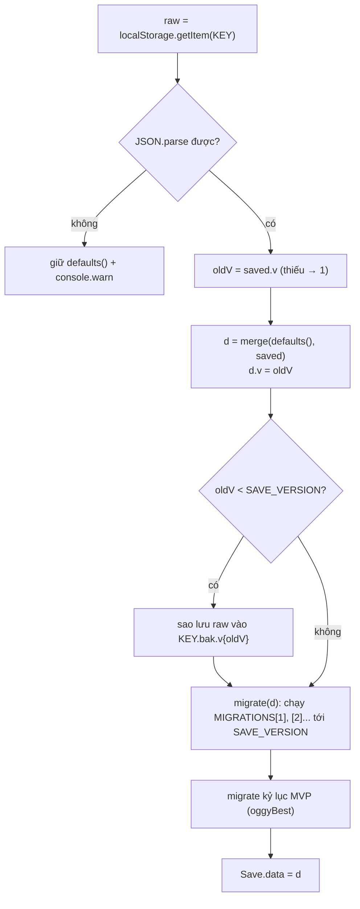

# Lời giải — Bài 11: Lưu trữ & migrate

> ✋ **Hãy tự làm trước.** Lời giải chỉ là *một* cách làm. Nếu bài của bạn khác nhưng chạy đúng và giải thích được vì sao, bài đó vẫn đạt.
> Quay lại bài học: [11-luu-tru-migrate.md](../11-luu-tru-migrate.md)

Sau mỗi thay đổi: `node --check <file>`, `node tests/smoke.js` (phải **XANH**); file có `// @ts-check` thì chạy thêm `npx -y -p typescript@5.6.3 tsc -p jsconfig.json --noEmit`.

---

## ⭐ Cài đặt `showFps`

Trong `defaults()` của [src/core/save.js](../../../src/core/save.js), thêm field vào object `settings`:

```js
      settings: { masterVolume: 1, musicVolume: 0.6, sfxVolume: 0.8, muted: false, touchControls: 'auto', tapJump: 'auto', difficulty: 'kid', showFps: false },
```

và cập nhật typedef ở đầu file:

```js
 * @property {boolean} showFps                 hiện bộ đếm FPS (mặc định false)
```

**Kiểm chứng trong console**

```js
// 1) Save cũ thiếu field → nhận mặc định
localStorage.setItem('oggy.bak', localStorage.getItem('oggyAdventure.save.v1'));        // sao lưu
localStorage.setItem('oggyAdventure.save.v1', JSON.stringify({ coins: 5, settings: { musicVolume: 0.2 } }));
location.reload();
OG.Save.data.settings.showFps;      // false, merge điền từ defaults()

// 2) + 3) Ghi và phát event
OG.Events.on('settings:change', function (e) { console.log('settings:change', e); });
OG.Save.setSetting('showFps', true); // in: settings:change {key: 'showFps', value: true}
location.reload();
OG.Save.data.settings.showFps;      // true

// Khôi phục
localStorage.setItem('oggyAdventure.save.v1', localStorage.getItem('oggy.bak')); location.reload();
```

**Giải thích:** `merge(defaults(), saved)` chỉ ghi đè những field mà `saved` *có*. Save cũ không có `showFps`, nên giá trị `false` của bản mặc định được giữ lại. Ta không phải viết dòng migrate nào.

---

## ⭐⭐ Module `OG.JumpStats`

File mới `src/game/jump-stats.js` (bạn tự tạo, repo gốc không có file này):

```js
// @ts-check
/* ============================================================================
 * OG.JumpStats — THỐNG KÊ SỐ LẦN NHẢY (ví dụ module dùng OG.Save.ns)
 * ----------------------------------------------------------------------------
 * Vai trò:      Đếm số lần nhảy: tổng cộng và kỷ lục "ít lần nhảy nhất" mỗi màn. Lưu trong
 *               OG.Save.ns('jumpStats'), chỉ commit ở mốc quan trọng (xong màn / thua), không commit mỗi cú nhảy.
 * Khái niệm:    namespace dữ liệu (ext) · tự chữa dữ liệu thiếu/hỏng · gom ghi (batch commit) · observer
 * Bài học:      docs/learn/11-luu-tru-migrate.md (bài tập ⭐⭐)
 * Phụ thuộc:    LOAD: OG.Events.on · CHẠY: OG.Save.ns, OG.Save.commit
 * Event:        nghe: 'player:jump', 'level:start', 'level:complete', 'game:over'
 * API công khai: OG.JumpStats.total(), OG.JumpStats.fewest(levelId)
 * ========================================================================== */
(function () {
  'use strict';
  var OG = window.OG;

  // ⚠️ Bẫy: KHÔNG gọi OG.Save.ns() ở đây (lúc LOAD). Save.load() chạy SAU trong main.js và THAY
  //   OG.Save.data bằng object mới → mọi thứ ghi vào bản cũ biến mất. Cũng không lưu tham chiếu `var s = ns()`
  //   dài hạn: Save.reset() thay object, tham chiếu cũ thành "mồ côi". Gọi store() mỗi lần cần.
  function store() {
    var s = OG.Save.ns('jumpStats');
    if (typeof s.total !== 'number' || !isFinite(s.total)) s.total = 0;       // tự chữa save hỏng / sửa tay
    if (!s.fewest || typeof s.fewest !== 'object') s.fewest = {};
    return s;
  }

  var jumpsThisLevel = 0;   // trạng thái TẠM của màn đang chơi — không cần lưu

  OG.Events.on('level:start', function () { jumpsThisLevel = 0; });
  OG.Events.on('player:jump', function () {
    jumpsThisLevel++;
    store().total++;        // sửa trong bộ nhớ, CHƯA ghi xuống localStorage
  });
  OG.Events.on('level:complete', function (r) {
    var s = store(), id = r && r.levelId;
    if (id && (s.fewest[id] == null || jumpsThisLevel < s.fewest[id])) s.fewest[id] = jumpsThisLevel;
    OG.Save.commit();       // 💡 gom ghi: một lần commit thay cho hàng trăm lần (JSON.stringify cả save mỗi lần)
  });
  OG.Events.on('game:over', function () { OG.Save.commit(); });

  OG.JumpStats = {
    /** @returns {number} tổng số lần nhảy từ trước tới nay */
    total: function () { return store().total; },
    /** @param {string} levelId @returns {number|null} số lần nhảy ít nhất khi qua màn (null = chưa qua) */
    fewest: function (levelId) { var v = store().fewest[levelId]; return v == null ? null : v; }
  };
})();
```

Trong [index.html](../../../index.html), thêm ngay sau dòng nạp `src/game/progress.js`:

```html
<script src="src/game/jump-stats.js"></script>
```

> ⚠️ Viết đúng dạng `<script src="..."></script>` (nháy kép, không thuộc tính khác). Smoke test chỉ nhận dạng đúng mẫu này khi đọc danh sách script (xem [Bài 13](../13-kiem-thu-ci.md)).

**Kết quả kiểm thử:** smoke test XANH. Sau khi chạy hết kịch bản, `OG.JumpStats.total()` = 125 và `fewest('kitchen')` = 18 (nhiều màn hành trình ra 0 vì test *dịch chuyển* người chơi thay vì nhảy).

**Giải thích các quyết định**

| Quyết định | Lý do |
|---|---|
| Listener đăng ký lúc load, `store()` chỉ gọi trong listener | Listener chỉ chạy khi có event, tức là sau `boot()`, khi `Save.load()` đã xong. |
| Không lưu `var s = OG.Save.ns(...)` thành biến module | `Save.reset()` gán `Save.data = defaults()`; biến cũ sẽ trỏ vào object không còn được lưu. Gọi `store()` mỗi lần thì luôn lấy đúng "ngăn" hiện tại. |
| `jumpsThisLevel` không lưu | Là trạng thái tạm của *một lượt chơi*; lưu nó chỉ làm save phình ra. |
| Commit ở `level:complete` / `game:over` | Mỗi commit `JSON.stringify` cả save. Đánh đổi: tắt tab giữa màn thì mất số lần nhảy của màn đó (nhưng các module khác commit thường xuyên nên phần lớn vẫn được ghi theo). |
| Kiểm tra `typeof`/`isFinite` | Save sửa tay `"total": "abc"` thì `total++` cho ra `NaN` mãi mãi; kiểm tra để tự chữa về 0. |

---

## ⭐⭐⭐ Migrate có phiên bản

Ba thay đổi trong [src/core/save.js](../../../src/core/save.js).

**1. Hằng phiên bản, bảng migrate và hàm `migrate`**, đặt ngay sau `PROBE_KEY`:

```js
  var SAVE_VERSION = 2;
  /** @param {any[]} arr @returns {any[]} mảng đã bỏ phần tử trùng (giữ thứ tự gặp đầu tiên) */
  function unique(arr) { return arr.filter(function (x, i) { return arr.indexOf(x) === i; }); }
  /**
   * MIGRATIONS[n] nâng dữ liệu từ v = n lên v = n + 1 (SỬA trực tiếp d). Mỗi bước chỉ biết đúng 2 phiên bản kề nhau.
   * @type {Object<number, function(any): void>}
   */
  var MIGRATIONS = {
    1: function (d) {
      // v2: chỉ nhận 2 chế độ chơi; giá trị lạ (save sửa tay, bản thử nghiệm) → 'kid'.
      if (d.settings.difficulty !== 'kid' && d.settings.difficulty !== 'challenge') d.settings.difficulty = 'kid';
      // v2: danh sách mở khoá không được trùng (bản cũ có thể push 2 lần).
      if (Array.isArray(d.unlockedChars)) d.unlockedChars = unique(d.unlockedChars);
      if (d.progress && Array.isArray(d.progress.unlocked)) d.progress.unlocked = unique(d.progress.unlocked);
    }
  };
  /** Chạy lần lượt các bước migrate cho tới SAVE_VERSION. @param {any} d @returns {any} chính d */
  function migrate(d) {
    if (typeof d.v !== 'number' || !isFinite(d.v)) d.v = 1;      // save rất cũ không có v → coi là v1
    if (d.v > SAVE_VERSION) { console.warn('[OG.Save] save từ phiên bản mới hơn (v' + d.v + '), giữ nguyên'); return d; }
    while (d.v < SAVE_VERSION) {
      var step = MIGRATIONS[d.v];
      if (!step) { console.warn('[OG.Save] thiếu migrate v' + d.v); break; }
      step(d);
      d.v++;
    }
    return d;
  }
```

**2. `defaults()` mang phiên bản mới nhất:**

```js
    return {
      v: SAVE_VERSION,              // save MỚI đã ở phiên bản mới nhất, không cần migrate
      coins: 0,
```

**3. Trong `load()`**, thay dòng `try { d = merge(d, JSON.parse(raw)); } catch ...` bằng:

```js
        var saved = null;
        try { saved = JSON.parse(raw); } catch (e) { console.warn('[OG.Save] dữ liệu hỏng, dùng mặc định'); }
        if (saved && typeof saved === 'object') {
          var oldV = typeof saved.v === 'number' ? saved.v : 1;
          d = merge(d, saved);
          // ⚠️ Bẫy: save cũ KHÔNG có field v thì merge giữ v mặc định (= SAVE_VERSION) → tưởng đã mới, bỏ qua
          //   migrate. Phải đặt lại v theo dữ liệu ĐÃ LƯU.
          d.v = oldV;
          // Sao lưu chuỗi gốc trước khi biến đổi: migrate có bug thì vẫn khôi phục được bằng tay.
          if (oldV < SAVE_VERSION) storageSet(KEY + '.bak.v' + oldV, raw);
          try { migrate(d); } catch (e) { console.warn('[OG.Save] migrate lỗi, giữ dữ liệu đã gộp', e); }
        }
```

Phần migrate kỷ lục MVP (`LEGACY_BEST_KEY`) phía sau giữ nguyên.

**Thứ tự xử lý trong `load()` sau khi sửa:**



**Kiểm thử bằng Node** (không cần trình duyệt). Script nạp `save.js` vào `vm` với `localStorage` giả của [tests/fake-dom.js](../../../tests/fake-dom.js):

```js
// check-migrate.js — chạy: node check-migrate.js   (đặt ở gốc repo)
const fs = require('fs'), vm = require('vm');
const D = require('./tests/fake-dom.js');
function run(saved) {
  const storage = D.makeStorage();
  storage.setItem('oggyAdventure.save.v1', JSON.stringify(saved));
  const warns = [];
  const ctx = { localStorage: storage, console: { warn: (...a) => warns.push(a.join(' ')), log() {} } };
  ctx.window = ctx; ctx.OG = { Events: { emit() {} } };      // save.js chỉ cần OG.Events.emit
  vm.createContext(ctx);
  vm.runInContext(fs.readFileSync('src/core/save.js', 'utf8'), ctx);
  const d = ctx.OG.Save.load();
  return { v: d.v, diff: d.settings.difficulty, chars: d.unlockedChars, unl: d.progress.unlocked,
    bak: storage.getItem('oggyAdventure.save.v1.bak.v1') != null, warns };
}
console.log(run({ v: 1, coins: 50, unlockedChars: ['oggy', 'jack', 'oggy'], settings: { difficulty: 'easy' }, progress: { unlocked: ['kitchen', 'kitchen'] } }));
console.log(run({ coins: 7, settings: { difficulty: 'challenge' } }));   // save rất cũ, không có v
console.log(run({ v: 2, coins: 9 }));
console.log(run({ v: 3, coins: 9 }));                                     // từ phiên bản mới hơn
```

Kết quả thật khi chạy:

| Đầu vào | `v` sau load | `difficulty` | Mảng | Sao lưu | Cảnh báo |
|---|---|---|---|---|---|
| `v:1`, `difficulty:'easy'`, mảng trùng | 2 | `'kid'` | `['oggy','jack']`, `['kitchen']` | có | (không) |
| không có `v` | 2 | `'challenge'` (hợp lệ, giữ) | `['oggy']` | có | (không) |
| `v:2` | 2 | `'kid'` (mặc định) | không đổi | không | (không) |
| `v:3` | 3 | `'kid'` | không đổi | không | "save từ phiên bản mới hơn (v3), giữ nguyên" |

Smoke test vẫn XANH và tsc sạch sau thay đổi.

**Giải thích các bẫy**

1. **`v` bị merge che mất.** Đây là lỗi tinh vi nhất. Bản mặc định giờ có `v: 2`; save cũ không có `v` thì `merge` không đụng tới field này, nên `d.v` vẫn là 2 và migrate không chạy. Phải đọc `saved.v` *trước* khi merge.
2. **Migrate chạy nối tiếp.** Khi có v3, chỉ cần thêm `MIGRATIONS[2]`. Save v1 sẽ đi 1 → 2 → 3, và không bao giờ phải viết bước "nhảy cóc" 1 → 3.
3. **Không hạ cấp.** Người chơi mở bản game *cũ hơn* save (vd tab cũ còn cache) thì giữ nguyên dữ liệu. Nếu migrate "ngược", lần sau mở bản mới sẽ mất field.
4. **Sao lưu + `try/catch` riêng cho migrate.** Bản gốc bắt mọi lỗi rồi dùng mặc định. Nếu bọc cả migrate chung trong `try` đó, một bug trong migrate sẽ khiến game dùng dữ liệu mặc định, và lần `commit` kế tiếp **ghi đè** tiến độ thật. Với cách viết trên, dữ liệu đã gộp vẫn được giữ, và chuỗi gốc nằm trong `oggyAdventure.save.v1.bak.v1`.
5. **Migrate nên "an toàn khi chạy lại"** (idempotent): bỏ trùng lần hai không đổi gì. Nhờ vậy, nếu `commit` chưa kịp chạy và lần sau load lại từ `v: 1`, kết quả vẫn đúng.
